# locallibrary

locallibrary looks after your rekordbox library and the USB drives that carry it. If you export
from rekordbox to a stick and play from it on CDJs or XDJs, it can:

- keep every copy of your library identical to the drive you export to, copying only what changed;
- tell you which drive is newest, and why;
- keep a history of your library on your computer, so a lost or broken drive can be rebuilt from
  any earlier state;
- edit playlists, tags, cues, ratings and cover art right on your drives, without going back to
  rekordbox, and make those edits again after rekordbox's next export replaces them;
- check drives before a set, down to the tracks a particular player won't load;
- keep the history lists players record, which rekordbox deletes when it imports them, and turn
  them into tracklists for Mixcloud, YouTube or a CUE sheet;
- set the same player and mixer My Settings on every drive;
- format drives the way players read them.

It runs in a terminal (Terminal on macOS). Typing `locallibrary` on its own opens a player where
you can browse your library and listen to it the way a CDJ shows it.

## What you need

- A Mac. Linux and Windows are experimental (see [Platforms](#platforms)).
- rekordbox, exporting to USB drives. locallibrary reads and writes the drives; it never
  changes rekordbox's own collection.
- Some comfort typing commands in a terminal. You don't need to write code.

## Install

There's no ready-made download yet. Until the first release, you build it on your own computer.
On a Mac:

1. Install Apple's command line tools, which include `git` and what Rust needs to build. If
   they're already installed, this says so.

   ```bash
   xcode-select --install
   ```

2. Install Rust, the language locallibrary is written in, and follow its prompts:

   ```bash
   curl --proto '=https' --tlsv1.2 -sSf https://sh.rustup.rs | sh
   ```

3. Open a new Terminal window, then download locallibrary and build it. The first build takes
   several minutes.

   ```bash
   git clone https://github.com/cutenode/localnetwork.git
   cargo install --path localnetwork/apps/locallibrary --locked
   ```

4. Check it worked:

   ```bash
   locallibrary --version
   ```

Once there's a release, it will be one command (or `brew install cutenode/tap/locallibrary`).
[Installing locallibrary](docs/install.md) covers both ways, Linux and Windows, and tab
completion for your shell.

## Getting started

Plug in your rekordbox drives, then run:

```bash
locallibrary setup
```

`setup` asks a few questions as it goes:

1. which of the plugged-in drives are copies of your library, and what to call the library (the
   one they're in already, else "My library"). Drives keep their volume names;
2. which drive rekordbox exports to (your primary), and what the others are for: a backup, a
   drive you take to sets, or an archive that's never written to;
3. whether to start your library in the store: the primary first, then the drives that hold the
   same library, but archives;
4. whether to copy the primary's My Settings into your settings profile, set the name players
   show for each drive and your contact details, and remember which player models you play on;
5. whether to save drives into the store whenever they're plugged in from then on, syncing the
   other copies plugged in.

Every change shows what it will do and asks first. It ends with the commands you'll use most.

## Everyday use

| When | Run |
| --- | --- |
| You want to see your library, its drives and whether they're up to date | `locallibrary status` |
| rekordbox just exported to your primary drive | `locallibrary refresh` (puts back your edits and settings, saves it in the store; `--sync` also updates your other drives) |
| You want every drive to match the newest one | `locallibrary sync` |
| You want your library on another computer | `locallibrary store serve` here, then `locallibrary store fetch <code>` there |
| You want your library without a drive rekordbox exported to | `locallibrary collection export ~/rekordbox-export`, then `locallibrary pull ~/rekordbox-export` |
| You want every drive saved in the store as soon as it's plugged in | `locallibrary watch --install` |
| It's the night before a set | `locallibrary prep` (saves, syncs, checks and ejects your library's drives) |
| You want to check your drives for a particular player | `locallibrary check --players CDJ-3000X,CDJ-2000NXS2` |
| You changed your mind about the last change | `locallibrary undo` |
| You want to browse and listen | `locallibrary` |
| You want to know what a command does | `locallibrary help sync` |
| Something went wrong | `locallibrary bug` (reports it, with your version and system filled in) |

With one library plugged in, the commands above need nothing more. Edits name the library:
`locallibrary playlist new Home Friday` makes the playlist on its newest drive, then copies that
onto the other drives of the library that are plugged in (one with changes of its own is left
alone, and the plan says so). Where you mean one particular stick, give its name (its volume name,
such as `REKORDBOX`) or its mount path. `locallibrary --help` lists every command by what it's for.

## Is it safe?

- Every command that changes a library on a drive shows its plan first and asks, but for `watch`,
  which you opt into. If the drive changed in between (rekordbox exported again, say), it writes
  nothing and asks you to plan again.
- Edits, merges and other changes to a library made in place are backed up first, and `locallibrary undo` takes
  the last one back. A `sync` or `library push` isn't backed up: it replaces the library, and `undo`
  refuses after it.
- It only writes inside the drive's `PIONEER/` and `Contents/` folders (and its own
  `.locallibrary/`), apart from a few commands made for it, such as `drive tidy`, which list what
  they touch. Your other files on the drive are left alone.
- `sync` won't copy one drive over another unless it can tell which is newer, and nothing writes
  to a drive you marked as an archive unless you say so.
- A sync cut off part way (a pulled plug, Ctrl-C) leaves a drive players can still read, unless it
  ran with `--delete-first`, and running it again finishes the job.

[Safety](docs/how-it-works.md#safety) has the full list.

## Words used here

| Word | Meaning |
| --- | --- |
| library | your music, playlists and analysis, as rekordbox exports them; most commands take a library's name |
| drive | a USB stick or SD card holding a copy of a library (a clone of it) |
| lead clone | the drive a command given a library's name uses: the newest of its drives plugged in (the primary when they're identical or can't be ordered) |
| store | the folder on your computer where locallibrary keeps the history of your libraries (`~/Library/Application Support/locallibrary` on a Mac) |
| snapshot | one saved state of a library in the store; `locallibrary pull` makes one |
| primary, backup, set, archive | a drive's role: the one rekordbox exports to, copies of it, drives you take to sets, and drives never written to |
| session | a history list a player recorded on the drive |
| set | what you played on a night, which you declare from one or more sessions or a recording |
| My Settings | player and mixer settings (quantize, jog mode, fader curves...) players load from the drive |
| My Tags | rekordbox's track tags, which players filter by |
| `export.pdb`, OneLibrary | the two databases rekordbox 7 writes on a drive: most players read `export.pdb`; the CDJ-3000X, OPUS-QUAD, XDJ-AZ and a few others read only OneLibrary. locallibrary keeps both up to date |

## Guides

- [Commands](docs/commands.md): every command, its output, exit status and JSON
- [The player](docs/player.md): the terminal player and its keys
- [The store](docs/store.md): snapshots, saving drives as they're plugged in, pruning, off-site
  copies
- [Editing your library](docs/editing.md): after rekordbox exports, playlists, tracks, filters, My
  Tags, cues, cover art
- [My Settings](docs/settings.md): one settings profile for every drive, and taking everything you
  set to another computer
- [Sets, history and mixes](docs/sets.md): checking drives before a set, sessions, sets, recorded
  mixes, your DJ profile
- [Drives](docs/drives.md): your library's drives, roles, health, space, formatting, the doctor's
  report
- [Atmosphere account](docs/account.md) (alpha): signing in, publishing sets, settings and your
  profile, and reporting bugs
- [rekordbox and other DJ software](docs/other-software.md): rekordbox's own collection, Traktor,
  Serato and Engine DJ
- [Plugins](docs/plugins.md): what plugins add, and where it shows up
- [How it works](docs/how-it-works.md): the design, safety and known limitations

Building on locallibrary: [the JSON-RPC sidecar](docs/sidecar.md) for desktop apps, and
[Contributing](CONTRIBUTING.md) for working on the code.

## Crates for other DJ tools

Some of locallibrary's parts are Rust crates of their own, which don't depend on locallibrary:

- [loclib-progress](../../crates/loclib-progress): progress events and cancellation for long-running work
- [loclib-model](../../crates/loclib-model): tracks, playlists, library diffs, Camelot keys and a track's
  analysis (beat grid, cues, waveforms, phrases)
- [loclib-equipment](../../crates/loclib-equipment): what each Pioneer DJ / AlphaTheta player and mixer
  reads from a USB drive, with sources, also as JSON
- [loclib-mysettings](../../crates/loclib-mysettings): reading and writing the My Settings files
  players load from a drive
- [loclib-tracklist](../../crates/loclib-tracklist): reading M3U, CSV, rekordbox and plain-text
  tracklists, and finding their tracks in a library
- [loclib-mixid](../../crates/loclib-mixid): which known tracks a recorded mix plays, when and at what
  speed
- [loclib-transcode](../../crates/loclib-transcode): which copy of a file a set of players needs,
  and lossless copies (AIFF, WAV, FLAC) that keep cue points in time
- [loclib-analysis](../../crates/loclib-analysis): a second opinion on tempo and key, loudness and
  clipping, three-band waveforms, and scoring analyzers against annotated datasets
- [loclib-interop](../../crates/loclib-interop): writing a library for Traktor, Serato and Engine DJ,
  and reading Traktor's back
- [loclib-waveform](../../crates/loclib-waveform): ratatui widgets for waveforms, cues, phrases, a
  spectrum and cover art
- [loclib-plugin](../../crates/loclib-plugin): the plugin protocol (JSON-RPC over stdio), the
  plugin manifest, and an SDK for writing plugins in Rust

They aren't on crates.io yet.

## Platforms

locallibrary is developed and used on macOS. Linux and Windows are experimental and untested on
hardware: most commands only read and write files and should work the same, but the ones that
drive the operating system's disk tools (formatting, ejecting, file system checks) have only ever
run on macOS. [Platforms](docs/install.md#platforms) has the details.

## Credits

- [rekordbox-pdb-rs](https://github.com/fragmede/rekordbox-pdb-rs) (MIT): `export.pdb` reading and
  editing, vendored.
- [rekordcrate](https://github.com/Holzhaus/rekordcrate) and [Deep Symmetry's
  crate-digger](https://github.com/Deep-Symmetry/crate-digger): the reverse-engineered formats this
  builds on.
- [pyrekordbox](https://github.com/dylanljones/pyrekordbox): the OneLibrary database key and schema,
  and `master.db`'s key and tables.
- [jacquard](https://tangled.org/nonbinary.computer/jacquard) (MPL-2.0): AT Protocol OAuth, identity
  resolution and XRPC for Atmosphere account sign-in.
- [baken](https://github.com/M-Igashi/baken) (MIT): byte-level cue sections from a real rekordbox 7
  export, used to test the cue writer.
- Other DJ software's formats as their communities document them:
  [traktor-nml-utils](https://github.com/wolkenarchitekt/traktor-nml-utils) (a collection Traktor
  wrote), [serato-tags](https://github.com/Holzhaus/serato-tags) (MIT; its `Serato Markers2` test
  data checks the encoder), [serato-tools](https://github.com/bvandrc/serato-tools) and the [mixxx
  wiki](https://github.com/mixxxdj/mixxx/wiki/Serato-Database-Format) (crates), and
  [libdjinterop](https://github.com/xsco/libdjinterop) (Engine DJ's library schema).

## Licence

MIT: see [LICENSE](LICENSE). The vendored rekordbox-pdb is MIT as well
([its licence](../../vendor/rekordbox-pdb/LICENSE)), and the test fixtures carry their own
([fixtures README](../../crates/locallibrary/tests/fixtures/README.md)).

## Diagrams

How locallibrary is put together, drawn from its code.

- Overview and commands: [How the parts connect](#how-the-parts-connect), [What the binary is built from](#what-the-binary-is-built-from), [How a run starts](#how-a-run-starts), [Exit status](#exit-status), [Commands by heading](#commands-by-heading), [Everyday commands](#everyday-commands), [Drive commands](#drive-commands), [Library and store commands](#library-and-store-commands), [Editing commands](#editing-commands), [Plays and players commands](#plays-and-players-commands), [Other commands](#other-commands)
- Changing drives: [Plan, confirm, apply](#plan-confirm-apply), [A plan's life](#a-plans-life), [The one write routine](#the-one-write-routine), [Copying a whole library](#copying-a-whole-library), [Which way a sync goes](#which-way-a-sync-goes), [Back from a set](#back-from-a-set), [Syncing a library's drives](#syncing-a-librarys-drives), [A change reaches the other clones](#a-change-reaches-the-other-clones), [A write cut off part way](#a-write-cut-off-part-way), [Undo and redo](#undo-and-redo), [Bringing a playlist back](#bringing-a-playlist-back), [Editing both databases](#editing-both-databases), [Edits after an export](#edits-after-an-export), [The refresh job](#the-refresh-job), [The prep job](#the-prep-job), [How a job runs](#how-a-job-runs), [First run with setup](#first-run-with-setup), [Setting up a drive with provision](#setting-up-a-drive-with-provision), [Merge, pack and convert](#merge-pack-and-convert)
- Store and drives: [Store records](#store-records), [Inside the store folder](#inside-the-store-folder), [Inside a drive](#inside-a-drive), [The .locallibrary folder](#the-locallibrary-folder), [Saving a drive with pull](#saving-a-drive-with-pull), [Writing a snapshot with library push](#writing-a-snapshot-with-library-push), [Copies of the store](#copies-of-the-store), [Serving a store to another computer](#serving-a-store-to-another-computer), [What a fetch does to each library](#what-a-fetch-does-to-each-library), [Pruning and collecting](#pruning-and-collecting), [Watching drives](#watching-drives), [A drive's life](#a-drives-life), [Checking drives](#checking-drives), [Repairing a drive](#repairing-a-drive), [Clearing a drive](#clearing-a-drive), [What's using a drive](#whats-using-a-drive), [Recordings and firmware](#recordings-and-firmware)
- Data: [Reading a library](#reading-a-library), [My Settings](#my-settings), [Importing published settings](#importing-published-settings), [rekordbox's collection](#rekordboxs-collection), [Exporting a collection](#exporting-a-collection), [Sets from sessions and recordings](#sets-from-sessions-and-recordings), [Play statistics](#play-statistics), [Identifying a mix](#identifying-a-mix), [The DJ profile](#the-dj-profile), [Writing a library out](#writing-a-library-out)
- The player: [Player views](#player-views), [Panes and dialogs](#panes-and-dialogs), [Player threads](#player-threads), [Opening a drive in the player](#opening-a-drive-in-the-player), [Changing a drive from the player](#changing-a-drive-from-the-player), [An unplugged drive in the player](#an-unplugged-drive-in-the-player), [Drives view rows](#drives-view-rows), [Search and filter](#search-and-filter), [Playback](#playback), [Output devices](#output-devices), [Signing in from the player](#signing-in-from-the-player), [Identifying in the Mixes view](#identifying-in-the-mixes-view), [What the player remembers](#what-the-player-remembers)
- Plugins: [What plugins can add](#what-plugins-can-add), [Built-in plugins that work on a library](#built-in-plugins-that-work-on-a-library), [Built-in plugins that publish a set](#built-in-plugins-that-publish-a-set), [Loading plugins](#loading-plugins), [A plugin process's life](#a-plugin-processs-life), [Talking to a plugin](#talking-to-a-plugin), [Plugin question rounds](#plugin-question-rounds), [What a plugin can reach](#what-a-plugin-can-reach), [A plugin's net/fetch](#a-plugins-netfetch), [How plugins change a library](#how-plugins-change-a-library), [Plugins that write elsewhere](#plugins-that-write-elsewhere), [Running an analyzer](#running-an-analyzer), [Running checks and guards](#running-checks-and-guards), [Plugin panels](#plugin-panels), [Plugin settings and keys](#plugin-settings-and-keys), [Plugin events and suggestions](#plugin-events-and-suggestions), [A plugin service's life](#a-plugin-services-life)
- The sidecar: [How the sidecar is wired](#how-the-sidecar-is-wired), [A sidecar's lifecycle](#a-sidecars-lifecycle), [A sidecar request](#a-sidecar-request), [Plans in the sidecar](#plans-in-the-sidecar), [Sidecar notifications](#sidecar-notifications), [Sidecar errors](#sidecar-errors), [Sidecar methods that read](#sidecar-methods-that-read), [Sidecar plans](#sidecar-plans), [Sidecar changes made at once](#sidecar-changes-made-at-once), [Sidecar contract](#sidecar-contract)
- Accounts: [Accounts and access](#accounts-and-access), [Signing in to the DJ account](#signing-in-to-the-dj-account), [What the DJ account is allowed](#what-the-dj-account-is-allowed), [The DJ account's life](#the-dj-accounts-life), [Signing in through the token exchange](#signing-in-through-the-token-exchange), [Signing in with keys](#signing-in-with-keys), [An account's life](#an-accounts-life), [When a plugin needs more of an account](#when-a-plugin-needs-more-of-an-account), [When a destination starts](#when-a-destination-starts), [Managing access](#managing-access), [Signing in from another computer](#signing-in-from-another-computer)
- Publishing and services: [Publishing a record](#publishing-a-record), [What each command publishes](#what-each-command-publishes), [Publishing a set](#publishing-a-set), [Publishing at a set destination](#publishing-at-a-set-destination), [Reporting a bug](#reporting-a-bug), [Online services of the core library](#online-services-of-the-core-library), [Online services of plugins and the browser](#online-services-of-plugins-and-the-browser), [Programs on this computer](#programs-on-this-computer)

### How the parts connect

The front ends, the core library they share, and what it reads and writes.

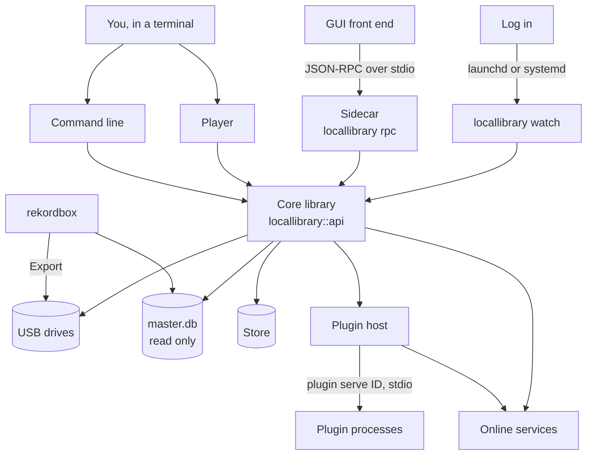

Source: [`src/main.rs`](src/main.rs), [`src/rpc.rs`](src/rpc.rs), [`src/tui/mod.rs`](src/tui/mod.rs), [`src/autostart.rs`](src/autostart.rs), [`crates/locallibrary/src/api.rs`](../../crates/locallibrary/src/api.rs), [`crates/locallibrary/src/plugin.rs`](../../crates/locallibrary/src/plugin.rs)

### What the binary is built from

The crates the binary and the core library link.

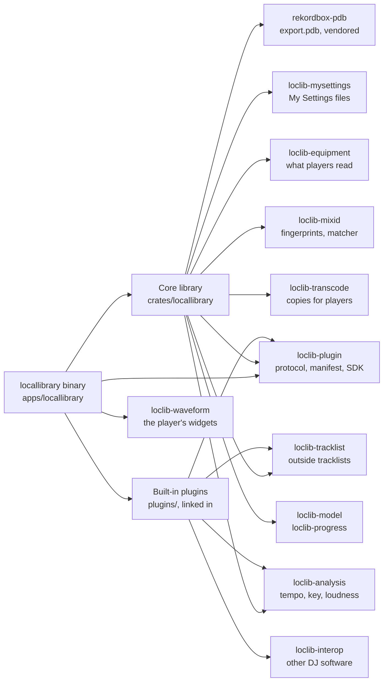

Source: [`Cargo.toml`](Cargo.toml), [`crates/locallibrary/Cargo.toml`](../../crates/locallibrary/Cargo.toml), [`build.rs`](build.rs)

### How a run starts

What `main` does before and after a command.

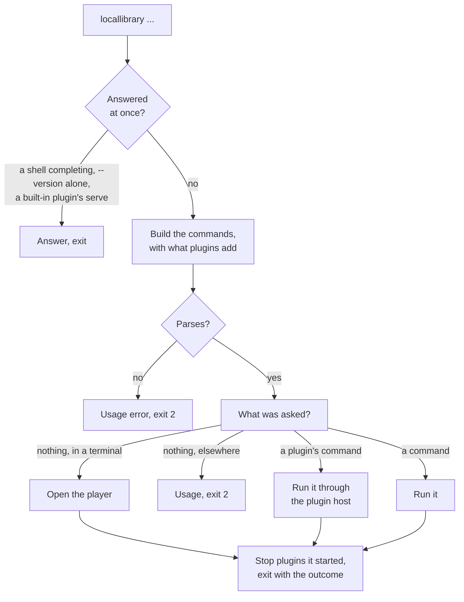

Source: [`src/main.rs`](src/main.rs), [`src/help.rs`](src/help.rs), [`src/completion.rs`](src/completion.rs), [`src/plugin_cmd/contributed.rs`](src/plugin_cmd/contributed.rs)

### Exit status

What a command comes to, and the status it exits with. With `--json`, the same word is `outcome`, but a usage error's `outcome` is `error`, with `kind` `usage`.

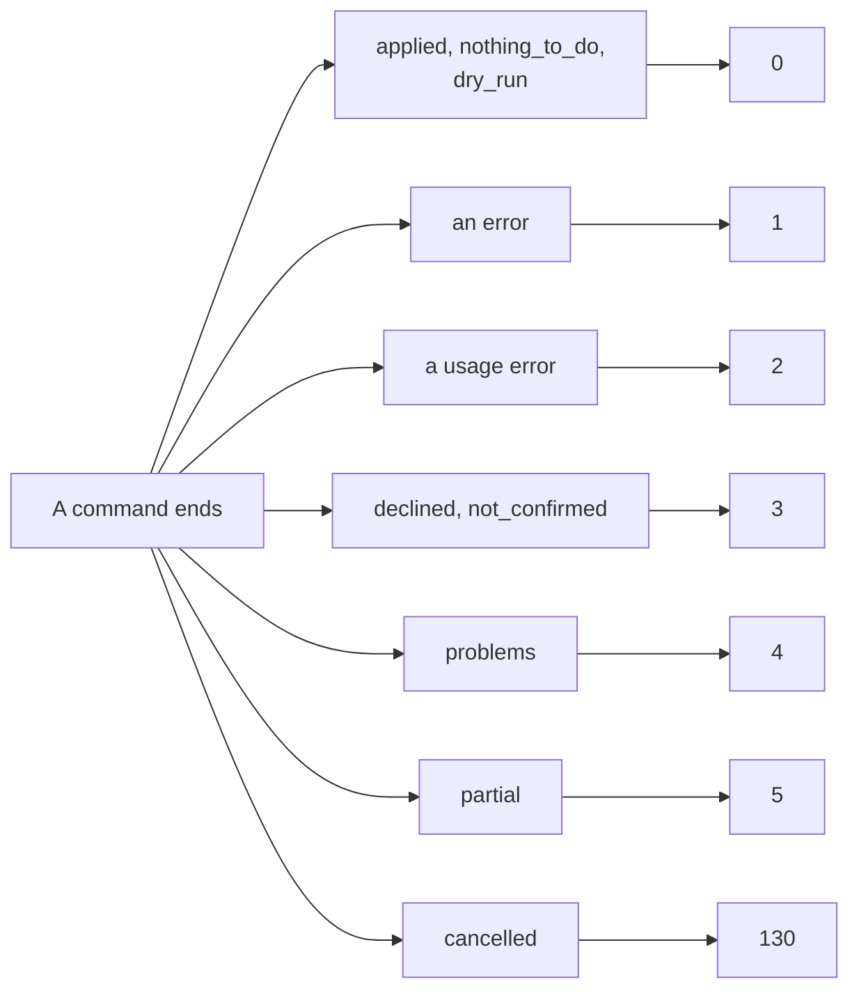

Source: [`src/output.rs`](src/output.rs), [`src/main.rs`](src/main.rs)

### Commands by heading

Every top-level command, under the headings `locallibrary --help` lists them by.

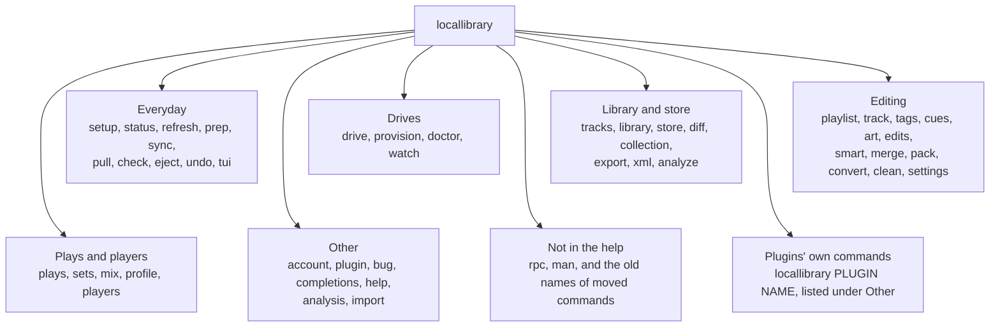

Source: [`src/help.rs`](src/help.rs), [`src/main.rs`](src/main.rs), [`src/drive_cmd.rs`](src/drive_cmd.rs), [`src/plugin_cmd/contributed.rs`](src/plugin_cmd/contributed.rs)

### Everyday commands

The commands for what a DJ does most, and what each does.

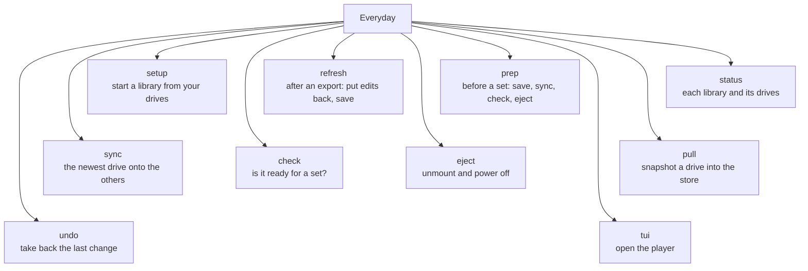

Source: [`src/main.rs`](src/main.rs), [`src/jobs_cmd.rs`](src/jobs_cmd.rs), [`src/check_cmd.rs`](src/check_cmd.rs), [`src/store_cmd.rs`](src/store_cmd.rs), [`src/restore_cmd.rs`](src/restore_cmd.rs), [`src/drive_cmd.rs`](src/drive_cmd.rs)

### Drive commands

`drive` and its subcommands by what they're for, with the other commands about drives.

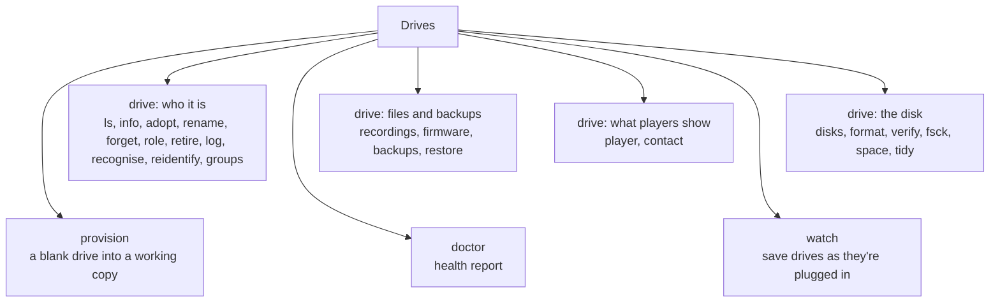

Source: [`src/drive_cmd.rs`](src/drive_cmd.rs), [`src/doctor_cmd.rs`](src/doctor_cmd.rs), [`src/watch_cmd.rs`](src/watch_cmd.rs)

### Library and store commands

Reading a library, and looking after the store.

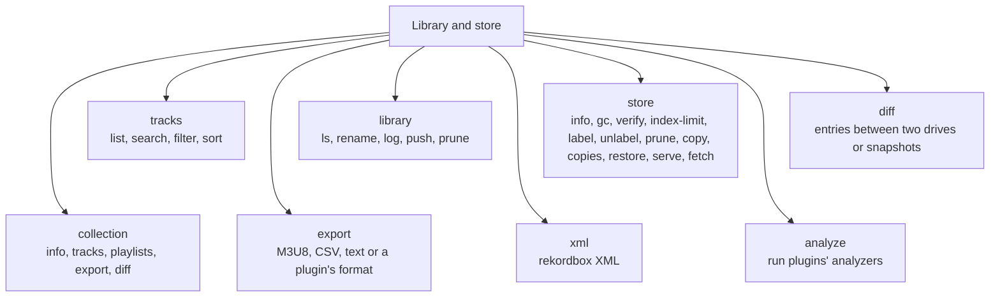

Source: [`src/library_cmd.rs`](src/library_cmd.rs), [`src/store_cmd.rs`](src/store_cmd.rs), [`src/diff_cmd.rs`](src/diff_cmd.rs), [`src/collection_cmd.rs`](src/collection_cmd.rs), [`src/export_cmd.rs`](src/export_cmd.rs), [`src/plugin_cmd/analyze.rs`](src/plugin_cmd/analyze.rs)

### Editing commands

The commands that change what's on a drive.

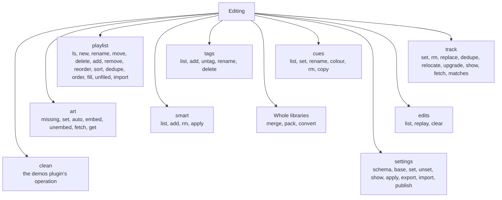

Source: [`src/edit_cmd.rs`](src/edit_cmd.rs), [`src/tags_cmd.rs`](src/tags_cmd.rs), [`src/cues_cmd.rs`](src/cues_cmd.rs), [`src/main.rs`](src/main.rs), [`plugins/demos/locallibrary-plugin.toml`](../../plugins/demos/locallibrary-plugin.toml), [`plugins/tracklist/locallibrary-plugin.toml`](../../plugins/tracklist/locallibrary-plugin.toml)

### Plays and players commands

What players recorded, what you played, and who you are as a DJ.

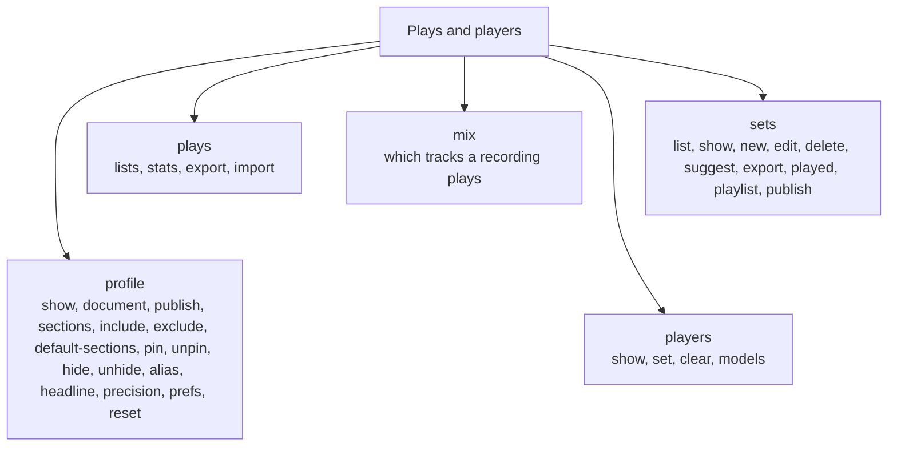

Source: [`src/plays_cmd.rs`](src/plays_cmd.rs), [`src/sets_cmd.rs`](src/sets_cmd.rs), [`src/mix_cmd.rs`](src/mix_cmd.rs), [`src/profile_cmd.rs`](src/profile_cmd.rs), [`src/players_cmd.rs`](src/players_cmd.rs)

### Other commands

The rest of the command tree, with the commands the help leaves out.

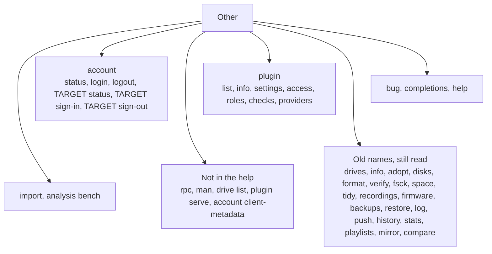

Source: [`src/account_cmd.rs`](src/account_cmd.rs), [`src/plugin_cmd.rs`](src/plugin_cmd.rs), [`src/bug_cmd.rs`](src/bug_cmd.rs), [`src/completion.rs`](src/completion.rs), [`src/analysis_cmd.rs`](src/analysis_cmd.rs), [`src/help.rs`](src/help.rs), [`src/main.rs`](src/main.rs)

### Plan, confirm, apply

How a planned change is worked out, shown, and made only as it was shown.

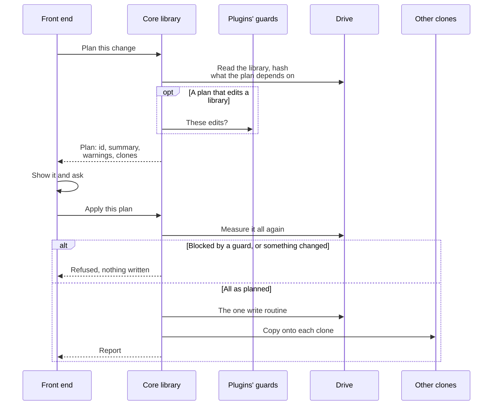

Source: [`crates/locallibrary/src/op.rs`](../../crates/locallibrary/src/op.rs), [`crates/locallibrary/src/commit.rs`](../../crates/locallibrary/src/commit.rs), [`crates/locallibrary/src/plugin/checks.rs`](../../crates/locallibrary/src/plugin/checks.rs), [`src/output.rs`](src/output.rs)

### A plan's life

The states a plan goes through, whichever front end holds it. Not confirmed means a dry run, a no, or nobody to ask.

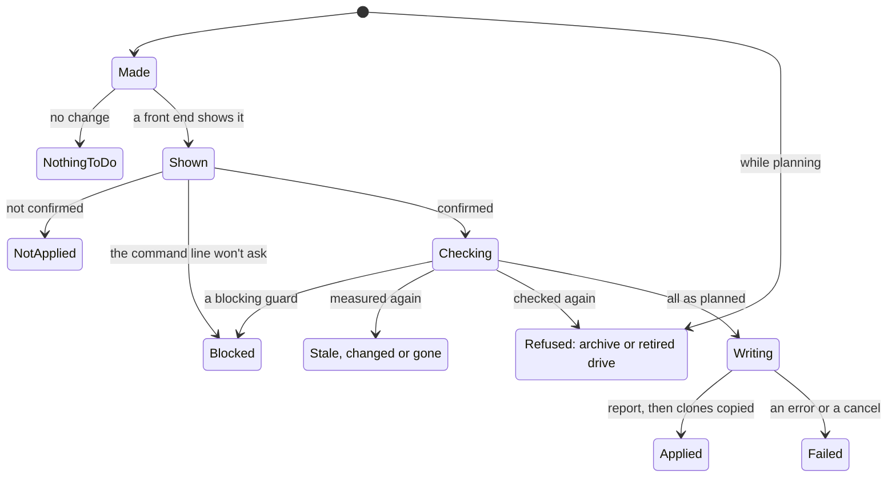

Source: [`crates/locallibrary/src/op.rs`](../../crates/locallibrary/src/op.rs), [`crates/locallibrary/src/fleet.rs`](../../crates/locallibrary/src/fleet.rs), [`src/output.rs`](src/output.rs)

### The one write routine

How a change made in place reaches a drive, and what a failure leaves.

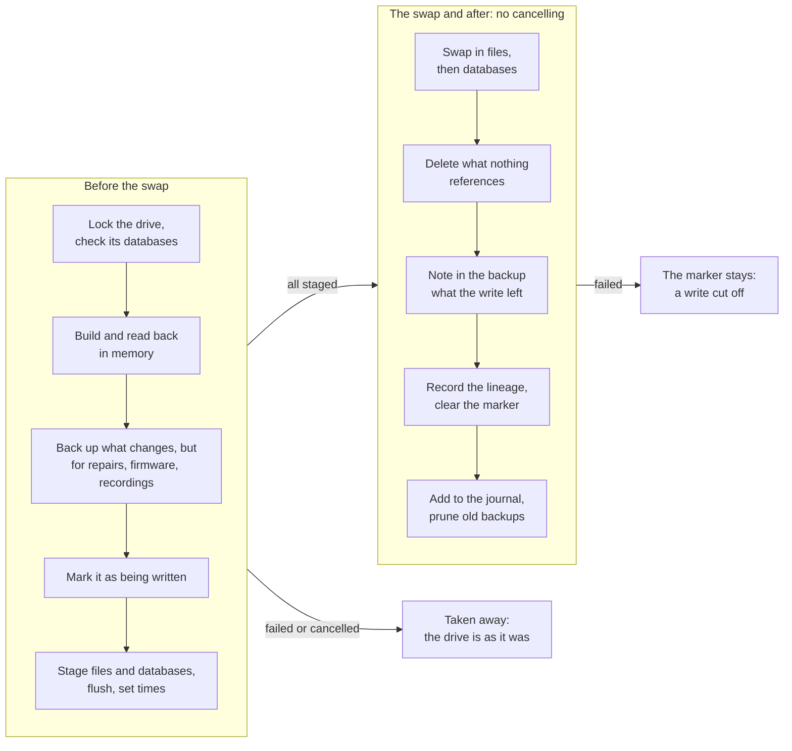

Source: [`crates/locallibrary/src/commit.rs`](../../crates/locallibrary/src/commit.rs), [`crates/locallibrary/src/backup.rs`](../../crates/locallibrary/src/backup.rs), [`crates/locallibrary/src/device.rs`](../../crates/locallibrary/src/device.rs)

### Copying a whole library

How `sync` and `library push` write a drive, so it stays playable if the copy stops, unless `--delete-first` took its databases off.

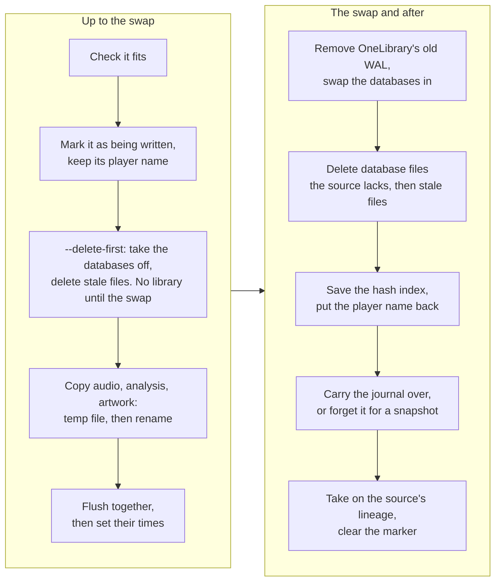

Source: [`crates/locallibrary/src/sync.rs`](../../crates/locallibrary/src/sync.rs), [`crates/locallibrary/src/library_write.rs`](../../crates/locallibrary/src/library_write.rs), [`crates/locallibrary/src/player.rs`](../../crates/locallibrary/src/player.rs)

### Which way a sync goes

How `sync A B`, with two drives named, decides what's copied onto what. A library or no drives goes through [Syncing a library's drives](#syncing-a-librarys-drives).

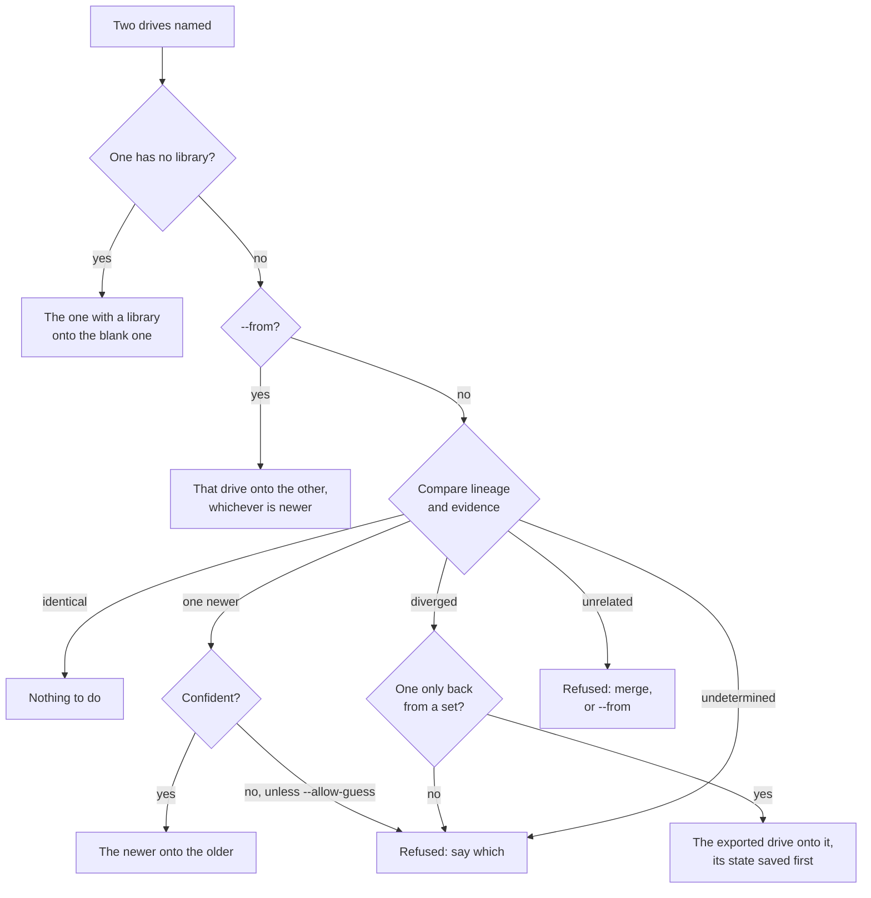

Source: [`crates/locallibrary/src/api.rs`](../../crates/locallibrary/src/api.rs), [`crates/locallibrary/src/compare.rs`](../../crates/locallibrary/src/compare.rs), [`crates/locallibrary/src/after_set.rs`](../../crates/locallibrary/src/after_set.rs)

### Back from a set

What `sync A B`, `prep` and `refresh --sync` do when one drive came back from a set and the other has a new export. `sync` with a library or no drives refuses instead, and says to sync the pair first.

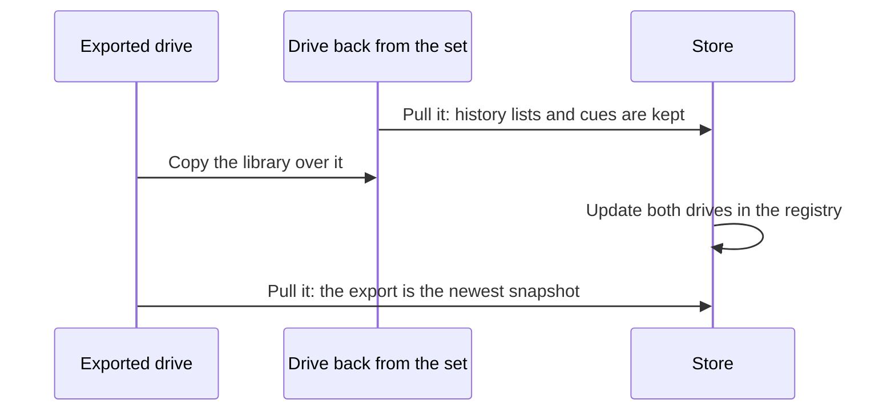

Source: [`crates/locallibrary/src/api.rs`](../../crates/locallibrary/src/api.rs), [`crates/locallibrary/src/after_set.rs`](../../crates/locallibrary/src/after_set.rs), [`crates/locallibrary/src/sync.rs`](../../crates/locallibrary/src/sync.rs)

### Syncing a library's drives

What `sync` does with no drives, a library's name, or three or more drives: one source, written to several targets at once.

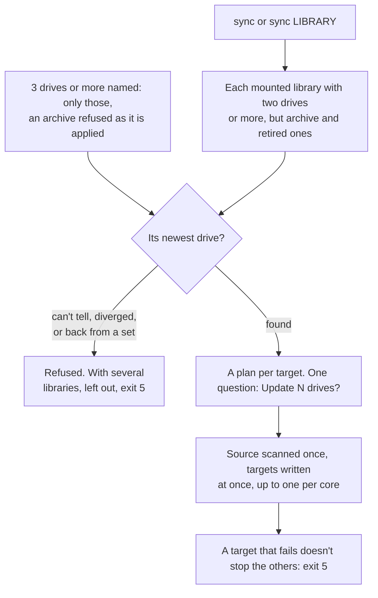

Source: [`src/main.rs`](src/main.rs), [`src/drive_cmd.rs`](src/drive_cmd.rs), [`crates/locallibrary/src/api.rs`](../../crates/locallibrary/src/api.rs), [`crates/locallibrary/src/sync.rs`](../../crates/locallibrary/src/sync.rs)

### A change reaches the other clones

How a plan on a library's lead clone is copied onto its other drives plugged in.

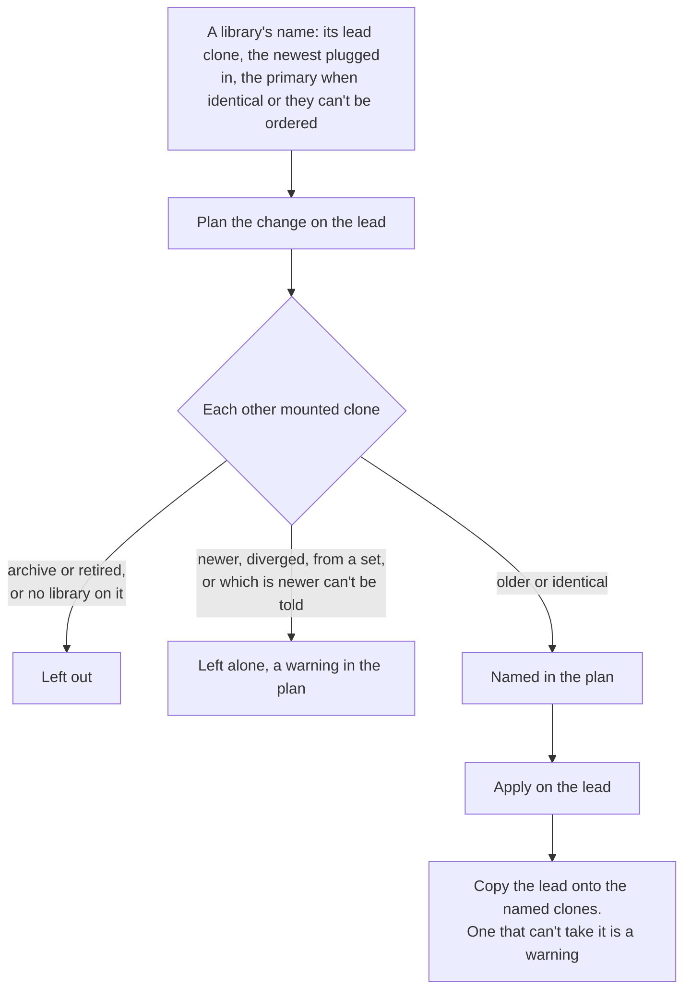

Source: [`crates/locallibrary/src/api/jobs.rs`](../../crates/locallibrary/src/api/jobs.rs), [`crates/locallibrary/src/op.rs`](../../crates/locallibrary/src/op.rs), [`crates/locallibrary/src/fleet.rs`](../../crates/locallibrary/src/fleet.rs)

### A write cut off part way

The marker in a drive's `state.json`, and what a drive holding one lets through. `tracks`, the player, `check` and `doctor` still read it, and all but `tracks` say so.

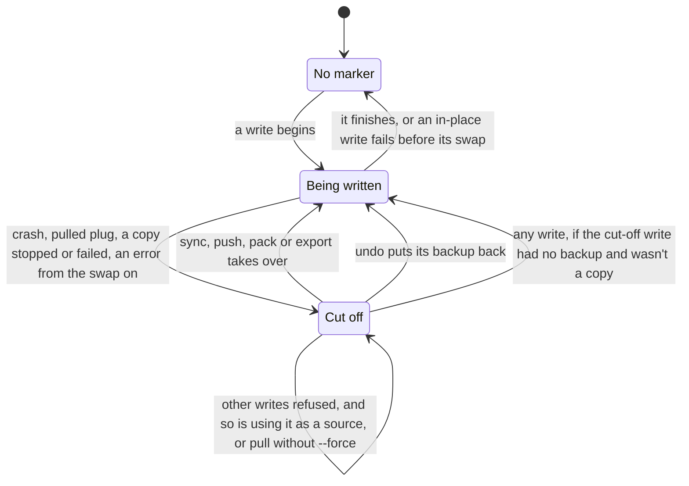

Source: [`crates/locallibrary/src/device.rs`](../../crates/locallibrary/src/device.rs), [`crates/locallibrary/src/commit.rs`](../../crates/locallibrary/src/commit.rs), [`crates/locallibrary/src/sync.rs`](../../crates/locallibrary/src/sync.rs)

### Undo and redo

How `undo` picks a backup and puts it back.

```mermaid
flowchart TD
    pick["undo picks the last change's<br/>backup the drive still holds"] --> changed{"Drive changed since,<br/>or audio gone?"}
    changed -->|"yes, no --force"| refused["Refused"]
    changed -->|"no, or --force"| plan["Plan: files, playlists, history lists<br/>dropped, journal entries taken off"]
    plan --> redo["Once confirmed, back up what it<br/>replaces: putting that back is the redo"]
    redo --> write["Put the backup back through<br/>the one write routine"]
    write --> journal["Put the backup's journal back"]
    journal --> clones["Copy onto the library's other clones"]
```

Source: [`crates/locallibrary/src/api/undo.rs`](../../crates/locallibrary/src/api/undo.rs), [`crates/locallibrary/src/backup.rs`](../../crates/locallibrary/src/backup.rs), [`src/restore_cmd.rs`](src/restore_cmd.rs)

### Bringing a playlist back

`drive restore --playlist`, and `enter` in the player's Snapshots view: one playlist or folder from an earlier state.

```mermaid
flowchart TD
    ask["A playlist or folder to bring back"] --> from{"From where?"}
    from -->|"--backup"| backup["One of the drive's backups"]
    from -->|"--snapshot"| snapshot["That snapshot"]
    from -->|"neither"| newest["The newest snapshot of<br/>the library that has it"]
    backup --> match["Entries matched to the drive's tracks by<br/>audio file. Those it lacks are left out and listed"]
    snapshot --> match
    newest --> match
    match --> edit["An ordinary playlist edit: planned,<br/>backed up, journaled, undone like any"]
```

Source: [`crates/locallibrary/src/api/restore.rs`](../../crates/locallibrary/src/api/restore.rs), [`src/restore_cmd.rs`](src/restore_cmd.rs), [`src/drive_cmd.rs`](src/drive_cmd.rs), [`src/tui/drives.rs`](src/tui/drives.rs)

### Editing both databases

How one edit lands in `export.pdb` and OneLibrary, whose row ids differ. What one database lacks is skipped there, with a warning.

```mermaid
flowchart TD
    edit["An edit, naming playlists by path<br/>and tracks by audio file"] --> plan["Plan against export.pdb,<br/>else OneLibrary"]
    plan --> pdb["export.pdb edited in memory,<br/>exportExt.pdb after it: if that<br/>fails, a warning"]
    plan --> one["OneLibrary: a decrypted working copy,<br/>WAL replayed, edited with SQLite"]
    pdb --> model["export.pdb and OneLibrary read back:<br/>each must match the model of what it should hold"]
    one --> model
    one --> sealed["integrity_check, encrypt and decrypt<br/>round trip, the drive's own salt"]
    sealed --> commit
    model --> commit["The one write routine, under one backup"]
    commit --> journal["One entry in the journal"]
```

Source: [`crates/locallibrary/src/edit.rs`](../../crates/locallibrary/src/edit.rs), [`crates/locallibrary/src/onelibrary/mod.rs`](../../crates/locallibrary/src/onelibrary/mod.rs), [`crates/locallibrary/src/pdb.rs`](../../crates/locallibrary/src/pdb.rs)

### Edits after an export

Why edits come back after rekordbox replaces a drive's databases.

```mermaid
flowchart TD
    edit["An edit is applied"] --> journal[(".locallibrary/edits.json")]
    export["rekordbox exports again"] --> gone["The drive's databases are replaced,<br/>the journal stays"]
    journal --> gone
    gone --> ways{"What brings them back"}
    ways --> refresh["refresh"]
    ways --> replay["edits replay"]
    ways --> offer["The player's offer, y"]
    refresh --> plan["Plan the recorded edits again.<br/>One that no longer applies is skipped"]
    replay --> plan
    offer --> plan
    plan --> write["One backup, then each step made.<br/>Not recorded again"]
```

Source: [`crates/locallibrary/src/edit.rs`](../../crates/locallibrary/src/edit.rs), [`crates/locallibrary/src/api/editing.rs`](../../crates/locallibrary/src/api/editing.rs), [`crates/locallibrary/src/api/jobs.rs`](../../crates/locallibrary/src/api/jobs.rs), [`src/tui/app.rs`](src/tui/app.rs)

### The refresh job

What `refresh` runs after a rekordbox export, in order. Each step that has nothing to do sits out.

```mermaid
flowchart TD
    clean["clean<br/>demo tracks"] --> replay["replay<br/>recorded edits"]
    replay --> smart["smart<br/>rule-based playlists"]
    smart --> player["player<br/>name and colour"]
    player --> settings["settings<br/>My Settings"]
    settings --> ops["operations<br/>those --then asks for"]
    ops --> pull["pull<br/>save it in the store"]
    pull --> sync["sync, with --sync<br/>the library's other drives"]
```

Source: [`crates/locallibrary/src/api/jobs.rs`](../../crates/locallibrary/src/api/jobs.rs), [`src/jobs_cmd.rs`](src/jobs_cmd.rs)

### The prep job

What `prep` runs the night before a set. One plan, one confirmation.

```mermaid
flowchart TD
    pull["pull<br/>save every drive, history lists first"] --> pick["Find the drive with the newest library"]
    pick --> sync["sync<br/>copy it onto the others"]
    pick -->|"none is newest:<br/>a warning, no copy"| check
    sync --> check["check<br/>against the players"]
    check --> ok{"Problems?"}
    ok -->|yes| stop["Stop, drives stay mounted"]
    ok -->|no| eject["eject<br/>unless --no-eject"]
```

Source: [`crates/locallibrary/src/api/jobs.rs`](../../crates/locallibrary/src/api/jobs.rs), [`src/jobs_cmd.rs`](src/jobs_cmd.rs)

### How a job runs

The rules `refresh` and `prep` share.

```mermaid
stateDiagram-v2
    state "Next step" as Next
    state "Planned again" as Again
    state "Running" as Running
    [*] --> Next
    Next --> Again: an earlier step changed its drive
    Next --> Running: its plan still holds
    Next --> Running: pull and sync, planned as they run
    Again --> Running: nothing else changed the drive
    Again --> Stopped: an outside write, stale_plan
    Running --> Next: done
    Running --> Stopped: it failed, or a check found problems
    Running --> Cancelled: Ctrl-C
    Next --> [*]: no steps left
    Stopped --> [*]: the report says what was done
    Cancelled --> [*]
```

Source: [`crates/locallibrary/src/api/jobs.rs`](../../crates/locallibrary/src/api/jobs.rs)

### First run with setup

The questions `setup` asks, in order.

```mermaid
flowchart TD
    drives["Which plugged-in drives are copies<br/>of your library, and its name"] --> ids["Give them identities: a known drive's back,<br/>or a new one"]
    ids --> roles["Which is the primary,<br/>and the others' roles"]
    roles --> pull["Pull the primary into the library,<br/>then the others that hold it, but archives"]
    pull --> settings["Make the primary's My Settings<br/>your profile"]
    settings --> names["The Device Name for each drive,<br/>and your contact details"]
    names --> players["The player models you play on"]
    players --> watch["Save drives as they're plugged in:<br/>watch --install"]
```

Source: [`src/jobs_cmd.rs`](src/jobs_cmd.rs), [`src/autostart.rs`](src/autostart.rs)

### Setting up a drive with provision

The steps of `provision`, one plan for a new drive. Steps not asked for sit out, and a failed step leaves the ones before it done.

```mermaid
flowchart TD
    format["format<br/>with --format: erase and repartition"] --> name["name<br/>identity, under its volume name or --name"]
    name --> library["library<br/>the latest snapshot, or another drive with --like"]
    library --> settings["settings<br/>write My Settings"]
    settings --> role["role<br/>what the drive is for"]
    role --> player["player<br/>name and colour players show"]
    player --> verify["verify<br/>read every file back"]
    verify --> eject["eject"]
```

Source: [`crates/locallibrary/src/api/drives.rs`](../../crates/locallibrary/src/api/drives.rs), [`crates/locallibrary/src/format/mod.rs`](../../crates/locallibrary/src/format/mod.rs), [`src/drive_cmd.rs`](src/drive_cmd.rs)

### Merge, pack and convert

The three commands that write a library from another one, and how they differ from a sync.

```mermaid
flowchart TD
    merge["merge: another library's tracks into this one"] --> present{"Target has the track?<br/>Same path and size, or artist, title, duration"}
    present -->|yes| keep["Keep the target's"]
    present -->|no| add["Copy audio, analysis, artwork,<br/>add a row to each database"]
    add --> playlists["Playlists: one new folder,<br/>by name, or none"]
    keep --> playlists
    pack["pack: some playlists onto another drive"] --> cut["Cut the databases down in memory"]
    cut --> saved["Save what players left on it in the store"]
    saved --> packed["If it holds a library, back up databases, analysis, artwork,<br/>not audio: undo needs --force if tracks were removed"]
    packed --> transcode["Copy what differs. With --transcode:<br/>lossless copies the players can play"]
    convert["convert: one database from the other"] --> rows["Add what it lacks,<br/>or rebuild with --replace"]
    playlists --> backup["The one write routine, backed up first"]
    rows --> backup
```

Source: [`crates/locallibrary/src/merge.rs`](../../crates/locallibrary/src/merge.rs), [`crates/locallibrary/src/pack.rs`](../../crates/locallibrary/src/pack.rs), [`crates/locallibrary/src/pack/transcode.rs`](../../crates/locallibrary/src/pack/transcode.rs), [`crates/locallibrary/src/convert.rs`](../../crates/locallibrary/src/convert.rs)

### Store records

What the store's records say about each other.

```mermaid
erDiagram
    LIBRARY ||--o{ SNAPSHOT : "holds"
    LIBRARY |o--o| SNAPSHOT : "head"
    SNAPSHOT }o--o{ SNAPSHOT : "parents"
    SNAPSHOT }o--o{ PRUNED_SNAPSHOT : "parents gone from snapshots/"
    SNAPSHOT ||--|{ FILE_ENTRY : "lists"
    FILE_ENTRY }o--|| OBJECT : "hash names"
    LABEL }o--|| SNAPSHOT : "names"
    DRIVE_RECORD }o--o| LIBRARY : "library_id"
    SNAPSHOT {
        hash id
        hash fingerprint
        json lineage
    }
    FILE_ENTRY {
        string path
        int size
        int mtime
    }
    DRIVE_RECORD {
        uuid id
        string role
        path last_mount
    }
```

Source: [`crates/locallibrary/src/store.rs`](../../crates/locallibrary/src/store.rs), [`crates/locallibrary/src/tree.rs`](../../crates/locallibrary/src/tree.rs)

### Inside the store folder

What the store keeps, by what it's for. `~/Library/Application Support/locallibrary` on a Mac, or `--store` and `$LOCALLIBRARY_STORE`.

```mermaid
flowchart TD
    hub["Store"]
    hub --> history["Library history<br/>store.json, objects/, snapshots/, libraries.json, labels.json, pruned.json"]
    hub --> yours["What you set<br/>settings.json, players.json, smart.json, sets.json, profile.json, mix.json"]
    hub --> registry["The registry<br/>drives.json"]
    hub --> worked["Worked out, kept to save time<br/>cache/, reports/, profile-document.json"]
    hub --> player["The player<br/>tui.json"]
    hub --> art["art embed's copies<br/>embed-backups/"]
    hub --> plugins["Plugins<br/>plugins/ID/work/, scratch/, settings.json, plugins/settings.json, suggested.json, seen.json"]
    hub --> accounts["Accounts<br/>atmosphere.json, accounts.json, and without a keychain atmosphere-session.json, secrets/"]
    hub --> copies["Its copies<br/>copies.json, and copy.json in a copy"]
    hub --> locks["Locks<br/>lock, drives.lock, accounts.lock, atmosphere.lock, accounts/, plugins/suggested.lock, each scratch folder's .lock"]
    history ~~~ player
    yours ~~~ art
    worked ~~~ plugins
    player ~~~ accounts
    art ~~~ copies
    plugins ~~~ locks
```

Source: [`crates/locallibrary/src/store.rs`](../../crates/locallibrary/src/store.rs), [`crates/locallibrary/src/plugin/settings.rs`](../../crates/locallibrary/src/plugin/settings.rs), [`crates/locallibrary/src/plugin/accounts/kept.rs`](../../crates/locallibrary/src/plugin/accounts/kept.rs), [`crates/locallibrary/src/atmosphere/store.rs`](../../crates/locallibrary/src/atmosphere/store.rs), [`crates/locallibrary/src/audio_cache.rs`](../../crates/locallibrary/src/audio_cache.rs), [`crates/locallibrary/src/offsite.rs`](../../crates/locallibrary/src/offsite.rs)

### Inside a drive

Each kind of file on a drive, and what locallibrary does with it.

```mermaid
flowchart LR
    db["PIONEER/rekordbox/<br/>export.pdb, exportExt.pdb,<br/>exportLibrary.db and its WAL"] --> library["Library: synced,<br/>saved in snapshots"]
    anlz["PIONEER/USBANLZ/"] --> library
    art["PIONEER/Artwork/"] --> library
    audio["Contents/, and audio the<br/>database names elsewhere"] --> library
    other["Anything else under PIONEER/"] --> library
    settings["PIONEER/*SETTING*.DAT"] --> profile["Only the settings profile's<br/>commands write them, never a sync"]
    identity["PIONEER/DeviceLibBackup/"] --> stays["Stays with the drive: never copied,<br/>deleted or fingerprinted"]
    extracted["PIONEER/extracted/"] --> stays
    players["LOG, CDJ, MPJ, TRASHBOX, RBFLTR.DAT,<br/>playlists3*.sync"] --> stays
    shm["exportLibrary.db-shm"] --> rebuilt["Never copied, deleted with<br/>the database it belongs to"]
    outside["Anything else outside<br/>PIONEER/ and Contents/"] --> left["Left alone, but for<br/>the commands made for it"]
```

Source: [`crates/locallibrary/src/paths.rs`](../../crates/locallibrary/src/paths.rs), [`crates/locallibrary/src/sync.rs`](../../crates/locallibrary/src/sync.rs), [`crates/locallibrary/src/settings.rs`](../../crates/locallibrary/src/settings.rs)

### The .locallibrary folder

What locallibrary keeps on each drive for itself.

```mermaid
flowchart LR
    state[(".locallibrary/")] --> id["state.json<br/>identity, library, lineage, the write marker"]
    state --> index["index.json<br/>hash cache by size and modification time"]
    state --> lock["lock<br/>one writer per drive"]
    state --> edits["edits.json<br/>the journal of edits"]
    state --> staged["artwork/, waveforms/<br/>files the journal's edits name"]
    state --> backups["backups/ID/<br/>backup.json, carried.json, files as they were"]
    state --> pack["pack.json<br/>what it was packed from"]
    state --> collection["collection.json<br/>what it was exported from"]
    state --> transcodes["transcodes.json<br/>the copies pack made"]
```

Source: [`crates/locallibrary/src/device.rs`](../../crates/locallibrary/src/device.rs), [`crates/locallibrary/src/backup.rs`](../../crates/locallibrary/src/backup.rs), [`crates/locallibrary/src/edit.rs`](../../crates/locallibrary/src/edit.rs), [`crates/locallibrary/src/pack.rs`](../../crates/locallibrary/src/pack.rs), [`crates/locallibrary/src/pack/transcode.rs`](../../crates/locallibrary/src/pack/transcode.rs), [`crates/locallibrary/src/collection_export.rs`](../../crates/locallibrary/src/collection_export.rs)

### Saving a drive with pull

How one named drive becomes a snapshot. `pull` with a library's name or no drive decides as `watch --pull` does, and warns where this refuses.

```mermaid
flowchart TD
    locks["Lock the store and the drive.<br/>A write cut off refuses, without --force"] --> scan["Adopt it, scan it, fingerprint it"]
    scan --> library["Find its library, or start one"]
    library --> head{"Against the<br/>library's head"}
    head -->|same| linked["Up to date: link the drive"]
    head -->|"older"| older["Refused: push to update it"]
    head -->|"diverged"| diverged["Refused: force it,<br/>or pull into another library"]
    head -->|"no head yet, descends,<br/>or --force"| import["Import each library file,<br/>reading only what the store lacks"]
    import --> save["Flush, save the snapshot, move the head"]
    save --> link["Link the drive: lineage and registry"]
```

Source: [`crates/locallibrary/src/sync.rs`](../../crates/locallibrary/src/sync.rs), [`crates/locallibrary/src/store.rs`](../../crates/locallibrary/src/store.rs), [`src/store_cmd.rs`](src/store_cmd.rs)

### Writing a snapshot with library push

How any snapshot gets back onto a drive.

```mermaid
flowchart TD
    which["The snapshot named,<br/>else the library's head"] --> scan["Scan the drive"]
    scan --> unsaved{"Its state in the store,<br/>or behind the snapshot?"}
    unsaved -->|"no, no --force"| refused["Refused: pull it first"]
    unsaved -->|"yes, or --force"| plan["Plan the files to copy and delete"]
    plan --> confirm["Confirm"]
    confirm --> copy["Copy from the store's objects,<br/>as a sync copies"]
    copy --> lineage["The drive takes on the snapshot's<br/>lineage and library"]
    lineage --> register["Update the registry"]
```

Source: [`crates/locallibrary/src/sync.rs`](../../crates/locallibrary/src/sync.rs), [`src/library_cmd.rs`](src/library_cmd.rs)

### Copies of the store

Where a store can be copied, and how a copy comes back.

```mermaid
flowchart TD
    store[("Store")] -->|"store copy DIR"| folder["A folder: NAS, disk, cloud folder"]
    store -->|"store copy --to PLUGIN:DESTINATION"| dest["A plugin's store destination"]
    store -->|"store serve, code printed"| peer["Another computer's store fetch"]
    folder -->|"--store DIR reads it"| reader["locallibrary, reading the copy"]
    dest -->|"store restore --from"| store
    dest -->|"drive verify --from --repair"| drive["A damaged drive"]
    order["Order of a copy: files, then snapshots<br/>with all their files, then libraries.json"] -.-> folder
    order -.-> dest
    leftout["Never copied: accounts, plugins' folders,<br/>mix.json, tui.json, embed-backups/,<br/>locks, caches, reports"] -.-> folder
    leftout -.-> dest
```

Source: [`crates/locallibrary/src/offsite.rs`](../../crates/locallibrary/src/offsite.rs), [`crates/locallibrary/src/plugin/destinations.rs`](../../crates/locallibrary/src/plugin/destinations.rs), [`crates/locallibrary/src/scrub.rs`](../../crates/locallibrary/src/scrub.rs), [`src/store_cmd.rs`](src/store_cmd.rs)

### Serving a store to another computer

How `store serve` and `store fetch` copy snapshots over iroh. With `--local` nothing goes through a relay.

```mermaid
sequenceDiagram
    participant S as store serve
    participant R as n0 relay, when needed
    participant F as store fetch
    S->>S: Print a code: iroh ticket and a token for this run
    F->>S: Connect, directly or through the relay
    F->>S: locallibrary/store/1, with the token
    S-->>F: Catalog: libraries, snapshots, labels
    loop Each snapshot and file this store lacks
        F->>S: Ask by hash, one stream each
        S-->>F: Its bytes, hashed on arrival
    end
    F->>F: Save manifests, libraries, labels
```

Source: [`crates/locallibrary/src/peers/mod.rs`](../../crates/locallibrary/src/peers/mod.rs), [`crates/locallibrary/src/peers/serve.rs`](../../crates/locallibrary/src/peers/serve.rs), [`crates/locallibrary/src/peers/fetch.rs`](../../crates/locallibrary/src/peers/fetch.rs), [`crates/locallibrary/src/catalog.rs`](../../crates/locallibrary/src/catalog.rs)

### What a fetch does to each library

`store fetch` and `store restore --from`: what each library comes to. Nothing this store has is replaced.

```mermaid
flowchart LR
    fetch["Each library the<br/>other store has"] -->|"not here"| added["added"]
    fetch -->|"theirs is newer"| updated["updated: the latest moves on"]
    fetch -->|"same, or this one newer"| same["up_to_date"]
    fetch -->|"both changed"| diverged["diverged: keeps its latest,<br/>theirs beside it"]
    fetch -->|"their latest can't be had"| unavailable["unavailable: left as it was"]
```

Source: [`crates/locallibrary/src/catalog.rs`](../../crates/locallibrary/src/catalog.rs), [`crates/locallibrary/src/offsite.rs`](../../crates/locallibrary/src/offsite.rs), [`crates/locallibrary/src/peers/fetch.rs`](../../crates/locallibrary/src/peers/fetch.rs)

### Pruning and collecting

What `store prune` keeps, and what `store gc` frees.

```mermaid
flowchart TD
    prune["store prune"] --> keep["Keeps each library's latest, labelled ones,<br/>what each drive in use last held, the newest with<br/>each history list, those it can't read, and what<br/>--keep-last, --keep-daily, --keep-weekly ask for"]
    keep --> gone["The rest go, their parents kept in pruned.json"]
    gone -->|"then, in the same run"| gc["store gc"]
    gc --> freed["Deletes snapshots of no library (not labelled,<br/>a head, or a kept one's parent), objects no snapshot<br/>uses, what cut-off writes left, unread caches,<br/>plugins' abandoned scratch folders"]
```

Source: [`crates/locallibrary/src/retention.rs`](../../crates/locallibrary/src/retention.rs), [`crates/locallibrary/src/store.rs`](../../crates/locallibrary/src/store.rs), [`crates/locallibrary/src/api/snapshots.rs`](../../crates/locallibrary/src/api/snapshots.rs)

### Watching drives

What `watch` does with each drive, and the same from the sidecar's `watch.start`.

```mermaid
flowchart TD
    poll["Poll volumes each second"] --> settle["Plugged in or changed:<br/>wait until it's still for 5 s"]
    settle --> ours{"In a library the store has,<br/>not archive or retired?"}
    settle -->|"in use: says so, looks again.<br/>--once gives up after 60 s"| settle
    ours -->|no| skip["Skipped, and why"]
    ours -->|yes| next{"Against the<br/>newest snapshot"}
    next -->|"older, another library,<br/>diverged otherwise"| skip
    next -->|"saved beside it already"| done["Up to date, no group sync"]
    next -->|identical| saved["Up to date"]
    next -->|newer| pull["--pull: pull it.<br/>Without: say so"]
    next -->|"only players changed it"| beside["--pull: pull beside the newest.<br/>Without: say so"]
    saved --> group["--sync-group: sync the library's other<br/>drives, if newest with confidence"]
    pull -->|pulled| group
```

Source: [`crates/locallibrary/src/api/autopull.rs`](../../crates/locallibrary/src/api/autopull.rs), [`crates/locallibrary/src/watch/mod.rs`](../../crates/locallibrary/src/watch/mod.rs), [`src/watch_cmd.rs`](src/watch_cmd.rs), [`src/autostart.rs`](src/autostart.rs)

### A drive's life

The states a drive goes through in the store's registry and on the drive. `drive format` keeps its identity and empties its lineage. `drive forget` takes it out of the registry, and the next write puts it back.

```mermaid
stateDiagram-v2
    state "No identity" as Unknown
    state "Has an identity" as Adopted
    state "In a library" as Member
    state "Lost its identity" as Lost
    state "Identity shared with a copy" as Twin
    [*] --> Unknown
    Unknown --> Adopted: drive adopt
    Unknown --> Member: pull, sync, push, setup, provision
    Adopted --> Member: pull, sync, push
    Adopted --> Retired: drive retire
    Member --> Retired: drive retire
    Retired --> Member: --undo
    Member --> Lost: erased elsewhere
    Lost --> Member: drive adopt --as, setup
    Lost --> Adopted: drive adopt
    Member --> Twin: copied by another tool
    Twin --> Member: drive reidentify
```

Source: [`crates/locallibrary/src/fleet.rs`](../../crates/locallibrary/src/fleet.rs), [`crates/locallibrary/src/device.rs`](../../crates/locallibrary/src/device.rs), [`crates/locallibrary/src/api/drives.rs`](../../crates/locallibrary/src/api/drives.rs)

### Checking drives

What each health command reads, and what it adds up to.

```mermaid
flowchart LR
    status["status"] --> lineage["Lineage, the registry,<br/>settings drift"]
    check["check"] --> db["Databases, files, history saved,<br/>what each player reads"]
    doctor["doctor"] --> files["Duplicates, missing and orphaned<br/>files, drift, large files, --audio"]
    doctor -->|"--analyze"| opinions["Opinions on tempo, key<br/>and level, never a problem"]
    verify["drive verify"] --> bytes["Every byte against a snapshot<br/>or the hash cache"]
    fsck["drive fsck"] --> os["The OS's file system check"]
    storeverify["store verify"] --> objects["Every stored file<br/>against its hash"]
    check --> plugins["Plugins' checks"]
    doctor --> plugins
    db --> four["Exit 4 on problems"]
    files --> four
    bytes --> four
    os --> four
    objects --> four
    plugins --> four
```

Source: [`crates/locallibrary/src/check.rs`](../../crates/locallibrary/src/check.rs), [`crates/locallibrary/src/doctor.rs`](../../crates/locallibrary/src/doctor.rs), [`crates/locallibrary/src/scrub.rs`](../../crates/locallibrary/src/scrub.rs), [`crates/locallibrary/src/fscheck.rs`](../../crates/locallibrary/src/fscheck.rs), [`crates/locallibrary/src/fleet.rs`](../../crates/locallibrary/src/fleet.rs), [`crates/locallibrary/src/store.rs`](../../crates/locallibrary/src/store.rs)

### Repairing a drive

What `drive verify` compares with, and what `--repair` writes back.

```mermaid
flowchart TD
    verify["drive verify reads every byte"] --> refs["Against a snapshot of this state, else<br/>the hash cache, else an older snapshot"]
    refs --> found["Damaged, unreadable, missing"]
    found -->|"--repair"| again["Each checked again: intact, or<br/>no good copy, is skipped"]
    again --> source["A copy from the store, --against a drive,<br/>or --from a destination, fetched first"]
    source --> write["The one write routine, no backup,<br/>each copy checked as it's staged"]
    write --> back["Read back against its hash"]
```

Source: [`crates/locallibrary/src/scrub.rs`](../../crates/locallibrary/src/scrub.rs), [`crates/locallibrary/src/api/drives.rs`](../../crates/locallibrary/src/api/drives.rs), [`src/drive_cmd.rs`](src/drive_cmd.rs)

### Clearing a drive

The two commands that remove what nothing needs.

```mermaid
flowchart TD
    fix["doctor --fix-orphans"] --> orphans["Audio, analysis and artwork<br/>no track in either database uses"]
    orphans --> commit["Confirmed, then the one write routine: backed up,<br/>undo takes it back, copied onto clones"]
    tidy["drive tidy"] --> clutter["._*, .DS_Store, Thumbs.db, .TemporaryItems,<br/>Spotlight, .fseventsd, cut-off temp files,<br/>the trash with --empty-trash"]
    clutter --> gone["Confirmed, then deleted: no backup.<br/>It reaches outside PIONEER/ and Contents/"]
```

Source: [`crates/locallibrary/src/doctor.rs`](../../crates/locallibrary/src/doctor.rs), [`crates/locallibrary/src/api/doctor.rs`](../../crates/locallibrary/src/api/doctor.rs), [`crates/locallibrary/src/tidy.rs`](../../crates/locallibrary/src/tidy.rs), [`crates/locallibrary/src/paths.rs`](../../crates/locallibrary/src/paths.rs)

### What's using a drive

What `drive space` reports.

```mermaid
flowchart TD
    space["drive space"] --> walk["Walks the whole volume, by kind: audio, analysis, artwork,<br/>databases, My Settings, backups, recordings, clutter, trash,<br/>audio copied by hand"]
    space --> forecast["With the store: the library's growth<br/>across its snapshots, and when it fills"]
    space --> fits["Whether it fits on the library's other drives,<br/>with 200 MB left for players"]
```

Source: [`crates/locallibrary/src/space.rs`](../../crates/locallibrary/src/space.rs), [`src/drive_cmd.rs`](src/drive_cmd.rs)

### Recordings and firmware

Files that live outside the library, in a drive's root.

```mermaid
flowchart TD
    recordings["drive recordings: XDJ-AZ and OPUS-QUAD<br/>MASTER REC files, listed"] -->|"--copy-to"| copied["Copied here, every byte checked,<br/>a tracklist beside it if asked"]
    copied -->|"--delete, confirmed"| deleted["Deleted from the drive once verified: no backup"]
    firmware["drive firmware FILE.UPD"] --> rules["Checks its name, the drive's partitions<br/>and file system, other update files"]
    rules -->|"a problem, no --force"| refused["Refused"]
    rules -->|"confirmed"| staged["Copied to the root: no backup"]
    staged -->|"--remove, after updating"| removed["Update files removed"]
```

Source: [`crates/locallibrary/src/recordings.rs`](../../crates/locallibrary/src/recordings.rs), [`crates/locallibrary/src/firmware.rs`](../../crates/locallibrary/src/firmware.rs), [`src/drive_cmd.rs`](src/drive_cmd.rs)

### Reading a library

How the bytes on a drive become the library every command works with. A `combined` read adds what only OneLibrary holds, as exports do.

```mermaid
flowchart TD
    pdb["export.pdb"] --> reader["rekordbox-pdb"]
    one["exportLibrary.db and its WAL"] --> decrypt["Decrypt, replay the WAL's<br/>committed transactions"]
    reader --> library["Library model:<br/>tracks, playlists, history lists"]
    decrypt -->|"no export.pdb, or combined"| library
    decrypt --> drift["Compared with export.pdb<br/>for drift"]
    ext["exportExt.pdb"] --> tags["My Tags"]
    decrypt --> tags
    anlz["Analysis files"] --> analysis["Beat grid, cues, waveforms, phrases"]
    fields["The store's analyzer fields"] --> filter["Filters and sorts:<br/>bpm:120-128 sound.bpm:>120"]
    library --> filter
    tags --> filter
    library --> cache["Sidecar: parsed libraries of the last 4 drives,<br/>read again when a database changes"]
```

Source: [`crates/locallibrary/src/device.rs`](../../crates/locallibrary/src/device.rs), [`crates/locallibrary/src/pdb.rs`](../../crates/locallibrary/src/pdb.rs), [`crates/locallibrary/src/onelibrary/mod.rs`](../../crates/locallibrary/src/onelibrary/mod.rs), [`crates/locallibrary/src/anlz.rs`](../../crates/locallibrary/src/anlz.rs), [`crates/locallibrary/src/query.rs`](../../crates/locallibrary/src/query.rs), [`crates/locallibrary/src/api/cache.rs`](../../crates/locallibrary/src/api/cache.rs)

### My Settings

Where the settings profile comes from and where it goes.

```mermaid
flowchart TD
    drive["A drive's *SETTING*.DAT"] -->|"settings import DRIVE"| profile[("settings.json<br/>base values, per-drive overrides")]
    rekordbox["rekordbox's own settings"] -->|"settings import"| profile
    file["A file from settings export"] -->|"settings import FILE"| profile
    published["Published My Settings"] -->|"--from-handle, --from-account"| profile
    cli["settings set, unset"] --> profile
    profile -->|"settings apply, refresh, provision"| patched["Patched into each drive's files,<br/>backed up first"]
    profile -->|"settings publish: base values"| record["The DJ account"]
    profile -->|"settings export"| out["One file, for another computer"]
```

Source: [`crates/locallibrary/src/settings.rs`](../../crates/locallibrary/src/settings.rs), [`crates/locallibrary/src/settings/transfer.rs`](../../crates/locallibrary/src/settings/transfer.rs), [`crates/locallibrary/src/api.rs`](../../crates/locallibrary/src/api.rs), [`crates/locallibrary/src/api/publish.rs`](../../crates/locallibrary/src/api/publish.rs), [`crates/loclib-mysettings/src/lib.rs`](../../crates/loclib-mysettings/src/lib.rs)

### Importing published settings

`settings import --from-handle` and `--from-account`: someone's published My Settings into your profile's base.

```mermaid
flowchart TD
    ask["A handle or DID, or the signed-in account"] --> own{"Your own?"}
    own -->|yes| index["Ask the directory to read you again,<br/>the first time on this computer"]
    own -->|no| read["Read the record from the directory"]
    index --> read
    read --> plan["Plan: add to the base, or replace it with --replace.<br/>Values this version doesn't know are left out, with a warning"]
    plan --> apply["Confirmed: only the base changes, overrides stay.<br/>stale_plan if the profile changed since"]
```

Source: [`crates/locallibrary/src/api/publish.rs`](../../crates/locallibrary/src/api/publish.rs), [`crates/locallibrary/src/publish.rs`](../../crates/locallibrary/src/publish.rs), [`crates/locallibrary/src/atmosphere/directory.rs`](../../crates/locallibrary/src/atmosphere/directory.rs), [`src/main.rs`](src/main.rs)

### rekordbox's collection

How `collection` reads `master.db` without touching it, and `collection export` makes a library from it.

```mermaid
flowchart TD
    master[("master.db and its WAL")] --> copy["Copied to a temporary folder,<br/>decrypted, WAL replayed"]
    copy --> read["Opened read only"]
    read --> reads["collection info, tracks, playlists"]
    read --> diff["collection diff:<br/>what a drive lacks"]
    read --> export["collection export"]
    export --> write["Copy what differs, build both databases,<br/>swap them in"]
    write --> target["A drive, or a folder laid out like one"]
    target -->|"pull"| store[("Store")]
    store -->|"library push"| drive["Any drive"]
```

Source: [`crates/locallibrary/src/masterdb.rs`](../../crates/locallibrary/src/masterdb.rs), [`crates/locallibrary/src/collection_export.rs`](../../crates/locallibrary/src/collection_export.rs), [`crates/locallibrary/src/library_write.rs`](../../crates/locallibrary/src/library_write.rs), [`src/collection_cmd.rs`](src/collection_cmd.rs)

### Exporting a collection

`collection export`, as a writer of whole libraries. `--from PLUGIN:SOURCE` fills the same writer from a plugin's library source.

```mermaid
flowchart TD
    source["master.db, or a plugin's source<br/>with the folders you --grant"] --> plan["Plan the files that differ. A library it holds<br/>from elsewhere is replaced only when asked"]
    plan --> saved["Save what only the target has in the store"]
    saved --> backup["Back up what it replaces, not audio,<br/>if it holds a library. Mark it as being written"]
    backup --> copy["Copy what differs: library_write, as pack does"]
    copy --> build["Build both databases and exportExt.pdb,<br/>checked, then swapped in"]
    build --> delete["Delete what's no longer used, record the<br/>new state, write collection.json, forget the journal"]
```

Source: [`crates/locallibrary/src/collection_export.rs`](../../crates/locallibrary/src/collection_export.rs), [`crates/locallibrary/src/library_write.rs`](../../crates/locallibrary/src/library_write.rs), [`crates/locallibrary/src/plugin/sources.rs`](../../crates/locallibrary/src/plugin/sources.rs), [`crates/locallibrary/src/api/collection.rs`](../../crates/locallibrary/src/api/collection.rs), [`src/collection_cmd.rs`](src/collection_cmd.rs)

### Sets from sessions and recordings

How what players logged becomes a set the DJ declares, and where a set goes.

```mermaid
flowchart TD
    lists["History lists on drives"] --> sessions["Sessions"]
    archive["History lists in snapshots"] --> sessions
    imported["Beat Link Trigger logs,<br/>plugins' importers"] --> sessions
    sessions -->|"--from. sets suggest groups one night's"| new["sets new"]
    recording["A recording, identified by mix"] -->|"its tracklist wins"| new
    new --> book[("sets.json")]
    edit["sets edit"] --> book
    book --> export["sets export: text, Mixcloud, CUE,<br/>YouTube, 1001Tracklists, Podcasting 2.0,<br/>CSV, M3U8, a plugin's format"]
    book --> playlist["sets playlist: a playlist on a drive"]
    book --> played["sets played: when and where<br/>you played a track"]
    book --> publish["sets publish"]
    book --> profile["DJ profile"]
```

Source: [`crates/locallibrary/src/sets/mod.rs`](../../crates/locallibrary/src/sets/mod.rs), [`crates/locallibrary/src/sets/build.rs`](../../crates/locallibrary/src/sets/build.rs), [`crates/locallibrary/src/sets/suggest.rs`](../../crates/locallibrary/src/sets/suggest.rs), [`crates/locallibrary/src/sets/import.rs`](../../crates/locallibrary/src/sets/import.rs), [`crates/locallibrary/src/sets/export.rs`](../../crates/locallibrary/src/sets/export.rs), [`crates/locallibrary/src/plays.rs`](../../crates/locallibrary/src/plays.rs), [`src/sets_cmd.rs`](src/sets_cmd.rs)

### Play statistics

`plays stats`: what a library's play counts and history lists add up to.

```mermaid
flowchart TD
    source["A library (its newest drive, else its latest<br/>snapshot), a drive, or snapshot:ID"] --> stats["Tracks, history lists, played,<br/>never played, most played"]
    source -->|"--since a snapshot or a date"| since["New history lists since,<br/>and the tracks played since"]
```

Source: [`crates/locallibrary/src/plays.rs`](../../crates/locallibrary/src/plays.rs), [`src/plays_cmd.rs`](src/plays_cmd.rs)

### Identifying a mix

How `mix` and the player's Mixes view find which tracks a recording plays.

```mermaid
flowchart TD
    tracks["The drive's tracks up to 20 minutes"] --> prints["Fingerprints, each track decoded once,<br/>cached in the store"]
    prints --> index["A hash index for the drive,<br/>kept while under the limit"]
    mix["A recording, or an Audacity project"] --> listen["Decoded and fingerprinted"]
    listen --> match["Matcher: where each track sits,<br/>at what speed"]
    index --> match
    match --> report["Mix report: plays, transitions,<br/>tempo, keys, a 3-band waveform"]
    report --> html["--html, --open: the interactive page"]
    report --> data["--export: JSON for Local Network,<br/>or a plugin's format"]
    report -.->|"--format, --open, sets new --recording,<br/>a save in the player or sidecar"| kept["Kept in the store's reports/"]
    report --> set["sets new, from the recording"]
```

Source: [`crates/locallibrary/src/mix/mod.rs`](../../crates/locallibrary/src/mix/mod.rs), [`crates/locallibrary/src/mix/index.rs`](../../crates/locallibrary/src/mix/index.rs), [`crates/locallibrary/src/mix/report.rs`](../../crates/locallibrary/src/mix/report.rs), [`crates/locallibrary/src/mix/export.rs`](../../crates/locallibrary/src/mix/export.rs), [`src/mix_cmd.rs`](src/mix_cmd.rs)

### The DJ profile

What the report is built from, and what's allowed out of it.

```mermaid
flowchart TD
    sets["Declared sets"] --> report["Profile report: stays on this computer"]
    sessions["Sessions, until sets are declared"] --> report
    collection["The collection, with neither"] --> report
    analysis["Analysis and tags, from mounted drives<br/>and the store's snapshots"] --> report
    settings["The drives' My Settings"] --> report
    report --> document["Profile document: rounded unless<br/>precision is exact, no paths, list<br/>names or exact dates"]
    prefs[("profile.json<br/>include, pin, hide, alias, headline, precision")] --> document
    document -->|"profile document -o"| file["A file"]
    document -->|"profile publish"| account["computer.localnetwork.dj.profile"]
```

Source: [`crates/locallibrary/src/profile/mod.rs`](../../crates/locallibrary/src/profile/mod.rs), [`crates/locallibrary/src/profile/document.rs`](../../crates/locallibrary/src/profile/document.rs), [`src/profile_cmd.rs`](src/profile_cmd.rs)

### Writing a library out

The commands that write files for other software.

```mermaid
flowchart LR
    export["export"] --> own["M3U8, CSV, text"]
    export --> format["A plugin's format"]
    xml["xml"] --> rekordbox["interop plugin:<br/>rekordbox XML"]
    mix["mix --export --format"] --> format
    sets["sets export"] --> format
    format --> traktor["interop plugin: Traktor, Serato, Engine DJ,<br/>and rekordbox for a drive's library"]
    plays["plays export"] --> own
    sets --> setformats["Text, Mixcloud, CUE, YouTube, 1001Tracklists,<br/>Podcasting 2.0, CSV, M3U8"]
```

Source: [`src/export_cmd.rs`](src/export_cmd.rs), [`crates/locallibrary/src/export.rs`](../../crates/locallibrary/src/export.rs), [`crates/locallibrary/src/plugin/exports.rs`](../../crates/locallibrary/src/plugin/exports.rs), [`plugins/interop/locallibrary-plugin.toml`](../../plugins/interop/locallibrary-plugin.toml), [`crates/locallibrary/src/sets/export.rs`](../../crates/locallibrary/src/sets/export.rs)

### Player views

The player's five views and what crosses from one to another. `1` to `5` switch views, unless the pads make the digits hot cues. `o` in any view goes to the playing track, in the library or, for a set, in Mixes.

```mermaid
flowchart TD
    library["1 Library<br/>drives, playlist tree, tracks, details, crate"]
    drives["2 Drives<br/>libraries, drives, the work on each"]
    snapshots["3 Snapshots<br/>the store's snapshots"]
    profile["4 Profile<br/>DJ profile, DJ account"]
    mixes["5 Mixes<br/>recordings and their tracks"]
    drives -->|"enter opens a drive"| library
    mixes -->|"o goes to a track"| library
    snapshots -.->|"enter: a playlist back onto<br/>the open drive, staying here"| library
    library -->|"mark playlists to pack"| drives
    library -->|"m marks, a adds, t shows it"| crate["Crate: TAG LIST"]
    crate -->|"w saves it to its drive"| crate
    crate -->|"packed onto a drive"| drives
```

Source: [`src/tui/app.rs`](src/tui/app.rs), [`src/tui/keymap.rs`](src/tui/keymap.rs), [`src/tui/ui.rs`](src/tui/ui.rs), [`src/tui/drives.rs`](src/tui/drives.rs), [`src/tui/profile.rs`](src/tui/profile.rs), [`src/tui/mix.rs`](src/tui/mix.rs), [`src/tui/crate_list.rs`](src/tui/crate_list.rs)

### Panes and dialogs

Where keys go in the Library view, and the dialogs that take them first.

```mermaid
flowchart TD
    first["Ahead of the panes: help ?, messages !,<br/>a dialog, the output list d, the search box"] --> panes["Panes, tab to move: drive list,<br/>playlist tree, tracks, details, crate"]
    panes -->|"e, or the right mouse<br/>button but on the drive list"| menu["Menu"]
    panes -->|":"| pick["Pick: the palette"]
    menu --> prompt["Prompt: a name"]
    pick --> prompt
    menu --> form["Form: a plugin's params"]
    pick --> form
    pick --> report["Report: a check's or<br/>a command's results"]
    pick --> ask["Ask: a yes or no<br/>off the drive"]
    prompt --> plan["A plan, in the background"]
    form --> plan
    plan --> confirm["Confirm: y applies, esc stops"]
```

Source: [`src/tui/edits.rs`](src/tui/edits.rs), [`src/tui/palette.rs`](src/tui/palette.rs), [`src/tui/form.rs`](src/tui/form.rs), [`src/tui/keymap.rs`](src/tui/keymap.rs)

### Player threads

What runs where. Library reads and writes run off the UI thread, with one exception: reviewing a plugin's suggestion about tracks on a drive that isn't open reads it there. At exit the UI thread waits for a write under way.

```mermaid
flowchart TD
    loop["UI thread: draw, keys, mouse, tick.<br/>60 fps while moving, else 4 a second"]
    workers["Worker threads: one per job"] -->|"Msg"| channel["Channel, read each tick"]
    opener["Track opener thread:<br/>one file at a time"] -->|"Opened, TrackInfo"| channel
    plugins["Threads reading each plugin"] -->|"Notice, Suggested"| channel
    stderr["stderr capture thread"] -->|"Log"| channel
    channel --> loop
    loop -->|"spawn"| workers
    loop -->|"open a track"| opener
    loop -->|"each second"| poll["A worker polls the volumes"]
    poll --> channel
    audio["Audio thread"] -->|"playhead and tap, read without locks"| loop
    loop -->|"seek, loop, pause, through the playhead"| audio
```

Source: [`src/tui/mod.rs`](src/tui/mod.rs), [`src/tui/app.rs`](src/tui/app.rs), [`src/tui/audio.rs`](src/tui/audio.rs), [`src/tui/stderr.rs`](src/tui/stderr.rs), [`src/tui/plugins/events.rs`](src/tui/plugins/events.rs)

### Opening a drive in the player

The reads a drive starts, each on its own worker. A result for a drive no longer open is dropped.

```mermaid
sequenceDiagram
    participant U as UI thread
    participant L as Library read
    participant B as Other reads
    U->>L: Read the library
    L-->>U: Library, tracks shown at once
    U->>B: Check files, index, sets, replay offer
    U->>B: My Tags and analyzer fields, when shown
    B-->>U: Missing: tracks with no audio file
    B-->>U: Indexed: sort ranks, Browse's groups
    B-->>U: Sets: the store's sets
    B-->>U: Replay: edits an export replaced
    B-->>U: MyTags, Fields
```

Source: [`src/tui/app.rs`](src/tui/app.rs), [`src/tui/browse.rs`](src/tui/browse.rs)

### Changing a drive from the player

How a change goes from a key to the drive, and when it can still be stopped.

```mermaid
stateDiagram-v2
    state "Planning in the background" as Planning
    state "Confirm dialog" as Confirm
    state "Writing" as Writing
    state "Past stopping" as Committed
    state "Reading the drive again" as Reading
    [*] --> Idle
    Idle --> Planning: an action
    Planning --> Idle: esc, or nothing to change, or an error
    Planning --> Confirm: a plan
    Confirm --> Idle: esc or n
    Confirm --> Writing: y
    Writing --> Committed: databases being written, or files deleted
    Writing --> Reading: done, failed, or esc before it commits
    Writing --> Idle: the open drive wasn't written
    Committed --> Reading: done, or failed
    Reading --> Idle
    Reading --> Planning: a crate saved, now packed
```

Source: [`src/tui/edits.rs`](src/tui/edits.rs), [`src/tui/app.rs`](src/tui/app.rs)

### An unplugged drive in the player

What the player does when the open drive goes away. It looks each second.

```mermaid
stateDiagram-v2
    state "Open" as Open
    state "Shown, marked unplugged" as Stale
    state "Reading it again" as Reading
    [*] --> Open
    Open --> Stale: gone at a poll
    Stale --> Stale: playing from it, planning any change on it and identifying against it refused
    Stale --> Reading: back
    Reading --> Open: read
```

Source: [`src/tui/app.rs`](src/tui/app.rs), [`src/tui/ui.rs`](src/tui/ui.rs), [`src/tui/drives.rs`](src/tui/drives.rs), [`src/tui/mix.rs`](src/tui/mix.rs)

### Drives view rows

What each row of the Drives view is, and what `enter` and `e` do on it.

```mermaid
flowchart TD
    rows["Rows, in order: each library then its<br/>drives plugged in, then drives of no library"]
    rows --> library["A library"]
    rows --> drive["A drive"]
    rows --> none["The heading of drives of no library"]
    library -->|enter| open["Opens its newest drive in the library"]
    library -->|e| clones["Sync its clones, check them for a set, eject them"]
    drive -->|enter| browse["Browses the drive"]
    drive -->|e| work["Pull, check, set prep, sync, pack, restore, replay,<br/>undo, eject, and plugins' operations for a drive"]
    none -->|e| select["Says to select one of the drives"]
```

Source: [`src/tui/drives.rs`](src/tui/drives.rs), [`src/tui/ui.rs`](src/tui/ui.rs)

### Search and filter

What the search box does as you type.

```mermaid
flowchart TD
    slash["/ opens the box. Tab: this list or the whole drive"] --> typed["Typing. Over 5,000 tracks, it waits for 150 ms of quiet"]
    typed --> parse["Plain words, and terms with<br/>a field read as a filter"]
    parse -->|"plain words"| words["Matched across each track's text"]
    parse -->|"a filter"| filter["The filter language, as tracks --filter"]
    parse -->|"a filter still being typed"| last["The last good list stays"]
    filter -->|"tag: or sound.bpm:"| read["My Tags or analyzer fields read in the<br/>background: until then they match nothing"]
    words --> list["The list narrows, the selection kept if it's still there"]
    filter --> list
    read --> list
```

Source: [`src/tui/app.rs`](src/tui/app.rs), [`src/tui/browse.rs`](src/tui/browse.rs), [`crates/locallibrary/src/query.rs`](../../crates/locallibrary/src/query.rs)

### Playback

The path from a file on a drive to the output, and what the UI reads back.

```mermaid
flowchart TD
    file["Audio file"] --> opener["Opener thread"]
    next["Next track, opened 30 s<br/>before this one ends"] --> opener
    opener --> decoder["rodio decoder"]
    decoder --> looper["Looper: counts frames,<br/>plays loops from memory"]
    looper --> tap["Tap: copies samples<br/>to a ring buffer"]
    tap --> output["Output device"]
    looper --> playhead["Playhead"]
    playhead --> ui["UI: clock, waveforms, cues"]
    tap --> vis["Visualisers"]
```

Source: [`src/tui/audio.rs`](src/tui/audio.rs), [`src/tui/deck.rs`](src/tui/deck.rs), [`src/tui/analyzer.rs`](src/tui/analyzer.rs), [`src/tui/app.rs`](src/tui/app.rs)

### Output devices

The output the player plays through. Opening one never holds up the UI.

```mermaid
stateDiagram-v2
    state "No output" as None
    state "Opening in the background" as Opening
    state "Playing through it" as Open
    [*] --> None
    None --> Opening: the player starting, a track to play, or space
    Opening --> Open: opened, or the default if the picked one is missing
    Opening --> None: none opens, the track stops where it was
    Open --> Opening: d picks another, the track carries on
    Opening --> Open: a pick that fails keeps the output there is
    Open --> None: it went away, the track waits where it was
```

Source: [`src/tui/app.rs`](src/tui/app.rs), [`src/tui/deck.rs`](src/tui/deck.rs), [`src/tui/audio.rs`](src/tui/audio.rs)

### Signing in from the player

The DJ account's sign-in on the Profile view, kept off the UI thread.

```mermaid
stateDiagram-v2
    state "Typing the handle" as Typing
    state "Finding the account's server" as Starting
    state "Waiting for the browser" as Waiting
    state "Signing out" as SigningOut
    state "Signed in" as In
    state "Signed out" as Out
    [*] --> Out
    [*] --> In: an account saved
    Out --> Typing: L
    Typing --> Out: esc
    Typing --> Starting: enter
    Starting --> Waiting: the browser was sent
    Starting --> Out: esc, or it failed
    Waiting --> In: the browser came back
    Waiting --> Out: esc, or it failed
    In --> SigningOut: L twice within a few seconds
    SigningOut --> Out: done
    SigningOut --> In: it failed
```

Source: [`src/tui/account.rs`](src/tui/account.rs), [`src/tui/profile.rs`](src/tui/profile.rs)

### Identifying in the Mixes view

What the Mixes view does with a recording, on a worker. An older run's answer is dropped.

```mermaid
stateDiagram-v2
    state "Listing recordings" as List
    state "Identifying, with progress" as Busy
    state "A report" as Report
    state "What went wrong" as Failed
    [*] --> List
    List --> List: not a recording, or no drive open, refused
    List --> Busy: a recording picked, or O
    Busy --> List: esc
    Busy --> Report: its tracks found, remembered
    Busy --> Failed: an error
    Report --> Busy: another recording
    Failed --> Busy: another recording
    Report --> List: esc
```

Source: [`src/tui/mix.rs`](src/tui/mix.rs), [`src/tui/app.rs`](src/tui/app.rs)

### What the player remembers

What's saved between runs, and where it goes before there's a store.

```mermaid
flowchart TD
    change["Something changes"] --> check["Checked every 2 s, and on quitting"]
    check --> has{"Where to?"}
    has -->|"a store"| tui["tui.json in the store"]
    has -->|"no store yet"| beside["STORE-player/tui.json,<br/>in a folder beside it"]
    has -->|"inside the open drive,<br/>or its file can't be read"| none["Not saved"]
    tui --> keeps["Drive, list, view, sort, volume, panels, columns,<br/>theme, visualiser, modes, output, crate,<br/>recordings opened, queue and place"]
    beside --> keeps
    keeps -->|"preferences only"| export["settings export"]
```

Source: [`src/tui/state.rs`](src/tui/state.rs), [`src/tui/app.rs`](src/tui/app.rs), [`crates/locallibrary/src/store.rs`](../../crates/locallibrary/src/store.rs), [`crates/locallibrary/src/settings/transfer.rs`](../../crates/locallibrary/src/settings/transfer.rs)

### What plugins can add

Each thing a plugin's manifest can contribute, and the protocol method that asks for it.

```mermaid
flowchart TD
    hub["A plugin's manifest"]
    hub --> commands["Commands<br/>command/run"]
    hub --> operations["Operations<br/>op/plan"]
    hub --> panels["Panels<br/>panel/render"]
    hub --> analyzers["Analyzers<br/>track/analyze"]
    hub --> checks["Checks and guards<br/>check/run, plan/check"]
    hub --> exporters["Exporters<br/>export/write"]
    hub --> importers["Importers<br/>import/read"]
    hub --> providers["Providers<br/>provide/candidates"]
    hub --> sources["Library sources<br/>library/read"]
    hub --> destinations["Destinations<br/>blobs/*, manifest/*, set/publish"]
    hub --> services["Services<br/>service/start"]
    hub --> events["Events<br/>event/notify"]
    hub --> manifest["From the manifest alone<br/>account types, themes, settings"]
    commands ~~~ checks
    operations ~~~ exporters
    panels ~~~ importers
    analyzers ~~~ providers
    checks ~~~ sources
    exporters ~~~ destinations
    importers ~~~ services
    providers ~~~ events
    sources ~~~ manifest
```

Source: [`crates/loclib-plugin/src/manifest.rs`](../../crates/loclib-plugin/src/manifest.rs), [`crates/loclib-plugin/src/hooks.rs`](../../crates/loclib-plugin/src/hooks.rs), [`crates/locallibrary/src/plugin.rs`](../../crates/locallibrary/src/plugin.rs)

### Built-in plugins that work on a library

The built-in plugins that read and change libraries, what each adds, and the servers it may reach.

```mermaid
flowchart LR
    sound["sound"] --> soundadds["Analyzer tempo-key-loudness<br/>events: suggests analysing new tracks"]
    musicbrainz["musicbrainz"] --> mbadds["Analyzer ids<br/>musicbrainz.org"]
    coverart["coverart"] --> coveradds["Providers covers, tags<br/>events: suggests fetching covers<br/>musicbrainz.org, coverartarchive.org,<br/>archive.org, *.archive.org"]
    demos["demos"] --> demoadds["Check tracks, operation clean"]
    tracklist["tracklist"] --> trackadds["Operation import: playlist import<br/>Importer and source for rekordbox XML"]
    interop["interop"] --> interopadds["Exporters traktor, serato, engine, rekordbox<br/>Importer and source for Traktor"]
```

Source: [`plugins/sound/locallibrary-plugin.toml`](../../plugins/sound/locallibrary-plugin.toml), [`plugins/musicbrainz/locallibrary-plugin.toml`](../../plugins/musicbrainz/locallibrary-plugin.toml), [`plugins/coverart/locallibrary-plugin.toml`](../../plugins/coverart/locallibrary-plugin.toml), [`plugins/demos/locallibrary-plugin.toml`](../../plugins/demos/locallibrary-plugin.toml), [`plugins/tracklist/locallibrary-plugin.toml`](../../plugins/tracklist/locallibrary-plugin.toml), [`plugins/interop/locallibrary-plugin.toml`](../../plugins/interop/locallibrary-plugin.toml)

### Built-in plugins that publish a set

Each set destination, the account type it uses, and how that account is signed in to. Browser sign-ins need each service's app registered: the manifests' client ids are placeholders so far.

```mermaid
flowchart LR
    plyr["plyr: track<br/>api.plyr.fm"] --> plyrtype["plyr account<br/>keys: a developer token"]
    archive["archive: item<br/>archive.org, s3.us.archive.org"] --> archivetype["archive account<br/>keys: S3 keys"]
    mixcloud["mixcloud: show<br/>api.mixcloud.com"] --> mixtype["mixcloud account<br/>browser, token exchange"]
    soundcloud["soundcloud: track<br/>api.soundcloud.com"] --> soundtype["soundcloud account<br/>browser, token exchange"]
    youtube["youtube: video<br/>www.googleapis.com"] --> googletype["google account<br/>browser, token exchange"]
    youtube --> ffmpeg["FFmpeg on this computer"]
```

Source: [`plugins/plyr/locallibrary-plugin.toml`](../../plugins/plyr/locallibrary-plugin.toml), [`plugins/archive/locallibrary-plugin.toml`](../../plugins/archive/locallibrary-plugin.toml), [`plugins/mixcloud/locallibrary-plugin.toml`](../../plugins/mixcloud/locallibrary-plugin.toml), [`plugins/soundcloud/locallibrary-plugin.toml`](../../plugins/soundcloud/locallibrary-plugin.toml), [`plugins/youtube/locallibrary-plugin.toml`](../../plugins/youtube/locallibrary-plugin.toml), [`plugins/accounts`](../../plugins/accounts)

### Loading plugins

How the plugins in `plugins/` end up in a host. Only built-in plugins run. A clash is with a command, a sidecar method or another plugin, or an account nothing can meet.

```mermaid
flowchart TD
    folders["plugins/ID, plugins/accounts/ID"] --> build["build.rs writes the table:<br/>each manifest and how it serves"]
    build --> specs["Compiled in. A spec for each:<br/>run this binary, plugin serve ID"]
    specs --> check{"Debug builds<br/>only: a clash?"}
    check -->|yes| out["Left out, and said why"]
    check -->|"no, or a release"| host["The plugin host. A repeated id or<br/>cli place refuses every plugin"]
    host --> lazy["Started when first used"]
    host --> account["Account plugins:<br/>signed in from, never started"]
```

Source: [`build.rs`](build.rs), [`src/plugins.rs`](src/plugins.rs), [`crates/locallibrary/src/plugin.rs`](../../crates/locallibrary/src/plugin.rs)

### A plugin process's life

From first use to being stopped, and what happens when one misbehaves.

```mermaid
stateDiagram-v2
    state "Not running" as Off
    state "Starting" as Start
    state "Saying hello" as Hello
    state "Running" as Run
    state "Stopping" as Stop
    [*] --> Off
    Off --> Start: first used
    Start --> Off: won't start, or the host runs as root or an administrator
    Start --> Hello: spawned in STORE/plugins/ID/work, a temporary folder with no store
    Hello --> Off: wrong protocol, id, version, manifest or features, or no answer in 10 s
    Hello --> Run: all as its manifest says
    Run --> Off: it crashed, started again on next use
    Run --> Off: ignored a cancel for 5 s, killed
    Run --> Stop: idle 60 s, or the command ended
    Stop --> Off: input closed, killed after 5 s
```

Source: [`crates/locallibrary/src/plugin/process.rs`](../../crates/locallibrary/src/plugin/process.rs), [`crates/locallibrary/src/plugin.rs`](../../crates/locallibrary/src/plugin.rs)

### Talking to a plugin

The protocol: JSON-RPC, one message a line over the plugin's stdin and stdout.

```mermaid
sequenceDiagram
    participant H as Plugin host
    participant P as Plugin process
    H->>P: hello: protocol, host, features
    P-->>H: plugin id, version, features
    H->>P: describe
    P-->>H: Its manifest, which must match
    H->>P: A hook: track/analyze, op/plan...
    P->>H: A read, net/fetch or accounts/ensure
    H-->>P: Checked, then answered
    P->>H: progress, partial, host/notify
    opt You stop it
        H->>P: $/cancel
    end
    P-->>H: The hook's answer
```

Source: [`crates/loclib-plugin/src/protocol.rs`](../../crates/loclib-plugin/src/protocol.rs), [`crates/locallibrary/src/plugin/process.rs`](../../crates/locallibrary/src/plugin/process.rs), [`crates/locallibrary/src/plugin/callbacks.rs`](../../crates/locallibrary/src/plugin/callbacks.rs)

### Plugin question rounds

What happens when a hook asks a question before it can answer.

```mermaid
sequenceDiagram
    participant F as Front end
    participant H as Plugin host
    participant P as Plugin
    F->>H: Run a command or plan an operation
    H->>P: The hook
    P-->>H: A question, up to 64 in one round
    alt Someone to ask
        H-->>F: The items: a list in the player,<br/>numbered in a terminal
        F->>H: The answers
        H->>P: The same hook, its params set
        P-->>H: Its answer, or another round
    else --json, or no terminal
        H-->>F: Refused, saying how to answer with --choose
    end
```

Source: [`crates/loclib-plugin/src/choice.rs`](../../crates/loclib-plugin/src/choice.rs), [`src/plugin_cmd/choose.rs`](src/plugin_cmd/choose.rs), [`src/tui/plugins.rs`](src/tui/plugins.rs), [`crates/locallibrary/src/plugin/operations.rs`](../../crates/locallibrary/src/plugin/operations.rs), [`crates/locallibrary/src/plugin/commands.rs`](../../crates/locallibrary/src/plugin/commands.rs)

### What a plugin can reach

The limits the host keeps. Your system doesn't enforce them: a plugin runs as you, isn't sandboxed, and could read any file you can.

```mermaid
flowchart LR
    plugin["Plugin process"] -->|"reads its capabilities grant"| reads["Sidecar read methods: drives by name,<br/>pages bounded, paths scrubbed"]
    plugin -->|"net/fetch"| net["Servers its net: capabilities name,<br/>sending files lent to the hook"]
    plugin -->|"accounts/ensure"| ensure["More scopes of an account"]
    plugin -->|"its answers"| scratch["Its request's scratch folder"]
    plugin -->|"its files"| work["STORE/plugins/ID/work/"]
    plugin -->|"fs:read"| folders["Folders you grant for a source read"]
    plugin -->|"host/notify"| notify["A message or a suggestion"]
    plugin -.->|"no way through the host"| drive[("Writing a drive or the store")]
    plugin -.->|"no way through the host"| tokens["Tokens, keys, secret settings"]
```

Source: [`crates/locallibrary/src/plugin/callbacks.rs`](../../crates/locallibrary/src/plugin/callbacks.rs), [`crates/locallibrary/src/plugin/net.rs`](../../crates/locallibrary/src/plugin/net.rs), [`crates/locallibrary/src/plugin/blobs.rs`](../../crates/locallibrary/src/plugin/blobs.rs), [`crates/locallibrary/src/plugin/secrets.rs`](../../crates/locallibrary/src/plugin/secrets.rs), [`crates/loclib-plugin/src/manifest.rs`](../../crates/loclib-plugin/src/manifest.rs), [`docs/plugins.md`](docs/plugins.md)

### A plugin's net/fetch

What the host checks before a plugin's request leaves, and what it does with the answer.

```mermaid
flowchart TD
    host["net/fetch: public https, in its net:<br/>capabilities, no user or password?"]
    host -->|yes| account["A scope of its access covers<br/>any account it names?"]
    host -->|no| denied["Refused"]
    account -->|no| denied
    account -->|yes| fill["Fill in the token, keys or secret settings,<br/>refreshing a token about to expire"]
    fill --> send["Wait its turn under the [[net]] limit,<br/>send as locallibrary/VERSION"]
    send -->|"401, token refused"| again["Refresh it, once"]
    again --> send
    send -->|"a redirect, 5 at most"| follow["Checked again. The token stops at<br/>another server, or where no scope covers"]
    follow --> send
    follow -->|"somewhere refused"| denied
    send -->|"scopes lacking"| denied
    send -->|"any other answer"| answer["Passed on, tokens kept out of logs. A scratch<br/>file if it asks, over 8 MiB refused otherwise"]
```

Source: [`crates/locallibrary/src/plugin/net.rs`](../../crates/locallibrary/src/plugin/net.rs), [`crates/locallibrary/src/plugin/accounts/token.rs`](../../crates/locallibrary/src/plugin/accounts/token.rs), [`crates/locallibrary/src/plugin/accounts.rs`](../../crates/locallibrary/src/plugin/accounts.rs)

### How plugins change a library

Plugins never write to a drive. What each kind of hook answers becomes a plan the host makes.

```mermaid
flowchart TD
    op["Operation:<br/>answers edits"] --> plan["One edit plan, made by the host"]
    fix["A check's fix:<br/>an operation"] --> plan
    provider["Provider: you pick,<br/>or a clear best is picked"] --> plan
    importer["Importer:<br/>what a file says"] --> plan
    importer -->|"its plays"| sessions[("Sessions, in sets.json")]
    analyzer["Analyzer: fields<br/>kept in cache/"] -->|"analyze --apply"| plan
    plan --> guards["Plugins' guards"]
    guards --> confirm["Confirmed like any change"]
    guards -->|"a blocking guard found something"| blocked["Not applied"]
    confirm --> write["The one write routine:<br/>backed up, journaled"]
```

Source: [`crates/locallibrary/src/plugin/operations.rs`](../../crates/locallibrary/src/plugin/operations.rs), [`crates/locallibrary/src/plugin/providers.rs`](../../crates/locallibrary/src/plugin/providers.rs), [`crates/locallibrary/src/plugin/imports.rs`](../../crates/locallibrary/src/plugin/imports.rs), [`crates/locallibrary/src/plugin/analyzers.rs`](../../crates/locallibrary/src/plugin/analyzers.rs), [`crates/locallibrary/src/plugin/apply.rs`](../../crates/locallibrary/src/plugin/apply.rs), [`crates/locallibrary/src/plugin/sources.rs`](../../crates/locallibrary/src/plugin/sources.rs), [`crates/locallibrary/src/plugin/exports.rs`](../../crates/locallibrary/src/plugin/exports.rs)

### Plugins that write elsewhere

Two hooks that write files without an edit plan, and what the host checks.

```mermaid
flowchart TD
    source["Library source:<br/>answers tracks"] --> copied["The host checks each file is in<br/>a folder you granted, and hashes it"]
    copied --> built["Written as collection export writes"]
    exporter["Exporter: writes its own<br/>files, where you say"] --> dry["A dry run first, overwrites confirmed. Never on<br/>a drive or in the store, and it must write what it said"]
```

Source: [`crates/locallibrary/src/plugin/sources.rs`](../../crates/locallibrary/src/plugin/sources.rs), [`crates/locallibrary/src/plugin/exports.rs`](../../crates/locallibrary/src/plugin/exports.rs), [`crates/locallibrary/src/collection_export.rs`](../../crates/locallibrary/src/collection_export.rs)

### Running an analyzer

`track/analyze` over a drive's tracks. Each audio file is handed to the plugin read only.

```mermaid
flowchart TD
    tracks["analyze: the drive's tracks"] --> each{"Each track"}
    each -->|"its audio isn't there"| failed["A warning, counted as failed"]
    each -->|"fields kept for this file<br/>and analyzer version"| kept["Left as it is"]
    each -->|"otherwise"| ask["track/analyze, a few at a time"]
    ask -->|"answered, fields as declared"| fields[("Fields in cache/,<br/>grids and waveforms beside them")]
    ask -->|"it failed"| failed
    ask -->|"a field it didn't declare"| failed
```

Source: [`crates/locallibrary/src/plugin/analyzers.rs`](../../crates/locallibrary/src/plugin/analyzers.rs), [`crates/locallibrary/src/fields.rs`](../../crates/locallibrary/src/fields.rs), [`src/plugin_cmd/analyze.rs`](src/plugin_cmd/analyze.rs)

### Running checks and guards

How a plugin's check is held to its time, for `check`, `doctor` and plans.

```mermaid
flowchart TD
    check["check/run on a drive"] --> within{"Answered in time?<br/>10 s, checks.timeout up to an hour"}
    guard["plan/check on a plan's edits"] --> within
    within -->|yes| found["Its findings, named PLUGIN.CHECK"]
    within -->|"late or failed: a check"| warning["A warning saying so"]
    within -->|"late or failed: a guard"| info["An info line saying so"]
    found -->|"a blocking guard, warning or worse"| blocked["The plan is blocked"]
```

Source: [`crates/locallibrary/src/plugin/checks.rs`](../../crates/locallibrary/src/plugin/checks.rs), [`src/plugin_cmd/checks.rs`](src/plugin_cmd/checks.rs)

### Plugin panels

A panel under a track's details in the player. Nothing a plugin does runs as a frame is drawn.

```mermaid
stateDiagram-v2
    state "Waiting for the selection to settle" as Wait
    state "Loading, in the room it took last" as Loading
    state "Shown" as Ready
    state "Failed, the reason in the messages" as Failed
    [*] --> Wait
    Wait --> Loading: panel/render, on a worker per panel
    Loading --> Ready: answered
    Loading --> Failed: an error
    Loading --> Wait: the selection moved, cancelled
    Ready --> Wait: the selection moved
    Failed --> Wait: the selection moved
```

Source: [`src/tui/plugins/panels.rs`](src/tui/plugins/panels.rs), [`crates/locallibrary/src/plugin/panels.rs`](../../crates/locallibrary/src/plugin/panels.rs)

### Plugin settings and keys

Where what you set for a plugin goes, from `plugin settings` or the player's form.

```mermaid
flowchart TD
    set["plugin settings ID KEY VALUE,<br/>or the player's form"] --> plain["A setting, given to each hook"]
    set --> secret["A secret, --secret"]
    set --> service["services.NAME: a switch"]
    set --> key["keys.NAME: a key in the player"]
    plain --> file[("plugins/ID/settings.json")]
    secret --> keychain["The keychain, or secrets/plugins/ID.json.<br/>Filled into net/fetch by the host, never shown"]
    service --> file
    key --> taken{"In the player's form: the player uses it,<br/>or another command has it?"}
    taken -->|yes| refused["Refused, saying why"]
    taken -->|no| file
    key -->|"plugin settings: saved, and the player<br/>says why and leaves it unbound"| file
```

Source: [`crates/locallibrary/src/plugin/settings.rs`](../../crates/locallibrary/src/plugin/settings.rs), [`crates/locallibrary/src/plugin/secrets.rs`](../../crates/locallibrary/src/plugin/secrets.rs), [`src/tui/keymap/bound.rs`](src/tui/keymap/bound.rs), [`src/tui/plugins.rs`](src/tui/plugins.rs)

### Plugin events and suggestions

What plugins are told, and how what they say back reaches you.

```mermaid
flowchart TD
    volumes["Player, sidecar, watch"] -->|"drive.mounted,<br/>unmounted, changed"| queue["A queue per plugin listening,<br/>its capability allowing, 64 at most"]
    pulls["watch, watch.start"] -->|"drive.pulled,<br/>set.returned"| queue
    sidecar["The sidecar"] -->|"job.finished"| queue
    apply["Any plan applied"] -->|"plan.applied"| queue
    queue -->|"event/notify, then host/notify"| notice["A message, maybe a suggestion"]
    notice --> player["Player: a message,<br/>review: in the palette"]
    notice --> out["Sidecar: plugin.notice.<br/>watch: says it"]
    notice -->|"suggestions, in the<br/>player and watch"| kept[("plugins/suggested.json,<br/>the newest 20")]
    kept --> player
    player -->|"reviewed or dismissed"| seen[("plugins/seen.json")]
    seen -.->|"left out if seen or waiting"| notice
```

Source: [`crates/locallibrary/src/plugin/events.rs`](../../crates/locallibrary/src/plugin/events.rs), [`src/plugins/events.rs`](src/plugins/events.rs), [`src/tui/plugins/events.rs`](src/tui/plugins/events.rs), [`crates/locallibrary/src/op.rs`](../../crates/locallibrary/src/op.rs)

### A plugin service's life

A service runs only in a host that stays open: the player, the sidecar or `watch`.

```mermaid
stateDiagram-v2
    state "Off" as Off
    state "Running" as Run
    state "Waiting to start again" as Wait
    state "Left off" as Gone
    [*] --> Off
    Off --> Run: turned on, while a host stays open
    Run --> Off: turned off, or the host closes
    Run --> Wait: it stopped or crashed
    Wait --> Run: after a second, doubling up to 60 s
    Wait --> Off: turned off
    Run --> Gone: the 6th failure in a row, a run of 60 s resets the count
    Gone --> Run: the next host start, or its settings saved
```

Source: [`crates/locallibrary/src/plugin/services.rs`](../../crates/locallibrary/src/plugin/services.rs), [`crates/locallibrary/src/plugin.rs`](../../crates/locallibrary/src/plugin.rs)

### How the sidecar is wired

`locallibrary rpc` speaks newline-delimited JSON-RPC 2.0 on stdin and stdout, and nothing else. Only a trusted parent should run it.

```mermaid
flowchart TD
    parent["GUI front end"] -->|"stdin, a line a request"| reader["Reader loop"]
    reader -->|"control methods"| control["Answered at once on the reader"]
    reader -->|"quick reads"| reads["Reads pool, 4 workers by default"]
    reader -->|"everything else"| work["Work pool, 4 workers by default"]
    control --> out["stdout, a line a message"]
    reader -->|"job.started"| out
    reads --> api["Core library"]
    work --> api
    work --> plans[("Plans by id: 64 of its own, 64 plugins'")]
    api --> out
    events["Event poller, each second, while subscribed<br/>or a plugin listens"] --> out
    watch["watch.start thread"] --> out
    plugins["Plugin host"] --> out
    out --> parent
```

Source: [`src/rpc.rs`](src/rpc.rs), [`src/rpc/methods.rs`](src/rpc/methods.rs), [`docs/sidecar.md`](docs/sidecar.md)

### A sidecar's lifecycle

From being spawned to exiting, and what happens to requests still running.

```mermaid
stateDiagram-v2
    state "Serving" as Serve
    state "Finishing what's running" as Finish
    state "Cancelling what's running" as Cancel
    [*] --> Serve: spawned
    Serve --> Finish: stdin closes, or shutdown
    Serve --> Cancel: shutdown with cancel, or a signal
    Finish --> Cancel: a signal
    Finish --> Exited: watching and serving stop, requests answer
    Cancel --> Exited: requests answer cancelled
    Cancel --> Exited: a second signal, once no swap is under way
    Exited --> [*]
```

Source: [`src/rpc.rs`](src/rpc.rs)

### A sidecar request

What a client sees for a long request, from its id to the answer.

```mermaid
sequenceDiagram
    participant C as Client
    participant S as Sidecar
    participant W as Worker
    C->>S: id 7, sync.group.apply
    S-->>C: event job.started, when subscribed
    S->>W: Queue it, listed by jobs.list
    alt Cancelled while queued
        C->>S: $/cancel id 7
        S-->>C: event job.finished
        S-->>C: Error, data.kind cancelled
    else Cancelled while running
        W-->>C: progress, about ten a second
        C->>S: $/cancel id 7
        S->>W: Cancel at the next safe point
        W-->>C: event job.finished
        W-->>C: Error, data.kind cancelled
    else It ends
        W-->>C: progress, about ten a second
        W-->>C: event job.finished
        W-->>C: Its result or error for id 7
    end
```

Source: [`src/rpc.rs`](src/rpc.rs), [`crates/locallibrary/src/api/sidecar.rs`](../../crates/locallibrary/src/api/sidecar.rs), [`docs/sidecar.md`](docs/sidecar.md)

### Plans in the sidecar

What happens to a plan the sidecar keeps by `plan_id`.

```mermaid
stateDiagram-v2
    state "Kept" as Kept
    state "Taken out to apply" as Taken
    [*] --> Kept: *.plan, the newest 64 of its kind
    Kept --> Gone: 30 minutes, or pushed out
    Kept --> Taken: *.apply with plan_id
    Taken --> Applied: done
    Taken --> Kept: its check refuses it, stale_plan or conflict, or locked
    Taken --> Gone: any other failure while applying
    Applied --> [*]
    Gone --> [*]: applying it is stale_plan
```

Source: [`src/rpc.rs`](src/rpc.rs), [`src/rpc/methods.rs`](src/rpc/methods.rs), [`docs/sidecar.md`](docs/sidecar.md)

### Sidecar notifications

What the sidecar sends with no request id of its own.

```mermaid
flowchart TD
    out["Notifications"] --> progress["progress: a request's id and an event<br/>phase_start, item, bytes, phase_end, warning, step"]
    out --> event["event: after events.subscribe. watch.* comes while<br/>watching, unless a subscription leaves it out"]
    out --> serve["serve: store.serve's id and an event<br/>ready, with the code, connected, refused, done"]
    event --> drive["drive.attached, detached, changed<br/>store.changed"]
    event --> job["job.started, job.finished"]
    event --> watch["watch.up_to_date, pending, pulled,<br/>synced, waiting, skipped, failed"]
    event --> plugin["plugin.notice"]
```

Source: [`src/rpc.rs`](src/rpc.rs), [`crates/locallibrary/src/api/sidecar.rs`](../../crates/locallibrary/src/api/sidecar.rs), [`docs/rpc/schema.json`](docs/rpc/schema.json)

### Sidecar errors

The shape of an error, which a GUI can act on without reading its message.

```mermaid
flowchart TD
    error["error: code, message, data"] --> protocol["Protocol: -32700 a bad line, -32600 a bad request,<br/>-32601 no such method, -32602 bad params, -32603 internal"]
    error --> failed["-32000: the request failed"]
    failed --> kind["data.kind: not_found, conflict, stale_plan,<br/>no_space, locked, cancelled..."]
    failed --> reason["data.reason: which decision a conflict needs,<br/>or what would resolve it"]
    failed --> fields["data.fields: what it's about:<br/>path, drive, left, right..."]
    failed --> actions["data.actions: each label, method, params,<br/>a button and the call it makes"]
```

Source: [`src/rpc.rs`](src/rpc.rs), [`crates/locallibrary/src/api/sidecar.rs`](../../crates/locallibrary/src/api/sidecar.rs), [`crates/locallibrary/src/error.rs`](../../crates/locallibrary/src/error.rs), [`docs/sidecar.md`](docs/sidecar.md)

### Sidecar methods that read

The `read` and `control` methods, by what they're about.

```mermaid
flowchart TD
    hub["Reads and control"]
    hub --> control["The sidecar<br/>initialize, version, rpc.describe, $/cancel, jobs.list, events.subscribe, events.unsubscribe, watch.start, watch.stop, shutdown"]
    hub --> fleet["Drives<br/>status, fleet.status, drives.list, drives.mounted, drives.known, disks.list, drive.info, drive.library, drive.backups, drive.log, drive.groups, drive.recognise, drive.space, drive.verify, drive.restore.preview"]
    hub --> tracks["Library<br/>tracks.get, tracks.query, tracks.analysis, track.analysis, track.fields, track.show, track.matches, playlists.tree, tags.list, cues.list, art.missing, art.get, art.path, compare, diff, check, doctor"]
    hub --> store["Store<br/>store.info, store.history, store.verify, store.copies, store.serve, library.list, snapshot.library, undo.list, edits.list, smart.list"]
    hub --> plays["Plays and sets<br/>plays.history, plays.archive, plays.stats, sessions.list, sets.list, sets.get, sets.played, sets.suggest, mix.reports.list, mix.reports.get, profile.build, profile.document, profile.prefs"]
    hub --> settings["Settings and players<br/>settings.schema, settings.profile, settings.show, settings.export, players.models, players.show, player.show, recordings.list"]
    hub --> other["Others<br/>collection.info, collection.library, collection.diff, analysis.bench, account.status, account.check, account.client_metadata, accounts.list, accounts.access.list"]
    hub --> plugins["Plugins<br/>plugins.list, plugins.describe, plugins.settings, plugins.run, plugins.panel, plugins.checks, plugins.provide, plugins.providers, plugins.roles, plugins.store.verify"]
    control ~~~ plays
    fleet ~~~ settings
    tracks ~~~ other
    store ~~~ plugins
```

Source: [`src/rpc/methods.rs`](src/rpc/methods.rs), [`src/rpc/methods/accounts.rs`](src/rpc/methods/accounts.rs), [`src/rpc/methods/plugins.rs`](src/rpc/methods/plugins.rs), [`docs/rpc/schema.json`](docs/rpc/schema.json)

### Sidecar plans

Every change that comes as a `.plan` and `.apply` pair.

```mermaid
flowchart TD
    hub["Plan and apply"]
    hub --> copies["Whole libraries<br/>sync, sync.many, sync.group, pull, push, pack, merge, convert, collection.export, provision, format"]
    hub --> edits["Editing<br/>edit, dedupe, relocate, upgrade, tags, cues, art.set, art.auto, art.embed, art.unembed, smart.write, edits.replay, edits.clear, history.delete, playlist.restore, sets.playlist"]
    hub --> drive["A drive<br/>drive.adopt, drive.adopt_as, drive.reidentify, drive.rename, drive.contact, drive.eject, drive.restore, undo, doctor.orphans, tidy, firmware, firmware.remove, recordings.collect, player.set"]
    hub --> store["The store and settings<br/>store.gc, store.prune, settings.write, settings.import, settings.import_file, settings.import_published, players.set, players.clear"]
    hub --> jobs["Jobs<br/>refresh, prep"]
    hub --> publish["Publishing<br/>settings.publish, profile.publish, sets.publish"]
    hub --> plugin["Plugins<br/>plugins.op, plugins.export, plugins.import, plugins.source, plugins.publish, plugins.provide, plugins.apply_fields, plugins.apply_analysis"]
    copies ~~~ jobs
    edits ~~~ publish
    drive ~~~ plugin
```

Source: [`src/rpc/methods.rs`](src/rpc/methods.rs), [`src/rpc/methods/accounts.rs`](src/rpc/methods/accounts.rs), [`src/rpc/methods/plugins.rs`](src/rpc/methods/plugins.rs), [`docs/rpc/schema.json`](docs/rpc/schema.json)

### Sidecar changes made at once

The `immediate` methods: small changes and long runs with no plan step.

```mermaid
flowchart TD
    hub["At once"]
    hub --> store["Store<br/>store.copy, store.fetch, snapshot.label, library.rename, smart.set, smart.remove, settings.set, settings.unset"]
    hub --> sets["Sets and profile<br/>sets.new, sets.edit, sets.delete, sets.export, sets.lookup, sessions.dismiss, sessions.import, profile.prefs.set"]
    hub --> mix["Mixes and files<br/>mix.index, mix.identify, mix.export, mix.reports.html, export"]
    hub --> drive["Drives<br/>drive.role, drive.retire, drive.forget, drive.repair, drive.fsck"]
    hub --> account["Accounts<br/>account.login.begin, finish, paste, cancel, account.logout, accounts.sign_in.begin, finish, paste, cancel, accounts.sign_out, accounts.access.give, set_default, take_away"]
    hub --> plugins["Plugins<br/>plugins.settings.set, plugins.analyze, plugins.checks.set, plugins.checks.timeout.set, plugins.providers.set, plugins.roles.set, plugins.store.copy, plugins.store.restore, plugins.store.repair"]
    store ~~~ drive
    sets ~~~ account
    mix ~~~ plugins
```

Source: [`src/rpc/methods.rs`](src/rpc/methods.rs), [`src/rpc/methods/accounts.rs`](src/rpc/methods/accounts.rs), [`src/rpc/methods/plugins.rs`](src/rpc/methods/plugins.rs), [`docs/rpc/schema.json`](docs/rpc/schema.json)

### Sidecar contract

One list of methods answers everything: dispatch, `rpc.describe`, and the files in `docs/rpc`. A build without the `account` feature lacks `account.*`, the `*.publish.*` methods, `sets.lookup` and `settings.import_published.*`. One without `peers` lacks `store.serve` and `store.fetch`.

```mermaid
flowchart TD
    registry["Method registry: name, kind, aliases,<br/>params and result types"] --> dispatch["Dispatch at run time"]
    registry --> describe["rpc.describe"]
    registry --> emit["rpc --emit-schema DIR"]
    emit --> schema["schema.json"]
    emit --> dts["locallibrary.d.ts"]
    registry --> kinds["Kinds: read, plan, apply,<br/>immediate, control"]
```

Source: [`src/rpc/methods.rs`](src/rpc/methods.rs), [`src/rpc/contract.rs`](src/rpc/contract.rs), [`src/rpc/typescript.rs`](src/rpc/typescript.rs), [`docs/rpc/schema.json`](docs/rpc/schema.json), [`docs/rpc/locallibrary.d.ts`](docs/rpc/locallibrary.d.ts)

### Accounts and access

How accounts, account types, scopes and access relate. The DJ account is kept apart, in `atmosphere.json`.

```mermaid
erDiagram
    ACCOUNT_PLUGIN }|--|| ACCOUNT_TYPE : "provides"
    ACCOUNT_TYPE ||--o{ SCOPE : "names"
    ACCOUNT_TYPE ||--o{ ACCOUNT : "kind of"
    ACCOUNT_PLUGIN ||--o{ ACCOUNT : "signed it in"
    PLUGIN ||--o{ ACCESS : "is given"
    ACCOUNT |o--o{ ACCESS : "used through"
    ACCESS }o--o{ SCOPE : "may use"
    ACCOUNT {
        string type
        string plugin
        string subject
        string name
        list scopes "as the service names them"
    }
    ACCESS {
        string id
        string plugin
        list scopes "as the type names them"
        bool default
        list declined
    }
```

Source: [`crates/locallibrary/src/plugin/accounts/kept.rs`](../../crates/locallibrary/src/plugin/accounts/kept.rs), [`crates/locallibrary/src/plugin/accounts/access.rs`](../../crates/locallibrary/src/plugin/accounts/access.rs), [`crates/locallibrary/src/plugin/accounts/shared.rs`](../../crates/locallibrary/src/plugin/accounts/shared.rs), [`GLOSSARY.md`](GLOSSARY.md)

### Signing in to the DJ account

The Atmosphere sign-in, which the `jacquard-oauth` client runs. The password stays with the account's server. A `--client-id` document never falls back, and `--session-file` keeps the secrets in a file.

```mermaid
sequenceDiagram
    participant L as locallibrary
    participant C as Client document
    participant S as Account's server
    participant B as Browser
    participant K as Keychain or file
    L->>C: Online, allowing<br/>these scopes?
    Note over L,C: Offline: the localhost<br/>development client.<br/>Online without them: refused
    L->>L: Find the server from<br/>a handle, DID or address
    L->>S: Pushed authorization<br/>request, with PKCE
    L->>B: Open the sign-in page
    B->>S: You approve
    B->>L: Back to a one-off<br/>127.0.0.1 port
    L->>S: Trade the code for<br/>DPoP-bound tokens
    L->>K: DPoP key, refresh token
    L->>L: The rest in atmosphere.json
```

Source: [`crates/locallibrary/src/atmosphere/mod.rs`](../../crates/locallibrary/src/atmosphere/mod.rs), [`crates/locallibrary/src/atmosphere/store.rs`](../../crates/locallibrary/src/atmosphere/store.rs), [`crates/locallibrary/src/callback.rs`](../../crates/locallibrary/src/callback.rs), [`src/account_cmd/atmosphere.rs`](src/account_cmd/atmosphere.rs)

### What the DJ account is allowed

What each sign-in asks of the account's server. Each is asked for the first time it's needed.

```mermaid
flowchart TD
    plain["account login<br/>atproto: know who you are"] --> publish["Publishing, or login --publish<br/>include:computer.localnetwork.locallibraryPublishing,<br/>blob:audio/*"]
    plain --> report["bug, the first time<br/>repo:app.userinput.discussion?action=create"]
    publish --> records["Create and replace settings, profile, set, recording.<br/>Delete set, recording.<br/>A token for directory.requestIndex"]
    publish --> upload["Upload audio files"]
    report --> discussion["Create bug reports"]
```

Source: [`crates/locallibrary/src/atmosphere/mod.rs`](../../crates/locallibrary/src/atmosphere/mod.rs), [`lexicons/computer/localnetwork/locallibraryPublishing.json`](../../lexicons/computer/localnetwork/locallibraryPublishing.json)

### The DJ account's life

From signing in to signing out. The 14 days are Bluesky's limit as a constant here, counted by this computer's clock. Signing in again that fails leaves the account as it was.

```mermaid
stateDiagram-v2
    state "Signed out" as Out
    state "Waiting for the browser" as Waiting
    state "Signed in" as In
    state "Signing in again soon" as Soon
    state "Past its 14 days" as Expired
    [*] --> Out
    Out --> Waiting: account login
    Waiting --> Out: timed out, cancelled, refused
    Waiting --> In: tokens kept
    In --> Waiting: sign in again
    In --> In: refreshed under a lock
    In --> Soon: 2 days left
    Soon --> Waiting: sign in again
    Soon --> Expired: 14 days since sign-in
    Expired --> Waiting: sign in again
    In --> Out: account logout, or the server ended it, found on next use
    Soon --> Out: the same
    Expired --> Out: the same
```

Source: [`crates/locallibrary/src/atmosphere/mod.rs`](../../crates/locallibrary/src/atmosphere/mod.rs), [`crates/locallibrary/src/atmosphere/store.rs`](../../crates/locallibrary/src/atmosphere/store.rs), [`src/account_cmd/atmosphere.rs`](src/account_cmd/atmosphere.rs)

### Signing in through the token exchange

An account type whose service wants a client secret goes through `localnetwork.computer/api/token-exchange/SERVICE`, which adds it and keeps no tokens.

```mermaid
sequenceDiagram
    participant H as Plugin host
    participant B as Browser
    participant S as Service
    participant X as Token exchange
    participant K as Keychain or file
    H->>B: Sign-in page, PKCE
    B->>S: You approve
    B->>H: Back to 127.0.0.1
    H->>X: The code, as JSON
    X->>S: The code and<br/>client secret
    S-->>X: Tokens
    X-->>H: Tokens
    H->>S: whoami
    H->>K: Tokens
    H->>H: The rest in<br/>accounts.json
```

Source: [`crates/locallibrary/src/plugin/accounts.rs`](../../crates/locallibrary/src/plugin/accounts.rs), [`crates/locallibrary/src/plugin/accounts/shared.rs`](../../crates/locallibrary/src/plugin/accounts/shared.rs), [`crates/locallibrary/src/plugin/accounts/whoami.rs`](../../crates/locallibrary/src/plugin/accounts/whoami.rs), [`plugins/accounts/google-account/locallibrary-plugin.toml`](../../plugins/accounts/google-account/locallibrary-plugin.toml), [`apps/web/src/lib/server/token-exchange/services.ts`](../../apps/web/src/lib/server/token-exchange/services.ts)

### Signing in with keys

For a service that hands out keys instead, as the Internet Archive and plyr.fm do.

```mermaid
flowchart TD
    start["account TYPE sign-in"] --> where["Say where to get them"]
    where --> enter["Read them: unseen in a terminal,<br/>a form in the player"]
    enter --> whoami{"Does the type have a whoami?"}
    whoami -->|yes| asked["Ask the service whose they are"]
    whoami -->|no| named["You name the account"]
    asked -->|"refused"| stop["The sign-in ends, nothing kept"]
    asked --> keep["Keys in the keychain, or secrets/accounts.json,<br/>the rest in accounts.json"]
    named --> keep
    keep --> use["Sent only in the Authorization header,<br/>as the type spells it out"]
```

Source: [`crates/locallibrary/src/plugin/accounts/keys.rs`](../../crates/locallibrary/src/plugin/accounts/keys.rs), [`crates/locallibrary/src/plugin/accounts/shared.rs`](../../crates/locallibrary/src/plugin/accounts/shared.rs), [`docs/adr/0002-keys-accounts.md`](docs/adr/0002-keys-accounts.md), [`src/account_cmd/accounts.rs`](src/account_cmd/accounts.rs)

### An account's life

An account a plugin uses, from signing in to signing out. A plugin's access outlasts it. Lapsed requests fail as signed out. Sign-out revokes it if the service can. An account with keys never refreshes or expires: only sign-out ends it. A keychain that lost its tokens acts as signed out, with the account still listed.

```mermaid
stateDiagram-v2
    state "Signed in" as In
    state "Signed out" as Out
    state "Refreshing" as Refresh
    state "Lapsed, still listed" as Lapsed
    [*] --> In: signed in
    In --> Refresh: about to expire, or a 401
    Refresh --> In: new token, or the request fails
    Refresh --> Out: the service won't refresh it
    In --> Lapsed: expired, no refresh token
    Lapsed --> In: signed in again
    Lapsed --> Out: sign-out
    In --> Out: invalid_token, or sign-out
    Out --> In: signed in again
```

Source: [`crates/locallibrary/src/plugin/accounts.rs`](../../crates/locallibrary/src/plugin/accounts.rs), [`crates/locallibrary/src/plugin/accounts/token.rs`](../../crates/locallibrary/src/plugin/accounts/token.rs), [`crates/locallibrary/src/plugin/accounts/shared.rs`](../../crates/locallibrary/src/plugin/accounts/shared.rs), [`docs/plugins.md`](docs/plugins.md)

### When a plugin needs more of an account

What happens when a plugin asks for a scope it can do without.

```mermaid
flowchart TD
    ask["accounts/ensure from a plugin"] --> have{"Has the scopes?"}
    have -->|yes| go["Answers which it has"]
    have -->|"declined before"| answer["Answered as declined,<br/>the plugin carries on"]
    have -->|no| who{"Anyone to ask?"}
    who -->|"--json, --yes, no terminal,<br/>watch, sidecar"| fail["Fails, saying how to give them"]
    have -->|"no access of the type"| fail
    who -->|"terminal, player"| question["Why it wants them: may it?"]
    question -->|no| remember["Remembered as declined"]
    remember --> answer
    question -->|yes| give["Sign in again if the account needs it,<br/>give the access the scopes"]
    give --> go
```

Source: [`crates/locallibrary/src/plugin/accounts/ensure.rs`](../../crates/locallibrary/src/plugin/accounts/ensure.rs), [`crates/locallibrary/src/plugin/accounts/ready.rs`](../../crates/locallibrary/src/plugin/accounts/ready.rs), [`src/account_cmd/asking.rs`](src/account_cmd/asking.rs), [`src/tui/plugins/access.rs`](src/tui/plugins/access.rs)

### When a destination starts

What's checked before `store copy --to`, `store restore`, `drive verify --from` or `sets publish --to` sends anything. It's the command line's, and a no here isn't remembered.

```mermaid
flowchart TD
    start["A plugin's destination, named"] --> unready{"For each account type: an access to an<br/>account signed in, with what it needs,<br/>staying signed in long enough?"}
    unready -->|yes| go["Carry on. Checked again before<br/>a recording is lent to it"]
    unready -->|"no, in a terminal"| ask["Give it access, or sign in again?"]
    ask -->|yes| unready
    ask -->|no| refused["Refused: no_access, not_signed_in or missing_scope,<br/>saying what resolves it"]
    unready -->|"no, with --yes or no terminal"| refused
```

Source: [`src/account_cmd/access.rs`](src/account_cmd/access.rs), [`crates/locallibrary/src/plugin/accounts/ready.rs`](../../crates/locallibrary/src/plugin/accounts/ready.rs), [`src/sets_cmd.rs`](src/sets_cmd.rs), [`src/store_cmd.rs`](src/store_cmd.rs), [`src/drive_cmd.rs`](src/drive_cmd.rs)

### Managing access

`plugin access`, the player's "access for PLUGIN…" form, and the sidecar's `accounts.access.*`.

```mermaid
flowchart TD
    list["plugin access PLUGIN: its accesses"] --> give["--give ACCOUNT, --scope NAME:<br/>the scopes it needs, and those named"]
    list --> default["--default ACCOUNT: the one<br/>{account:TYPE} names"]
    list --> away["--take-away ACCOUNT"]
    give -->|"the first of its type"| isdefault["It's the default"]
    away -->|"it was the default,<br/>and one access is left"| left["That one becomes the default"]
    away --> gone["The account stays signed in"]
```

Source: [`crates/locallibrary/src/plugin/accounts/access.rs`](../../crates/locallibrary/src/plugin/accounts/access.rs), [`src/account_cmd/access.rs`](src/account_cmd/access.rs), [`src/tui/plugins/access.rs`](src/tui/plugins/access.rs), [`src/rpc/methods/accounts.rs`](src/rpc/methods/accounts.rs)

### Signing in from another computer

The paste path, for the DJ account and accounts plugins use, when the browser can't reach this computer's 127.0.0.1. `--no-browser` prints the link and still waits here. The sidecar's are `account.login.paste` and `accounts.sign_in.paste`.

```mermaid
sequenceDiagram
    participant L as locallibrary
    participant Y as You
    participant B as Browser elsewhere
    participant S as The server
    L->>Y: --paste prints the link
    Y->>B: Open it
    B->>S: You approve
    S-->>B: To 127.0.0.1,<br/>which fails there
    Y->>L: Paste the address<br/>it ended up on
    L->>S: Trade the code, as any sign-in
```

Source: [`src/browser.rs`](src/browser.rs), [`crates/locallibrary/src/atmosphere/mod.rs`](../../crates/locallibrary/src/atmosphere/mod.rs), [`crates/locallibrary/src/plugin/accounts/shared.rs`](../../crates/locallibrary/src/plugin/accounts/shared.rs), [`src/account_cmd/atmosphere.rs`](src/account_cmd/atmosphere.rs), [`src/account_cmd/accounts.rs`](src/account_cmd/accounts.rs)

### Publishing a record

How My Settings, the profile and a set reach the DJ account. Reads go through Local Network's directory, writes to the account's own server. A record unchanged since it was published stops before asking.

```mermaid
sequenceDiagram
    participant L as locallibrary
    participant D as Directory
    participant W as Website
    participant S as Account's server
    opt First publish from this account here, if it allows it
        L->>S: A token for requestIndex
        L->>W: directory.requestIndex
        W->>D: Read this account again
    end
    L->>D: What's published here now?
    L->>L: Plan the exact record,<br/>checked against its Lexicon
    opt The account can't write it yet
        L->>S: Sign in again, allowing it
        L->>L: Plan again, for<br/>whoever approved
    end
    L->>L: Ask: publish as this account?
    L->>S: Write it, only over<br/>the version the plan read
    S-->>L: at:// URI and CID
```

Source: [`crates/locallibrary/src/publish.rs`](../../crates/locallibrary/src/publish.rs), [`crates/locallibrary/src/api/publish.rs`](../../crates/locallibrary/src/api/publish.rs), [`crates/locallibrary/src/atmosphere/directory.rs`](../../crates/locallibrary/src/atmosphere/directory.rs), [`crates/locallibrary/src/atmosphere/repo.rs`](../../crates/locallibrary/src/atmosphere/repo.rs), [`crates/locallibrary/src/atmosphere/lexicon.rs`](../../crates/locallibrary/src/atmosphere/lexicon.rs), [`src/publish_cmd.rs`](src/publish_cmd.rs)

### What each command publishes

The record types locallibrary writes to the DJ account. Per-drive overrides, notes, paths and sessions stay on this computer.

```mermaid
flowchart LR
    settings["settings publish"] --> settingsrec["computer.localnetwork.locallibrary.settings<br/>key self: the profile's base values"]
    profile["profile publish"] --> profilerec["computer.localnetwork.dj.profile<br/>key self: the profile document"]
    sets["sets publish"] --> setrec["computer.localnetwork.dj.set<br/>keyed by the set's id or an older<br/>plays publish key, hidden tracks unnamed"]
    upload["sets publish --upload"] --> recording["computer.localnetwork.dj.recording<br/>the audio as a blob"]
    upload --> setrec
    delete["sets delete"] --> gone["Deletes both from the account"]
    bug["bug"] --> discussion["app.userinput.discussion<br/>a bug report"]
```

Source: [`crates/locallibrary/src/publish.rs`](../../crates/locallibrary/src/publish.rs), [`crates/locallibrary/src/atmosphere/lexicon.rs`](../../crates/locallibrary/src/atmosphere/lexicon.rs), [`crates/locallibrary/src/api/publish.rs`](../../crates/locallibrary/src/api/publish.rs), [`docs/account.md`](docs/account.md), [`lexicons/computer/localnetwork`](../../lexicons/computer/localnetwork)

### Publishing a set

The ways `sets publish` can go, in the order things happen.

```mermaid
flowchart TD
    start["sets publish SET"] --> to{"--to?"}
    to -->|yes| dest["The plugin's destination"]
    dest -->|"signed in, its record offered"| lookup
    to -->|no| upload{"--upload?"}
    upload -->|yes| encode["AAC with FFmpeg, if it<br/>won't play or fit"]
    encode --> blob["Upload the blob, publish<br/>the recording's record"]
    blob --> lookup["Unless --no-lookup or --dry-run:<br/>look up MusicBrainz IDs"]
    upload -->|no| lookup
    lookup --> record["Publish the set's record"]
```

Source: [`src/sets_cmd.rs`](src/sets_cmd.rs), [`src/publish_cmd.rs`](src/publish_cmd.rs), [`src/plugins/roles.rs`](src/plugins/roles.rs), [`crates/locallibrary/src/publish/recording.rs`](../../crates/locallibrary/src/publish/recording.rs), [`crates/locallibrary/src/api/publish.rs`](../../crates/locallibrary/src/api/publish.rs)

### Publishing at a set destination

How a plugin publishes a set's recording. Publishing needs a yes: asked, or `--yes`.

```mermaid
sequenceDiagram
    participant L as locallibrary
    participant P as Plugin
    participant S as Service
    L->>L: Do its accounts stay signed in long enough?
    L->>P: set/publish, as a dry run
    P-->>L: What would happen
    L->>L: Show it with the tracks left unnamed, ask
    L->>L: Check its accounts again
    L->>P: set/publish, the recording lent to it
    P->>L: net/fetch, sending the recording
    L->>S: Upload with the account's token
    S-->>L: Where it is
    L-->>P: The answer
    P-->>L: Its link and name, maybe a record
    L->>L: Keep them on the set
```

Source: [`crates/locallibrary/src/plugin/destinations/publish.rs`](../../crates/locallibrary/src/plugin/destinations/publish.rs), [`crates/locallibrary/src/plugin/accounts/ready.rs`](../../crates/locallibrary/src/plugin/accounts/ready.rs), [`src/sets_cmd.rs`](src/sets_cmd.rs), [`plugins/youtube/src/render.rs`](../../plugins/youtube/src/render.rs)

### Reporting a bug

Where `bug` sends a report. Until Local Network has a space on userinput.app, every report goes to GitHub.

```mermaid
flowchart TD
    bug["locallibrary bug"] --> space{"Can it post?"}
    space -->|"no space, signed out, no title"| github["GitHub's form,<br/>filled in, in the browser"]
    space -->|yes| show["Show the report"]
    show --> scope{"Allowed to?"}
    scope -->|no| again["Sign in again, allowing it"]
    again -->|"not done"| github
    again --> confirm
    scope -->|yes| confirm["Post it? Anyone can read it"]
    confirm -->|no| stop["Not posted"]
    confirm -->|yes| post["An app.userinput.discussion<br/>record in your repository"]
    post -->|"it fails"| github
```

Source: [`src/bug_cmd.rs`](src/bug_cmd.rs), [`crates/locallibrary/src/atmosphere/bug_report.rs`](../../crates/locallibrary/src/atmosphere/bug_report.rs)

### Online services of the core library

What the core library reaches itself. Nothing here is needed to sync drives.

```mermaid
flowchart LR
    core["Core library"] --> pds["The account's server:<br/>sign-in, records, blobs"]
    core --> handle["A handle's DNS or web<br/>address: finding its DID"]
    core --> plc["plc.directory: a did:plc<br/>account's server"]
    core --> happyview["happyview.localnetwork.computer:<br/>the directory"]
    core --> website["localnetwork.computer:<br/>requestIndex"]
    core --> client["locallibrary.localnetwork.computer:<br/>client document"]
    core --> iroh["iroh and n0's relays:<br/>store serve, store fetch"]
```

Source: [`crates/locallibrary/src/atmosphere/mod.rs`](../../crates/locallibrary/src/atmosphere/mod.rs), [`crates/locallibrary/src/atmosphere/directory.rs`](../../crates/locallibrary/src/atmosphere/directory.rs), [`crates/locallibrary/src/atmosphere/repo.rs`](../../crates/locallibrary/src/atmosphere/repo.rs), [`crates/locallibrary/src/peers/mod.rs`](../../crates/locallibrary/src/peers/mod.rs)

### Online services of plugins and the browser

What the plugin host reaches for plugins and account plugins, and what opens in your browser.

```mermaid
flowchart LR
    host["Plugin host"] --> exchange["localnetwork.computer:<br/>token exchange"]
    host --> oauth["Google, SoundCloud,<br/>Mixcloud: sign-in"]
    host --> upload["YouTube, SoundCloud, Mixcloud,<br/>plyr.fm, Internet Archive: uploads"]
    host --> mb["MusicBrainz, Cover Art<br/>Archive: lookups"]
    browser["Your browser"] --> oauth
    browser --> pds["The account's server: sign-in"]
    browser --> github["GitHub's bug form"]
```

Source: [`crates/locallibrary/src/plugin/net.rs`](../../crates/locallibrary/src/plugin/net.rs), [`crates/locallibrary/src/plugin/accounts.rs`](../../crates/locallibrary/src/plugin/accounts.rs), [`src/bug_cmd.rs`](src/bug_cmd.rs), [`plugins/accounts`](../../plugins/accounts)

### Programs on this computer

The other programs locallibrary runs, and what for.

```mermaid
flowchart LR
    format["drive format, provision"] --> disk["diskutil, newfs_msdos, newfs_exfat, plutil,<br/>ioreg; sfdisk, mkfs, lsblk, udevadm, sync,<br/>umount; PowerShell's Storage cmdlets"]
    fsck["drive fsck"] --> check["diskutil; fsck.vfat, fsck.exfat, sudo,<br/>udisksctl; chkdsk"]
    eject["eject"] --> ej["diskutil; udisksctl, umount;<br/>PowerShell, Explorer's Eject"]
    upload["sets publish --upload"] --> ffmpeg["ffmpeg"]
    youtube["youtube plugin"] --> ffmpeg
    youtube --> ffprobe["ffprobe"]
    watch["watch --install"] --> login["launchctl, systemctl"]
    open["Opening a page or file"] --> opener["open, rundll32, xdg-open"]
    pager["Long lists"] --> less["sh running $PAGER, else less"]
```

Source: [`crates/locallibrary/src/format/mod.rs`](../../crates/locallibrary/src/format/mod.rs), [`crates/locallibrary/src/fscheck.rs`](../../crates/locallibrary/src/fscheck.rs), [`crates/locallibrary/src/eject.rs`](../../crates/locallibrary/src/eject.rs), [`crates/locallibrary/src/publish/recording.rs`](../../crates/locallibrary/src/publish/recording.rs), [`plugins/youtube/src/render.rs`](../../plugins/youtube/src/render.rs), [`src/autostart.rs`](src/autostart.rs), [`crates/locallibrary/src/opener.rs`](../../crates/locallibrary/src/opener.rs), [`src/pager.rs`](src/pager.rs)
