# locallibrary

locallibrary looks after your rekordbox library and the USB drives that carry it. If you export
from rekordbox to a stick and play from it on CDJs or XDJs, it can:

- keep every copy of your library identical to the drive you export to, copying only what changed;
- tell you which drive is newest, and why;
- keep a history of your library on your computer, so a lost or broken drive can be rebuilt from
  any earlier state;
- edit playlists, tags, cues, ratings and cover art right on your drives, without going back to
  rekordbox, and make those edits again after rekordbox's next export replaces them;
- check drives before a set, down to the tracks a particular player won't load;
- keep the history lists players record, which rekordbox deletes when it imports them, and turn
  them into tracklists for Mixcloud, YouTube or a CUE sheet;
- set the same player and mixer My Settings on every drive;
- format drives the way players read them.

It runs in a terminal (Terminal on macOS). Typing `locallibrary` on its own opens a player where
you can browse your library and listen to it the way a CDJ shows it.

## What you need

- A Mac. Linux and Windows are experimental (see [Platforms](#platforms)).
- rekordbox, exporting to USB drives. locallibrary reads and writes the drives; it never
  changes rekordbox's own collection.
- Some comfort typing commands in a terminal. You don't need to write code.

## Install

There's no ready-made download yet. Until the first release, you build it on your own computer.
On a Mac:

1. Install Apple's command line tools, which include `git` and what Rust needs to build. If
   they're already installed, this says so.

   ```bash
   xcode-select --install
   ```

2. Install Rust, the language locallibrary is written in, and follow its prompts:

   ```bash
   curl --proto '=https' --tlsv1.2 -sSf https://sh.rustup.rs | sh
   ```

3. Open a new Terminal window, then download locallibrary and build it. The first build takes
   several minutes.

   ```bash
   git clone https://github.com/cutenode/localnetwork.git
   cargo install --path localnetwork/apps/locallibrary --locked
   ```

4. Check it worked:

   ```bash
   locallibrary --version
   ```

Once there's a release, it will be one command (or `brew install cutenode/tap/locallibrary`).
[Installing locallibrary](docs/install.md) covers both ways, Linux and Windows, and tab
completion for your shell.

## Getting started

Plug in your rekordbox drives, then run:

```bash
locallibrary setup
```

`setup` asks a few questions as it goes:

1. which of the plugged-in drives are copies of your library, and what to call the library (the
   one they're in already, else "My library"). Drives keep their volume names;
2. which drive rekordbox exports to (your primary), and what the others are for: a backup, a
   drive you take to sets, or an archive that's never written to;
3. whether to start your library in the store: the primary first, then the drives that hold the
   same library, but archives;
4. whether to copy the primary's My Settings into your settings profile, set the name players
   show for each drive and your contact details, and remember which player models you play on;
5. whether to save drives into the store whenever they're plugged in from then on, syncing the
   other copies plugged in.

Every change shows what it will do and asks first. It ends with the commands you'll use most.

## Everyday use

| When | Run |
| --- | --- |
| You want to see your library, its drives and whether they're up to date | `locallibrary status` |
| rekordbox just exported to your primary drive | `locallibrary refresh` (puts back your edits and settings, saves it in the store; `--sync` also updates your other drives) |
| You want every drive to match the newest one | `locallibrary sync` |
| You want your library on another computer | `locallibrary store serve` here, then `locallibrary store fetch <code>` there |
| You want your library without a drive rekordbox exported to | `locallibrary collection export ~/rekordbox-export`, then `locallibrary pull ~/rekordbox-export` |
| You want every drive saved in the store as soon as it's plugged in | `locallibrary watch --install` |
| It's the night before a set | `locallibrary prep` (saves, syncs, checks and ejects your library's drives) |
| You want to check your drives for a particular player | `locallibrary check --players CDJ-3000X,CDJ-2000NXS2` |
| You changed your mind about the last change | `locallibrary undo` |
| You want to browse and listen | `locallibrary` |
| You want a past version of a drive as a folder, nothing copied | `locallibrary store browse <snapshot>` |
| You want to know what a command does | `locallibrary help sync` |
| Something went wrong | `locallibrary bug` (reports it, with your version and system filled in) |

With one library plugged in, the commands above need nothing more. Edits name the library:
`locallibrary playlist new Home Friday` makes the playlist on its newest drive, then copies that
onto the other drives of the library that are plugged in (one with changes of its own is left
alone, and the plan says so). Where you mean one particular stick, give its name (its volume name,
such as `REKORDBOX`) or its mount path. `locallibrary --help` lists every command by what it's for.

## Is it safe?

- Every command that changes a library on a drive shows its plan first and asks, but for `watch`,
  which you opt into. If the drive changed in between (rekordbox exported again, say), it writes
  nothing and asks you to plan again. A dry run writes nothing. Otherwise the one thing written
  before you say yes is a short test of a drive's speed, in its `.locallibrary/`, which the plan
  mentions and which is removed after ([Speed](docs/drives.md#speed)).
- Edits, merges and other changes to a library made in place are backed up first, and `locallibrary undo` takes
  the last one back. A `sync` or `library push` isn't backed up: it replaces the library, and `undo`
  refuses after it.
- It only writes inside the drive's `PIONEER/` and `Contents/` folders (and its own
  `.locallibrary/`), apart from a few commands made for it, such as `drive tidy`, which list what
  they touch. Your other files on the drive are left alone.
- `sync` won't copy one drive over another unless it can tell which is newer, and nothing writes
  to a drive you marked as an archive unless you say so.
- A sync cut off part way (a pulled plug, Ctrl-C) leaves a drive players can still read, unless it
  ran with `--delete-first`, and running it again finishes the job.

[Safety](docs/how-it-works.md#safety) has the full list.

## Words used here

| Word | Meaning |
| --- | --- |
| library | your music, playlists and analysis, as rekordbox exports them; most commands take a library's name |
| drive | a USB stick or SD card holding a copy of a library (a clone of it) |
| lead clone | the drive a command given a library's name uses: the newest of its drives plugged in (the primary when they're identical or can't be ordered) |
| store | the folder on your computer where locallibrary keeps the history of your libraries (`~/Library/Application Support/locallibrary` on a Mac) |
| snapshot | one saved state of a library in the store; `locallibrary pull` makes one |
| primary, backup, set, archive | a drive's role: the one rekordbox exports to, copies of it, drives you take to sets, and drives never written to |
| history | a play history list a player recorded on the drive; commands call it a session |
| set | what you played on a night, which you declare from one or more histories or a recording |
| My Settings | player and mixer settings (quantize, jog mode, fader curves...) players load from the drive |
| My Tags | rekordbox's track tags, which players filter by |
| `export.pdb`, OneLibrary | the two databases rekordbox 7 writes on a drive: most players read `export.pdb`; the CDJ-3000X, OPUS-QUAD, XDJ-AZ and a few others read only OneLibrary. locallibrary keeps both up to date |

## Guides

- [Commands](docs/commands.md): every command, its output, exit status and JSON
- [The player](docs/player.md): the terminal player and its keys
- [The store](docs/store.md): snapshots, saving drives as they're plugged in, pruning, off-site
  copies
- [Editing your library](docs/editing.md): after rekordbox exports, playlists, tracks, filters, My
  Tags, cues, cover art
- [My Settings](docs/settings.md): one settings profile for every drive, and taking everything you
  set to another computer
- [Sets, history and mixes](docs/sets.md): checking drives before a set, histories, sets, recorded
  mixes, your DJ profile
- [Drives](docs/drives.md): your library's drives, roles, health, space, formatting, the doctor's
  report
- [Atmosphere account](docs/account.md) (alpha): signing in, publishing sets, settings and your
  profile, and reporting bugs
- [rekordbox and other DJ software](docs/other-software.md): rekordbox's own collection, Traktor,
  Serato and Engine DJ
- [Plugins](docs/plugins.md): what plugins add, and where it shows up
- [How it works](docs/how-it-works.md): the design, safety and known limitations

Building on locallibrary: [the JSON-RPC sidecar](docs/sidecar.md) for desktop apps, and
[Contributing](CONTRIBUTING.md) for working on the code.

## Crates for other DJ tools

Some of locallibrary's parts are Rust crates of their own, which don't depend on locallibrary:

- [loclib-progress](../../crates/loclib-progress): progress events and cancellation for long-running work
- [loclib-model](../../crates/loclib-model): tracks, playlists, library diffs, Camelot keys and a track's
  analysis (beat grid, cues, waveforms, phrases)
- [loclib-equipment](../../crates/loclib-equipment): what each Pioneer DJ / AlphaTheta player and mixer
  reads from a USB drive, with sources, also as JSON
- [loclib-mysettings](../../crates/loclib-mysettings): reading and writing the My Settings files
  players load from a drive
- [loclib-sqlcipher](../../crates/loclib-sqlcipher): decrypting and encrypting SQLCipher 4 databases
  (rekordbox's OneLibrary and collection) in pure Rust, with their write-ahead log replayed
- [loclib-tracklist](../../crates/loclib-tracklist): reading M3U, CSV, rekordbox and plain-text
  tracklists, and finding their tracks in a library
- [loclib-mixid](../../crates/loclib-mixid): which known tracks a recorded mix plays, when and at what
  speed
- [loclib-transcode](../../crates/loclib-transcode): which copy of a file a set of players needs,
  and lossless copies (AIFF, WAV, FLAC) that keep cue points in time
- [loclib-analysis](../../crates/loclib-analysis): a second opinion on tempo and key, loudness and
  clipping, three-band waveforms, and scoring analyzers against annotated datasets
- [loclib-interop](../../crates/loclib-interop): writing a library for Traktor, Serato and Engine DJ,
  and reading Traktor's back
- [loclib-waveform](../../crates/loclib-waveform): ratatui widgets for waveforms, cues, phrases, a
  spectrum and cover art
- [loclib-plugin](../../crates/loclib-plugin): the plugin protocol (JSON-RPC over stdio), the
  plugin manifest, and an SDK for writing plugins in Rust

They aren't on crates.io yet.

## Platforms

locallibrary is developed and used on macOS. Linux and Windows are experimental and untested on
hardware: most commands only read and write files and should work the same, but the ones that
drive the operating system's disk tools (formatting, ejecting, file system checks) have only ever
run on macOS. [Platforms](docs/install.md#platforms) has the details.

## Credits

- [rekordbox-pdb-rs](https://github.com/fragmede/rekordbox-pdb-rs) (MIT): `export.pdb` reading and
  editing, vendored.
- [rekordcrate](https://github.com/Holzhaus/rekordcrate) and [Deep Symmetry's
  crate-digger](https://github.com/Deep-Symmetry/crate-digger): the reverse-engineered formats this
  builds on.
- [pyrekordbox](https://github.com/dylanljones/pyrekordbox): the OneLibrary database key and schema,
  and `master.db`'s key and tables.
- [jacquard](https://tangled.org/nonbinary.computer/jacquard) (MPL-2.0): AT Protocol OAuth, identity
  resolution and XRPC for Atmosphere account sign-in.
- [baken](https://github.com/M-Igashi/baken) (MIT): byte-level cue sections from a real rekordbox 7
  export, used to test the cue writer.
- Other DJ software's formats as their communities document them:
  [traktor-nml-utils](https://github.com/wolkenarchitekt/traktor-nml-utils) (a collection Traktor
  wrote), [serato-tags](https://github.com/Holzhaus/serato-tags) (MIT; its `Serato Markers2` test
  data checks the encoder), [serato-tools](https://github.com/bvandrc/serato-tools) and the [mixxx
  wiki](https://github.com/mixxxdj/mixxx/wiki/Serato-Database-Format) (crates), and
  [libdjinterop](https://github.com/xsco/libdjinterop) (Engine DJ's library schema).

## Licence

MIT: see [LICENSE](LICENSE). The vendored rekordbox-pdb is MIT as well
([its licence](../../vendor/rekordbox-pdb/LICENSE)), and the test fixtures carry their own
([fixtures README](../../crates/locallibrary/tests/fixtures/README.md)).

## Diagrams

How locallibrary is put together, drawn from its code.

- Overview and commands: [How the parts connect](#how-the-parts-connect), [What the binary is built from](#what-the-binary-is-built-from), [How a run starts](#how-a-run-starts), [Exit status](#exit-status), [Commands by heading](#commands-by-heading), [Everyday commands](#everyday-commands), [Drive commands](#drive-commands), [Library and store commands](#library-and-store-commands), [Editing commands](#editing-commands), [Plays and players commands](#plays-and-players-commands), [Other commands](#other-commands)
- [Changing drives](docs/diagrams/changing-drives.md): plans, the write routine, syncs, undo, edits and jobs
- [The store and drives](docs/diagrams/store-and-drives.md): what's in the store and on a drive, pull, push, copies and checks
- [Library data](docs/diagrams/data.md): reading a library, My Settings, sets, mixes and the DJ profile
- [The player](docs/diagrams/player.md): views, panes, threads, playback and what it remembers
- [Plugins](docs/diagrams/plugins.md): loading, hooks, what a plugin can reach, events and services
- [The sidecar](docs/diagrams/sidecar.md): its lifecycle, requests, plans, every method and its contract
- [Accounts](docs/diagrams/accounts.md): the DJ account, token exchange, keys and access
- [Publishing and services](docs/diagrams/publishing-and-services.md): records, sets, bug reports, online services and other programs

### How the parts connect

The front ends, the core library they share, and what it reads and writes.

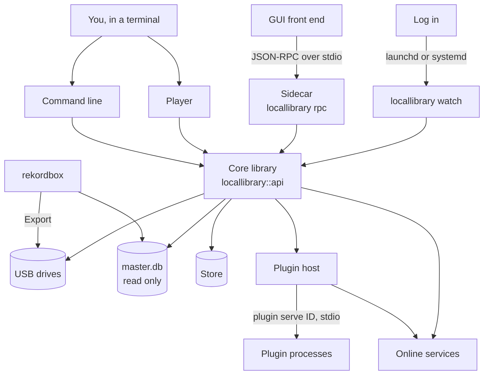

Source: [`src/main.rs`](src/main.rs), [`src/rpc.rs`](src/rpc.rs), [`src/tui/mod.rs`](src/tui/mod.rs), [`src/autostart.rs`](src/autostart.rs), [`crates/locallibrary/src/api.rs`](../../crates/locallibrary/src/api.rs), [`crates/locallibrary/src/plugin.rs`](../../crates/locallibrary/src/plugin.rs)

### What the binary is built from

The crates the binary and the core library link.

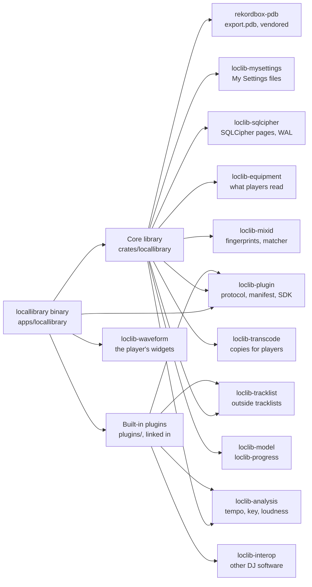

Source: [`Cargo.toml`](Cargo.toml), [`crates/locallibrary/Cargo.toml`](../../crates/locallibrary/Cargo.toml), [`build.rs`](build.rs)

### How a run starts

What `main` does before and after a command.

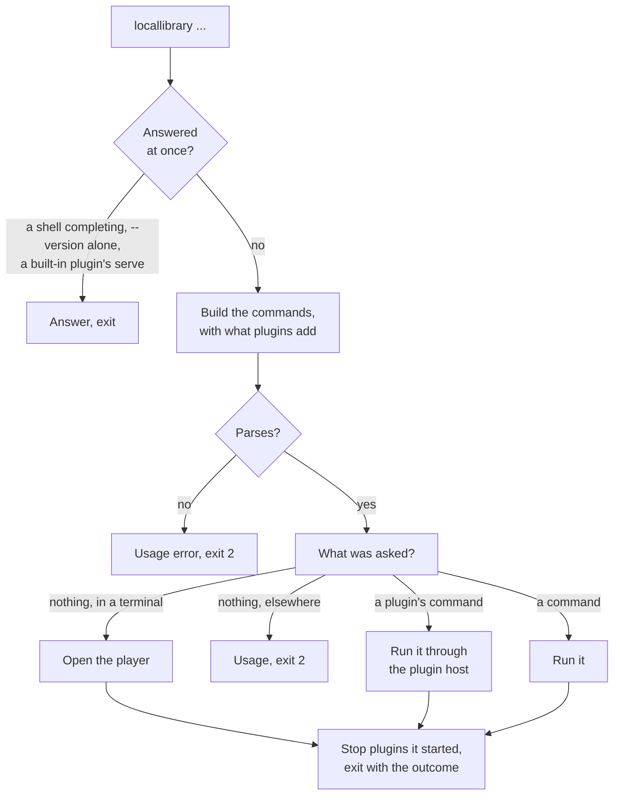

Source: [`src/main.rs`](src/main.rs), [`src/help.rs`](src/help.rs), [`src/completion.rs`](src/completion.rs), [`src/plugin_cmd/contributed.rs`](src/plugin_cmd/contributed.rs)

### Exit status

What a command comes to, and the status it exits with. With `--json`, the same word is `outcome`, but a usage error's `outcome` is `error`, with `kind` `usage`.

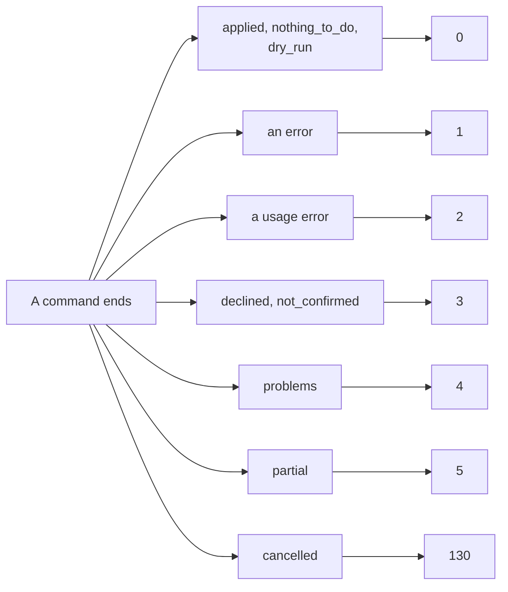

Source: [`src/output.rs`](src/output.rs), [`src/main.rs`](src/main.rs)

### Commands by heading

Every top-level command, under the headings `locallibrary --help` lists them by.

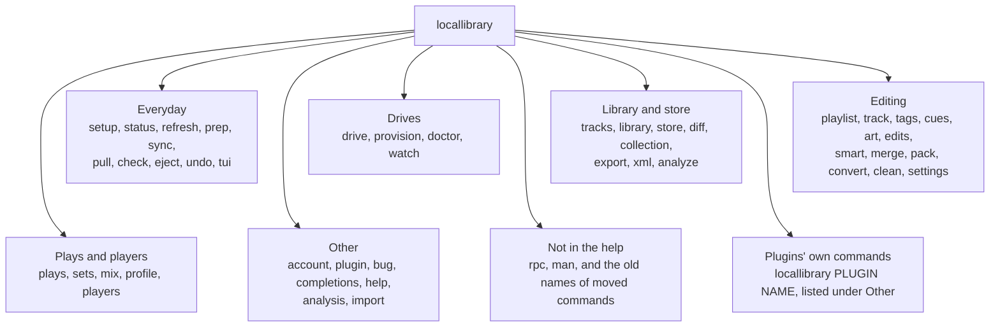

Source: [`src/help.rs`](src/help.rs), [`src/main.rs`](src/main.rs), [`src/drive_cmd.rs`](src/drive_cmd.rs), [`src/plugin_cmd/contributed.rs`](src/plugin_cmd/contributed.rs)

### Everyday commands

The commands for what a DJ does most, and what each does.

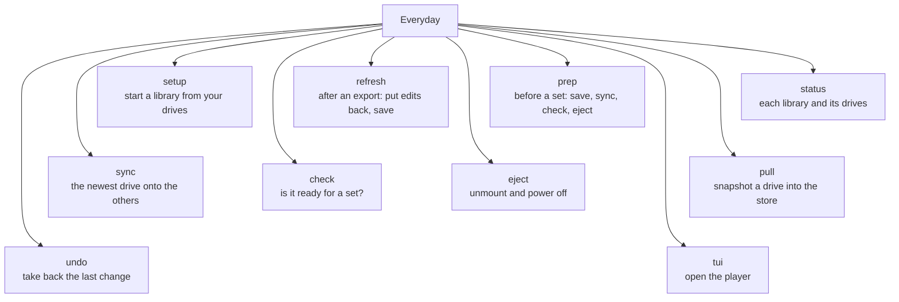

Source: [`src/main.rs`](src/main.rs), [`src/jobs_cmd.rs`](src/jobs_cmd.rs), [`src/check_cmd.rs`](src/check_cmd.rs), [`src/store_cmd.rs`](src/store_cmd.rs), [`src/restore_cmd.rs`](src/restore_cmd.rs), [`src/drive_cmd.rs`](src/drive_cmd.rs)

### Drive commands

`drive` and its subcommands by what they're for, with the other commands about drives.

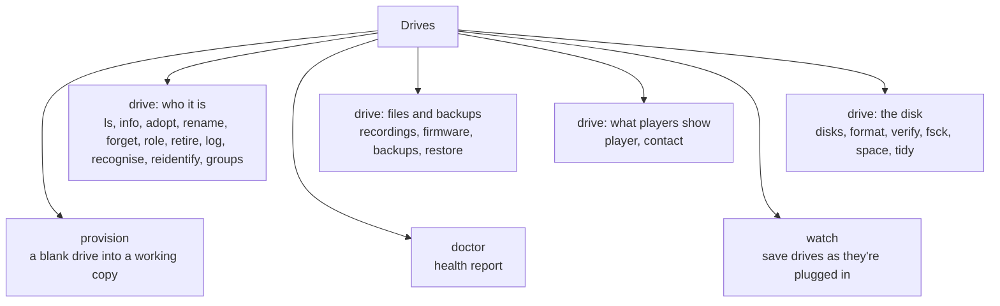

Source: [`src/drive_cmd.rs`](src/drive_cmd.rs), [`src/doctor_cmd.rs`](src/doctor_cmd.rs), [`src/watch_cmd.rs`](src/watch_cmd.rs)

### Library and store commands

Reading a library, and looking after the store.

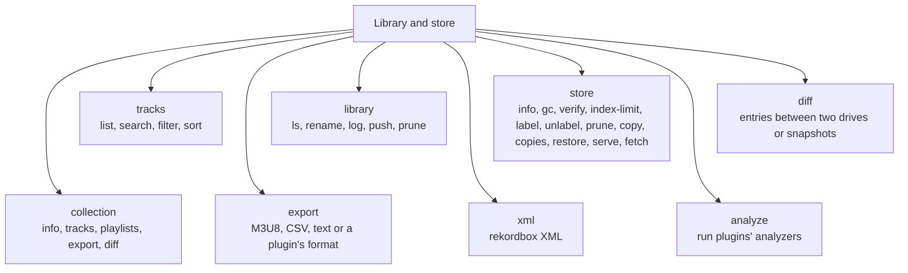

Source: [`src/library_cmd.rs`](src/library_cmd.rs), [`src/store_cmd.rs`](src/store_cmd.rs), [`src/diff_cmd.rs`](src/diff_cmd.rs), [`src/collection_cmd.rs`](src/collection_cmd.rs), [`src/export_cmd.rs`](src/export_cmd.rs), [`src/plugin_cmd/analyze.rs`](src/plugin_cmd/analyze.rs)

### Editing commands

The commands that change what's on a drive.

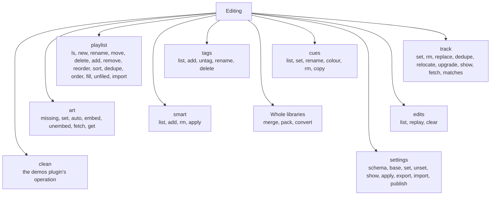

Source: [`src/edit_cmd.rs`](src/edit_cmd.rs), [`src/tags_cmd.rs`](src/tags_cmd.rs), [`src/cues_cmd.rs`](src/cues_cmd.rs), [`src/main.rs`](src/main.rs), [`plugins/demos/locallibrary-plugin.toml`](../../plugins/demos/locallibrary-plugin.toml), [`plugins/tracklist/locallibrary-plugin.toml`](../../plugins/tracklist/locallibrary-plugin.toml)

### Plays and players commands

What players recorded, what you played, and who you are as a DJ.

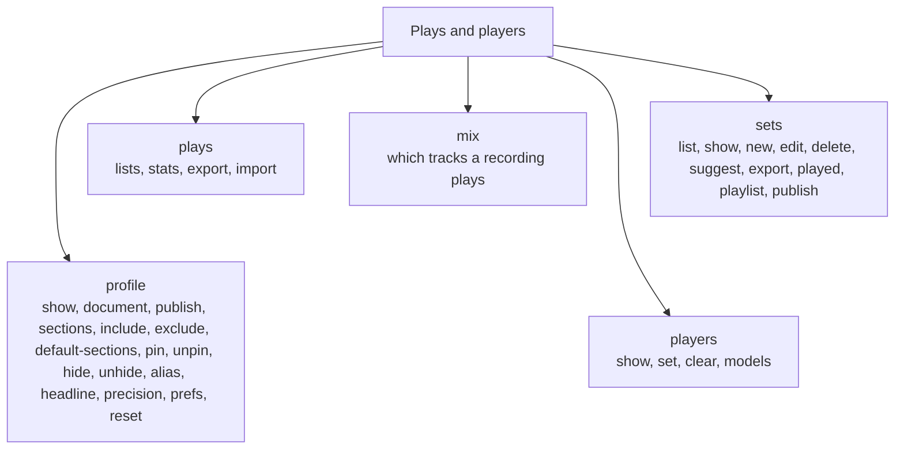

Source: [`src/plays_cmd.rs`](src/plays_cmd.rs), [`src/sets_cmd.rs`](src/sets_cmd.rs), [`src/mix_cmd.rs`](src/mix_cmd.rs), [`src/profile_cmd.rs`](src/profile_cmd.rs), [`src/players_cmd.rs`](src/players_cmd.rs)

### Other commands

The rest of the command tree, with the commands the help leaves out.

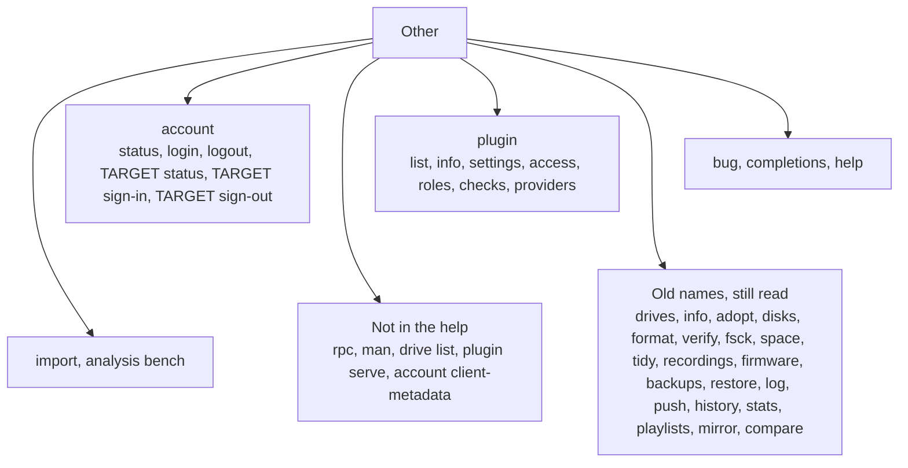

Source: [`src/account_cmd.rs`](src/account_cmd.rs), [`src/plugin_cmd.rs`](src/plugin_cmd.rs), [`src/bug_cmd.rs`](src/bug_cmd.rs), [`src/completion.rs`](src/completion.rs), [`src/analysis_cmd.rs`](src/analysis_cmd.rs), [`src/help.rs`](src/help.rs), [`src/main.rs`](src/main.rs)
