# locallibrary diagrams: Accounts

The DJ account, token exchange, keys and access. The rest are listed in the [README](../../README.md#diagrams).

- [Accounts and access](#accounts-and-access)
- [Signing in to the DJ account](#signing-in-to-the-dj-account)
- [What the DJ account is allowed](#what-the-dj-account-is-allowed)
- [The DJ account's life](#the-dj-accounts-life)
- [Signing in through the token exchange](#signing-in-through-the-token-exchange)
- [Signing in with keys](#signing-in-with-keys)
- [An account's life](#an-accounts-life)
- [When a plugin needs more of an account](#when-a-plugin-needs-more-of-an-account)
- [When a destination starts](#when-a-destination-starts)
- [Managing access](#managing-access)
- [Signing in from another computer](#signing-in-from-another-computer)

## Accounts and access

How accounts, account types, scopes and access relate. The DJ account is kept apart, in `atmosphere.json`.

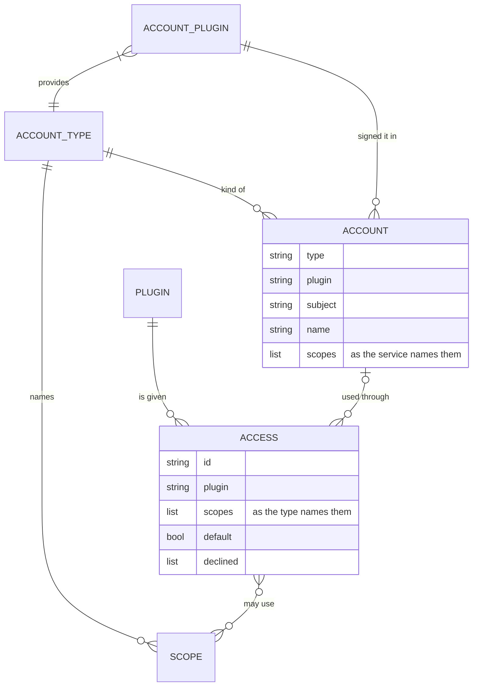

Source: [`crates/locallibrary/src/plugin/accounts/kept.rs`](../../../../crates/locallibrary/src/plugin/accounts/kept.rs), [`crates/locallibrary/src/plugin/accounts/access.rs`](../../../../crates/locallibrary/src/plugin/accounts/access.rs), [`crates/locallibrary/src/plugin/accounts/shared.rs`](../../../../crates/locallibrary/src/plugin/accounts/shared.rs), [`GLOSSARY.md`](../../GLOSSARY.md)

## Signing in to the DJ account

The Atmosphere sign-in, which the `jacquard-oauth` client runs. The password stays with the account's server. A `--client-id` document never falls back, and `--session-file` keeps the secrets in a file.

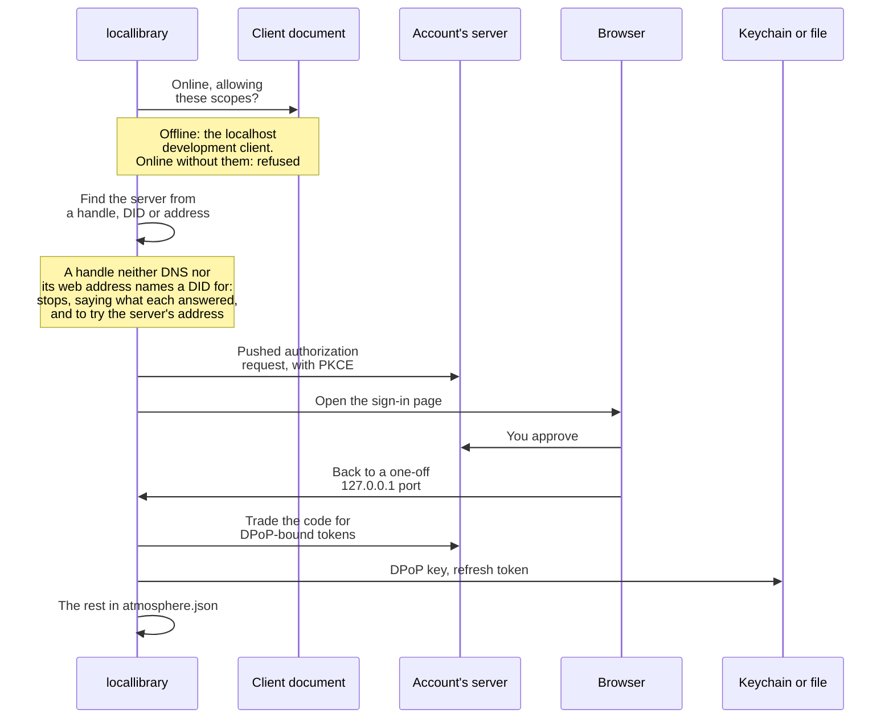

Source: [`crates/locallibrary/src/atmosphere/mod.rs`](../../../../crates/locallibrary/src/atmosphere/mod.rs), [`crates/locallibrary/src/atmosphere/store.rs`](../../../../crates/locallibrary/src/atmosphere/store.rs), [`crates/locallibrary/src/callback.rs`](../../../../crates/locallibrary/src/callback.rs), [`src/account_cmd/atmosphere.rs`](../../src/account_cmd/atmosphere.rs)

## What the DJ account is allowed

What each sign-in asks of the account's server. Each is asked for the first time it's needed.

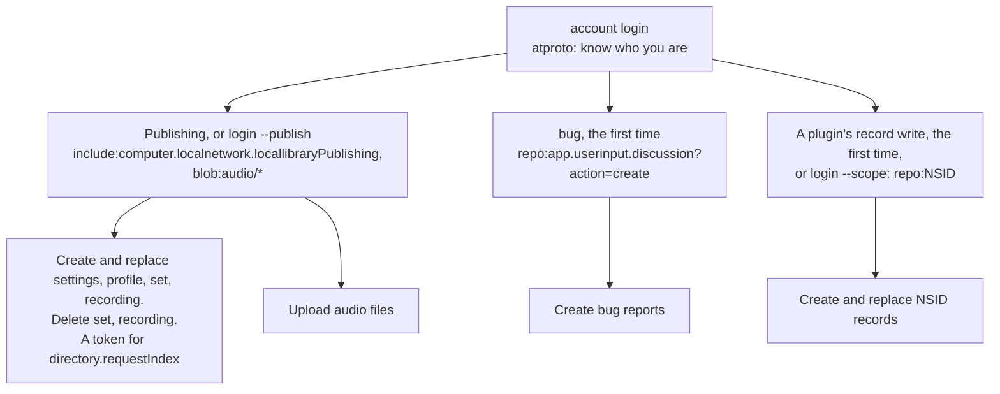

Source: [`crates/locallibrary/src/atmosphere/mod.rs`](../../../../crates/locallibrary/src/atmosphere/mod.rs), [`crates/locallibrary/src/atmosphere/repo.rs`](../../../../crates/locallibrary/src/atmosphere/repo.rs), [`src/account_cmd/atmosphere.rs`](../../src/account_cmd/atmosphere.rs), [`lexicons/computer/localnetwork/locallibraryPublishing.json`](../../../../lexicons/computer/localnetwork/locallibraryPublishing.json)

## The DJ account's life

From signing in to signing out. The 14 days are Bluesky's limit as a constant here, counted by this computer's clock. Signing in again that fails leaves the account as it was.

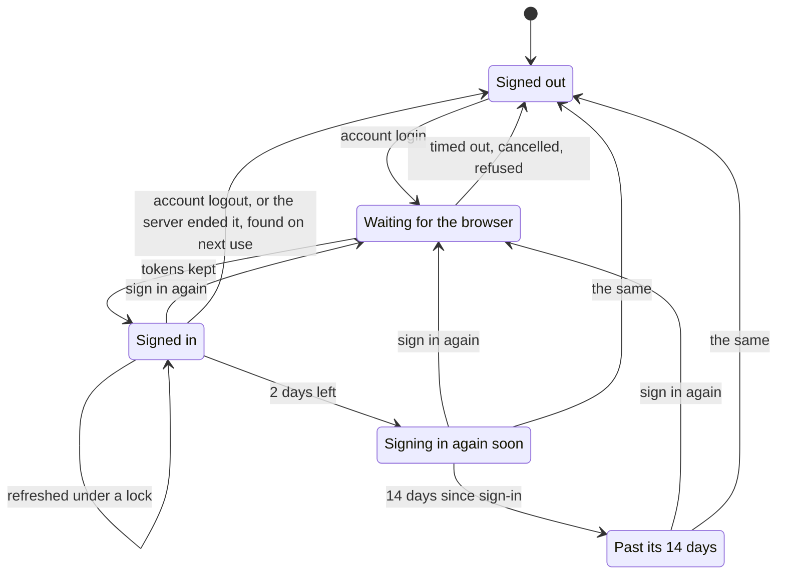

Source: [`crates/locallibrary/src/atmosphere/mod.rs`](../../../../crates/locallibrary/src/atmosphere/mod.rs), [`crates/locallibrary/src/atmosphere/store.rs`](../../../../crates/locallibrary/src/atmosphere/store.rs), [`src/account_cmd/atmosphere.rs`](../../src/account_cmd/atmosphere.rs)

## Signing in through the token exchange

An account type whose service wants a client secret goes through `localnetwork.computer/api/token-exchange/SERVICE`, which adds it and keeps no tokens. Local Network can pause one service's exchange with a flag, say when a secret leaks; it then answers 503 before asking the service, and the sign-in fails.

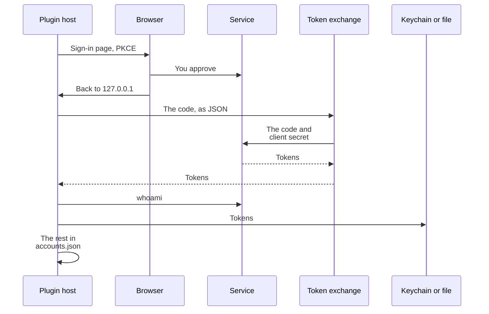

Source: [`crates/locallibrary/src/plugin/accounts.rs`](../../../../crates/locallibrary/src/plugin/accounts.rs), [`crates/locallibrary/src/plugin/accounts/shared.rs`](../../../../crates/locallibrary/src/plugin/accounts/shared.rs), [`crates/locallibrary/src/plugin/accounts/whoami.rs`](../../../../crates/locallibrary/src/plugin/accounts/whoami.rs), [`plugins/accounts/google-account/locallibrary-plugin.toml`](../../../../plugins/accounts/google-account/locallibrary-plugin.toml), [`apps/web/src/lib/server/token-exchange/services.ts`](../../../../apps/web/src/lib/server/token-exchange/services.ts), [`apps/web/src/lib/server/token-exchange/exchange.ts`](../../../../apps/web/src/lib/server/token-exchange/exchange.ts)

## Signing in with keys

For a service that hands out keys instead, as the Internet Archive and plyr.fm do.

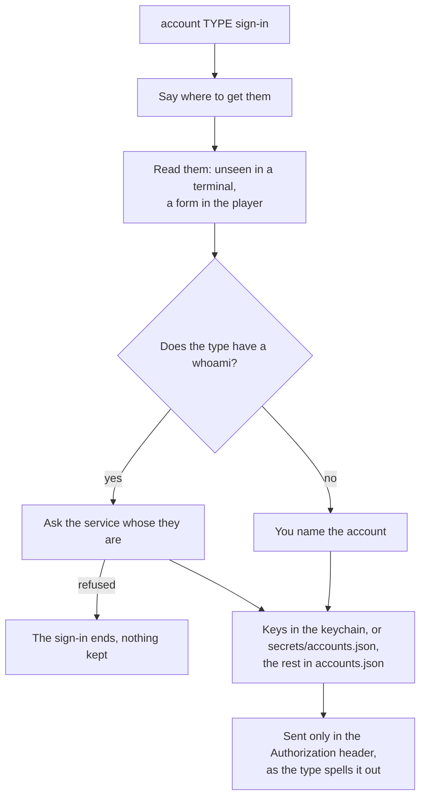

Source: [`crates/locallibrary/src/plugin/accounts/keys.rs`](../../../../crates/locallibrary/src/plugin/accounts/keys.rs), [`crates/locallibrary/src/plugin/accounts/shared.rs`](../../../../crates/locallibrary/src/plugin/accounts/shared.rs), [`docs/adr/0002-keys-accounts.md`](../adr/0002-keys-accounts.md), [`src/account_cmd/accounts.rs`](../../src/account_cmd/accounts.rs)

## An account's life

An account a plugin uses, from signing in to signing out. A plugin's access outlasts it. Lapsed requests fail as signed out. Sign-out revokes it if the service can. An account with keys never refreshes or expires: only sign-out ends it. A keychain that lost its tokens acts as signed out, with the account still listed.

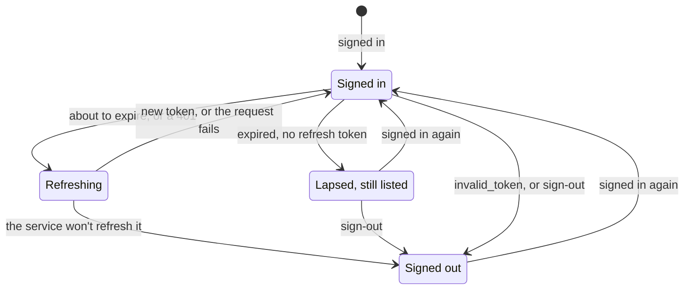

Source: [`crates/locallibrary/src/plugin/accounts.rs`](../../../../crates/locallibrary/src/plugin/accounts.rs), [`crates/locallibrary/src/plugin/accounts/token.rs`](../../../../crates/locallibrary/src/plugin/accounts/token.rs), [`crates/locallibrary/src/plugin/accounts/shared.rs`](../../../../crates/locallibrary/src/plugin/accounts/shared.rs), [`docs/plugins.md`](../plugins.md)

## When a plugin needs more of an account

What happens when a plugin asks for a scope it can do without.

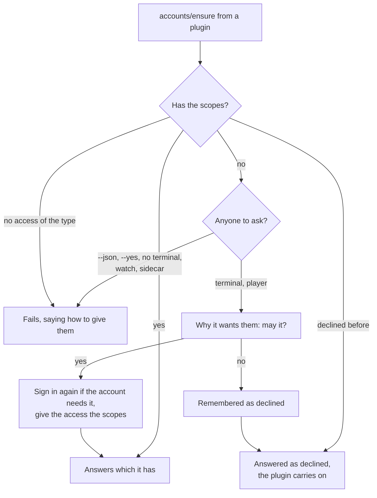

Source: [`crates/locallibrary/src/plugin/accounts/ensure.rs`](../../../../crates/locallibrary/src/plugin/accounts/ensure.rs), [`crates/locallibrary/src/plugin/accounts/ready.rs`](../../../../crates/locallibrary/src/plugin/accounts/ready.rs), [`src/account_cmd/asking.rs`](../../src/account_cmd/asking.rs), [`src/tui/plugins/access.rs`](../../src/tui/plugins/access.rs)

## When a destination starts

What's checked before `store copy --to`, `store restore`, `drive verify --from` or `sets publish --to` sends anything. It's the command line's, and a no here isn't remembered.

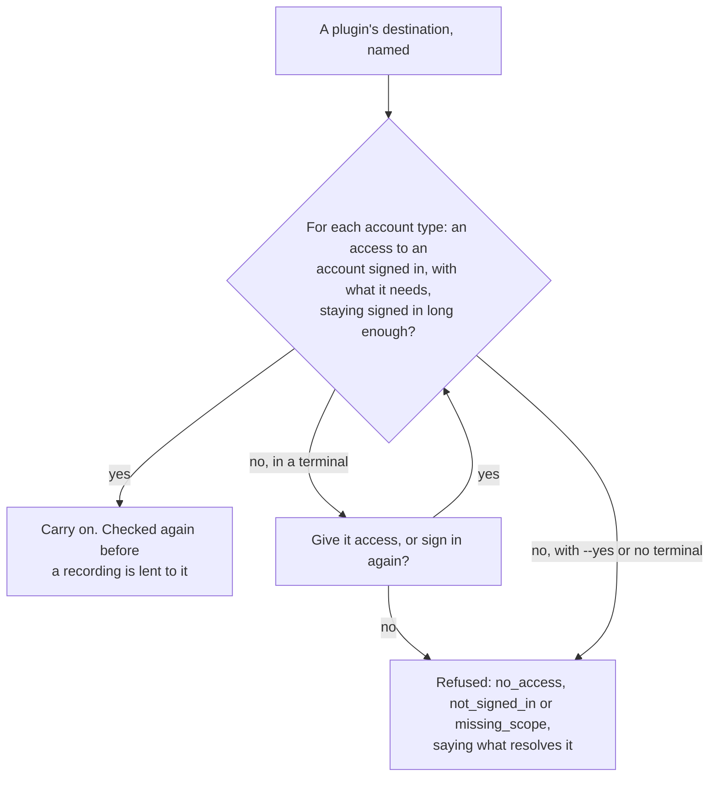

Source: [`src/account_cmd/access.rs`](../../src/account_cmd/access.rs), [`crates/locallibrary/src/plugin/accounts/ready.rs`](../../../../crates/locallibrary/src/plugin/accounts/ready.rs), [`src/sets_cmd.rs`](../../src/sets_cmd.rs), [`src/store_cmd.rs`](../../src/store_cmd.rs), [`src/drive_cmd.rs`](../../src/drive_cmd.rs)

## Managing access

`plugin access`, the player's "access for PLUGIN…" form, and the sidecar's `accounts.access.*`.

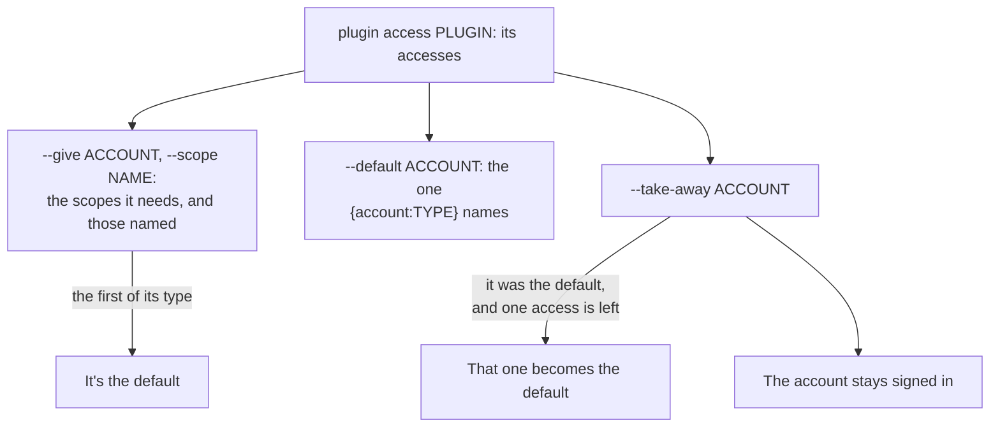

Source: [`crates/locallibrary/src/plugin/accounts/access.rs`](../../../../crates/locallibrary/src/plugin/accounts/access.rs), [`src/account_cmd/access.rs`](../../src/account_cmd/access.rs), [`src/tui/plugins/access.rs`](../../src/tui/plugins/access.rs), [`src/rpc/methods/accounts.rs`](../../src/rpc/methods/accounts.rs)

## Signing in from another computer

The paste path, for the DJ account and accounts plugins use, when the browser can't reach this computer's 127.0.0.1. `--no-browser` prints the link and still waits here. The sidecar's are `account.login.paste` and `accounts.sign_in.paste`.

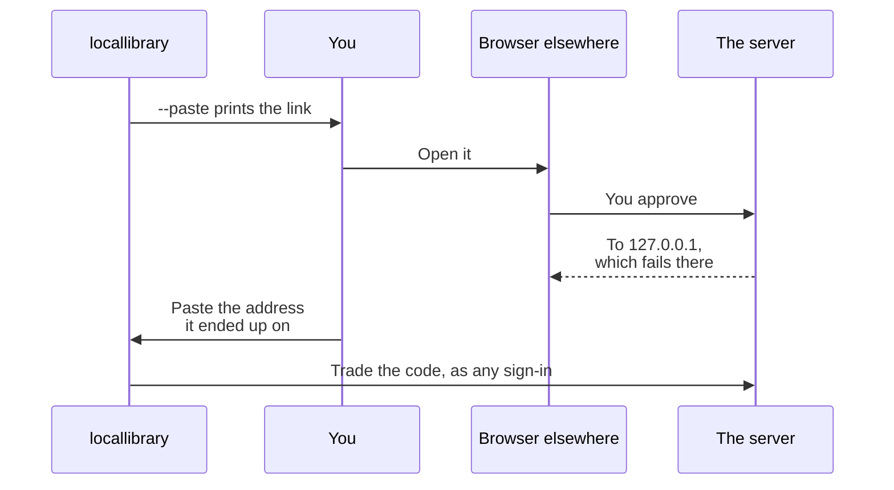

Source: [`src/browser.rs`](../../src/browser.rs), [`crates/locallibrary/src/atmosphere/mod.rs`](../../../../crates/locallibrary/src/atmosphere/mod.rs), [`crates/locallibrary/src/plugin/accounts/shared.rs`](../../../../crates/locallibrary/src/plugin/accounts/shared.rs), [`src/account_cmd/atmosphere.rs`](../../src/account_cmd/atmosphere.rs), [`src/account_cmd/accounts.rs`](../../src/account_cmd/accounts.rs)
