# locallibrary diagrams: Changing drives

Plans, the write routine, syncs, undo, edits and jobs. The rest are listed in the [README](../../README.md#diagrams).

- [Plan, confirm, apply](#plan-confirm-apply)
- [A plan's life](#a-plans-life)
- [The one write routine](#the-one-write-routine)
- [Copying a whole library](#copying-a-whole-library)
- [Which way a sync goes](#which-way-a-sync-goes)
- [Back from a set](#back-from-a-set)
- [Syncing a library's drives](#syncing-a-librarys-drives)
- [A change reaches the other clones](#a-change-reaches-the-other-clones)
- [A write cut off part way](#a-write-cut-off-part-way)
- [Undo and redo](#undo-and-redo)
- [Bringing a playlist back](#bringing-a-playlist-back)
- [Editing both databases](#editing-both-databases)
- [Edits after an export](#edits-after-an-export)
- [The refresh job](#the-refresh-job)
- [The prep job](#the-prep-job)
- [How a job runs](#how-a-job-runs)
- [First run with setup](#first-run-with-setup)
- [Setting up a drive with provision](#setting-up-a-drive-with-provision)
- [Merge, pack and convert](#merge-pack-and-convert)

## Plan, confirm, apply

How a planned change is worked out, shown, and made only as it was shown.

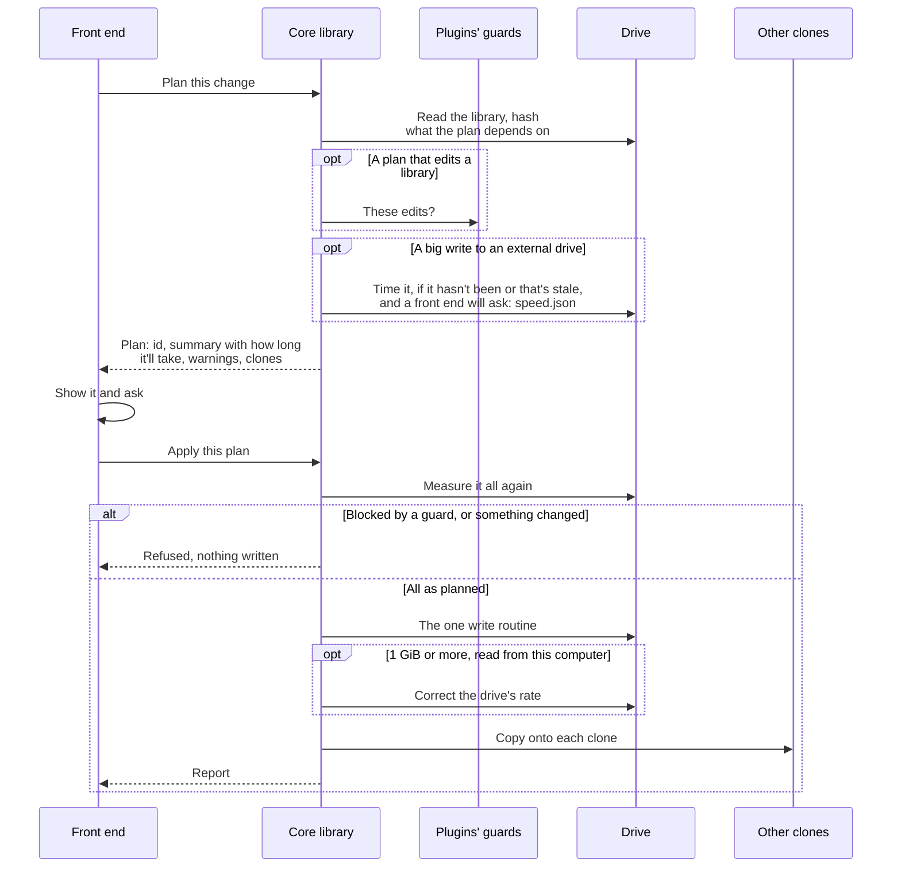

Source: [`crates/locallibrary/src/op.rs`](../../../../crates/locallibrary/src/op.rs), [`crates/locallibrary/src/commit.rs`](../../../../crates/locallibrary/src/commit.rs), [`crates/locallibrary/src/plugin/checks.rs`](../../../../crates/locallibrary/src/plugin/checks.rs), [`crates/locallibrary/src/drive_speed.rs`](../../../../crates/locallibrary/src/drive_speed.rs), [`crates/locallibrary/src/api/drive_speed.rs`](../../../../crates/locallibrary/src/api/drive_speed.rs), [`src/output.rs`](../../src/output.rs)

## A plan's life

The states a plan goes through, whichever front end holds it. Not confirmed means a dry run, a no, or nobody to ask.

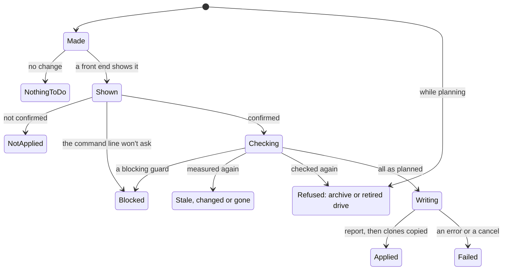

Source: [`crates/locallibrary/src/op.rs`](../../../../crates/locallibrary/src/op.rs), [`crates/locallibrary/src/fleet.rs`](../../../../crates/locallibrary/src/fleet.rs), [`src/output.rs`](../../src/output.rs)

## The one write routine

How a change made in place reaches a drive, and what a failure leaves.

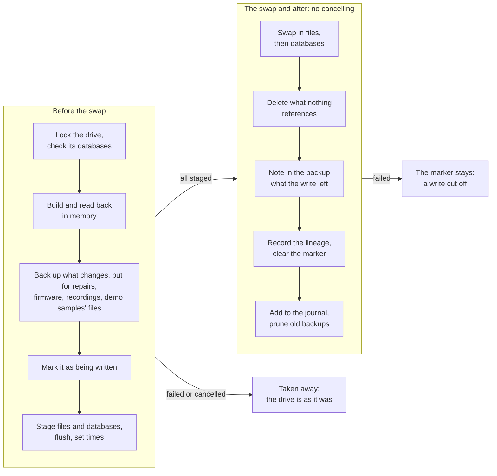

Source: [`crates/locallibrary/src/commit.rs`](../../../../crates/locallibrary/src/commit.rs), [`crates/locallibrary/src/backup.rs`](../../../../crates/locallibrary/src/backup.rs), [`crates/locallibrary/src/device.rs`](../../../../crates/locallibrary/src/device.rs)

## Copying a whole library

How `sync` and `library push` write a drive, so it stays playable if the copy stops, unless `--delete-first` took its databases off.

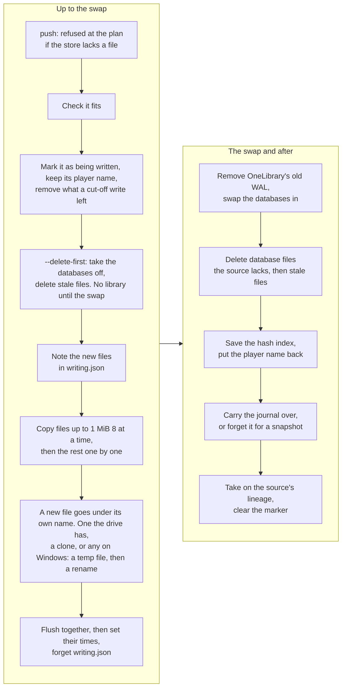

Source: [`crates/locallibrary/src/sync.rs`](../../../../crates/locallibrary/src/sync.rs), [`crates/locallibrary/src/library_write.rs`](../../../../crates/locallibrary/src/library_write.rs), [`crates/locallibrary/src/fsutil.rs`](../../../../crates/locallibrary/src/fsutil.rs), [`crates/locallibrary/src/writing.rs`](../../../../crates/locallibrary/src/writing.rs), [`crates/locallibrary/src/device.rs`](../../../../crates/locallibrary/src/device.rs), [`crates/locallibrary/src/player.rs`](../../../../crates/locallibrary/src/player.rs)

## Which way a sync goes

How `sync A B`, with two drives named, decides what's copied onto what. A library or no drives goes through [Syncing a library's drives](#syncing-a-librarys-drives).

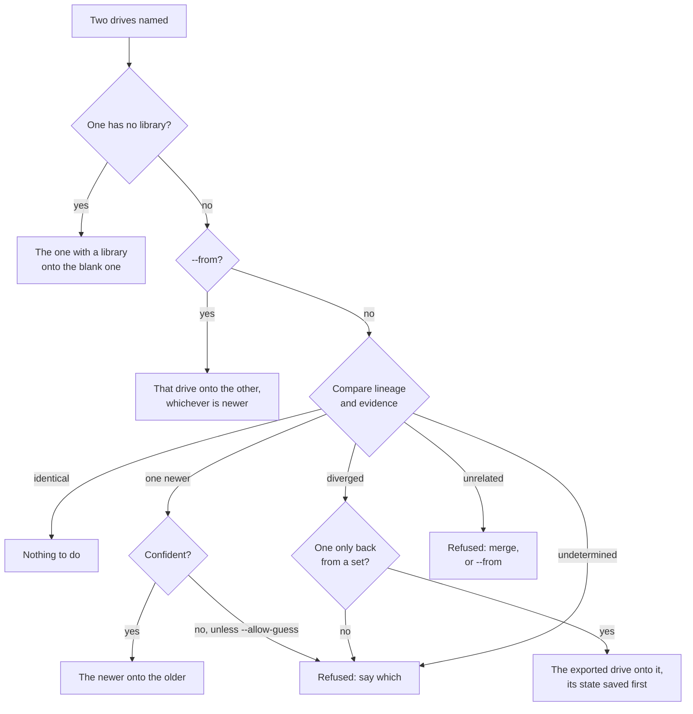

Source: [`crates/locallibrary/src/api.rs`](../../../../crates/locallibrary/src/api.rs), [`crates/locallibrary/src/compare.rs`](../../../../crates/locallibrary/src/compare.rs), [`crates/locallibrary/src/after_set.rs`](../../../../crates/locallibrary/src/after_set.rs)

## Back from a set

What `sync A B`, `prep` and `refresh --sync` do when one drive came back from a set and the other has a new export. `sync` with a library or no drives refuses instead, and says to sync the pair first.

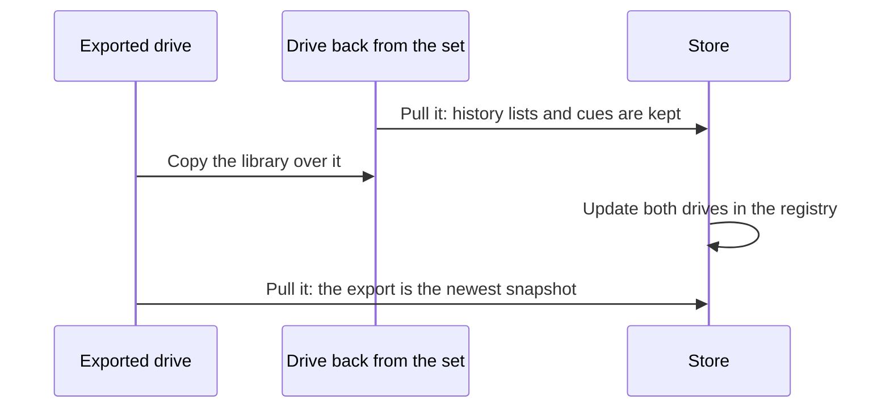

Source: [`crates/locallibrary/src/api.rs`](../../../../crates/locallibrary/src/api.rs), [`crates/locallibrary/src/after_set.rs`](../../../../crates/locallibrary/src/after_set.rs), [`crates/locallibrary/src/sync.rs`](../../../../crates/locallibrary/src/sync.rs)

## Syncing a library's drives

What `sync` does with no drives, a library's name, or three or more drives: one source, written to several targets at once.

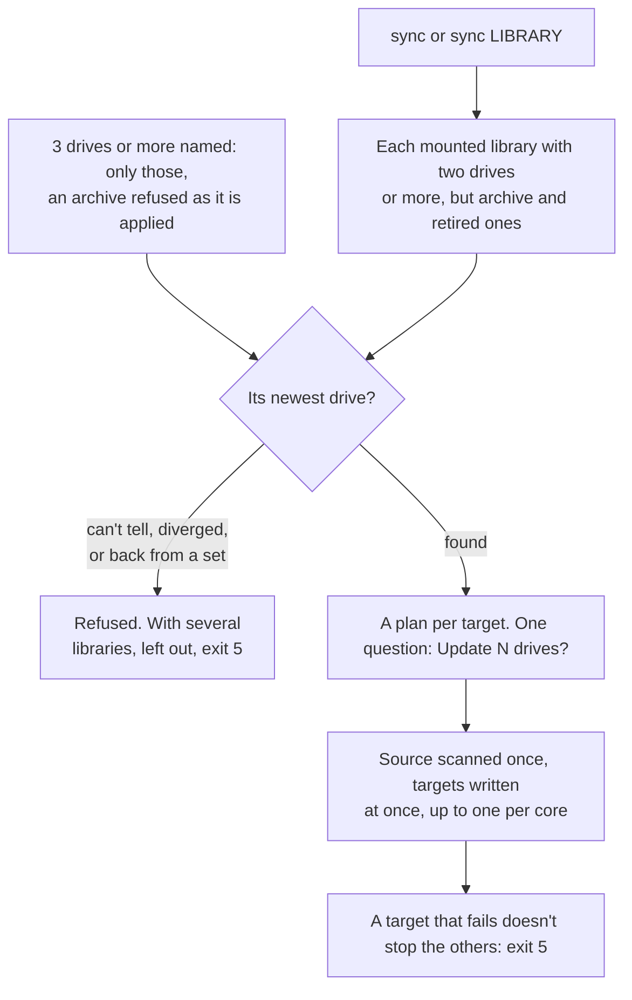

Source: [`src/main.rs`](../../src/main.rs), [`src/drive_cmd.rs`](../../src/drive_cmd.rs), [`crates/locallibrary/src/api.rs`](../../../../crates/locallibrary/src/api.rs), [`crates/locallibrary/src/sync.rs`](../../../../crates/locallibrary/src/sync.rs)

## A change reaches the other clones

How a plan on a library's lead clone is copied onto its other drives plugged in.

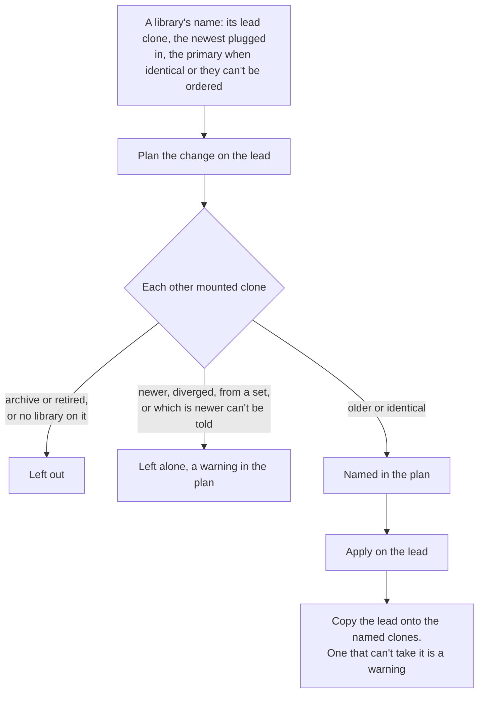

Source: [`crates/locallibrary/src/api/jobs.rs`](../../../../crates/locallibrary/src/api/jobs.rs), [`crates/locallibrary/src/op.rs`](../../../../crates/locallibrary/src/op.rs), [`crates/locallibrary/src/fleet.rs`](../../../../crates/locallibrary/src/fleet.rs)

## A write cut off part way

The marker in a drive's `state.json`, and what a drive holding one lets through. `tracks`, the player, `check` and `doctor` still read it, and all but `tracks` say so. A write that takes over first removes the temp files and the new files in `writing.json` that the cut-off one never finished.

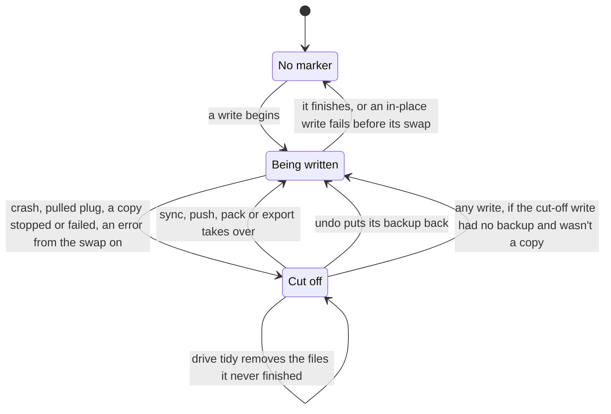

Source: [`crates/locallibrary/src/device.rs`](../../../../crates/locallibrary/src/device.rs), [`crates/locallibrary/src/commit.rs`](../../../../crates/locallibrary/src/commit.rs), [`crates/locallibrary/src/sync.rs`](../../../../crates/locallibrary/src/sync.rs), [`crates/locallibrary/src/writing.rs`](../../../../crates/locallibrary/src/writing.rs), [`crates/locallibrary/src/tidy.rs`](../../../../crates/locallibrary/src/tidy.rs)

## Undo and redo

How `undo` picks a backup and puts it back.

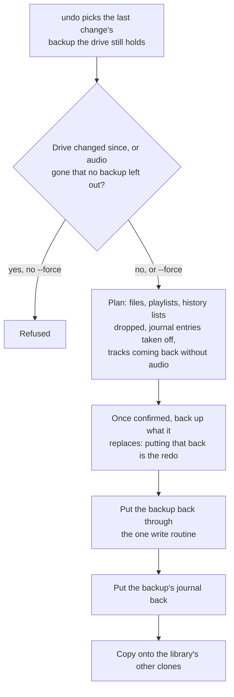

Source: [`crates/locallibrary/src/api/undo.rs`](../../../../crates/locallibrary/src/api/undo.rs), [`crates/locallibrary/src/backup.rs`](../../../../crates/locallibrary/src/backup.rs), [`src/restore_cmd.rs`](../../src/restore_cmd.rs)

## Bringing a playlist back

`drive restore --playlist`, and `enter` in the player's Snapshots view: one playlist or folder from an earlier state.

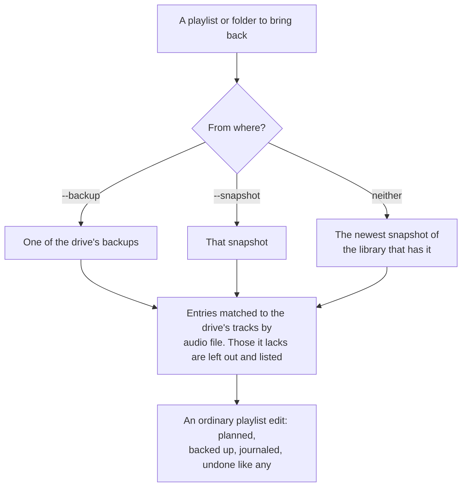

Source: [`crates/locallibrary/src/api/restore.rs`](../../../../crates/locallibrary/src/api/restore.rs), [`src/restore_cmd.rs`](../../src/restore_cmd.rs), [`src/drive_cmd.rs`](../../src/drive_cmd.rs), [`src/tui/drives.rs`](../../src/tui/drives.rs)

## Editing both databases

How one edit lands in `export.pdb` and OneLibrary, whose row ids differ. What one database lacks is skipped there, with a warning.

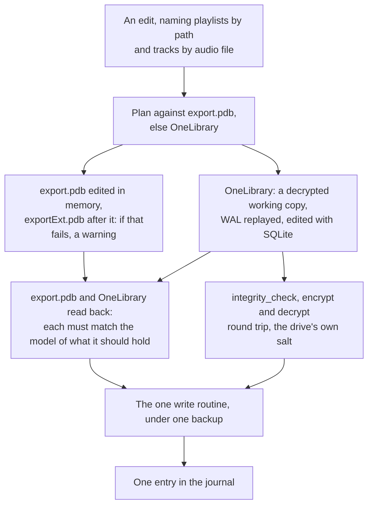

Source: [`crates/locallibrary/src/edit.rs`](../../../../crates/locallibrary/src/edit.rs), [`crates/locallibrary/src/onelibrary/mod.rs`](../../../../crates/locallibrary/src/onelibrary/mod.rs), [`crates/locallibrary/src/pdb.rs`](../../../../crates/locallibrary/src/pdb.rs)

## Edits after an export

Why edits come back after rekordbox replaces a drive's databases.

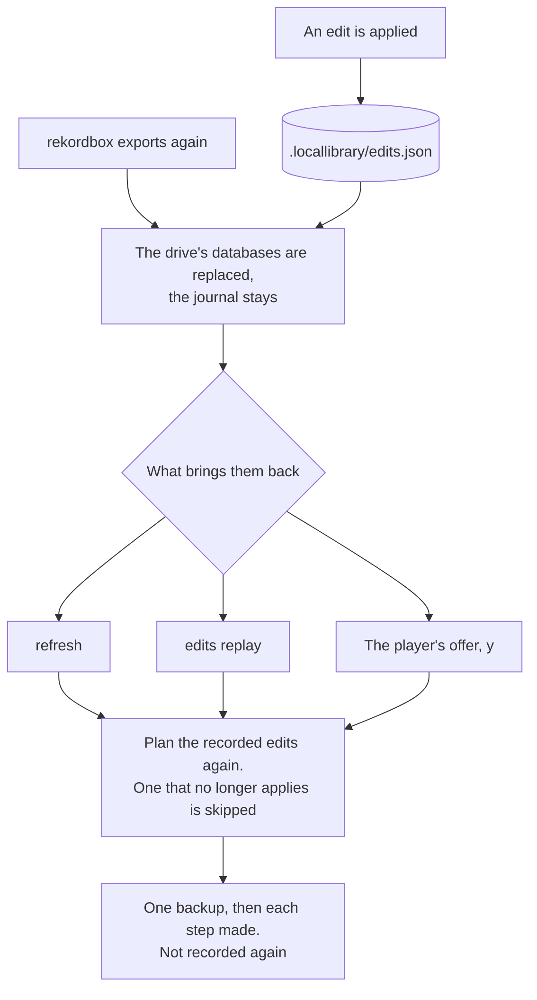

Source: [`crates/locallibrary/src/edit.rs`](../../../../crates/locallibrary/src/edit.rs), [`crates/locallibrary/src/api/editing.rs`](../../../../crates/locallibrary/src/api/editing.rs), [`crates/locallibrary/src/api/jobs.rs`](../../../../crates/locallibrary/src/api/jobs.rs), [`src/tui/app/drives.rs`](../../src/tui/app/drives.rs)

## The refresh job

What `refresh` runs after a rekordbox export, in order. Each step that has nothing to do sits out.

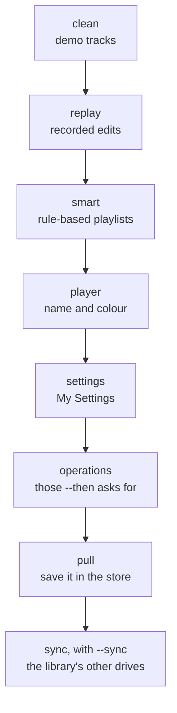

Source: [`crates/locallibrary/src/api/jobs.rs`](../../../../crates/locallibrary/src/api/jobs.rs), [`src/jobs_cmd.rs`](../../src/jobs_cmd.rs)

## The prep job

What `prep` runs the night before a set. One plan, one confirmation.

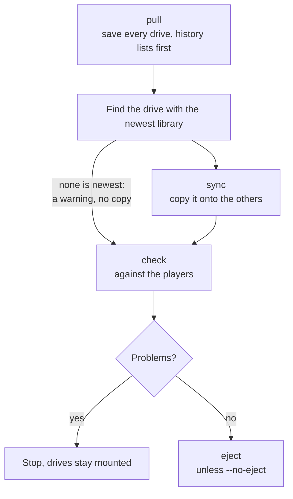

Source: [`crates/locallibrary/src/api/jobs.rs`](../../../../crates/locallibrary/src/api/jobs.rs), [`src/jobs_cmd.rs`](../../src/jobs_cmd.rs)

## How a job runs

The rules `refresh` and `prep` share.

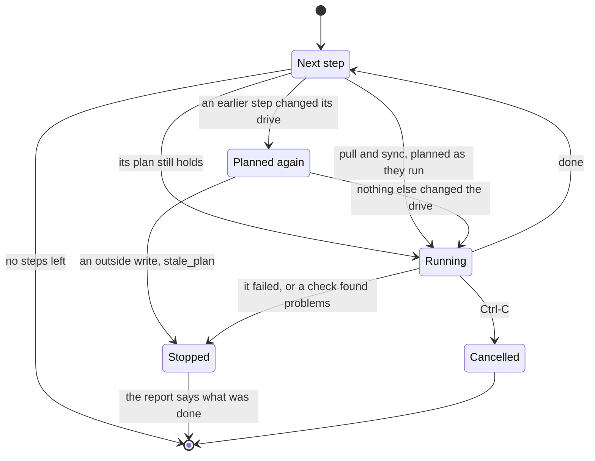

Source: [`crates/locallibrary/src/api/jobs.rs`](../../../../crates/locallibrary/src/api/jobs.rs)

## First run with setup

The questions `setup` asks, in order.

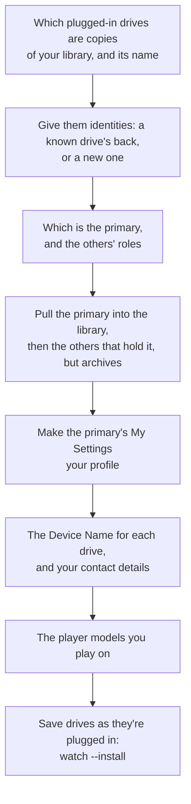

Source: [`src/jobs_cmd.rs`](../../src/jobs_cmd.rs), [`src/autostart.rs`](../../src/autostart.rs)

## Setting up a drive with provision

The steps of `provision`, one plan for a new drive. Steps not asked for sit out, and a failed step leaves the ones before it done.

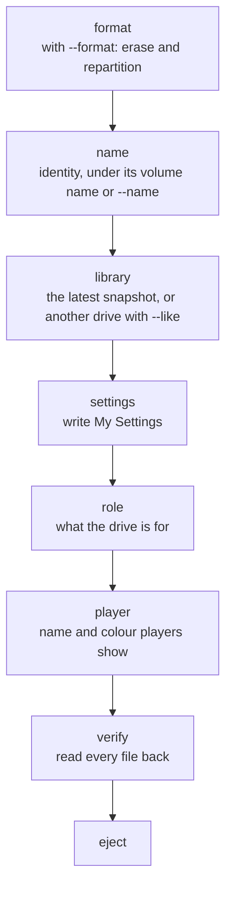

Source: [`crates/locallibrary/src/api/drives.rs`](../../../../crates/locallibrary/src/api/drives.rs), [`crates/locallibrary/src/format/mod.rs`](../../../../crates/locallibrary/src/format/mod.rs), [`src/drive_cmd.rs`](../../src/drive_cmd.rs)

## Merge, pack and convert

The three commands that write a library from another one, and how they differ from a sync.

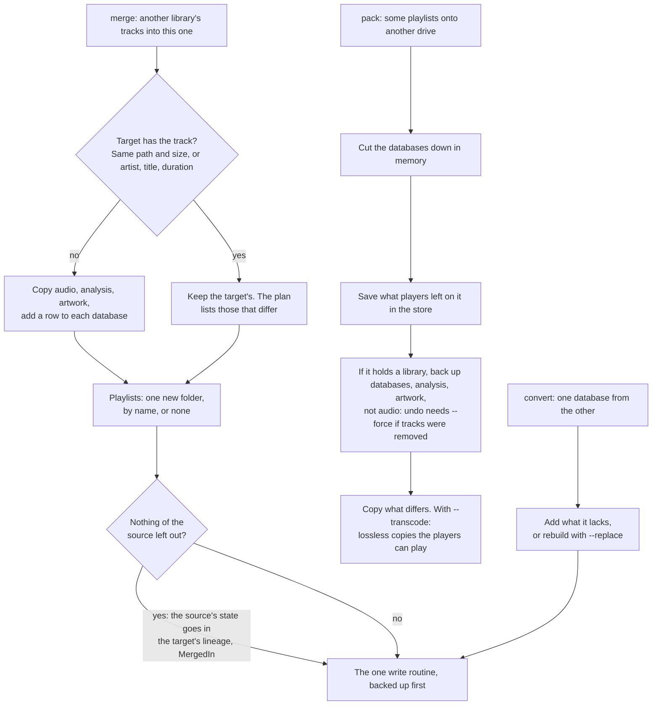

Source: [`crates/locallibrary/src/merge.rs`](../../../../crates/locallibrary/src/merge.rs), [`crates/locallibrary/src/commit.rs`](../../../../crates/locallibrary/src/commit.rs), [`crates/locallibrary/src/pack.rs`](../../../../crates/locallibrary/src/pack.rs), [`crates/locallibrary/src/pack/transcode.rs`](../../../../crates/locallibrary/src/pack/transcode.rs), [`crates/locallibrary/src/convert.rs`](../../../../crates/locallibrary/src/convert.rs)
