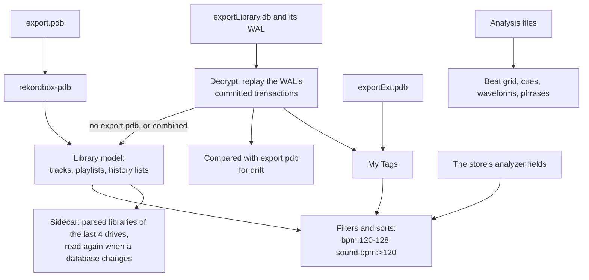
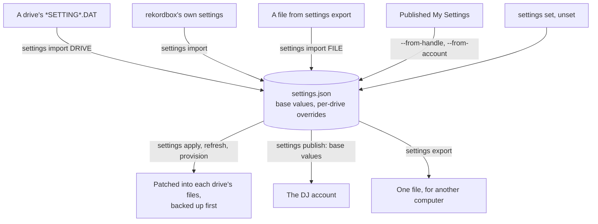
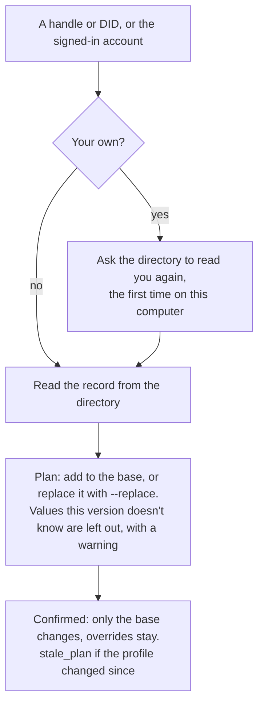
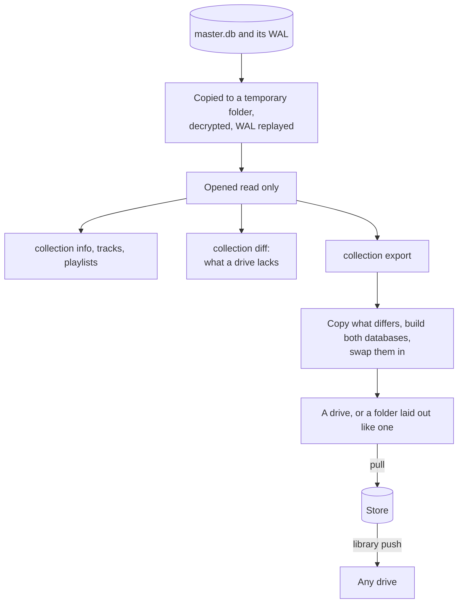
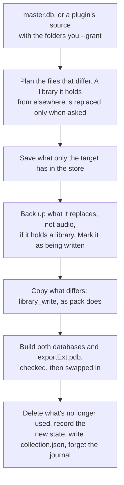
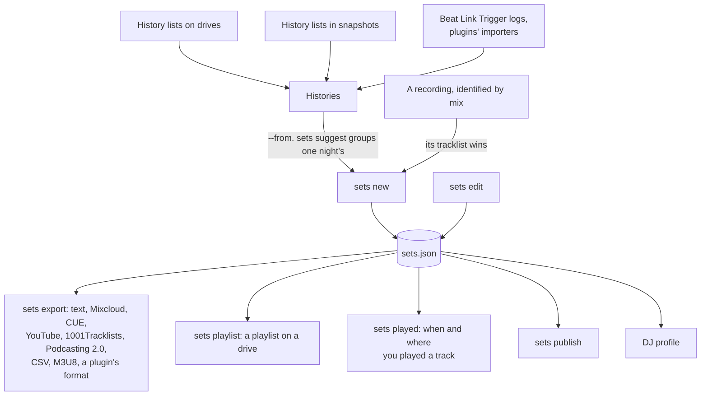
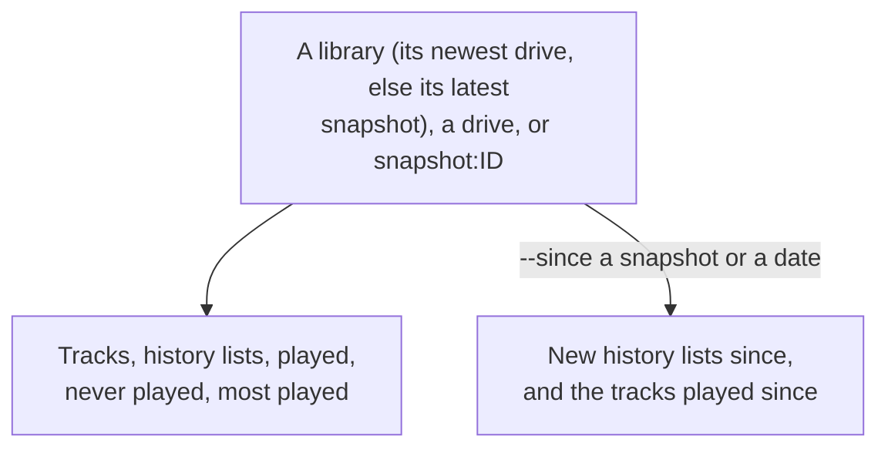
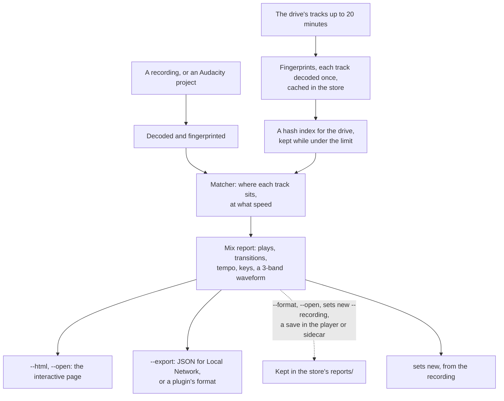
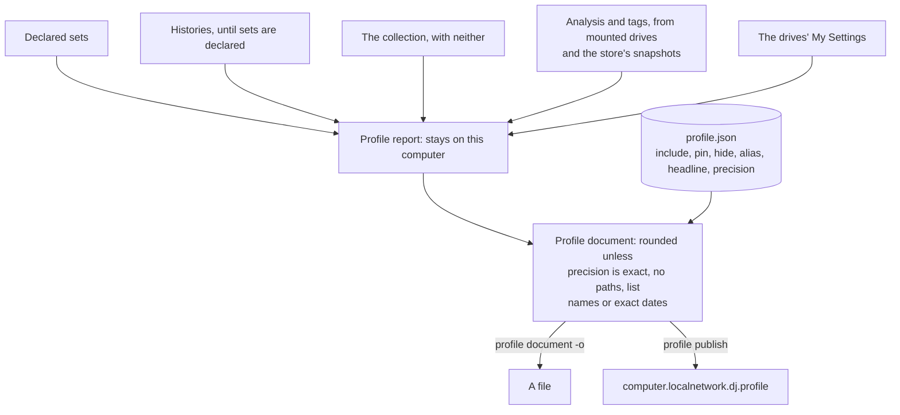
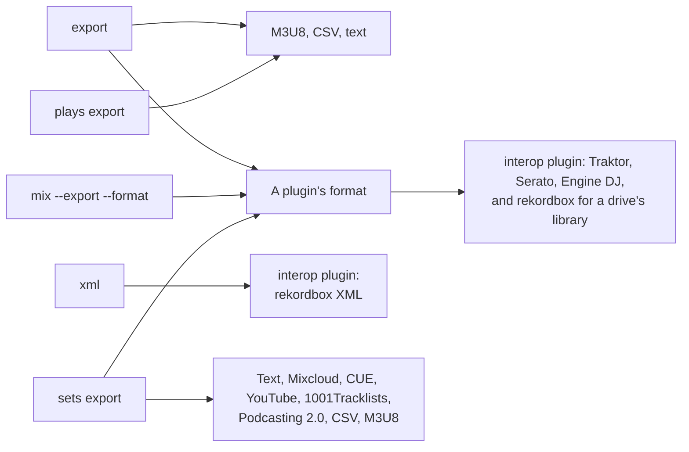

# locallibrary diagrams: Library data

Reading a library, My Settings, sets, mixes and the DJ profile. The rest are listed in the [README](../../README.md#diagrams).

- [Reading a library](#reading-a-library)
- [My Settings](#my-settings)
- [Importing published settings](#importing-published-settings)
- [rekordbox's collection](#rekordboxs-collection)
- [Exporting a collection](#exporting-a-collection)
- [Sets from histories and recordings](#sets-from-histories-and-recordings)
- [Play statistics](#play-statistics)
- [Identifying a mix](#identifying-a-mix)
- [The DJ profile](#the-dj-profile)
- [Writing a library out](#writing-a-library-out)

## Reading a library

How the bytes on a drive become the library every command works with. A `combined` read adds what only OneLibrary holds, as exports do.

Source: [`crates/locallibrary/src/device.rs`](../../../../crates/locallibrary/src/device.rs), [`crates/locallibrary/src/pdb.rs`](../../../../crates/locallibrary/src/pdb.rs), [`crates/locallibrary/src/onelibrary/mod.rs`](../../../../crates/locallibrary/src/onelibrary/mod.rs), [`crates/locallibrary/src/anlz.rs`](../../../../crates/locallibrary/src/anlz.rs), [`crates/locallibrary/src/query.rs`](../../../../crates/locallibrary/src/query.rs), [`crates/locallibrary/src/api/cache.rs`](../../../../crates/locallibrary/src/api/cache.rs)

## My Settings

Where the settings profile comes from and where it goes.

Source: [`crates/locallibrary/src/settings.rs`](../../../../crates/locallibrary/src/settings.rs), [`crates/locallibrary/src/settings/transfer.rs`](../../../../crates/locallibrary/src/settings/transfer.rs), [`crates/locallibrary/src/api.rs`](../../../../crates/locallibrary/src/api.rs), [`crates/locallibrary/src/api/publish.rs`](../../../../crates/locallibrary/src/api/publish.rs), [`crates/loclib-mysettings/src/lib.rs`](../../../../crates/loclib-mysettings/src/lib.rs)

## Importing published settings

`settings import --from-handle` and `--from-account`: someone's published My Settings into your profile's base.

Source: [`crates/locallibrary/src/api/publish.rs`](../../../../crates/locallibrary/src/api/publish.rs), [`crates/locallibrary/src/publish.rs`](../../../../crates/locallibrary/src/publish.rs), [`crates/locallibrary/src/atmosphere/directory.rs`](../../../../crates/locallibrary/src/atmosphere/directory.rs), [`src/main.rs`](../../src/main.rs)

## rekordbox's collection

How `collection` reads `master.db` without touching it, and `collection export` makes a library from it.

Source: [`crates/locallibrary/src/masterdb.rs`](../../../../crates/locallibrary/src/masterdb.rs), [`crates/locallibrary/src/collection_export.rs`](../../../../crates/locallibrary/src/collection_export.rs), [`crates/locallibrary/src/library_write.rs`](../../../../crates/locallibrary/src/library_write.rs), [`src/collection_cmd.rs`](../../src/collection_cmd.rs)

## Exporting a collection

`collection export`, as a writer of whole libraries. `--from PLUGIN:SOURCE` fills the same writer from a plugin's library source.

Source: [`crates/locallibrary/src/collection_export.rs`](../../../../crates/locallibrary/src/collection_export.rs), [`crates/locallibrary/src/library_write.rs`](../../../../crates/locallibrary/src/library_write.rs), [`crates/locallibrary/src/plugin/sources.rs`](../../../../crates/locallibrary/src/plugin/sources.rs), [`crates/locallibrary/src/api/collection.rs`](../../../../crates/locallibrary/src/api/collection.rs), [`src/collection_cmd.rs`](../../src/collection_cmd.rs)

## Sets from histories and recordings

How what players logged becomes a set the DJ declares, and where a set goes.

Source: [`crates/locallibrary/src/sets/mod.rs`](../../../../crates/locallibrary/src/sets/mod.rs), [`crates/locallibrary/src/sets/build.rs`](../../../../crates/locallibrary/src/sets/build.rs), [`crates/locallibrary/src/sets/suggest.rs`](../../../../crates/locallibrary/src/sets/suggest.rs), [`crates/locallibrary/src/sets/import.rs`](../../../../crates/locallibrary/src/sets/import.rs), [`crates/locallibrary/src/sets/export.rs`](../../../../crates/locallibrary/src/sets/export.rs), [`crates/locallibrary/src/plays.rs`](../../../../crates/locallibrary/src/plays.rs), [`src/sets_cmd.rs`](../../src/sets_cmd.rs)

## Play statistics

`plays stats`: what a library's play counts and history lists add up to.

Source: [`crates/locallibrary/src/plays.rs`](../../../../crates/locallibrary/src/plays.rs), [`src/plays_cmd.rs`](../../src/plays_cmd.rs)

## Identifying a mix

How `mix` and the player's Mixes view find which tracks a recording plays.

Source: [`crates/locallibrary/src/mix/mod.rs`](../../../../crates/locallibrary/src/mix/mod.rs), [`crates/locallibrary/src/mix/index.rs`](../../../../crates/locallibrary/src/mix/index.rs), [`crates/locallibrary/src/mix/report.rs`](../../../../crates/locallibrary/src/mix/report.rs), [`crates/locallibrary/src/mix/export.rs`](../../../../crates/locallibrary/src/mix/export.rs), [`src/mix_cmd.rs`](../../src/mix_cmd.rs)

## The DJ profile

What the report is built from, and what's allowed out of it.

Source: [`crates/locallibrary/src/profile/mod.rs`](../../../../crates/locallibrary/src/profile/mod.rs), [`crates/locallibrary/src/profile/document.rs`](../../../../crates/locallibrary/src/profile/document.rs), [`src/profile_cmd.rs`](../../src/profile_cmd.rs)

## Writing a library out

The commands that write files for other software.

Source: [`src/export_cmd.rs`](../../src/export_cmd.rs), [`crates/locallibrary/src/export.rs`](../../../../crates/locallibrary/src/export.rs), [`crates/locallibrary/src/plugin/exports.rs`](../../../../crates/locallibrary/src/plugin/exports.rs), [`plugins/interop/locallibrary-plugin.toml`](../../../../plugins/interop/locallibrary-plugin.toml), [`crates/locallibrary/src/sets/export.rs`](../../../../crates/locallibrary/src/sets/export.rs)
