# locallibrary diagrams: the player

Views, panes, threads, playback and what it remembers. The rest are listed in the [README](../../README.md#diagrams).

- [Player views](#player-views)
- [Panes and dialogs](#panes-and-dialogs)
- [Player threads](#player-threads)
- [Opening a drive in the player](#opening-a-drive-in-the-player)
- [Changing a drive from the player](#changing-a-drive-from-the-player)
- [An unplugged drive in the player](#an-unplugged-drive-in-the-player)
- [Drives view rows](#drives-view-rows)
- [Search and filter](#search-and-filter)
- [Playback](#playback)
- [Output devices](#output-devices)
- [Signing in from the player](#signing-in-from-the-player)
- [Identifying in the Mixes view](#identifying-in-the-mixes-view)
- [What the player remembers](#what-the-player-remembers)

## Player views

The player's five views and what crosses from one to another. `1` to `5` switch views, unless the pads make the digits hot cues. `o` in any view goes to the playing track, in the library or, for a set, in Mixes.

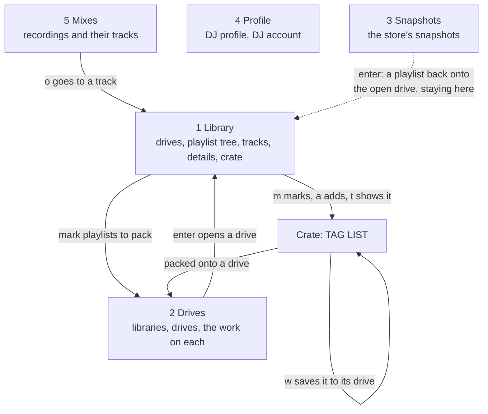

Source: [`src/tui/app/`](../../src/tui/app), [`src/tui/keymap.rs`](../../src/tui/keymap.rs), [`src/tui/ui/`](../../src/tui/ui), [`src/tui/drives.rs`](../../src/tui/drives.rs), [`src/tui/profile.rs`](../../src/tui/profile.rs), [`src/tui/mix.rs`](../../src/tui/mix.rs), [`src/tui/crate_list.rs`](../../src/tui/crate_list.rs)

## Panes and dialogs

Where keys go in the Library view, and the dialogs that take them first.

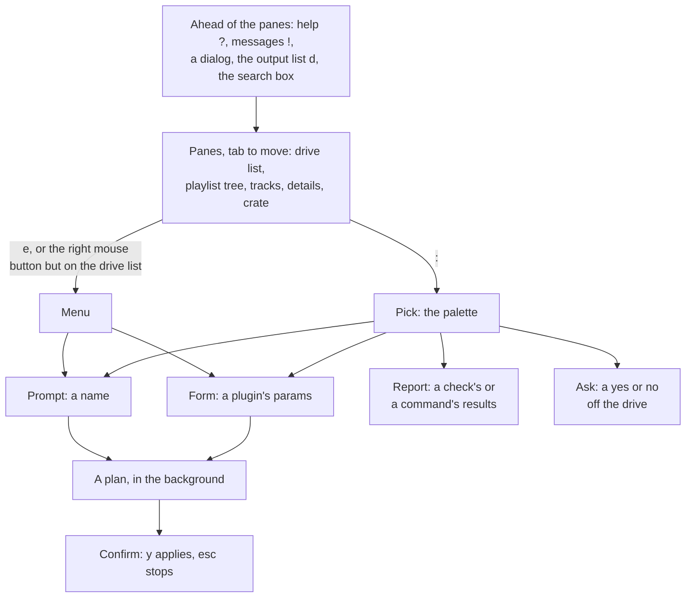

Source: [`src/tui/edits.rs`](../../src/tui/edits.rs), [`src/tui/palette.rs`](../../src/tui/palette.rs), [`src/tui/form.rs`](../../src/tui/form.rs), [`src/tui/keymap.rs`](../../src/tui/keymap.rs)

## Player threads

What runs where. Library reads and writes run off the UI thread, with one exception: reviewing a plugin's suggestion about tracks on a drive that isn't open reads it there. At exit the UI thread waits for a write under way.

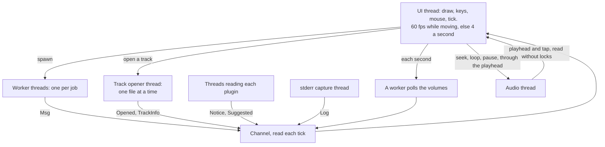

Source: [`src/tui/mod.rs`](../../src/tui/mod.rs), [`src/tui/app/`](../../src/tui/app), [`src/tui/audio.rs`](../../src/tui/audio.rs), [`src/tui/stderr.rs`](../../src/tui/stderr.rs), [`src/tui/plugins/events.rs`](../../src/tui/plugins/events.rs)

## Opening a drive in the player

The reads a drive starts, each on its own worker. A result for a drive no longer open is dropped.

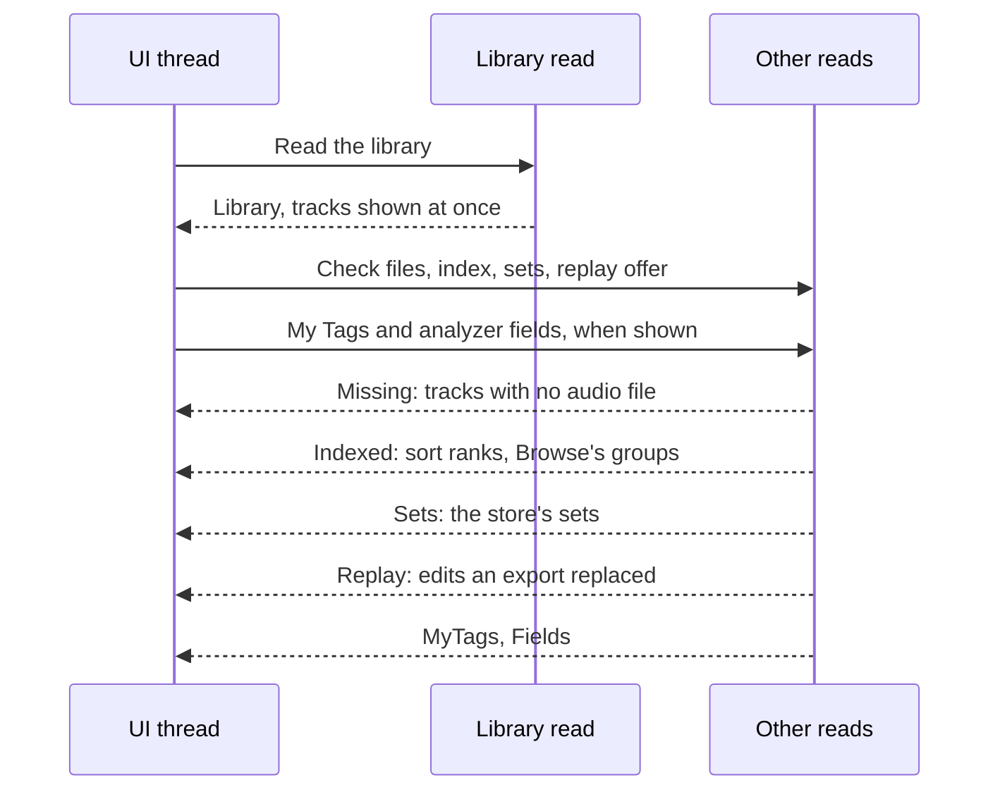

Source: [`src/tui/app/`](../../src/tui/app), [`src/tui/browse.rs`](../../src/tui/browse.rs)

## Changing a drive from the player

How a change goes from a key to the drive, and when it can still be stopped.

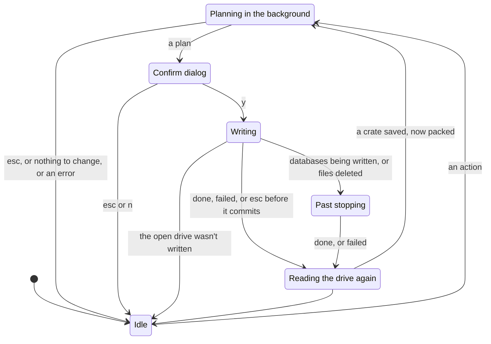

Source: [`src/tui/edits.rs`](../../src/tui/edits.rs), [`src/tui/app/`](../../src/tui/app)

## An unplugged drive in the player

What the player does when the open drive goes away. It looks each second.

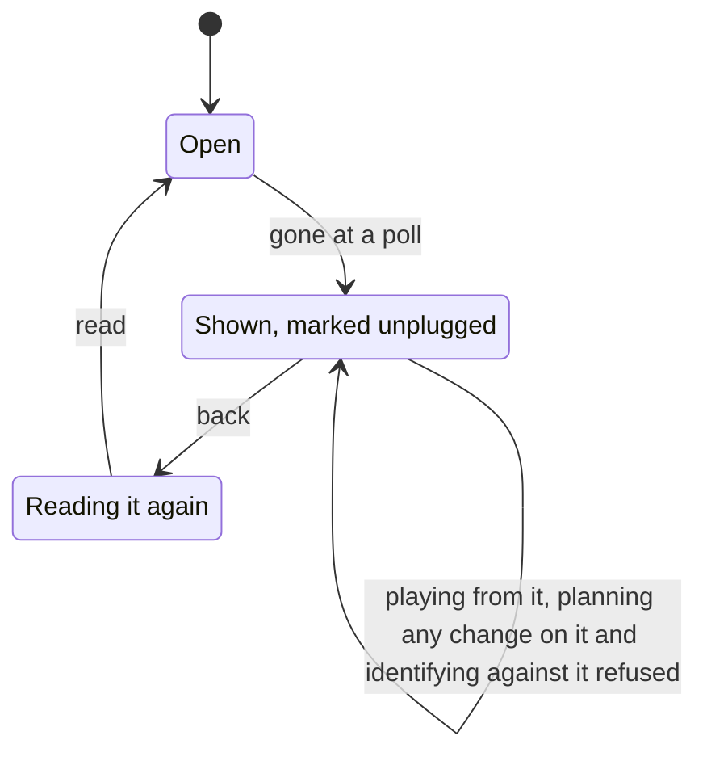

Source: [`src/tui/app/`](../../src/tui/app), [`src/tui/ui/`](../../src/tui/ui), [`src/tui/drives.rs`](../../src/tui/drives.rs), [`src/tui/mix.rs`](../../src/tui/mix.rs)

## Drives view rows

What each row of the Drives view is, and what `enter` and `e` do on it.

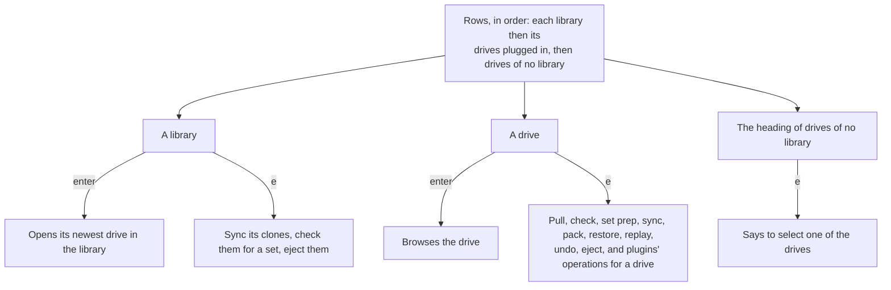

Source: [`src/tui/drives.rs`](../../src/tui/drives.rs), [`src/tui/ui/`](../../src/tui/ui)

## Search and filter

What the search box does as you type.

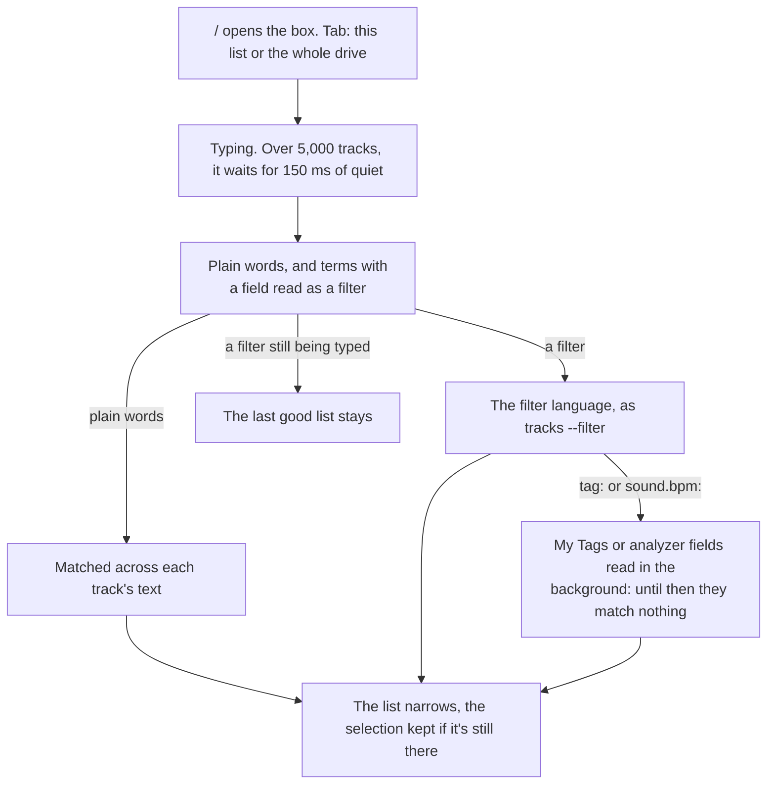

Source: [`src/tui/app/`](../../src/tui/app), [`src/tui/browse.rs`](../../src/tui/browse.rs), [`crates/locallibrary/src/query.rs`](../../../../crates/locallibrary/src/query.rs)

## Playback

The path from a file on a drive to the output, and what the UI reads back.

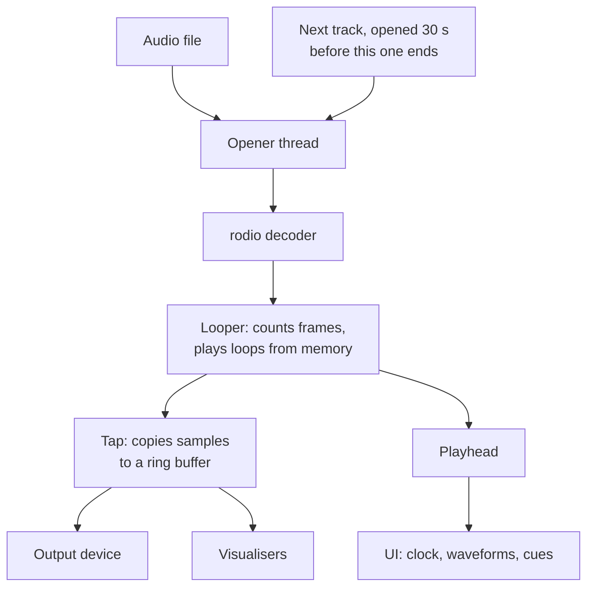

Source: [`src/tui/audio.rs`](../../src/tui/audio.rs), [`src/tui/deck.rs`](../../src/tui/deck.rs), [`src/tui/analyzer.rs`](../../src/tui/analyzer.rs), [`src/tui/app/`](../../src/tui/app)

## Output devices

The output the player plays through. Opening one never holds up the UI.

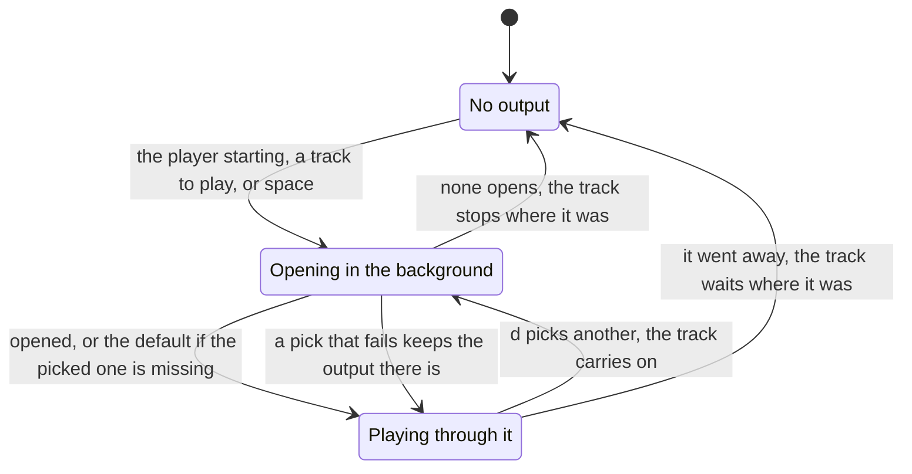

Source: [`src/tui/app/`](../../src/tui/app), [`src/tui/deck.rs`](../../src/tui/deck.rs), [`src/tui/audio.rs`](../../src/tui/audio.rs)

## Signing in from the player

The DJ account's sign-in on the Profile view, kept off the UI thread.

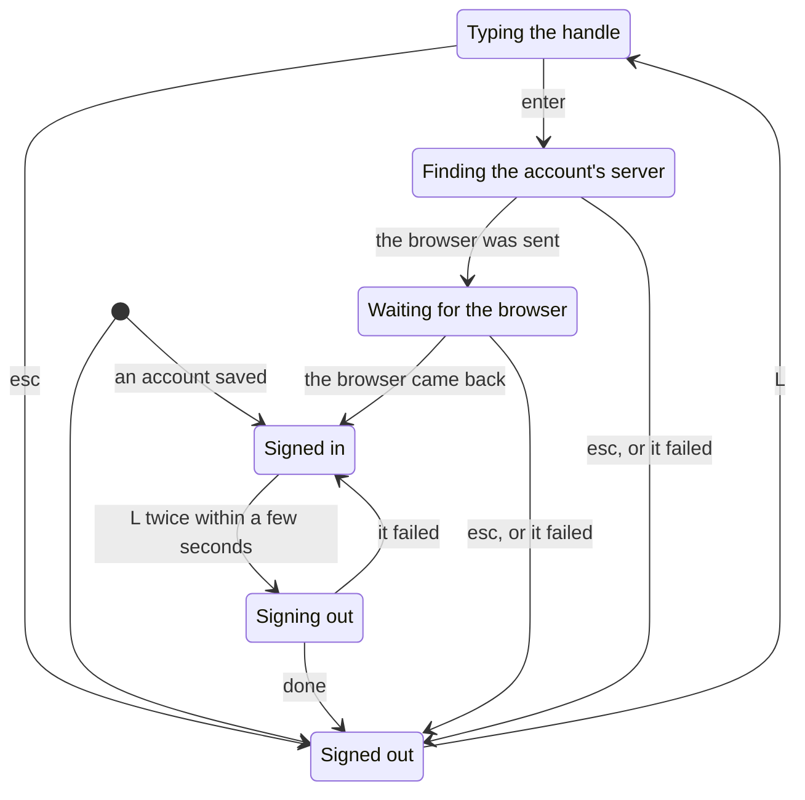

Source: [`src/tui/account.rs`](../../src/tui/account.rs), [`src/tui/profile.rs`](../../src/tui/profile.rs)

## Identifying in the Mixes view

What the Mixes view does with a recording, on a worker. An older run's answer is dropped.

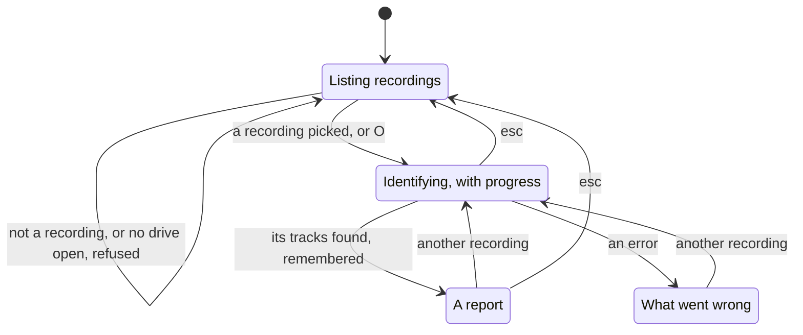

Source: [`src/tui/mix.rs`](../../src/tui/mix.rs), [`src/tui/app/`](../../src/tui/app)

## What the player remembers

What's saved between runs, and where it goes before there's a store.

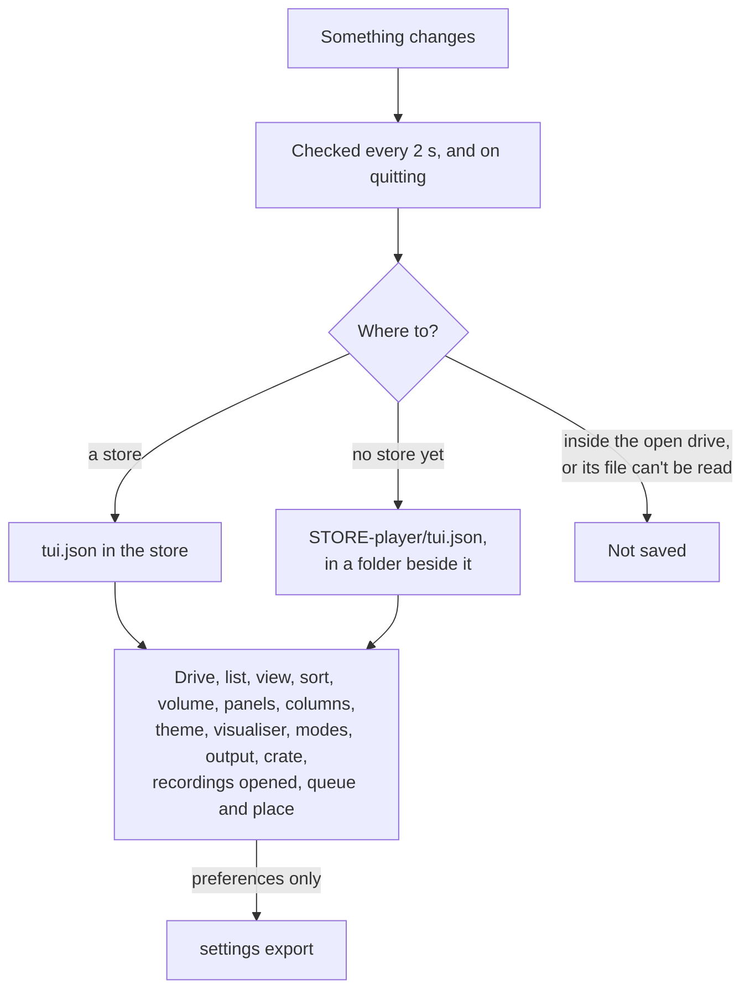

Source: [`src/tui/state.rs`](../../src/tui/state.rs), [`src/tui/app/`](../../src/tui/app), [`crates/locallibrary/src/store.rs`](../../../../crates/locallibrary/src/store.rs), [`crates/locallibrary/src/settings/transfer.rs`](../../../../crates/locallibrary/src/settings/transfer.rs)
