# locallibrary diagrams: Plugins

Loading, hooks, what a plugin can reach, events and services. The rest are listed in the [README](../../README.md#diagrams).

- [What plugins can add](#what-plugins-can-add)
- [Built-in plugins that work on a library](#built-in-plugins-that-work-on-a-library)
- [Built-in plugins that publish a set](#built-in-plugins-that-publish-a-set)
- [Loading plugins](#loading-plugins)
- [A plugin process's life](#a-plugin-processs-life)
- [Talking to a plugin](#talking-to-a-plugin)
- [Plugin question rounds](#plugin-question-rounds)
- [What a plugin can reach](#what-a-plugin-can-reach)
- [A plugin's net/fetch](#a-plugins-netfetch)
- [How plugins change a library](#how-plugins-change-a-library)
- [Plugins that write elsewhere](#plugins-that-write-elsewhere)
- [Running an analyzer](#running-an-analyzer)
- [Running checks and guards](#running-checks-and-guards)
- [Plugin panels](#plugin-panels)
- [Plugin settings and keys](#plugin-settings-and-keys)
- [Plugin events and suggestions](#plugin-events-and-suggestions)
- [A plugin service's life](#a-plugin-services-life)

## What plugins can add

Each thing a plugin's manifest can contribute, and the protocol method that asks for it.

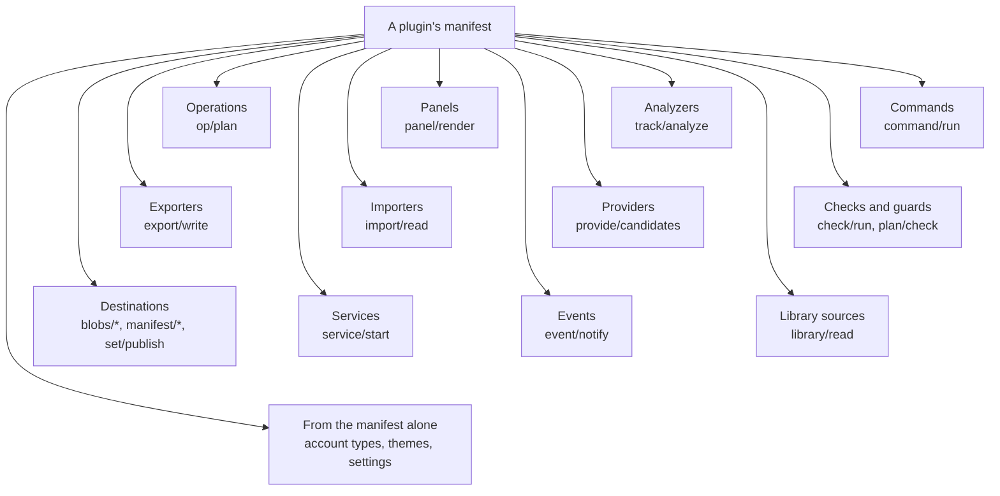

Source: [`crates/loclib-plugin/src/manifest.rs`](../../../../crates/loclib-plugin/src/manifest.rs), [`crates/loclib-plugin/src/hooks.rs`](../../../../crates/loclib-plugin/src/hooks.rs), [`crates/locallibrary/src/plugin.rs`](../../../../crates/locallibrary/src/plugin.rs)

## Built-in plugins that work on a library

The built-in plugins that read and change libraries, what each adds, and the servers it may reach.

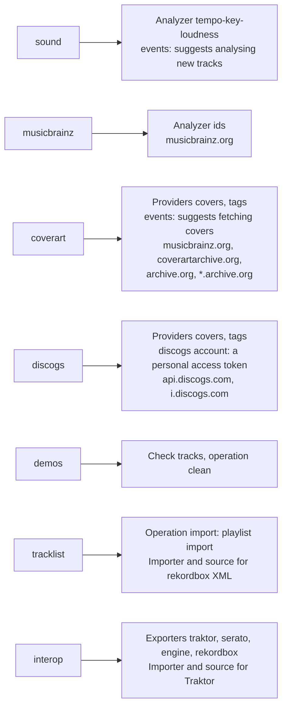

Source: [`plugins/sound/locallibrary-plugin.toml`](../../../../plugins/sound/locallibrary-plugin.toml), [`plugins/musicbrainz/locallibrary-plugin.toml`](../../../../plugins/musicbrainz/locallibrary-plugin.toml), [`plugins/coverart/locallibrary-plugin.toml`](../../../../plugins/coverart/locallibrary-plugin.toml), [`plugins/discogs/locallibrary-plugin.toml`](../../../../plugins/discogs/locallibrary-plugin.toml), [`plugins/demos/locallibrary-plugin.toml`](../../../../plugins/demos/locallibrary-plugin.toml), [`plugins/tracklist/locallibrary-plugin.toml`](../../../../plugins/tracklist/locallibrary-plugin.toml), [`plugins/interop/locallibrary-plugin.toml`](../../../../plugins/interop/locallibrary-plugin.toml)

## Built-in plugins that publish a set

Each set destination, the account type it uses, and how that account is signed in to. Browser sign-ins need each service's app registered: the manifests' client ids are placeholders so far.

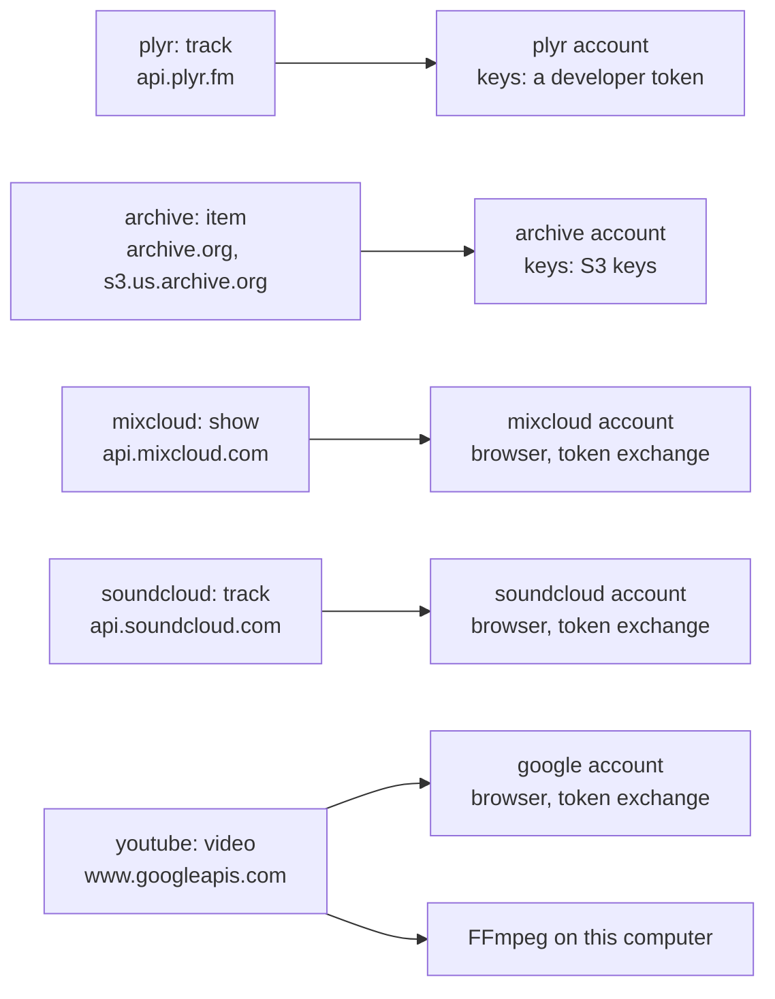

Source: [`plugins/plyr/locallibrary-plugin.toml`](../../../../plugins/plyr/locallibrary-plugin.toml), [`plugins/archive/locallibrary-plugin.toml`](../../../../plugins/archive/locallibrary-plugin.toml), [`plugins/mixcloud/locallibrary-plugin.toml`](../../../../plugins/mixcloud/locallibrary-plugin.toml), [`plugins/soundcloud/locallibrary-plugin.toml`](../../../../plugins/soundcloud/locallibrary-plugin.toml), [`plugins/youtube/locallibrary-plugin.toml`](../../../../plugins/youtube/locallibrary-plugin.toml), [`plugins/accounts`](../../../../plugins/accounts)

## Loading plugins

How the plugins in `plugins/` end up in a host. Only built-in plugins run. A clash is with a command, a sidecar method or another plugin, or an account nothing can meet.

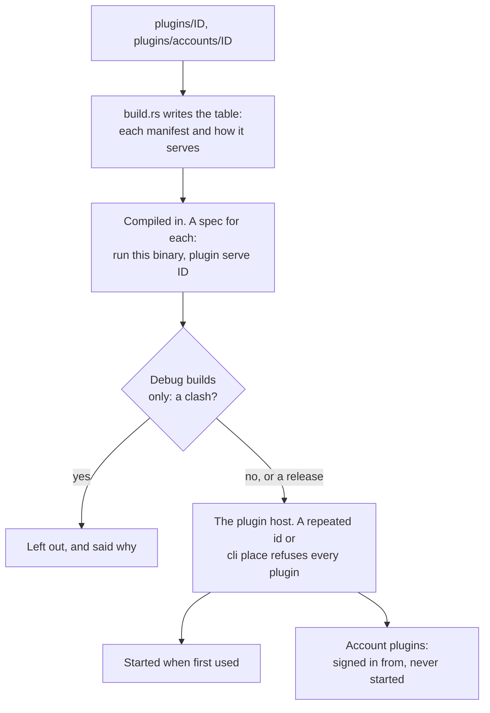

Source: [`build.rs`](../../build.rs), [`src/plugins.rs`](../../src/plugins.rs), [`crates/locallibrary/src/plugin.rs`](../../../../crates/locallibrary/src/plugin.rs)

## A plugin process's life

From first use to being stopped, and what happens when one misbehaves.

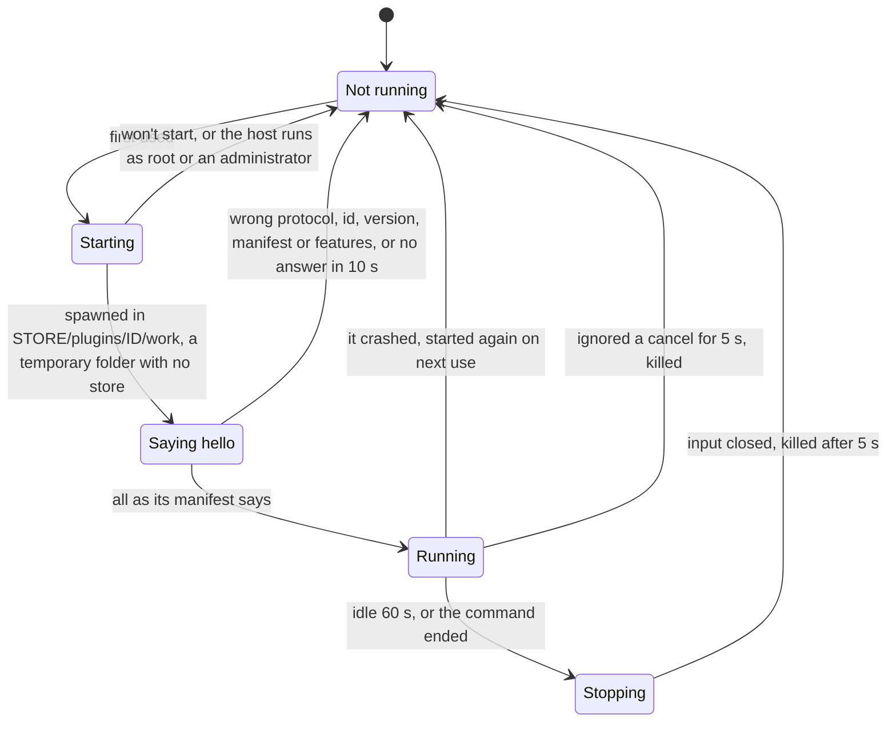

Source: [`crates/locallibrary/src/plugin/process.rs`](../../../../crates/locallibrary/src/plugin/process.rs), [`crates/locallibrary/src/plugin.rs`](../../../../crates/locallibrary/src/plugin.rs)

## Talking to a plugin

The protocol: JSON-RPC, one message a line over the plugin's stdin and stdout.

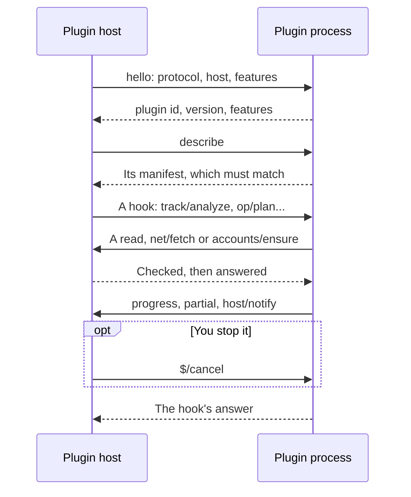

Source: [`crates/loclib-plugin/src/protocol.rs`](../../../../crates/loclib-plugin/src/protocol.rs), [`crates/locallibrary/src/plugin/process.rs`](../../../../crates/locallibrary/src/plugin/process.rs), [`crates/locallibrary/src/plugin/callbacks.rs`](../../../../crates/locallibrary/src/plugin/callbacks.rs)

## Plugin question rounds

What happens when a hook asks a question before it can answer.

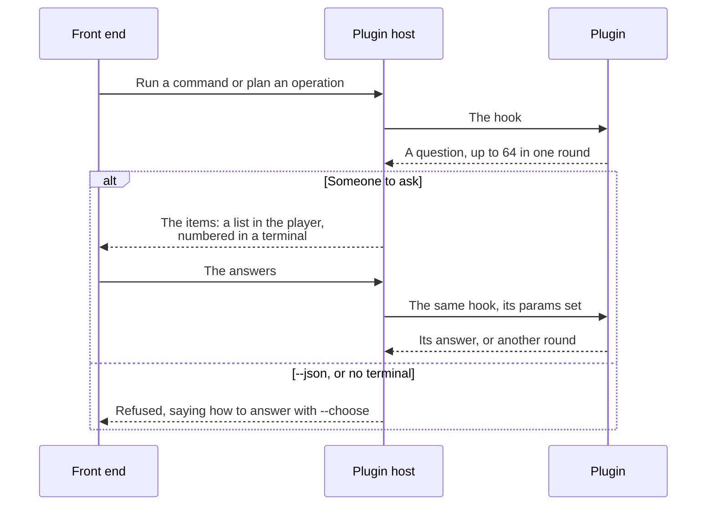

Source: [`crates/loclib-plugin/src/choice.rs`](../../../../crates/loclib-plugin/src/choice.rs), [`src/plugin_cmd/choose.rs`](../../src/plugin_cmd/choose.rs), [`src/tui/plugins.rs`](../../src/tui/plugins.rs), [`crates/locallibrary/src/plugin/operations.rs`](../../../../crates/locallibrary/src/plugin/operations.rs), [`crates/locallibrary/src/plugin/commands.rs`](../../../../crates/locallibrary/src/plugin/commands.rs)

## What a plugin can reach

The limits the host keeps. Your system doesn't enforce them: a plugin runs as you, isn't sandboxed, and could read any file you can.

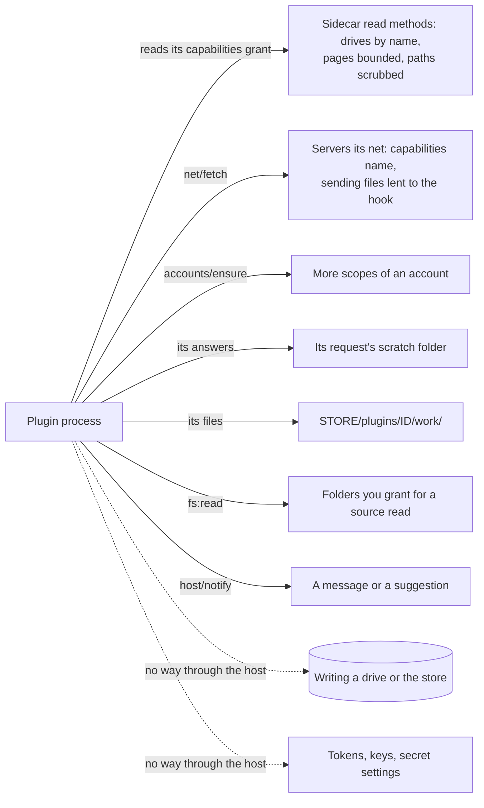

Source: [`crates/locallibrary/src/plugin/callbacks.rs`](../../../../crates/locallibrary/src/plugin/callbacks.rs), [`crates/locallibrary/src/plugin/net.rs`](../../../../crates/locallibrary/src/plugin/net.rs), [`crates/locallibrary/src/plugin/blobs.rs`](../../../../crates/locallibrary/src/plugin/blobs.rs), [`crates/locallibrary/src/plugin/secrets.rs`](../../../../crates/locallibrary/src/plugin/secrets.rs), [`crates/loclib-plugin/src/manifest.rs`](../../../../crates/loclib-plugin/src/manifest.rs), [`docs/plugins.md`](../plugins.md)

## A plugin's net/fetch

What the host checks before a plugin's request leaves, and what it does with the answer.

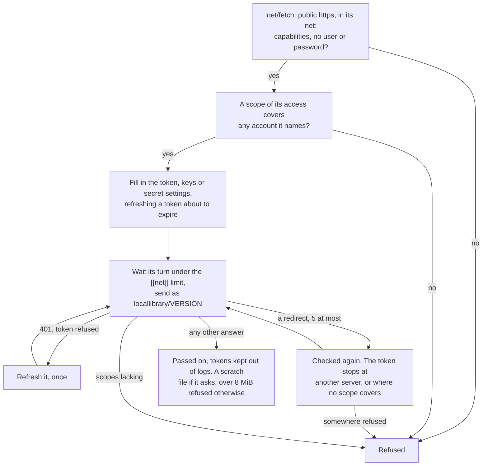

Source: [`crates/locallibrary/src/plugin/net.rs`](../../../../crates/locallibrary/src/plugin/net.rs), [`crates/locallibrary/src/plugin/accounts/token.rs`](../../../../crates/locallibrary/src/plugin/accounts/token.rs), [`crates/locallibrary/src/plugin/accounts.rs`](../../../../crates/locallibrary/src/plugin/accounts.rs)

## How plugins change a library

Plugins never write to a drive. What each kind of hook answers becomes a plan the host makes.

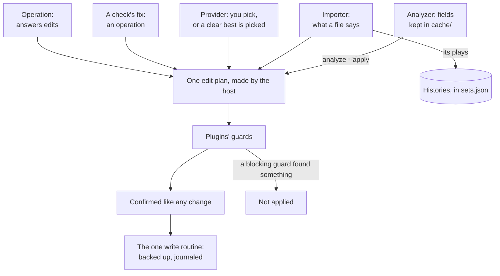

Source: [`crates/locallibrary/src/plugin/operations.rs`](../../../../crates/locallibrary/src/plugin/operations.rs), [`crates/locallibrary/src/plugin/providers.rs`](../../../../crates/locallibrary/src/plugin/providers.rs), [`crates/locallibrary/src/plugin/imports.rs`](../../../../crates/locallibrary/src/plugin/imports.rs), [`crates/locallibrary/src/plugin/analyzers.rs`](../../../../crates/locallibrary/src/plugin/analyzers.rs), [`crates/locallibrary/src/plugin/apply.rs`](../../../../crates/locallibrary/src/plugin/apply.rs), [`crates/locallibrary/src/plugin/sources.rs`](../../../../crates/locallibrary/src/plugin/sources.rs), [`crates/locallibrary/src/plugin/exports.rs`](../../../../crates/locallibrary/src/plugin/exports.rs)

## Plugins that write elsewhere

Two hooks that write files without an edit plan, and what the host checks.

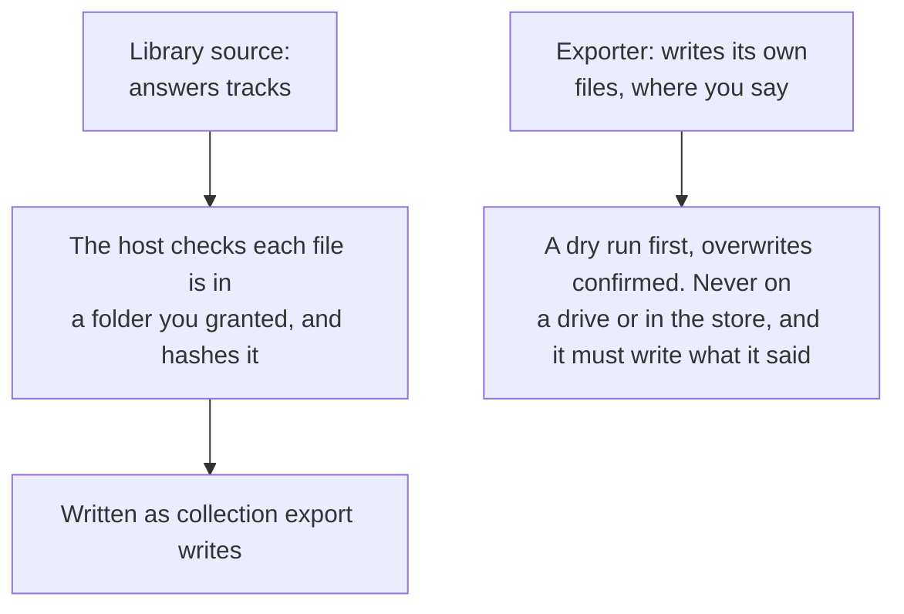

Source: [`crates/locallibrary/src/plugin/sources.rs`](../../../../crates/locallibrary/src/plugin/sources.rs), [`crates/locallibrary/src/plugin/exports.rs`](../../../../crates/locallibrary/src/plugin/exports.rs), [`crates/locallibrary/src/collection_export.rs`](../../../../crates/locallibrary/src/collection_export.rs)

## Running an analyzer

`track/analyze` over a drive's tracks. Each audio file is handed to the plugin read only.

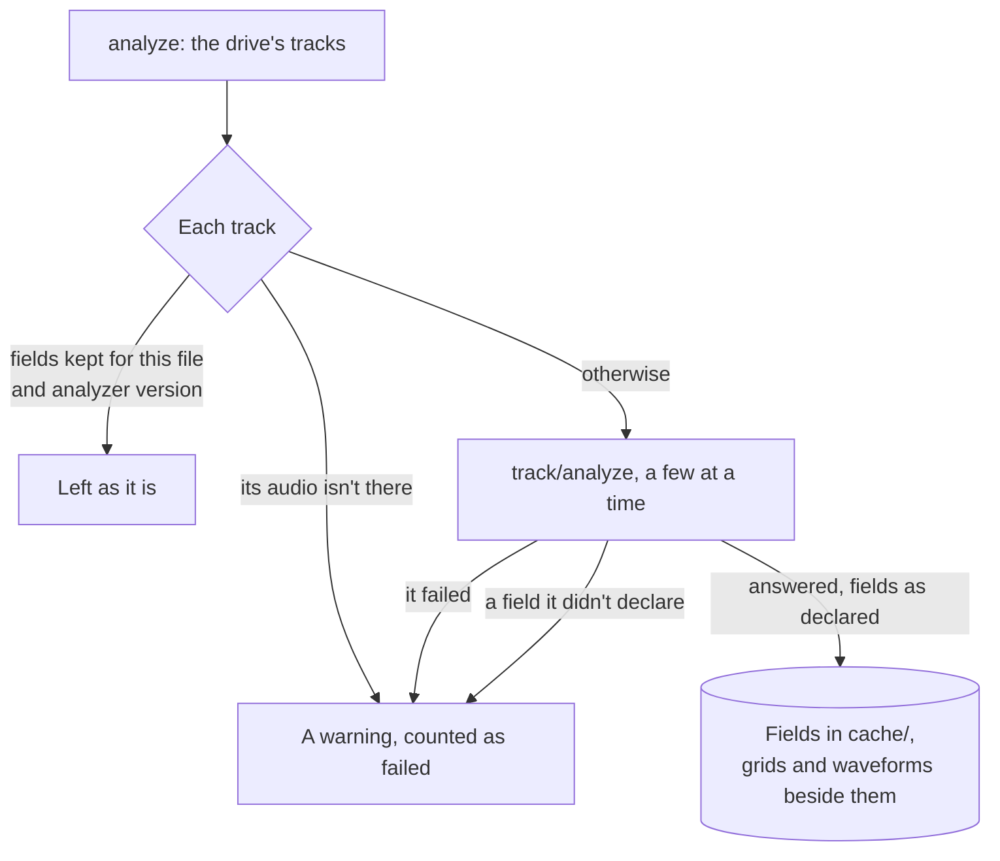

Source: [`crates/locallibrary/src/plugin/analyzers.rs`](../../../../crates/locallibrary/src/plugin/analyzers.rs), [`crates/locallibrary/src/fields.rs`](../../../../crates/locallibrary/src/fields.rs), [`src/plugin_cmd/analyze.rs`](../../src/plugin_cmd/analyze.rs)

## Running checks and guards

How a plugin's check is held to its time, for `check`, `doctor` and plans.

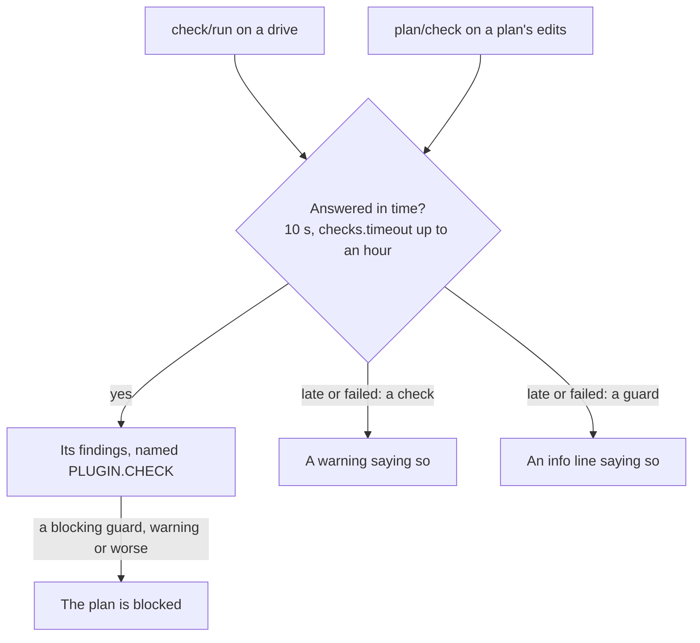

Source: [`crates/locallibrary/src/plugin/checks.rs`](../../../../crates/locallibrary/src/plugin/checks.rs), [`src/plugin_cmd/checks.rs`](../../src/plugin_cmd/checks.rs)

## Plugin panels

A panel under a track's details in the player. Nothing a plugin does runs as a frame is drawn.

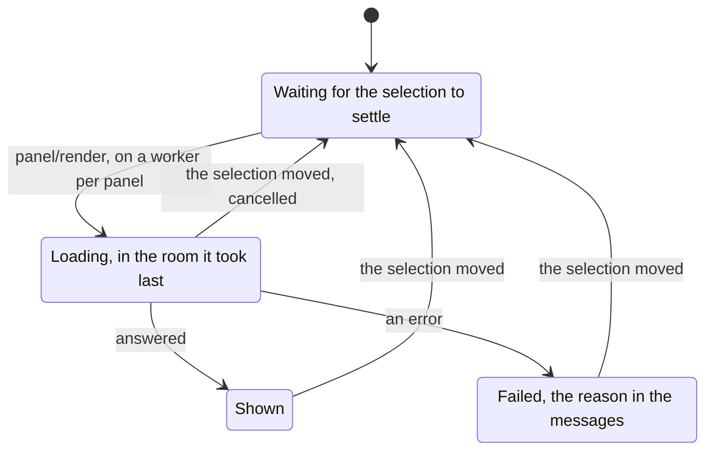

Source: [`src/tui/plugins/panels.rs`](../../src/tui/plugins/panels.rs), [`crates/locallibrary/src/plugin/panels.rs`](../../../../crates/locallibrary/src/plugin/panels.rs)

## Plugin settings and keys

Where what you set for a plugin goes, from `plugin settings` or the player's form.

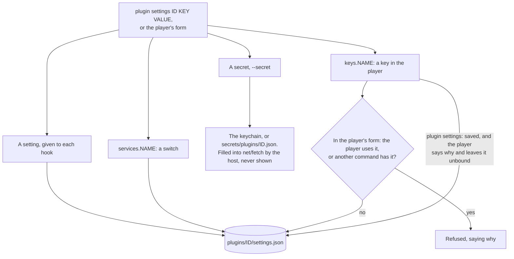

Source: [`crates/locallibrary/src/plugin/settings.rs`](../../../../crates/locallibrary/src/plugin/settings.rs), [`crates/locallibrary/src/plugin/secrets.rs`](../../../../crates/locallibrary/src/plugin/secrets.rs), [`src/tui/keymap/bound.rs`](../../src/tui/keymap/bound.rs), [`src/tui/plugins.rs`](../../src/tui/plugins.rs)

## Plugin events and suggestions

What plugins are told, and how what they say back reaches you.

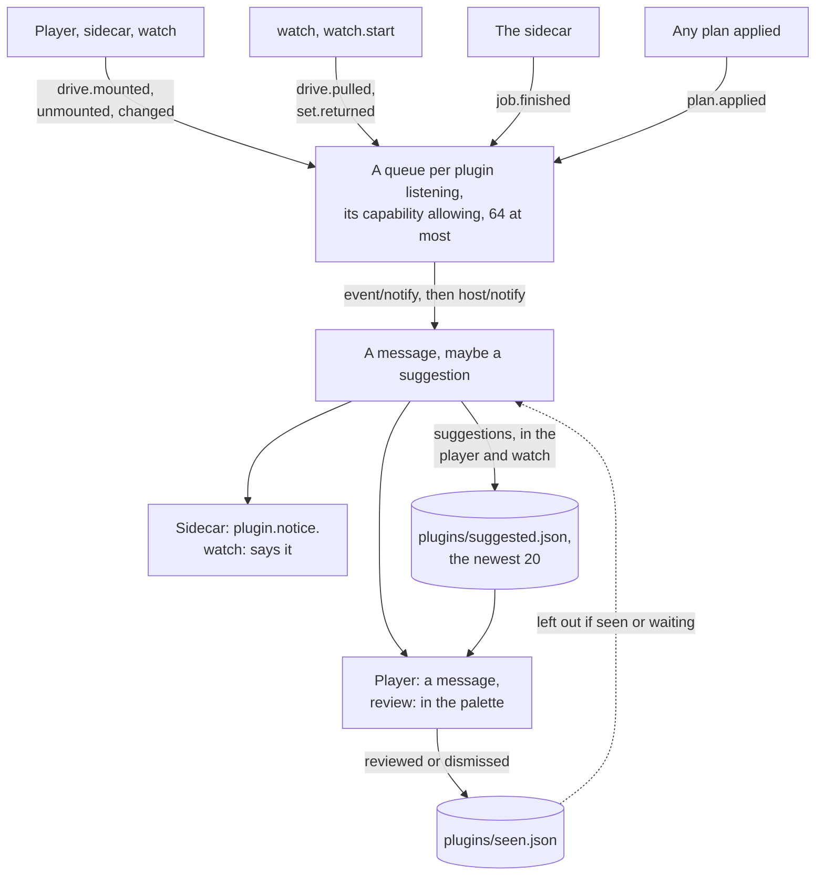

Source: [`crates/locallibrary/src/plugin/events.rs`](../../../../crates/locallibrary/src/plugin/events.rs), [`src/plugins/events.rs`](../../src/plugins/events.rs), [`src/tui/plugins/events.rs`](../../src/tui/plugins/events.rs), [`crates/locallibrary/src/op.rs`](../../../../crates/locallibrary/src/op.rs)

## A plugin service's life

A service runs only in a host that stays open: the player, the sidecar or `watch`.

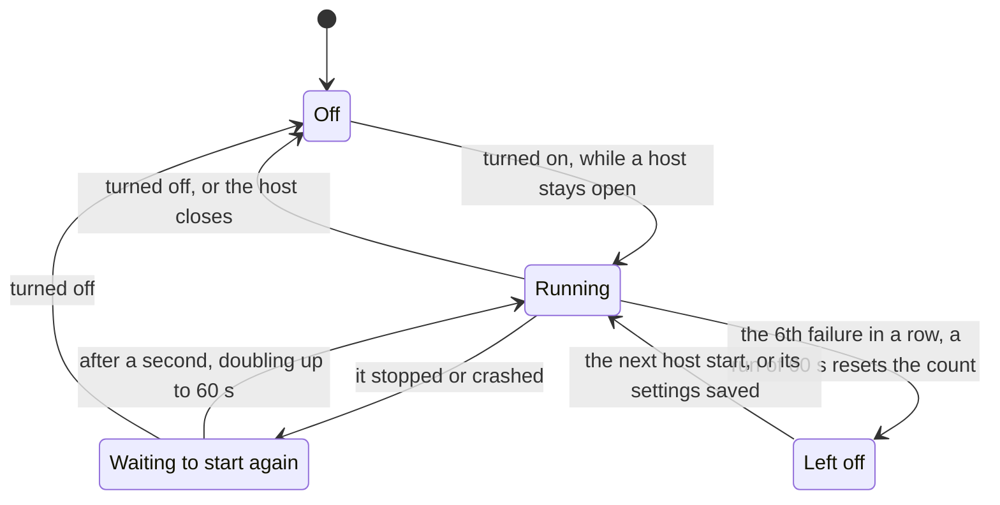

Source: [`crates/locallibrary/src/plugin/services.rs`](../../../../crates/locallibrary/src/plugin/services.rs), [`crates/locallibrary/src/plugin.rs`](../../../../crates/locallibrary/src/plugin.rs)
