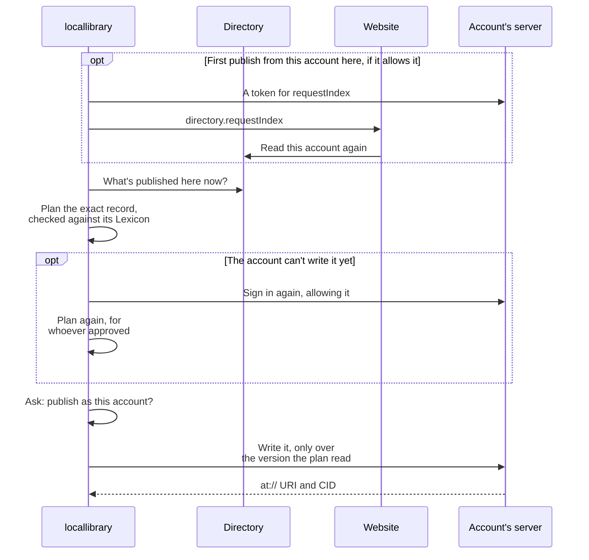
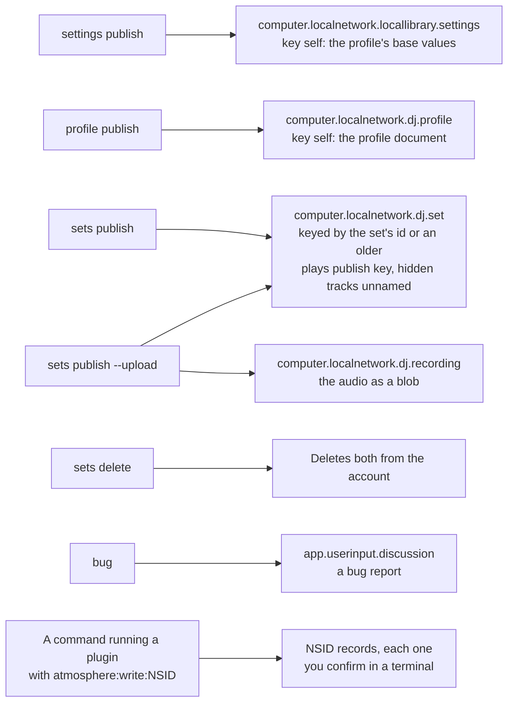
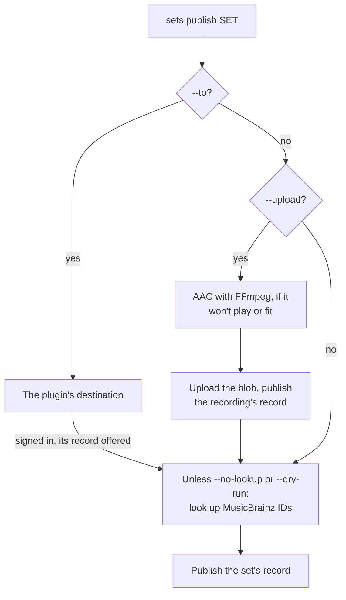
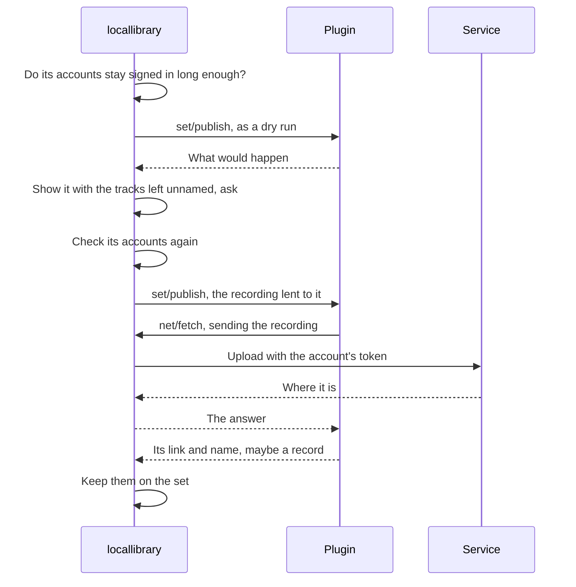
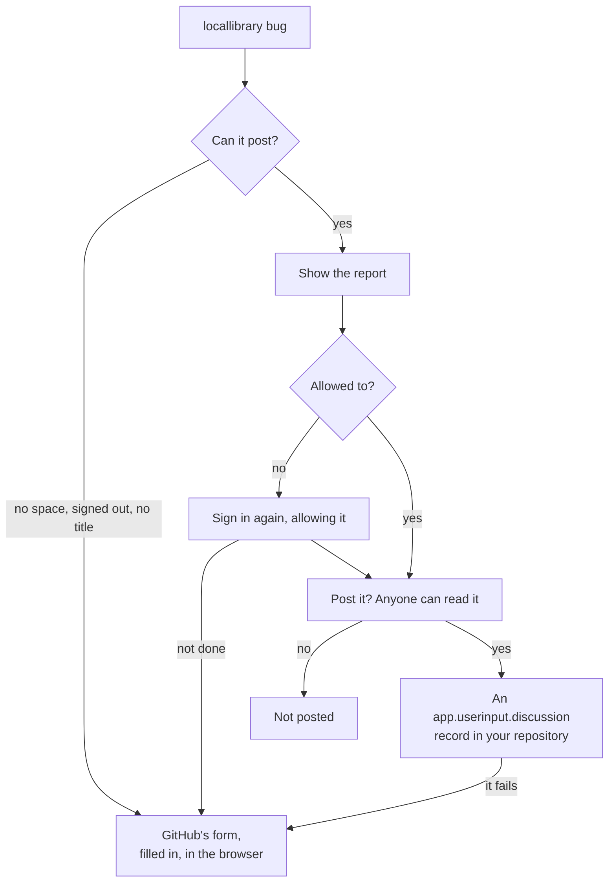
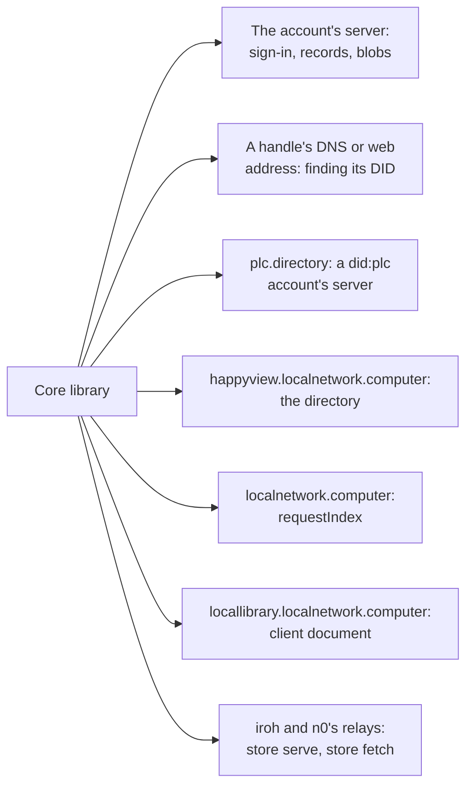
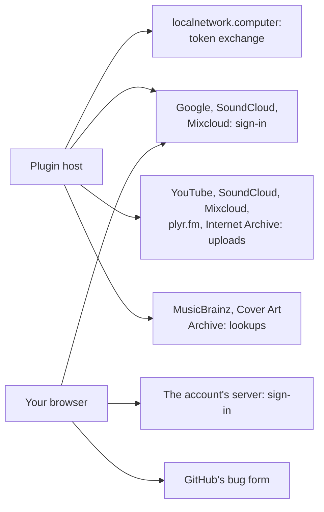
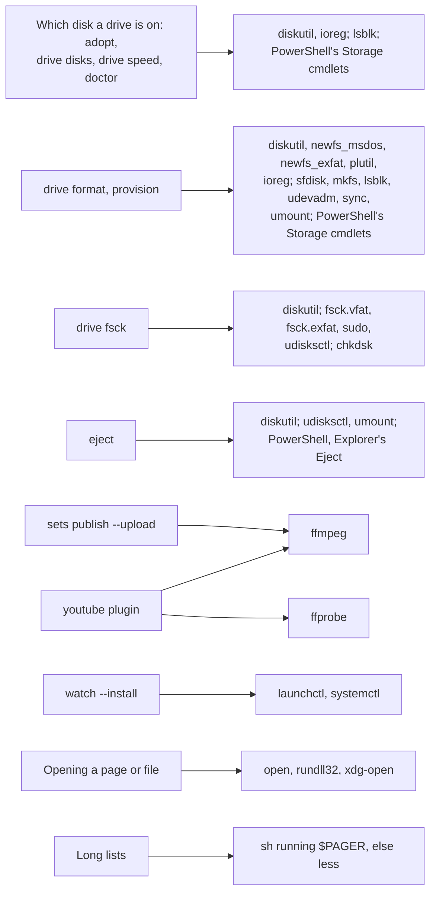

# locallibrary diagrams: Publishing and services

Records, sets, bug reports, online services and other programs. The rest are listed in the [README](../../README.md#diagrams).

- [Publishing a record](#publishing-a-record)
- [What each command publishes](#what-each-command-publishes)
- [Publishing a set](#publishing-a-set)
- [Publishing at a set destination](#publishing-at-a-set-destination)
- [Reporting a bug](#reporting-a-bug)
- [Online services of the core library](#online-services-of-the-core-library)
- [Online services of plugins and the browser](#online-services-of-plugins-and-the-browser)
- [Programs on this computer](#programs-on-this-computer)

## Publishing a record

How My Settings, the profile and a set reach the DJ account. Reads go through Local Network's directory, writes to the account's own server. A record unchanged since it was published stops before asking.

Source: [`crates/locallibrary/src/publish.rs`](../../../../crates/locallibrary/src/publish.rs), [`crates/locallibrary/src/api/publish.rs`](../../../../crates/locallibrary/src/api/publish.rs), [`crates/locallibrary/src/atmosphere/directory.rs`](../../../../crates/locallibrary/src/atmosphere/directory.rs), [`crates/locallibrary/src/atmosphere/repo.rs`](../../../../crates/locallibrary/src/atmosphere/repo.rs), [`crates/locallibrary/src/atmosphere/lexicon.rs`](../../../../crates/locallibrary/src/atmosphere/lexicon.rs), [`src/publish_cmd.rs`](../../src/publish_cmd.rs)

## What each command publishes

The record types locallibrary writes to the DJ account. Per-drive overrides, notes, paths and sessions stay on this computer.

Source: [`crates/locallibrary/src/publish.rs`](../../../../crates/locallibrary/src/publish.rs), [`crates/locallibrary/src/atmosphere/lexicon.rs`](../../../../crates/locallibrary/src/atmosphere/lexicon.rs), [`crates/locallibrary/src/api/publish.rs`](../../../../crates/locallibrary/src/api/publish.rs), [`docs/account.md`](../account.md), [`crates/locallibrary/src/plugin/atmosphere.rs`](../../../../crates/locallibrary/src/plugin/atmosphere.rs), [`lexicons/computer/localnetwork`](../../../../lexicons/computer/localnetwork)

## Publishing a set

The ways `sets publish` can go, in the order things happen.

Source: [`src/sets_cmd.rs`](../../src/sets_cmd.rs), [`src/publish_cmd.rs`](../../src/publish_cmd.rs), [`src/plugins/roles.rs`](../../src/plugins/roles.rs), [`crates/locallibrary/src/publish/recording.rs`](../../../../crates/locallibrary/src/publish/recording.rs), [`crates/locallibrary/src/api/publish.rs`](../../../../crates/locallibrary/src/api/publish.rs)

## Publishing at a set destination

How a plugin publishes a set's recording. Publishing needs a yes: asked, or `--yes`.

Source: [`crates/locallibrary/src/plugin/destinations/publish.rs`](../../../../crates/locallibrary/src/plugin/destinations/publish.rs), [`crates/locallibrary/src/plugin/accounts/ready.rs`](../../../../crates/locallibrary/src/plugin/accounts/ready.rs), [`src/sets_cmd.rs`](../../src/sets_cmd.rs), [`plugins/youtube/src/render.rs`](../../../../plugins/youtube/src/render.rs)

## Reporting a bug

Where `bug` sends a report. Until Local Network has a space on userinput.app, every report goes to GitHub.

Source: [`src/bug_cmd.rs`](../../src/bug_cmd.rs), [`crates/locallibrary/src/atmosphere/bug_report.rs`](../../../../crates/locallibrary/src/atmosphere/bug_report.rs)

## Online services of the core library

What the core library reaches itself. Nothing here is needed to sync drives.

Source: [`crates/locallibrary/src/atmosphere/mod.rs`](../../../../crates/locallibrary/src/atmosphere/mod.rs), [`crates/locallibrary/src/atmosphere/identity.rs`](../../../../crates/locallibrary/src/atmosphere/identity.rs), [`crates/locallibrary/src/atmosphere/directory.rs`](../../../../crates/locallibrary/src/atmosphere/directory.rs), [`crates/locallibrary/src/atmosphere/repo.rs`](../../../../crates/locallibrary/src/atmosphere/repo.rs), [`crates/locallibrary/src/peers/mod.rs`](../../../../crates/locallibrary/src/peers/mod.rs)

## Online services of plugins and the browser

What the plugin host reaches for plugins and account plugins, and what opens in your browser.

Source: [`crates/locallibrary/src/plugin/net.rs`](../../../../crates/locallibrary/src/plugin/net.rs), [`crates/locallibrary/src/plugin/accounts.rs`](../../../../crates/locallibrary/src/plugin/accounts.rs), [`src/bug_cmd.rs`](../../src/bug_cmd.rs), [`plugins/accounts`](../../../../plugins/accounts)

## Programs on this computer

The other programs locallibrary runs, and what for.

Source: [`crates/locallibrary/src/format/mod.rs`](../../../../crates/locallibrary/src/format/mod.rs), [`crates/locallibrary/src/fleet.rs`](../../../../crates/locallibrary/src/fleet.rs), [`crates/locallibrary/src/api/drive_speed.rs`](../../../../crates/locallibrary/src/api/drive_speed.rs), [`crates/locallibrary/src/fscheck.rs`](../../../../crates/locallibrary/src/fscheck.rs), [`crates/locallibrary/src/eject.rs`](../../../../crates/locallibrary/src/eject.rs), [`crates/locallibrary/src/publish/recording.rs`](../../../../crates/locallibrary/src/publish/recording.rs), [`plugins/youtube/src/render.rs`](../../../../plugins/youtube/src/render.rs), [`src/autostart.rs`](../../src/autostart.rs), [`crates/locallibrary/src/opener.rs`](../../../../crates/locallibrary/src/opener.rs), [`src/pager.rs`](../../src/pager.rs)
