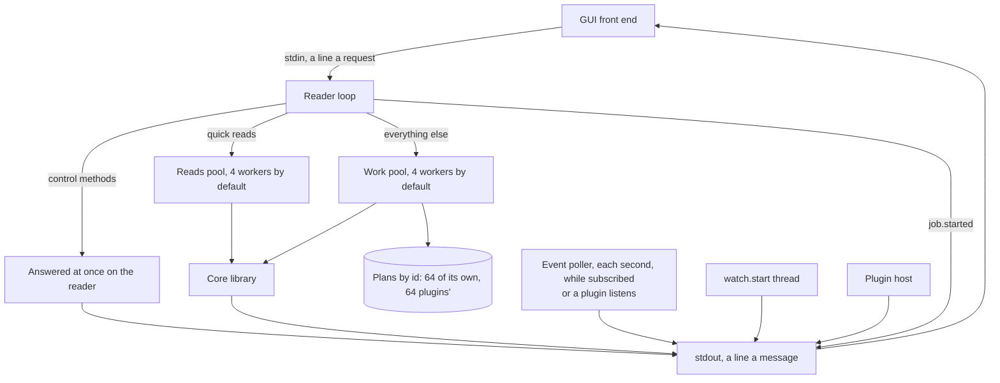
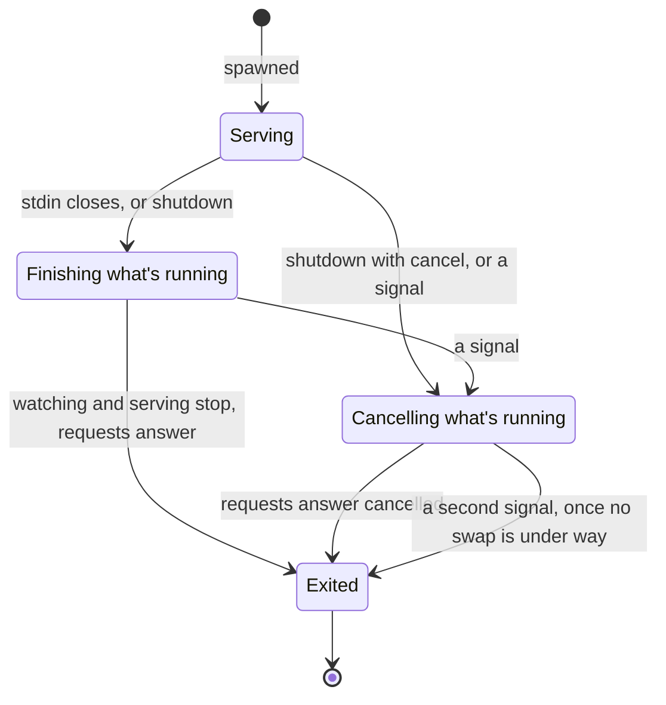
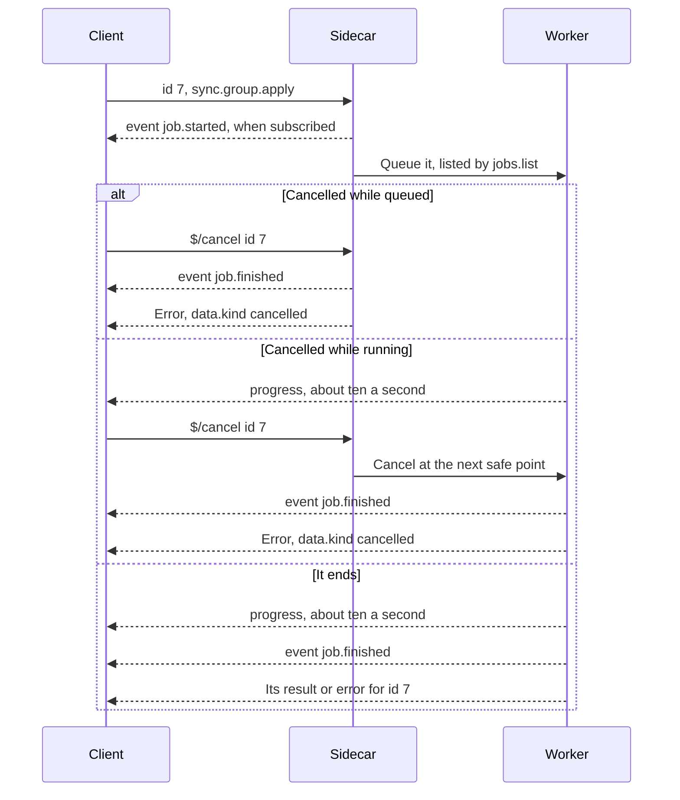
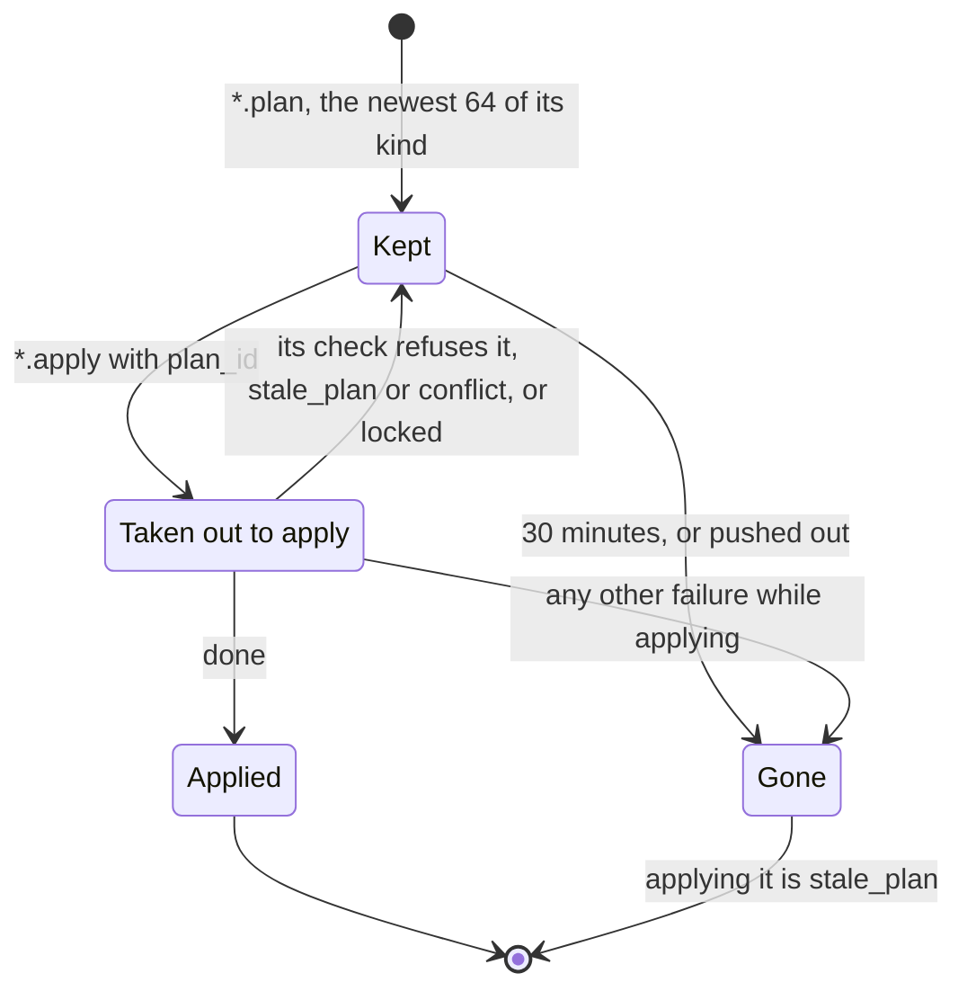
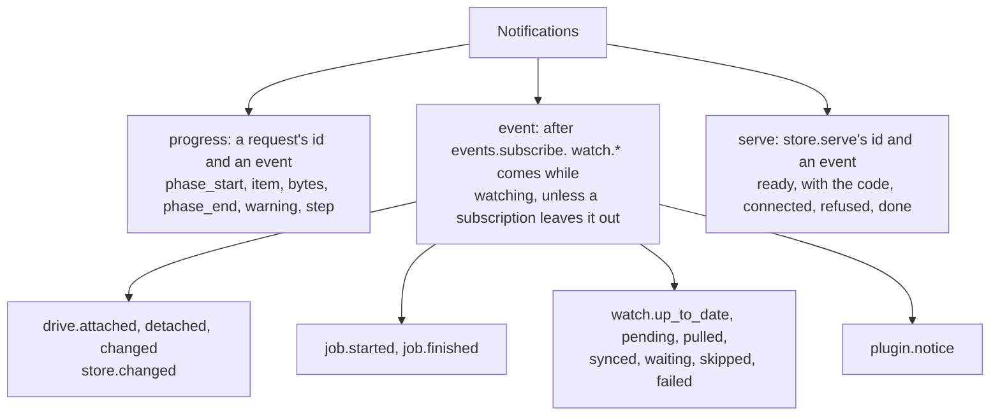
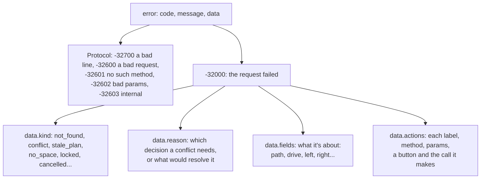
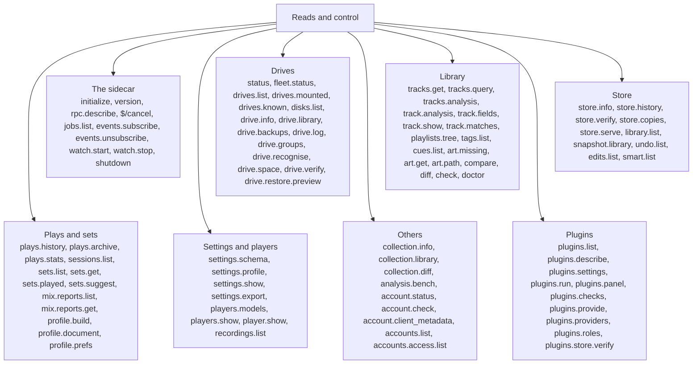
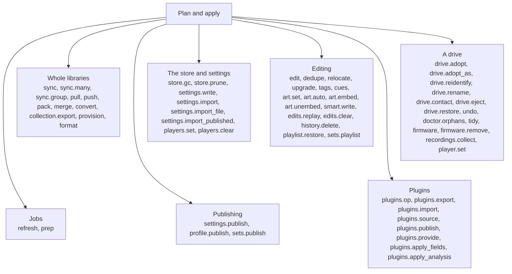
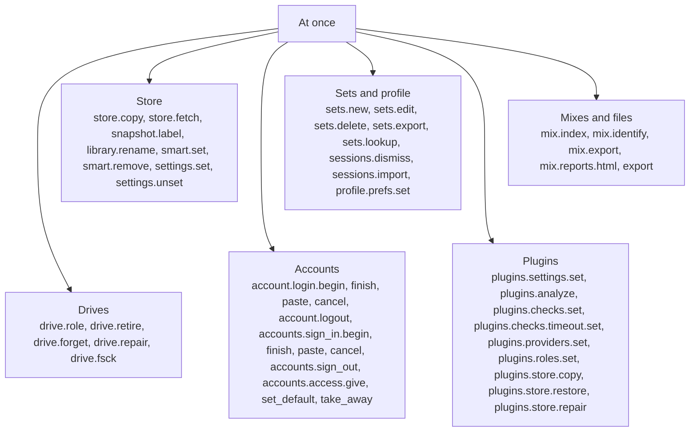
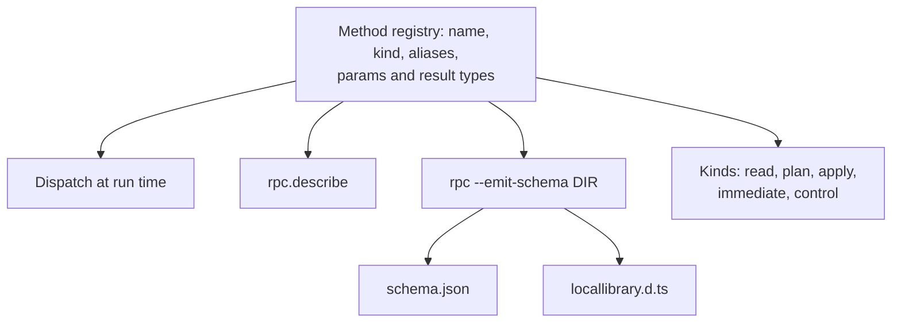

# locallibrary diagrams: the sidecar

Its lifecycle, requests, plans, every method and its contract. The rest are listed in the [README](../../README.md#diagrams).

- [How the sidecar is wired](#how-the-sidecar-is-wired)
- [A sidecar's lifecycle](#a-sidecars-lifecycle)
- [A sidecar request](#a-sidecar-request)
- [Plans in the sidecar](#plans-in-the-sidecar)
- [Sidecar notifications](#sidecar-notifications)
- [Sidecar errors](#sidecar-errors)
- [Sidecar methods that read](#sidecar-methods-that-read)
- [Sidecar plans](#sidecar-plans)
- [Sidecar changes made at once](#sidecar-changes-made-at-once)
- [Sidecar contract](#sidecar-contract)

## How the sidecar is wired

`locallibrary rpc` speaks newline-delimited JSON-RPC 2.0 on stdin and stdout, and nothing else. Only a trusted parent should run it.

Source: [`src/rpc.rs`](../../src/rpc.rs), [`src/rpc/methods.rs`](../../src/rpc/methods.rs), [`docs/sidecar.md`](../sidecar.md)

## A sidecar's lifecycle

From being spawned to exiting, and what happens to requests still running.

Source: [`src/rpc.rs`](../../src/rpc.rs)

## A sidecar request

What a client sees for a long request, from its id to the answer.

Source: [`src/rpc.rs`](../../src/rpc.rs), [`crates/locallibrary/src/api/sidecar.rs`](../../../../crates/locallibrary/src/api/sidecar.rs), [`docs/sidecar.md`](../sidecar.md)

## Plans in the sidecar

What happens to a plan the sidecar keeps by `plan_id`.

Source: [`src/rpc.rs`](../../src/rpc.rs), [`src/rpc/methods.rs`](../../src/rpc/methods.rs), [`docs/sidecar.md`](../sidecar.md)

## Sidecar notifications

What the sidecar sends with no request id of its own.

Source: [`src/rpc.rs`](../../src/rpc.rs), [`crates/locallibrary/src/api/sidecar.rs`](../../../../crates/locallibrary/src/api/sidecar.rs), [`docs/rpc/schema.json`](../rpc/schema.json)

## Sidecar errors

The shape of an error, which a GUI can act on without reading its message.

Source: [`src/rpc.rs`](../../src/rpc.rs), [`crates/locallibrary/src/api/sidecar.rs`](../../../../crates/locallibrary/src/api/sidecar.rs), [`crates/locallibrary/src/error.rs`](../../../../crates/locallibrary/src/error.rs), [`docs/sidecar.md`](../sidecar.md)

## Sidecar methods that read

The `read` and `control` methods, by what they're about.

Source: [`src/rpc/methods.rs`](../../src/rpc/methods.rs), [`src/rpc/methods/accounts.rs`](../../src/rpc/methods/accounts.rs), [`src/rpc/methods/plugins.rs`](../../src/rpc/methods/plugins.rs), [`docs/rpc/schema.json`](../rpc/schema.json)

## Sidecar plans

Every change that comes as a `.plan` and `.apply` pair.

Source: [`src/rpc/methods.rs`](../../src/rpc/methods.rs), [`src/rpc/methods/accounts.rs`](../../src/rpc/methods/accounts.rs), [`src/rpc/methods/plugins.rs`](../../src/rpc/methods/plugins.rs), [`docs/rpc/schema.json`](../rpc/schema.json)

## Sidecar changes made at once

The `immediate` methods: small changes and long runs with no plan step.

Source: [`src/rpc/methods.rs`](../../src/rpc/methods.rs), [`src/rpc/methods/accounts.rs`](../../src/rpc/methods/accounts.rs), [`src/rpc/methods/plugins.rs`](../../src/rpc/methods/plugins.rs), [`docs/rpc/schema.json`](../rpc/schema.json)

## Sidecar contract

One list of methods answers everything: dispatch, `rpc.describe`, and the files in `docs/rpc`. A build without the `account` feature lacks `account.*`, the `*.publish.*` methods, `sets.lookup` and `settings.import_published.*`. One without `peers` lacks `store.serve` and `store.fetch`.

Source: [`src/rpc/methods.rs`](../../src/rpc/methods.rs), [`src/rpc/contract.rs`](../../src/rpc/contract.rs), [`src/rpc/typescript.rs`](../../src/rpc/typescript.rs), [`docs/rpc/schema.json`](../rpc/schema.json), [`docs/rpc/locallibrary.d.ts`](../rpc/locallibrary.d.ts)
