# locallibrary diagrams: the store and drives

What's in the store and on a drive, pull, push, copies and checks. The rest are listed in the [README](../../README.md#diagrams).

- [Store records](#store-records)
- [Inside the store folder](#inside-the-store-folder)
- [Inside a drive](#inside-a-drive)
- [The .locallibrary folder](#the-locallibrary-folder)
- [Saving a drive with pull](#saving-a-drive-with-pull)
- [Writing a snapshot with library push](#writing-a-snapshot-with-library-push)
- [Copies of the store](#copies-of-the-store)
- [Serving a store to another computer](#serving-a-store-to-another-computer)
- [What a fetch does to each library](#what-a-fetch-does-to-each-library)
- [Pruning and collecting](#pruning-and-collecting)
- [Watching drives](#watching-drives)
- [A drive's life](#a-drives-life)
- [Checking drives](#checking-drives)
- [Repairing a drive](#repairing-a-drive)
- [Clearing a drive](#clearing-a-drive)
- [What's using a drive](#whats-using-a-drive)
- [Recordings and firmware](#recordings-and-firmware)

## Store records

What the store's records say about each other.

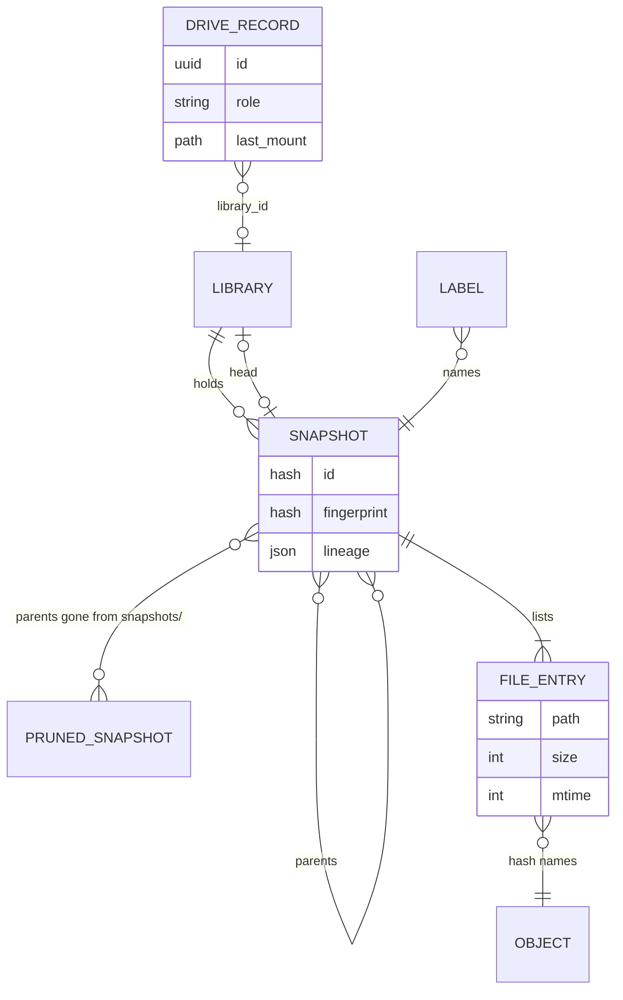

Source: [`crates/locallibrary/src/store.rs`](../../../../crates/locallibrary/src/store.rs), [`crates/locallibrary/src/tree.rs`](../../../../crates/locallibrary/src/tree.rs)

## Inside the store folder

What the store keeps, by what it's for. `~/Library/Application Support/locallibrary` on a Mac, or `--store` and `$LOCALLIBRARY_STORE`.

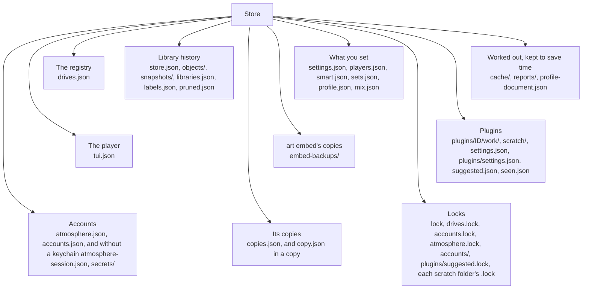

Source: [`crates/locallibrary/src/store.rs`](../../../../crates/locallibrary/src/store.rs), [`crates/locallibrary/src/plugin/settings.rs`](../../../../crates/locallibrary/src/plugin/settings.rs), [`crates/locallibrary/src/plugin/accounts/kept.rs`](../../../../crates/locallibrary/src/plugin/accounts/kept.rs), [`crates/locallibrary/src/atmosphere/store.rs`](../../../../crates/locallibrary/src/atmosphere/store.rs), [`crates/locallibrary/src/audio_cache.rs`](../../../../crates/locallibrary/src/audio_cache.rs), [`crates/locallibrary/src/offsite.rs`](../../../../crates/locallibrary/src/offsite.rs)

## Inside a drive

Each kind of file on a drive, and what locallibrary does with it.

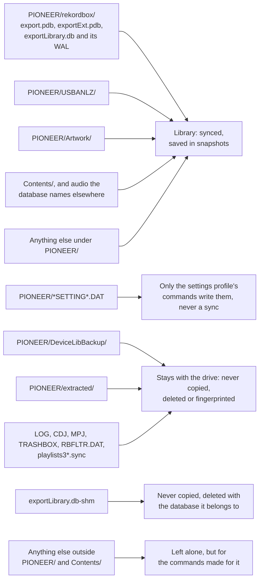

Source: [`crates/locallibrary/src/paths.rs`](../../../../crates/locallibrary/src/paths.rs), [`crates/locallibrary/src/sync.rs`](../../../../crates/locallibrary/src/sync.rs), [`crates/locallibrary/src/settings.rs`](../../../../crates/locallibrary/src/settings.rs)

## The .locallibrary folder

What locallibrary keeps on each drive for itself.

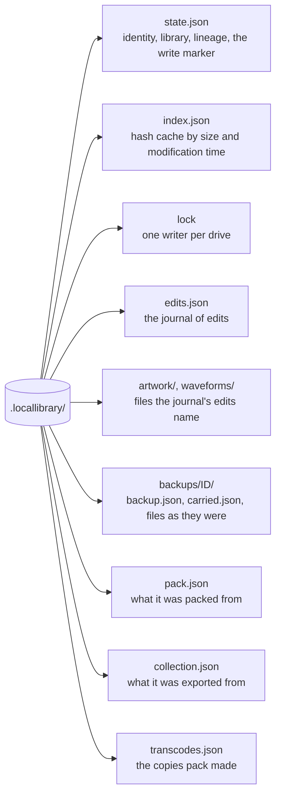

Source: [`crates/locallibrary/src/device.rs`](../../../../crates/locallibrary/src/device.rs), [`crates/locallibrary/src/backup.rs`](../../../../crates/locallibrary/src/backup.rs), [`crates/locallibrary/src/edit.rs`](../../../../crates/locallibrary/src/edit.rs), [`crates/locallibrary/src/pack.rs`](../../../../crates/locallibrary/src/pack.rs), [`crates/locallibrary/src/pack/transcode.rs`](../../../../crates/locallibrary/src/pack/transcode.rs), [`crates/locallibrary/src/collection_export.rs`](../../../../crates/locallibrary/src/collection_export.rs)

## Saving a drive with pull

How one named drive becomes a snapshot. `pull` with a library's name or no drive decides as `watch --pull` does, and warns where this refuses.

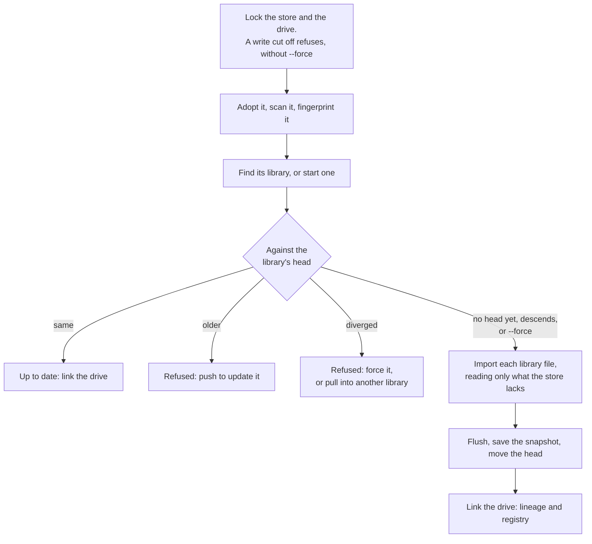

Source: [`crates/locallibrary/src/sync.rs`](../../../../crates/locallibrary/src/sync.rs), [`crates/locallibrary/src/store.rs`](../../../../crates/locallibrary/src/store.rs), [`src/store_cmd.rs`](../../src/store_cmd.rs)

## Writing a snapshot with library push

How any snapshot gets back onto a drive.

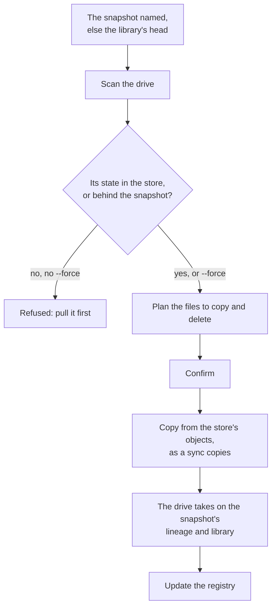

Source: [`crates/locallibrary/src/sync.rs`](../../../../crates/locallibrary/src/sync.rs), [`src/library_cmd.rs`](../../src/library_cmd.rs)

## Copies of the store

Where a store can be copied, and how a copy comes back.

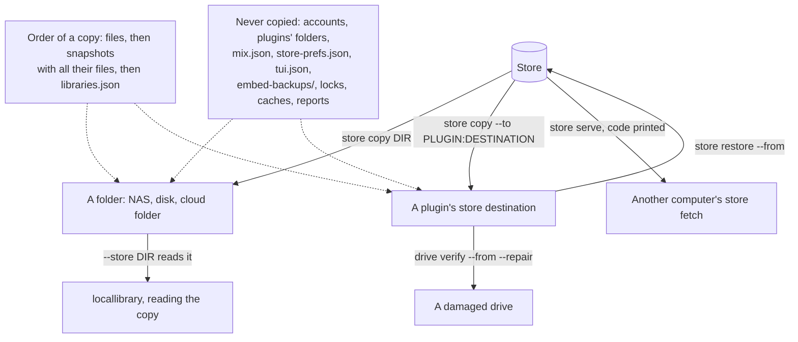

Source: [`crates/locallibrary/src/offsite.rs`](../../../../crates/locallibrary/src/offsite.rs), [`crates/locallibrary/src/plugin/destinations.rs`](../../../../crates/locallibrary/src/plugin/destinations.rs), [`crates/locallibrary/src/scrub.rs`](../../../../crates/locallibrary/src/scrub.rs), [`src/store_cmd.rs`](../../src/store_cmd.rs)

## Serving a store to another computer

How `store serve` and `store fetch` copy snapshots over iroh. With `--local` nothing goes through a relay.

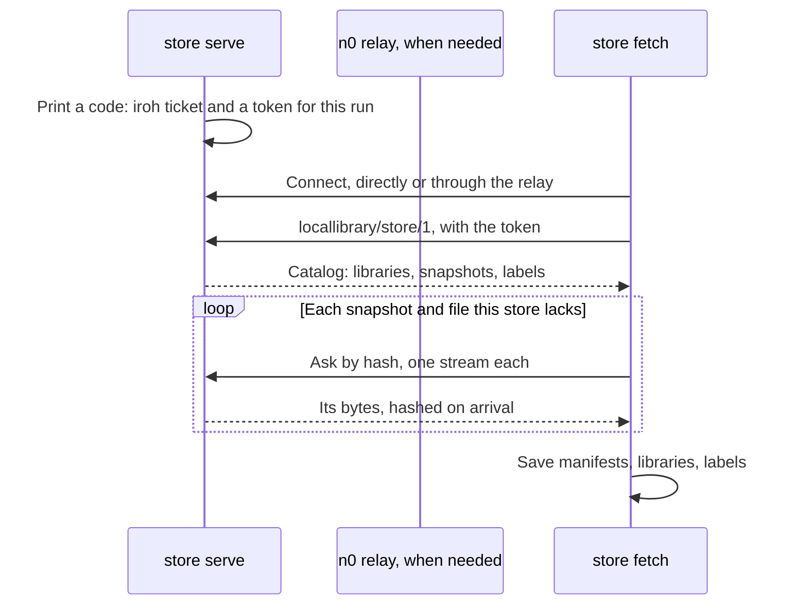

Source: [`crates/locallibrary/src/peers/mod.rs`](../../../../crates/locallibrary/src/peers/mod.rs), [`crates/locallibrary/src/peers/serve.rs`](../../../../crates/locallibrary/src/peers/serve.rs), [`crates/locallibrary/src/peers/fetch.rs`](../../../../crates/locallibrary/src/peers/fetch.rs), [`crates/locallibrary/src/catalog.rs`](../../../../crates/locallibrary/src/catalog.rs)

## What a fetch does to each library

`store fetch` and `store restore --from`: what each library comes to. Nothing this store has is replaced.

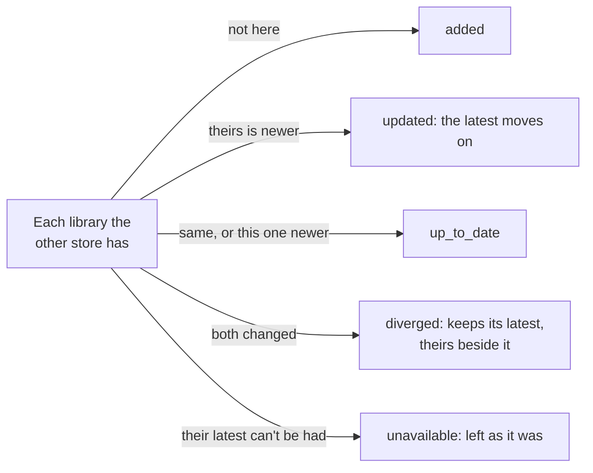

Source: [`crates/locallibrary/src/catalog.rs`](../../../../crates/locallibrary/src/catalog.rs), [`crates/locallibrary/src/offsite.rs`](../../../../crates/locallibrary/src/offsite.rs), [`crates/locallibrary/src/peers/fetch.rs`](../../../../crates/locallibrary/src/peers/fetch.rs)

## Pruning and collecting

What `store prune` keeps, and what `store gc` frees.

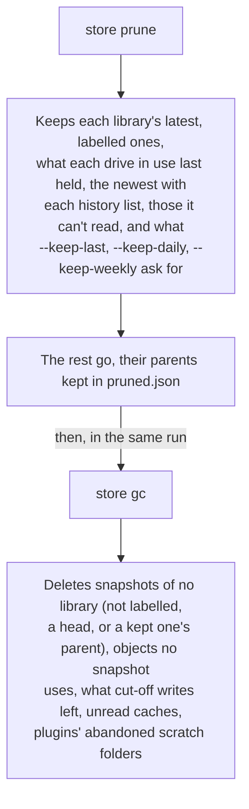

Source: [`crates/locallibrary/src/retention.rs`](../../../../crates/locallibrary/src/retention.rs), [`crates/locallibrary/src/store.rs`](../../../../crates/locallibrary/src/store.rs), [`crates/locallibrary/src/api/snapshots.rs`](../../../../crates/locallibrary/src/api/snapshots.rs)

## Watching drives

What `watch` does with each drive, and the same from the sidecar's `watch.start`.

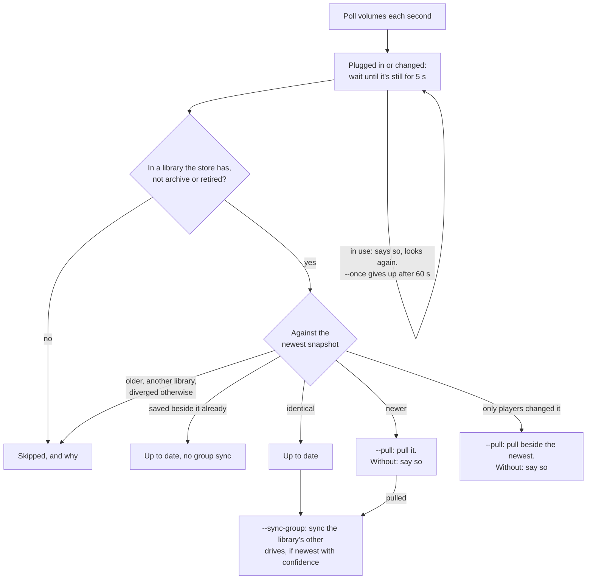

Source: [`crates/locallibrary/src/api/autopull.rs`](../../../../crates/locallibrary/src/api/autopull.rs), [`crates/locallibrary/src/watch/mod.rs`](../../../../crates/locallibrary/src/watch/mod.rs), [`src/watch_cmd.rs`](../../src/watch_cmd.rs), [`src/autostart.rs`](../../src/autostart.rs)

## A drive's life

The states a drive goes through in the store's registry and on the drive. `drive format` keeps its identity and empties its lineage. `drive forget` takes it out of the registry, and the next write puts it back.

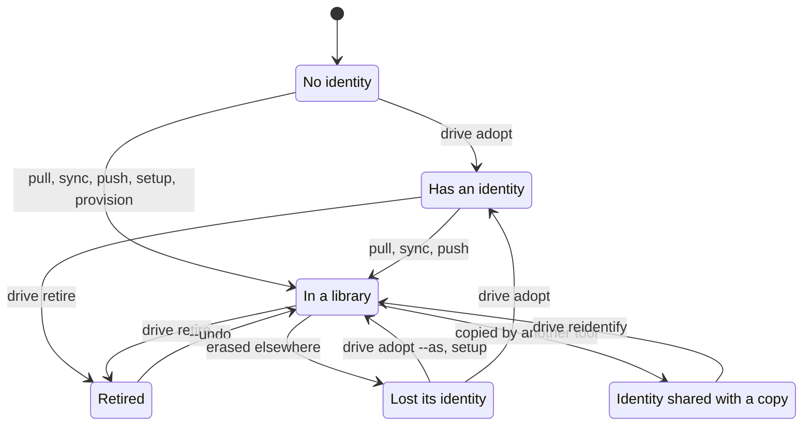

Source: [`crates/locallibrary/src/fleet.rs`](../../../../crates/locallibrary/src/fleet.rs), [`crates/locallibrary/src/device.rs`](../../../../crates/locallibrary/src/device.rs), [`crates/locallibrary/src/api/drives.rs`](../../../../crates/locallibrary/src/api/drives.rs)

## Checking drives

What each health command reads, and what it adds up to.

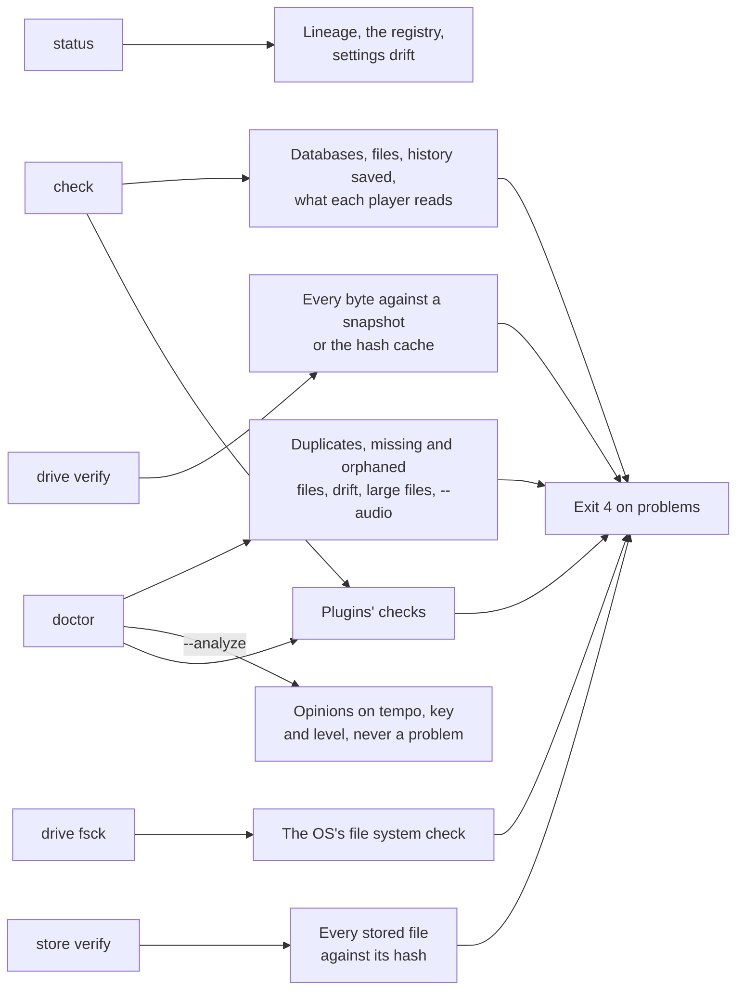

Source: [`crates/locallibrary/src/check.rs`](../../../../crates/locallibrary/src/check.rs), [`crates/locallibrary/src/doctor.rs`](../../../../crates/locallibrary/src/doctor.rs), [`crates/locallibrary/src/scrub.rs`](../../../../crates/locallibrary/src/scrub.rs), [`crates/locallibrary/src/fscheck.rs`](../../../../crates/locallibrary/src/fscheck.rs), [`crates/locallibrary/src/fleet.rs`](../../../../crates/locallibrary/src/fleet.rs), [`crates/locallibrary/src/store.rs`](../../../../crates/locallibrary/src/store.rs)

## Repairing a drive

What `drive verify` compares with, and what `--repair` writes back.

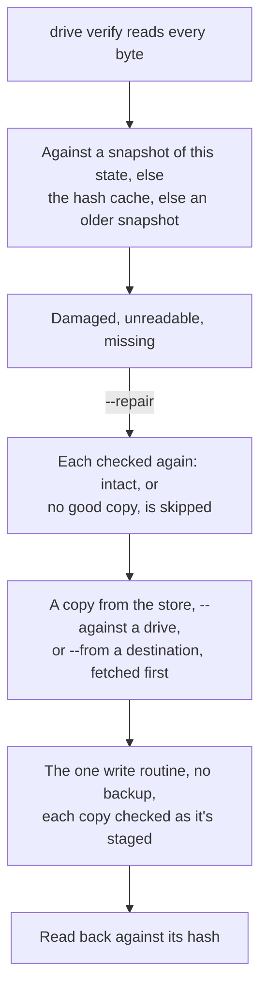

Source: [`crates/locallibrary/src/scrub.rs`](../../../../crates/locallibrary/src/scrub.rs), [`crates/locallibrary/src/api/drives.rs`](../../../../crates/locallibrary/src/api/drives.rs), [`src/drive_cmd.rs`](../../src/drive_cmd.rs)

## Clearing a drive

The two commands that remove what nothing needs.

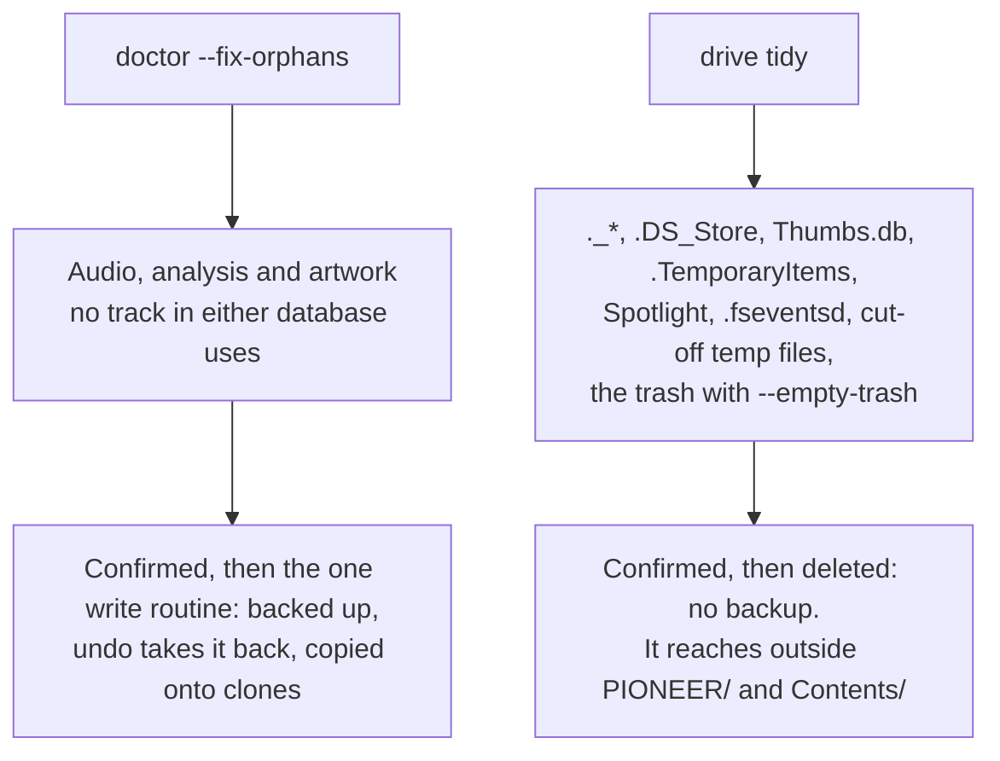

Source: [`crates/locallibrary/src/doctor.rs`](../../../../crates/locallibrary/src/doctor.rs), [`crates/locallibrary/src/api/doctor.rs`](../../../../crates/locallibrary/src/api/doctor.rs), [`crates/locallibrary/src/tidy.rs`](../../../../crates/locallibrary/src/tidy.rs), [`crates/locallibrary/src/paths.rs`](../../../../crates/locallibrary/src/paths.rs)

## What's using a drive

What `drive space` reports.

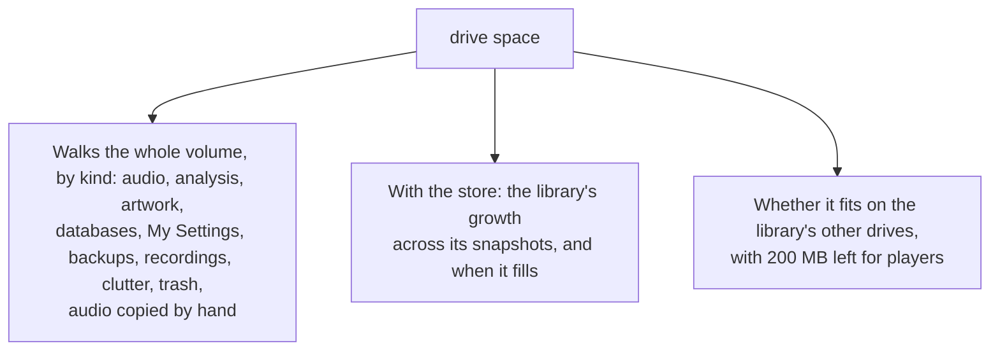

Source: [`crates/locallibrary/src/space.rs`](../../../../crates/locallibrary/src/space.rs), [`src/drive_cmd.rs`](../../src/drive_cmd.rs)

## Recordings and firmware

Files that live outside the library, in a drive's root.

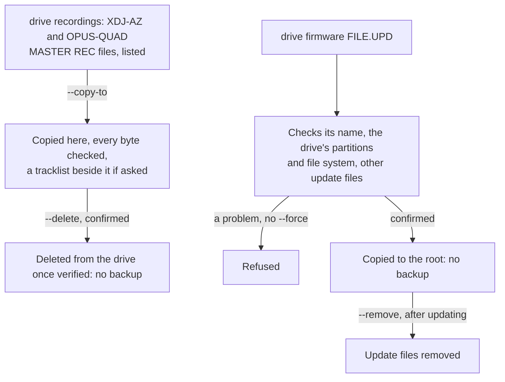

Source: [`crates/locallibrary/src/recordings.rs`](../../../../crates/locallibrary/src/recordings.rs), [`crates/locallibrary/src/firmware.rs`](../../../../crates/locallibrary/src/firmware.rs), [`src/drive_cmd.rs`](../../src/drive_cmd.rs)
