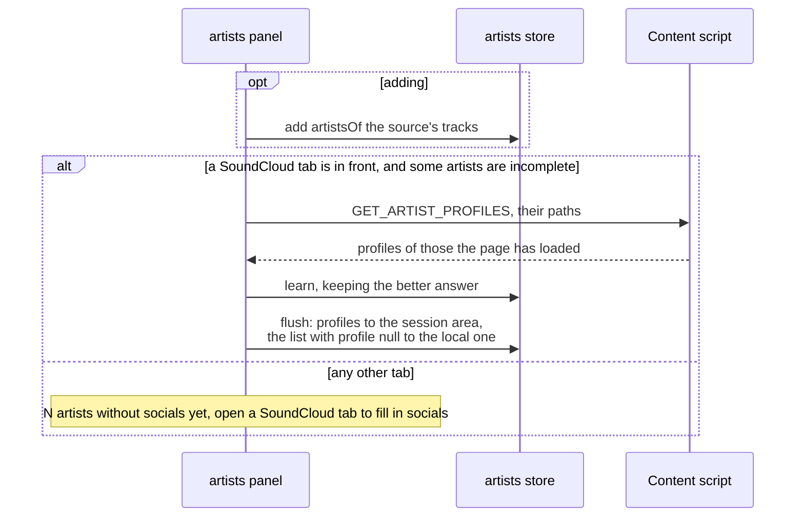
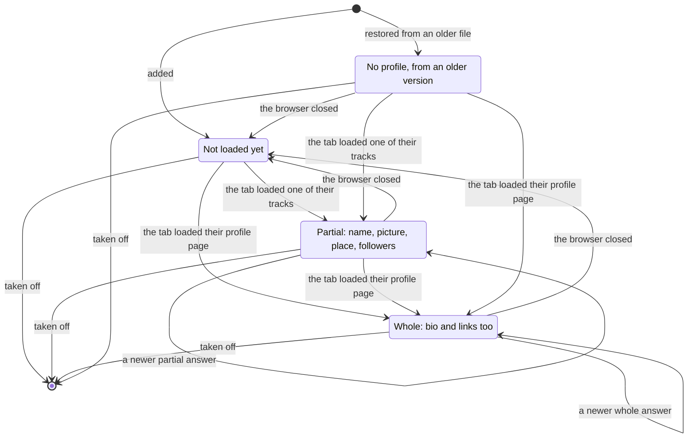
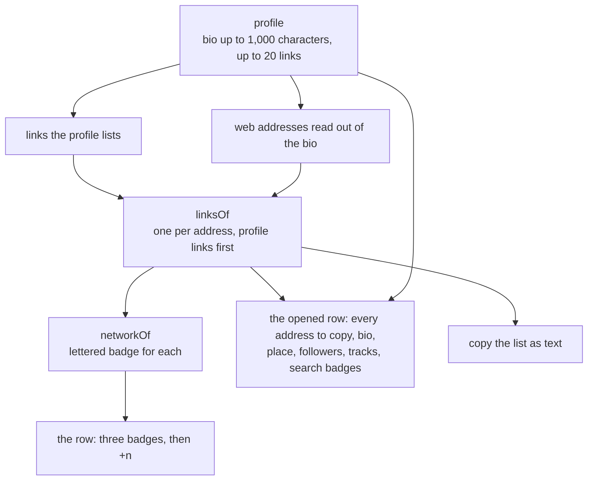
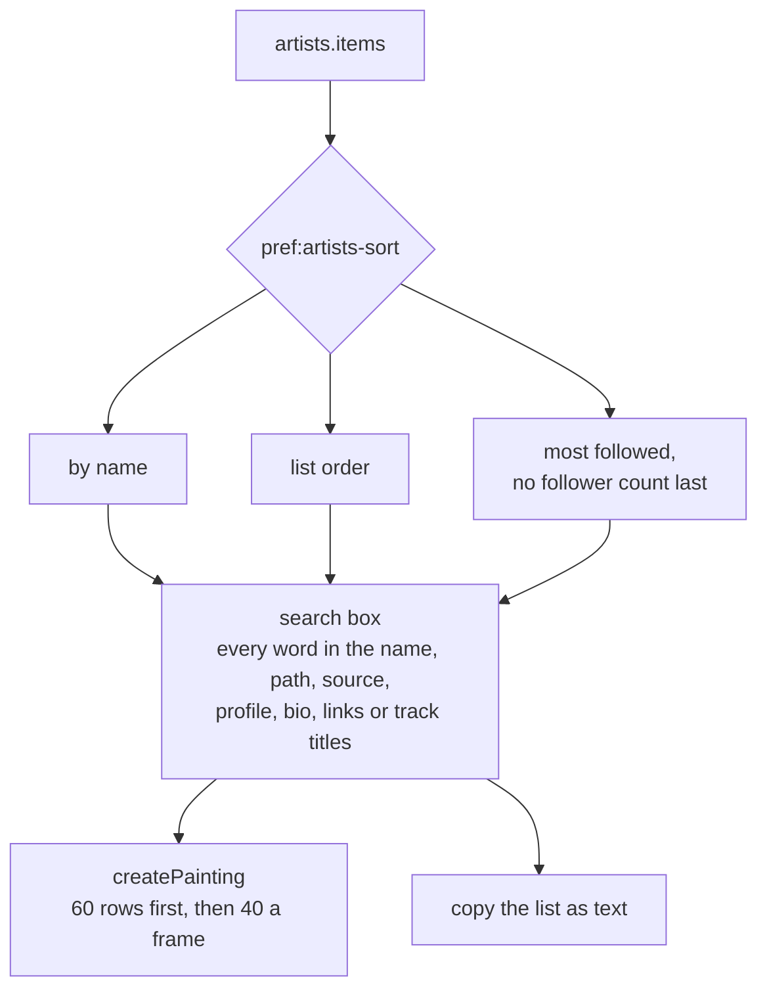
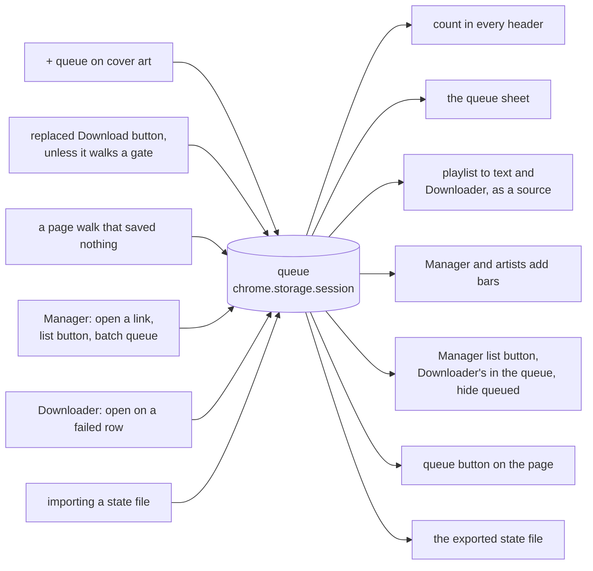
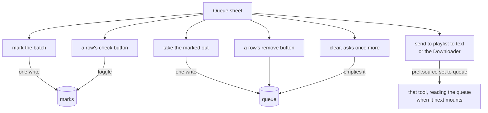
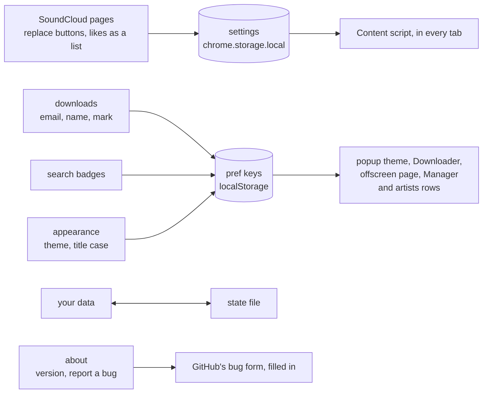

# localtoolbox diagrams: Artists, the queue and settings

Artist rows, the session queue and the settings sheet. The rest are listed in the [README](../../README.md#diagrams).

- [Adding artists and filling them in](#adding-artists-and-filling-them-in)
- [Life of an artist row](#life-of-an-artist-row)
- [What an artist row draws](#what-an-artist-row-draws)
- [Searching and sorting artists](#searching-and-sorting-artists)
- [Filling and reading the session queue](#filling-and-reading-the-session-queue)
- [What the queue sheet does](#what-the-queue-sheet-does)
- [What the settings sheet changes](#what-the-settings-sheet-changes)

## Adding artists and filling them in

Three sources feed the artists list. The SoundCloud tab in front, any page of it, fills in what it has loaded about each artist, as the panel opens and after every add. It answers from memory, so nothing is asked of SoundCloud.

Source: [`src/tools/artists/Panel.svelte`](../../src/tools/artists/Panel.svelte), [`src/tools/artists/AddBar.svelte`](../../src/tools/artists/AddBar.svelte), [`src/tools/artists/artists.svelte.ts`](../../src/tools/artists/artists.svelte.ts), [`src/tools/artists/lookup.ts`](../../src/tools/artists/lookup.ts), [`content.ts`](../../content.ts)

## Life of an artist row

What `profile` holds on an entry. A track names its uploader in short, and the bio, track count and links come with the artist's own profile page. A whole profile is never replaced by a partial one. Profiles live in the session area, so a new browser session starts every row at not loaded yet.

Source: [`src/tools/artists/artists.svelte.ts`](../../src/tools/artists/artists.svelte.ts), [`src/tools/artists/profiles.ts`](../../src/tools/artists/profiles.ts), [`src/tools/artists/Panel.svelte`](../../src/tools/artists/Panel.svelte), [`content.ts`](../../content.ts)

## What an artist row draws

How one profile becomes a row's badges and an opened row's fields.

Source: [`src/tools/artists/profiles.ts`](../../src/tools/artists/profiles.ts), [`src/tools/artists/Panel.svelte`](../../src/tools/artists/Panel.svelte), [`content.ts`](../../content.ts)

## Searching and sorting artists

The order comes first and the search second, and the copy button takes whatever is left.

Source: [`src/tools/artists/Panel.svelte`](../../src/tools/artists/Panel.svelte), [`src/tools/artists/profiles.ts`](../../src/tools/artists/profiles.ts), [`src/lib/filter.ts`](../../src/lib/filter.ts), [`src/lib/painting.svelte.ts`](../../src/lib/painting.svelte.ts)

## Filling and reading the session queue

Everything that puts a track in the queue, and everything that reads it.

Source: [`src/lib/queue.svelte.ts`](../../src/lib/queue.svelte.ts), [`content.ts`](../../content.ts), [`src/tools/manager/Panel.svelte`](../../src/tools/manager/Panel.svelte), [`src/tools/third-party-downloads/Panel.svelte`](../../src/tools/third-party-downloads/Panel.svelte), [`src/lib/components/StateTransfer.svelte`](../../src/lib/components/StateTransfer.svelte)

## What the queue sheet does

Each control on the sheet. Marks outlast the queue, and a queued track outlasts its mark. A tool already open under the sheet keeps its source until it next mounts.

Source: [`src/lib/components/QueueSheet.svelte`](../../src/lib/components/QueueSheet.svelte), [`src/lib/queue.svelte.ts`](../../src/lib/queue.svelte.ts), [`src/lib/source.ts`](../../src/lib/source.ts), [`src/lib/prefs.svelte.ts`](../../src/lib/prefs.svelte.ts)

## What the settings sheet changes

Each section, where it keeps what it sets, and who obeys it. An import writes back to the marks, both lists, the queue and three pref keys.

Source: [`src/lib/components/SettingsSheet.svelte`](../../src/lib/components/SettingsSheet.svelte), [`src/lib/settings.svelte.ts`](../../src/lib/settings.svelte.ts), [`src/lib/downloader.svelte.ts`](../../src/lib/downloader.svelte.ts), [`src/lib/components/StateTransfer.svelte`](../../src/lib/components/StateTransfer.svelte), [`src/lib/bug-report.ts`](../../src/lib/bug-report.ts)
