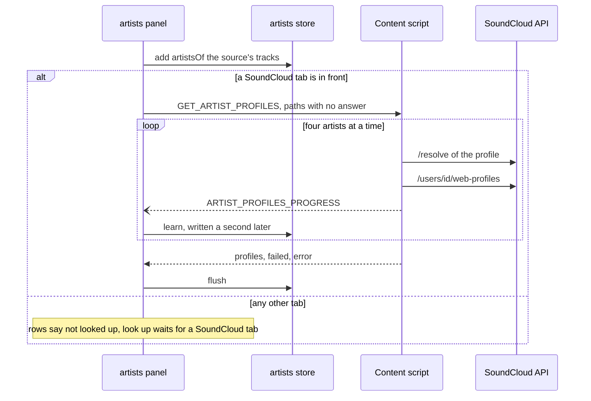
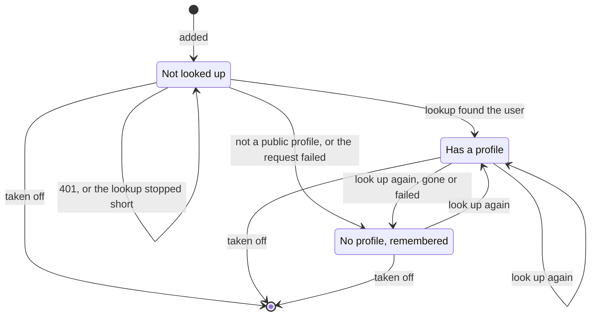
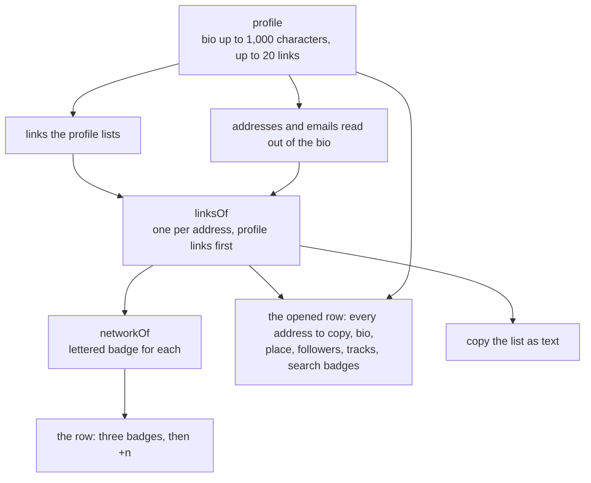
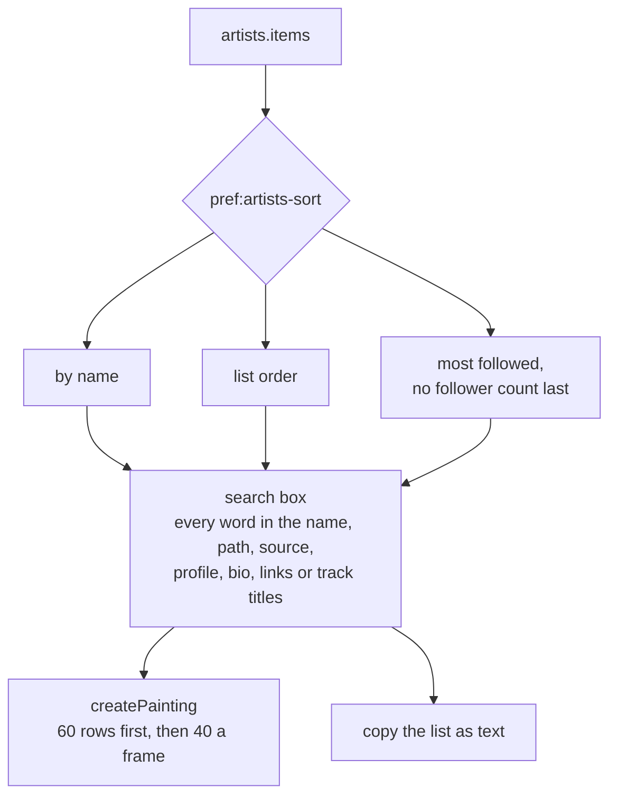
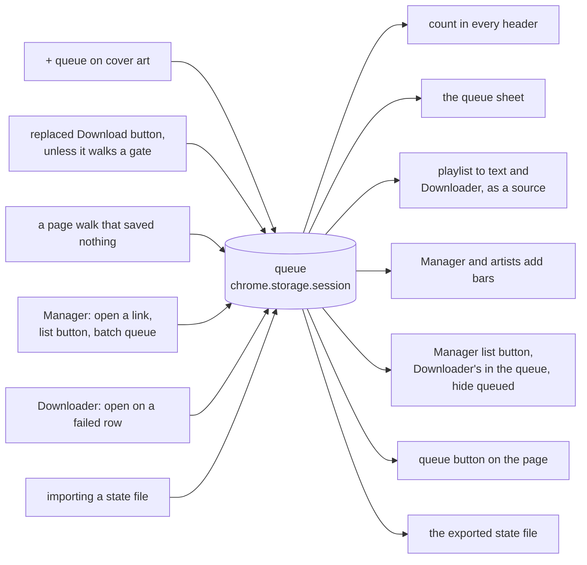
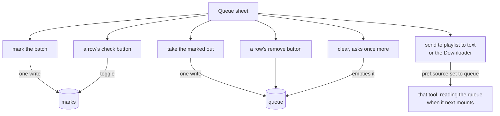
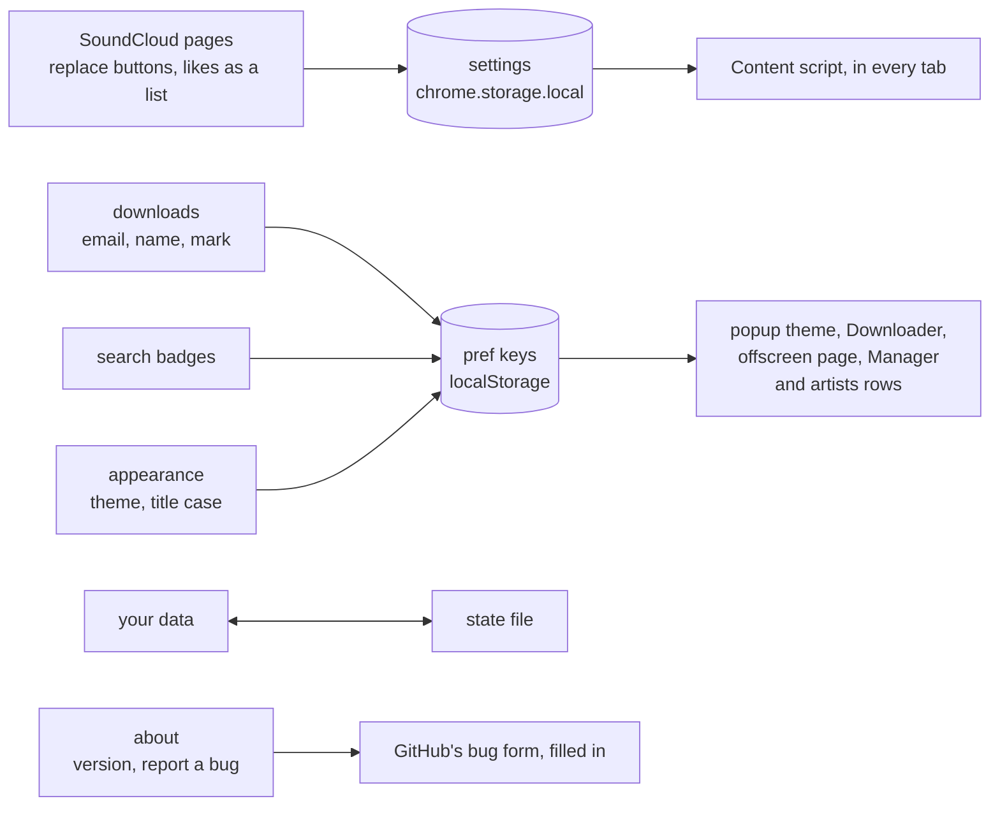

# localtoolbox diagrams: Artists, the queue and settings

Artist rows, the session queue and the settings sheet. The rest are listed in the [README](../../README.md#diagrams).

- [Adding artists and asking about them](#adding-artists-and-asking-about-them)
- [Life of an artist row](#life-of-an-artist-row)
- [What an artist row draws](#what-an-artist-row-draws)
- [Searching and sorting artists](#searching-and-sorting-artists)
- [Filling and reading the session queue](#filling-and-reading-the-session-queue)
- [What the queue sheet does](#what-the-queue-sheet-does)
- [What the settings sheet changes](#what-the-settings-sheet-changes)

## Adding artists and asking about them

Three sources feed the artists list, and the SoundCloud tab in front, any page of it, can answer for them.

Source: [`src/tools/artists/Panel.svelte`](../../src/tools/artists/Panel.svelte), [`src/tools/artists/AddBar.svelte`](../../src/tools/artists/AddBar.svelte), [`src/tools/artists/artists.svelte.ts`](../../src/tools/artists/artists.svelte.ts), [`src/tools/artists/lookup.ts`](../../src/tools/artists/lookup.ts), [`content.ts`](../../content.ts)

## Life of an artist row

What `profile` holds on an entry. A `401` leaves the row as it was, and any other failed `/resolve` counts as no profile, over whatever the row held.

Source: [`src/tools/artists/artists.svelte.ts`](../../src/tools/artists/artists.svelte.ts), [`src/tools/artists/profiles.ts`](../../src/tools/artists/profiles.ts), [`src/tools/artists/Panel.svelte`](../../src/tools/artists/Panel.svelte), [`content.ts`](../../content.ts)

## What an artist row draws

How one profile becomes a row's badges and an opened row's fields.

Source: [`src/tools/artists/profiles.ts`](../../src/tools/artists/profiles.ts), [`src/tools/artists/Panel.svelte`](../../src/tools/artists/Panel.svelte), [`content.ts`](../../content.ts)

## Searching and sorting artists

The order comes first and the search second, and the copy button takes whatever is left.

Source: [`src/tools/artists/Panel.svelte`](../../src/tools/artists/Panel.svelte), [`src/tools/artists/profiles.ts`](../../src/tools/artists/profiles.ts), [`src/lib/filter.ts`](../../src/lib/filter.ts), [`src/lib/painting.svelte.ts`](../../src/lib/painting.svelte.ts)

## Filling and reading the session queue

Everything that puts a track in the queue, and everything that reads it.

Source: [`src/lib/queue.svelte.ts`](../../src/lib/queue.svelte.ts), [`content.ts`](../../content.ts), [`src/tools/manager/Panel.svelte`](../../src/tools/manager/Panel.svelte), [`src/tools/third-party-downloads/Panel.svelte`](../../src/tools/third-party-downloads/Panel.svelte), [`src/lib/components/StateTransfer.svelte`](../../src/lib/components/StateTransfer.svelte)

## What the queue sheet does

Each control on the sheet. Marks outlast the queue, and a queued track outlasts its mark. A tool already open under the sheet keeps its source until it next mounts.

Source: [`src/lib/components/QueueSheet.svelte`](../../src/lib/components/QueueSheet.svelte), [`src/lib/queue.svelte.ts`](../../src/lib/queue.svelte.ts), [`src/lib/source.ts`](../../src/lib/source.ts), [`src/lib/prefs.svelte.ts`](../../src/lib/prefs.svelte.ts)

## What the settings sheet changes

Each section, where it keeps what it sets, and who obeys it. An import writes back to the marks, the details, both lists, the queue and three pref keys.

Source: [`src/lib/components/SettingsSheet.svelte`](../../src/lib/components/SettingsSheet.svelte), [`src/lib/settings.svelte.ts`](../../src/lib/settings.svelte.ts), [`src/lib/downloader.svelte.ts`](../../src/lib/downloader.svelte.ts), [`src/lib/components/StateTransfer.svelte`](../../src/lib/components/StateTransfer.svelte), [`src/lib/bug-report.ts`](../../src/lib/bug-report.ts)
