# localtoolbox diagrams: the content script

Repaints, pills, replaced buttons, walks and the likes list. The rest are listed in the [README](../../README.md#diagrams).

- [Content script start](#content-script-start)
- [The repaint pass](#the-repaint-pass)
- [Pills and the queue button](#pills-and-the-queue-button)
- [Opening session storage to the page](#opening-session-storage-to-the-page)
- [Noticing clicks on SoundCloud's buttons](#noticing-clicks-on-soundclouds-buttons)
- [Putting the replaced buttons in](#putting-the-replaced-buttons-in)
- [Pressing a replaced button](#pressing-a-replaced-button)
- [The walk behind a Download button](#the-walk-behind-a-download-button)
- [The signed-in frame](#the-signed-in-frame)
- [Pressing the List toggle](#pressing-the-list-toggle)

## Content script start

What runs when the page's scripts load in a frame. `page-data.js` is in before SoundCloud's own scripts, and `content.js` listens to it only once marks, queue and settings are in, since what it learns repaints the page.

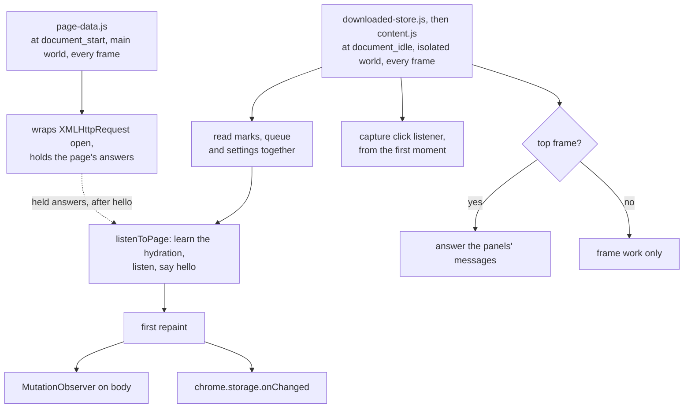

Source: [`content.ts`](../../content.ts), [`page-data.ts`](../../page-data.ts), [`src/manifest.json`](../../src/manifest.json)

## The repaint pass

`applyMarkers` is idempotent, so anything that might have changed the page just runs it again.

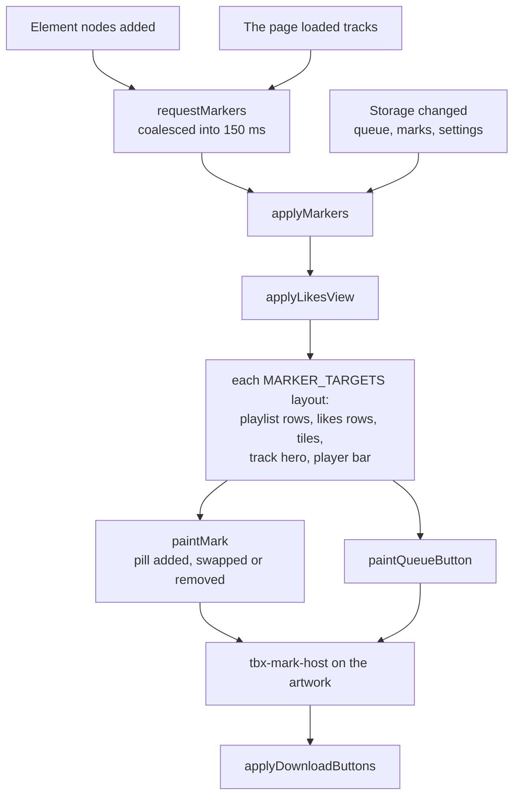

Source: [`content.ts`](../../content.ts), [`content.css`](../../content.css)

## Pills and the queue button

Each piece of artwork carries at most one pill, with `downloaded` winning. Details last as long as the page, so a `nodl` pill only goes when the track is marked or the tab reloads.

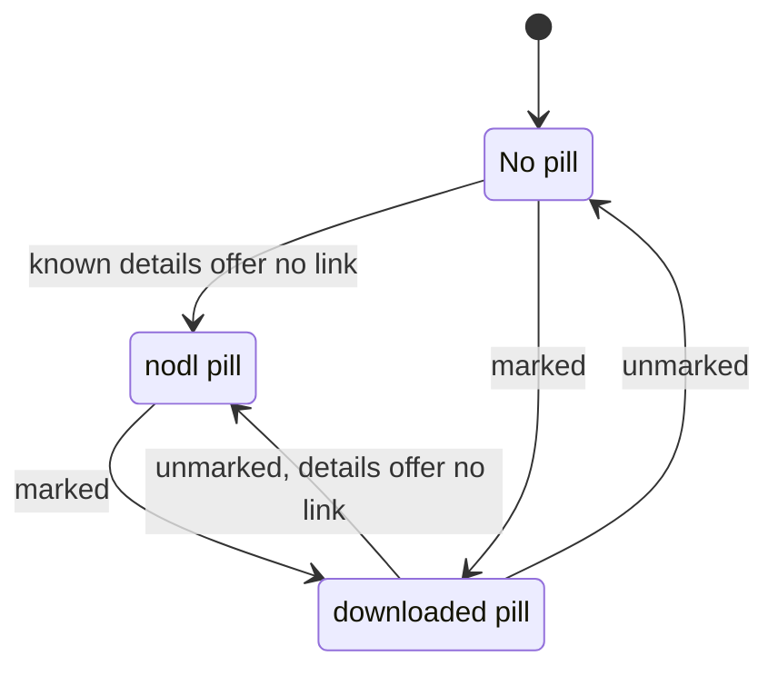

Source: [`content.ts`](../../content.ts), [`content.css`](../../content.css)

And one queue button that says whether the track is queued. Small art has room for a plus sign alone.

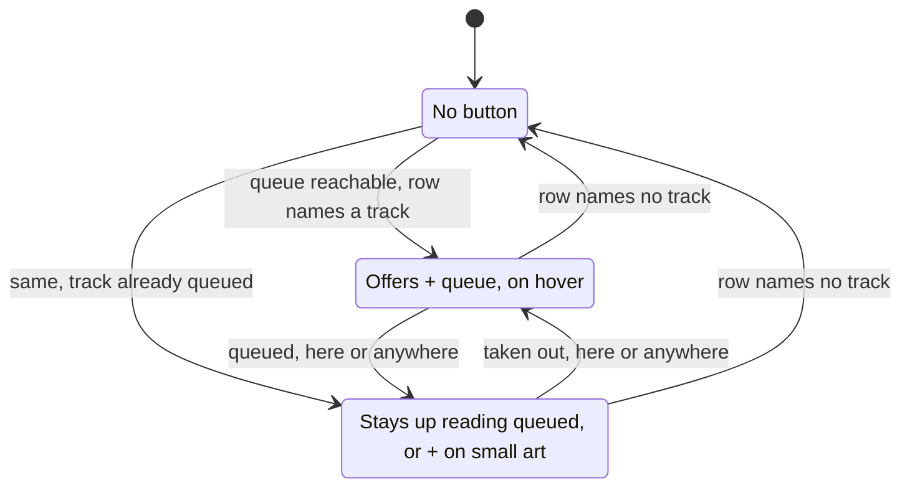

Source: [`content.ts`](../../content.ts), [`content.css`](../../content.css)

## Opening session storage to the page

A content script can't touch `chrome.storage.session` until a trusted context opens it, so the page offers no queue button until the popup has run once in a browsing session. A tab already open gets its buttons at the next change to the queue, or a reload.

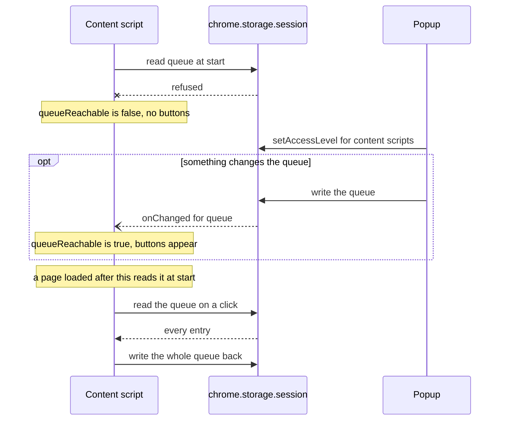

Source: [`src/lib/queue.svelte.ts`](../../src/lib/queue.svelte.ts), [`content.ts`](../../content.ts)

## Noticing clicks on SoundCloud's buttons

A capture listener sees each click before the page does and never stops it. This is how SoundCloud's own controls mark a track.

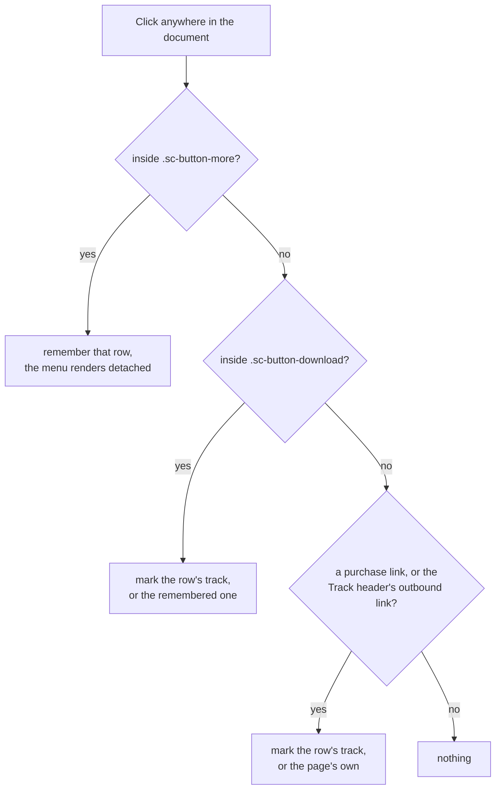

Source: [`content.ts`](../../content.ts), [`downloaded-store.ts`](../../downloaded-store.ts)

## Putting the replaced buttons in

One pass over SoundCloud's own controls. Nothing is removed, so turning the setting off shows the page as it was drawn.

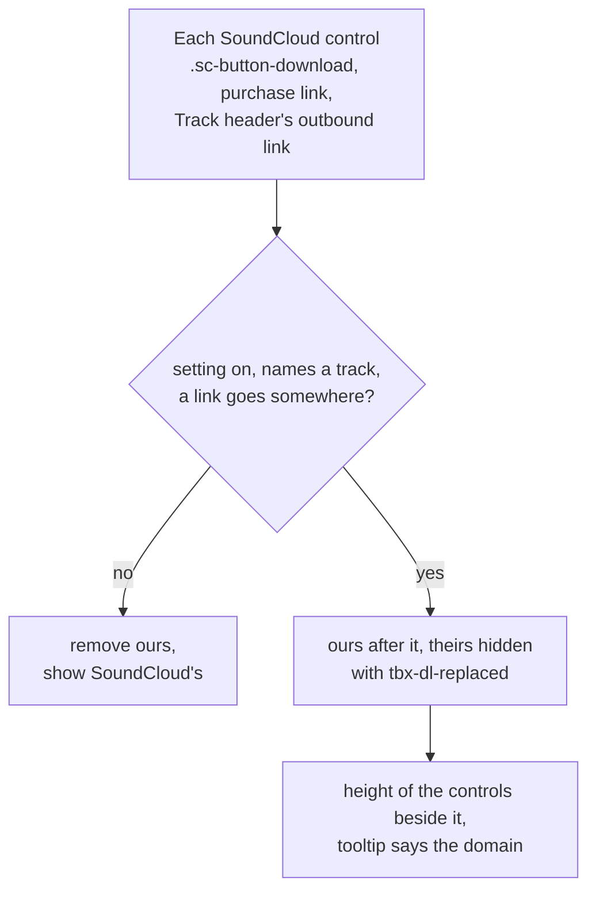

Source: [`content.ts`](../../content.ts), [`content.css`](../../content.css), [`src/lib/settings.svelte.ts`](../../src/lib/settings.svelte.ts)

## Pressing a replaced button

What a click on this extension's **Download** does, by the control it stands in for. Before the popup has run in a browsing session the buttons still draw, and queue nothing.

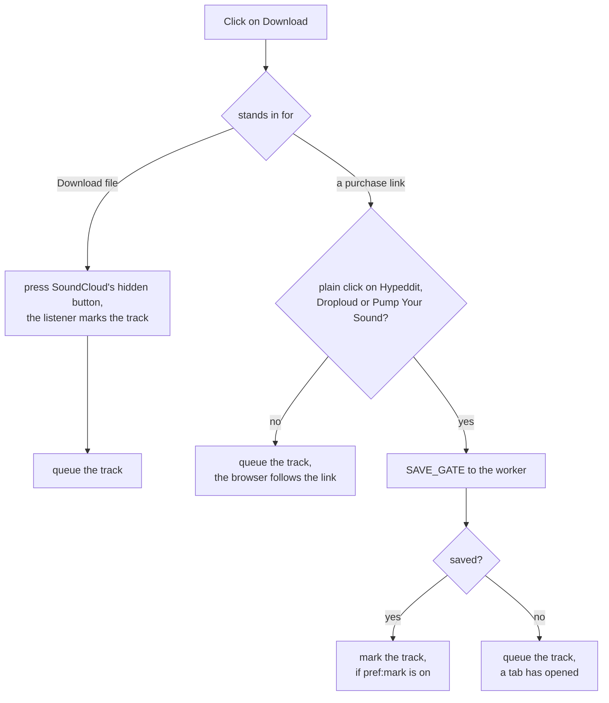

Source: [`content.ts`](../../content.ts), [`src/background.ts`](../../src/background.ts)

## The walk behind a Download button

The same site modules the Downloader panel uses. The offscreen page has `DOMParser` and host access, and the worker has tabs and downloads.

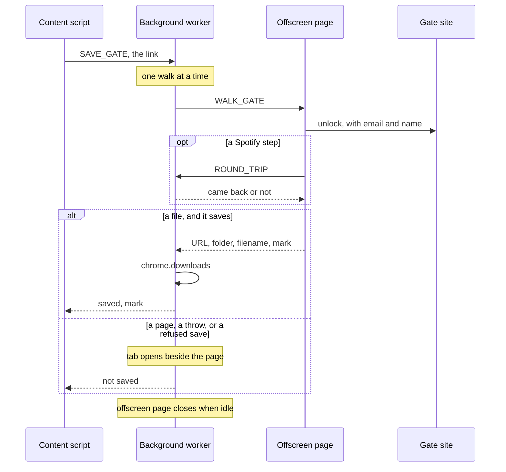

Source: [`src/background.ts`](../../src/background.ts), [`src/offscreen.ts`](../../src/offscreen.ts), [`src/tools/third-party-downloads/save.ts`](../../src/tools/third-party-downloads/save.ts), [`content.ts`](../../content.ts)

## The signed-in frame

Signed in, a track page puts the track in an iframe. Both scripts run in both documents, and each document does different work. Only the top one answers a panel, so what the frame's own page loads stays in the frame.

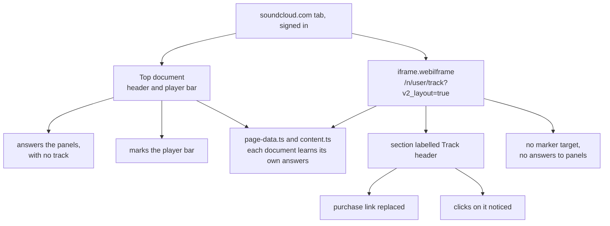

Source: [`content.ts`](../../content.ts), [`page-data.ts`](../../page-data.ts), [`src/manifest.json`](../../src/manifest.json)

## Pressing the List toggle

Once per arrival at `/you/likes`, and only with the setting on. Pressing Badges afterwards is left alone.

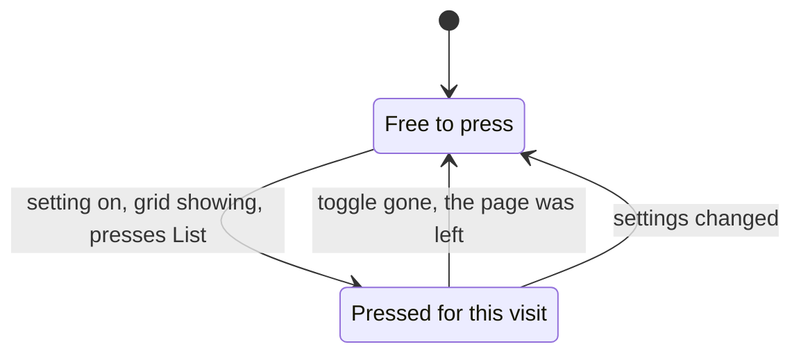

Source: [`content.ts`](../../content.ts)
