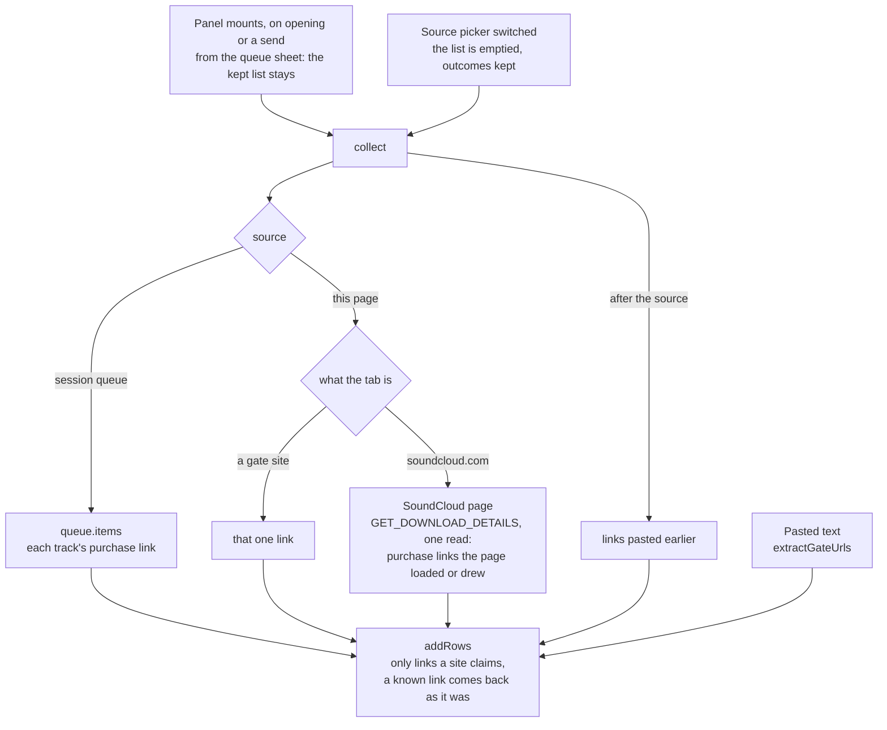
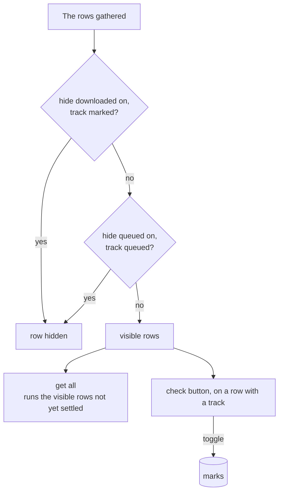
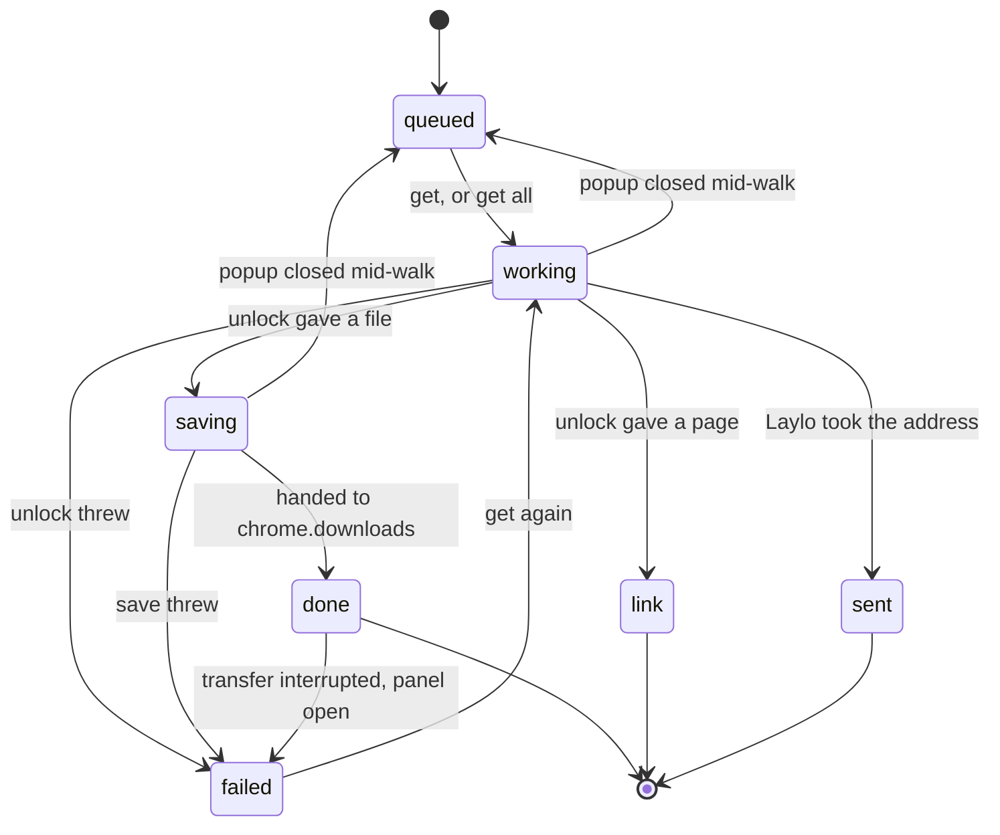
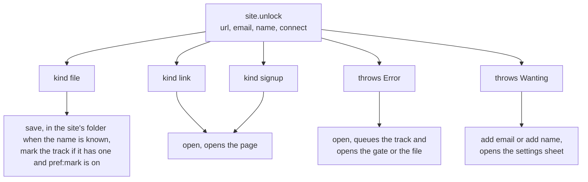
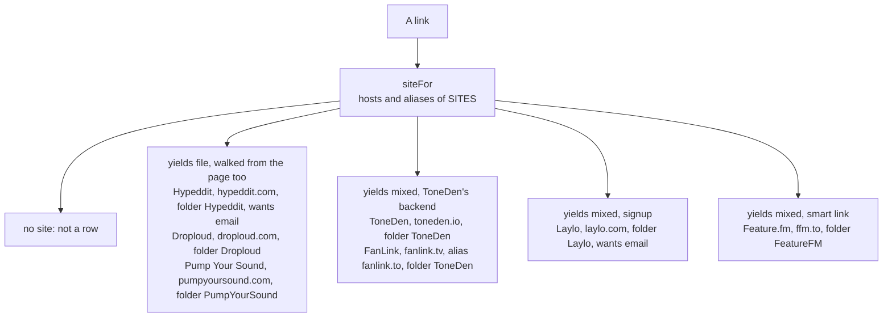
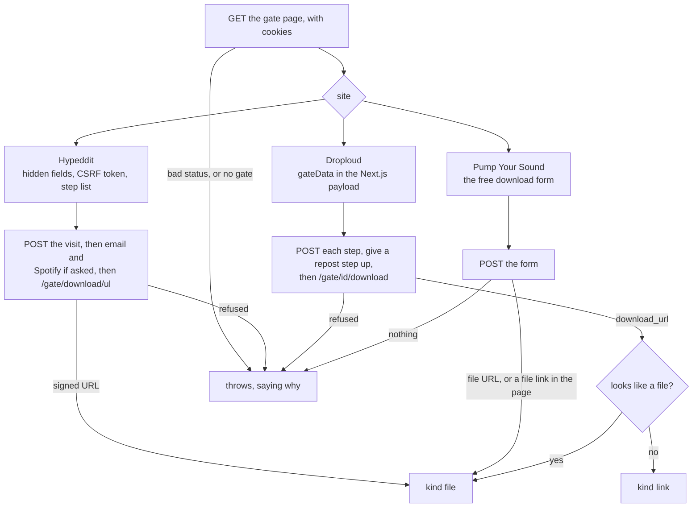
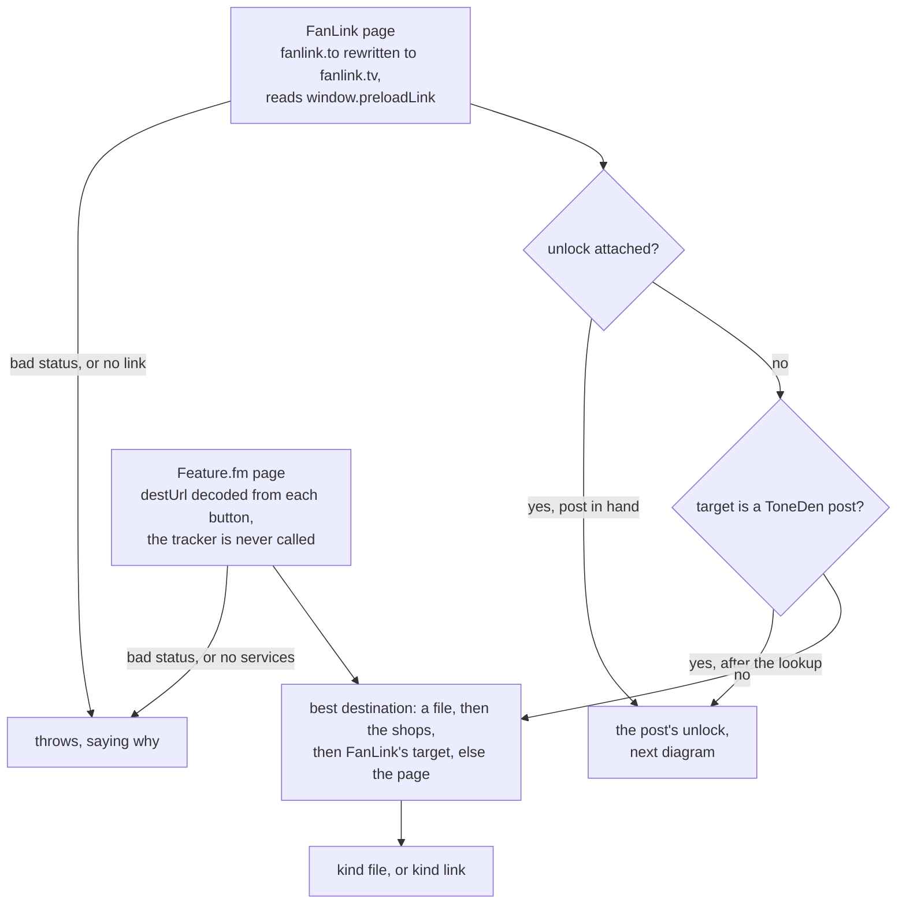
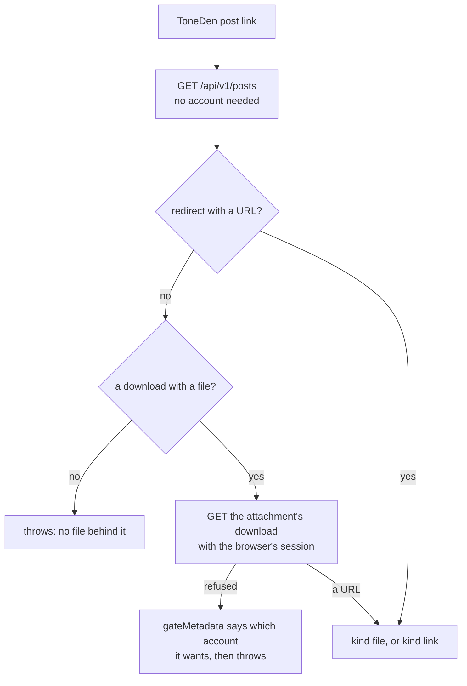
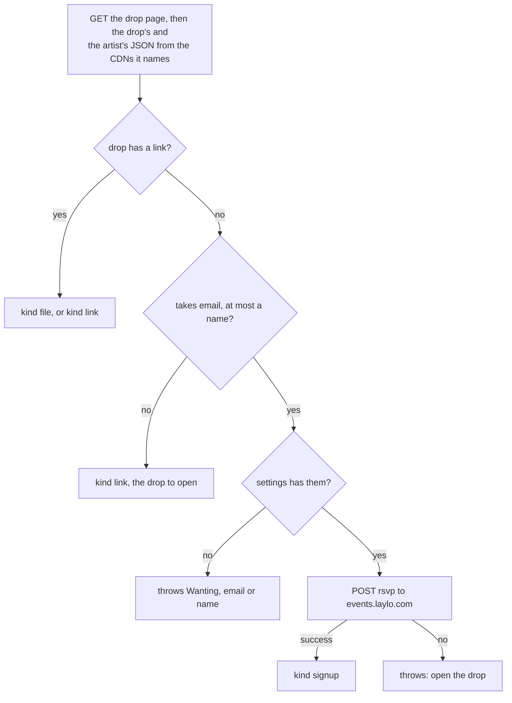
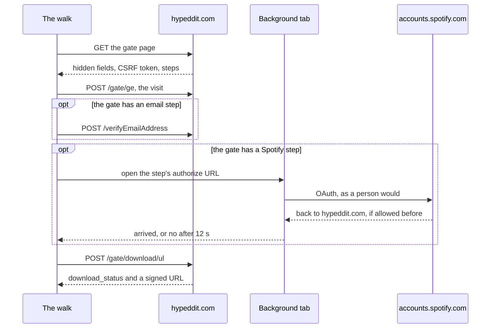

# localtoolbox diagrams: the downloader

Gate links, row life, walks and gate sites. The rest are listed in the [README](../../README.md#diagrams).

- [Gathering gate links](#gathering-gate-links)
- [Narrowing the Downloader list](#narrowing-the-downloader-list)
- [Life of a Downloader row](#life-of-a-downloader-row)
- [What a walk can answer](#what-a-walk-can-answer)
- [Gate sites as data](#gate-sites-as-data)
- [Gates that end in a file](#gates-that-end-in-a-file)
- [Account gates and smart links](#account-gates-and-smart-links)
- [Laylo drops](#laylo-drops)
- [The Spotify step on a Hypeddit gate](#the-spotify-step-on-a-hypeddit-gate)

## Gathering gate links

Where the third-party downloader's rows come from. Reopening the popup keeps the list, and only the source picker empties it. A send from the queue sheet adds the queue's links to what is listed.

Source: [`src/tools/third-party-downloads/Panel.svelte`](../../src/tools/third-party-downloads/Panel.svelte), [`src/tools/third-party-downloads/walked.svelte.ts`](../../src/tools/third-party-downloads/walked.svelte.ts), [`src/tools/third-party-downloads/sites/index.ts`](../../src/tools/third-party-downloads/sites/index.ts), [`src/lib/components/QueueSheet.svelte`](../../src/lib/components/QueueSheet.svelte)

## Narrowing the Downloader list

The two toggles choose what **get all** runs, and the check button marks a row by hand. A row with no track behind it is never hidden.

Source: [`src/tools/third-party-downloads/Panel.svelte`](../../src/tools/third-party-downloads/Panel.svelte), [`src/lib/filter.ts`](../../src/lib/filter.ts), [`src/lib/downloaded.svelte.ts`](../../src/lib/downloaded.svelte.ts)

## Life of a Downloader row

The `RowState` values. Rows walk one at a time, and a run dies with the popup that started it.

Source: [`src/tools/third-party-downloads/walked.svelte.ts`](../../src/tools/third-party-downloads/walked.svelte.ts), [`src/tools/third-party-downloads/Panel.svelte`](../../src/tools/third-party-downloads/Panel.svelte)

## What a walk can answer

Every site's `unlock` ends one of five ways. A page and a signup both offer **open**.

Source: [`src/tools/third-party-downloads/sites/index.ts`](../../src/tools/third-party-downloads/sites/index.ts), [`src/tools/third-party-downloads/next-step.ts`](../../src/tools/third-party-downloads/next-step.ts), [`src/tools/third-party-downloads/save.ts`](../../src/tools/third-party-downloads/save.ts), [`src/tools/third-party-downloads/Panel.svelte`](../../src/tools/third-party-downloads/Panel.svelte)

## Gate sites as data

`SITES` is the whole table. `siteFor` matches a link's host, without `www.`, and the diagrams below take these groups in turn.

Source: [`src/tools/third-party-downloads/sites/index.ts`](../../src/tools/third-party-downloads/sites/index.ts), [`src/tools/third-party-downloads/sites/hypeddit.ts`](../../src/tools/third-party-downloads/sites/hypeddit.ts), [`src/tools/third-party-downloads/sites/droploud.ts`](../../src/tools/third-party-downloads/sites/droploud.ts), [`src/tools/third-party-downloads/sites/pumpyoursound.ts`](../../src/tools/third-party-downloads/sites/pumpyoursound.ts), [`src/tools/third-party-downloads/sites/toneden.ts`](../../src/tools/third-party-downloads/sites/toneden.ts), [`src/tools/third-party-downloads/sites/laylo.ts`](../../src/tools/third-party-downloads/sites/laylo.ts), [`src/tools/third-party-downloads/sites/featurefm.ts`](../../src/tools/third-party-downloads/sites/featurefm.ts)

## Gates that end in a file

The `yields: 'file'` family. Each fetches its gate page, reads what the page carries, and posts back what pressing Download would.

Source: [`src/tools/third-party-downloads/sites/hypeddit.ts`](../../src/tools/third-party-downloads/sites/hypeddit.ts), [`src/tools/third-party-downloads/sites/droploud.ts`](../../src/tools/third-party-downloads/sites/droploud.ts), [`src/tools/third-party-downloads/sites/pumpyoursound.ts`](../../src/tools/third-party-downloads/sites/pumpyoursound.ts), [`src/tools/third-party-downloads/parse.ts`](../../src/tools/third-party-downloads/parse.ts), [`src/tools/third-party-downloads/save.ts`](../../src/tools/third-party-downloads/save.ts)

## Account gates and smart links

The `yields: 'mixed'` sites other than Laylo. First, how a smart link picks a destination.

Source: [`src/tools/third-party-downloads/sites/toneden.ts`](../../src/tools/third-party-downloads/sites/toneden.ts), [`src/tools/third-party-downloads/sites/featurefm.ts`](../../src/tools/third-party-downloads/sites/featurefm.ts), [`src/tools/third-party-downloads/parse.ts`](../../src/tools/third-party-downloads/parse.ts)

How a ToneDen post unlocks. A post attached to a FanLink starts at the redirect check.

Source: [`src/tools/third-party-downloads/sites/toneden.ts`](../../src/tools/third-party-downloads/sites/toneden.ts)

## Laylo drops

A drop is a signup, so the walk is reading the drop and leaving the address when it can.

Source: [`src/tools/third-party-downloads/sites/laylo.ts`](../../src/tools/third-party-downloads/sites/laylo.ts), [`src/tools/third-party-downloads/next-step.ts`](../../src/tools/third-party-downloads/next-step.ts)

## The Spotify step on a Hypeddit gate

The one step that needs a tab. A no throws before the download post goes out, and in a panel run the first no stops the trip for the rest of that run.

Source: [`src/tools/third-party-downloads/sites/hypeddit.ts`](../../src/tools/third-party-downloads/sites/hypeddit.ts), [`src/lib/chrome.ts`](../../src/lib/chrome.ts), [`src/tools/third-party-downloads/Panel.svelte`](../../src/tools/third-party-downloads/Panel.svelte)
