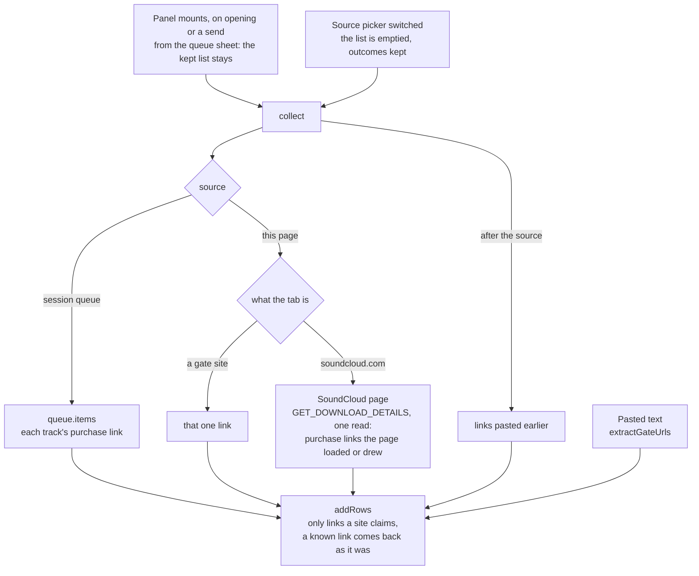
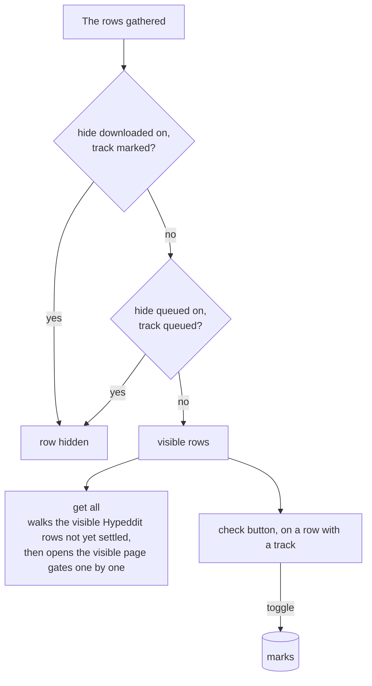
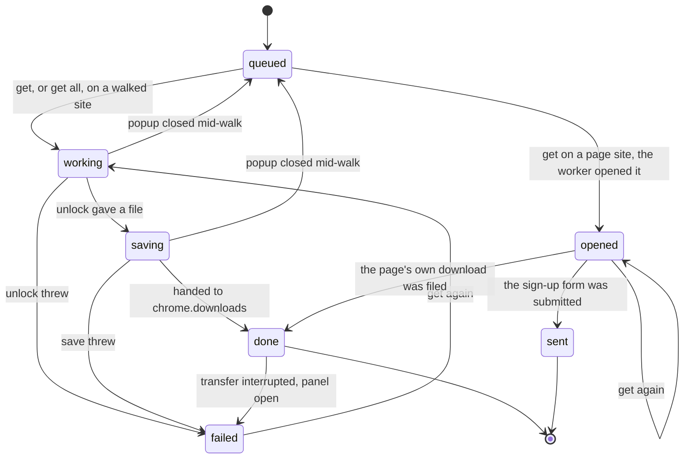
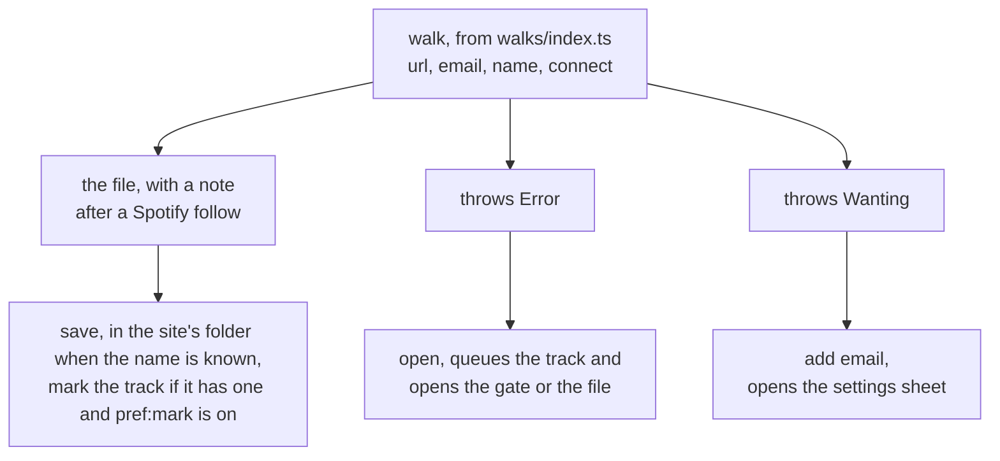
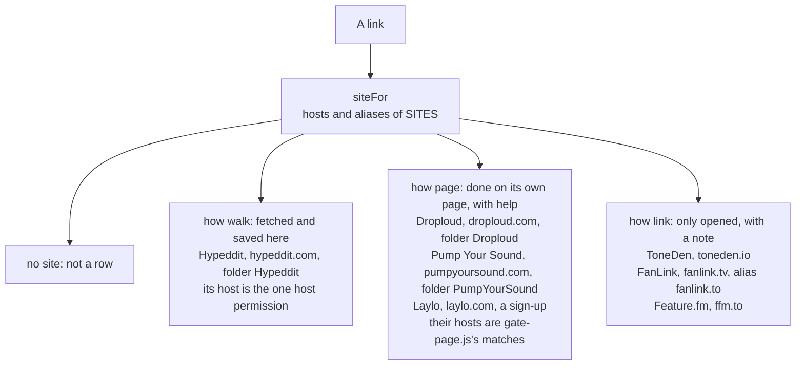
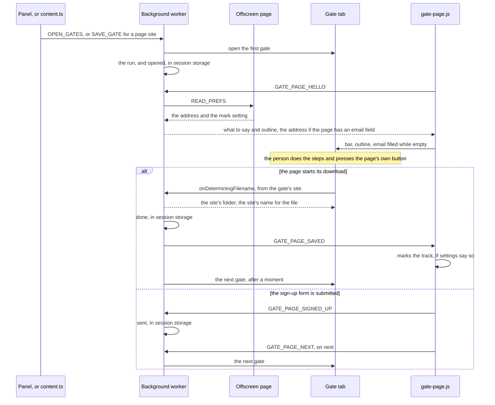
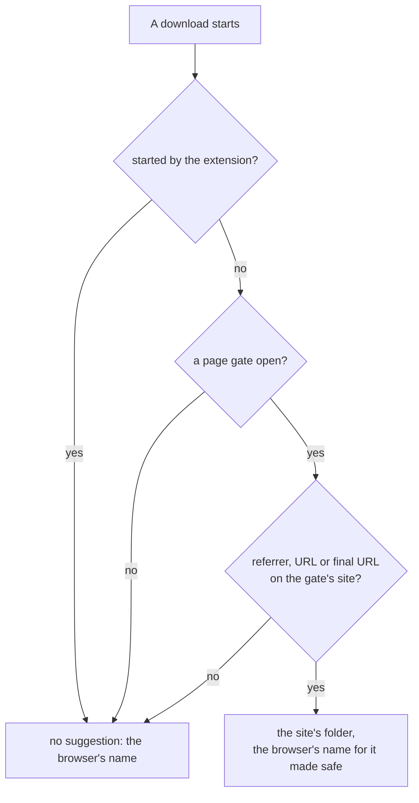
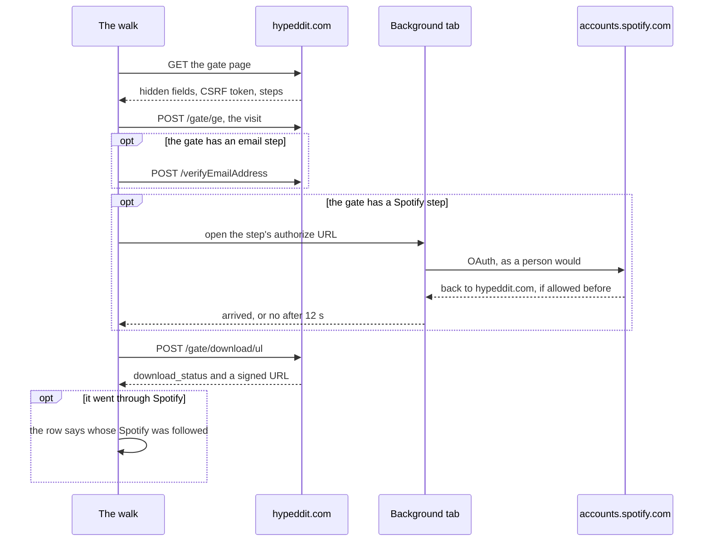

# localtoolbox diagrams: the downloader

Gate links, row life, walks, gates done on their own page, and gate sites. The rest are listed in the [README](../../README.md#diagrams).

- [Gathering gate links](#gathering-gate-links)
- [Narrowing the Downloader list](#narrowing-the-downloader-list)
- [Life of a Downloader row](#life-of-a-downloader-row)
- [What a walk can answer](#what-a-walk-can-answer)
- [Gate sites as data](#gate-sites-as-data)
- [A gate done on its own page](#a-gate-done-on-its-own-page)
- [The Spotify step on a Hypeddit gate](#the-spotify-step-on-a-hypeddit-gate)

## Gathering gate links

Where the third-party downloader's rows come from. Reopening the popup keeps the list, and only the source picker empties it. A send from the queue sheet adds the queue's links to what is listed.

Source: [`src/tools/third-party-downloads/Panel.svelte`](../../src/tools/third-party-downloads/Panel.svelte), [`src/tools/third-party-downloads/walked.svelte.ts`](../../src/tools/third-party-downloads/walked.svelte.ts), [`src/tools/third-party-downloads/sites/index.ts`](../../src/tools/third-party-downloads/sites/index.ts), [`src/lib/components/QueueSheet.svelte`](../../src/lib/components/QueueSheet.svelte)

## Narrowing the Downloader list

The two toggles choose what **get all** runs, and the check button marks a row by hand. A row with no track behind it is never hidden.

Source: [`src/tools/third-party-downloads/Panel.svelte`](../../src/tools/third-party-downloads/Panel.svelte), [`src/lib/filter.ts`](../../src/lib/filter.ts), [`src/lib/downloaded.svelte.ts`](../../src/lib/downloaded.svelte.ts)

## Life of a Downloader row

The `RowState` values. Walked rows run one at a time, and a run dies with the popup that started it. A page gate's row moves on through what the background worker reports, read when the popup next opens. A link site's row is an Open button in any state.

Source: [`src/tools/third-party-downloads/walked.svelte.ts`](../../src/tools/third-party-downloads/walked.svelte.ts), [`src/tools/third-party-downloads/Panel.svelte`](../../src/tools/third-party-downloads/Panel.svelte), [`src/tools/third-party-downloads/on-page.ts`](../../src/tools/third-party-downloads/on-page.ts)

## What a walk can answer

A walked site's walk ends one of three ways.

Source: [`src/tools/third-party-downloads/sites/index.ts`](../../src/tools/third-party-downloads/sites/index.ts), [`src/tools/third-party-downloads/walks/index.ts`](../../src/tools/third-party-downloads/walks/index.ts), [`src/tools/third-party-downloads/walks/hypeddit.ts`](../../src/tools/third-party-downloads/walks/hypeddit.ts), [`src/tools/third-party-downloads/next-step.ts`](../../src/tools/third-party-downloads/next-step.ts), [`src/tools/third-party-downloads/save.ts`](../../src/tools/third-party-downloads/save.ts), [`src/tools/third-party-downloads/Panel.svelte`](../../src/tools/third-party-downloads/Panel.svelte)

## Gate sites as data

`SITES` is the whole table. `siteFor` matches a link's host, without `www.`, and a site's `how` says what **get** does with it.

Source: [`src/tools/third-party-downloads/sites/index.ts`](../../src/tools/third-party-downloads/sites/index.ts), [`src/tools/third-party-downloads/sites/hypeddit.ts`](../../src/tools/third-party-downloads/sites/hypeddit.ts), [`src/tools/third-party-downloads/sites/droploud.ts`](../../src/tools/third-party-downloads/sites/droploud.ts), [`src/tools/third-party-downloads/sites/pumpyoursound.ts`](../../src/tools/third-party-downloads/sites/pumpyoursound.ts), [`src/tools/third-party-downloads/sites/laylo.ts`](../../src/tools/third-party-downloads/sites/laylo.ts), [`src/tools/third-party-downloads/sites/toneden.ts`](../../src/tools/third-party-downloads/sites/toneden.ts), [`src/tools/third-party-downloads/sites/featurefm.ts`](../../src/tools/third-party-downloads/sites/featurefm.ts), [`src/manifest.json`](../../src/manifest.json)

## A gate done on its own page

Get on a Droploud, Pump Your Sound or Laylo row, Get all with some listed, or the page's Download button on a link to one. The person does the steps; the extension opens the page, helps on it and files the download.

Source: [`src/tools/third-party-downloads/on-page.ts`](../../src/tools/third-party-downloads/on-page.ts), [`src/background.ts`](../../src/background.ts), [`src/offscreen.ts`](../../src/offscreen.ts), [`gate-page.ts`](../../gate-page.ts), [`src/tools/third-party-downloads/Panel.svelte`](../../src/tools/third-party-downloads/Panel.svelte), [`content.ts`](../../content.ts)

Which downloads are the gate's. Anything not claimed keeps the browser's own name.

Source: [`src/tools/third-party-downloads/on-page.ts`](../../src/tools/third-party-downloads/on-page.ts), [`src/tools/third-party-downloads/save.ts`](../../src/tools/third-party-downloads/save.ts), [`src/background.ts`](../../src/background.ts)

## The Spotify step on a Hypeddit gate

The one step that needs a tab. A no throws before the download post goes out, and in a panel run the first no stops the trip for the rest of that run.

Source: [`src/tools/third-party-downloads/walks/hypeddit.ts`](../../src/tools/third-party-downloads/walks/hypeddit.ts), [`src/lib/chrome.ts`](../../src/lib/chrome.ts), [`src/tools/third-party-downloads/Panel.svelte`](../../src/tools/third-party-downloads/Panel.svelte)
