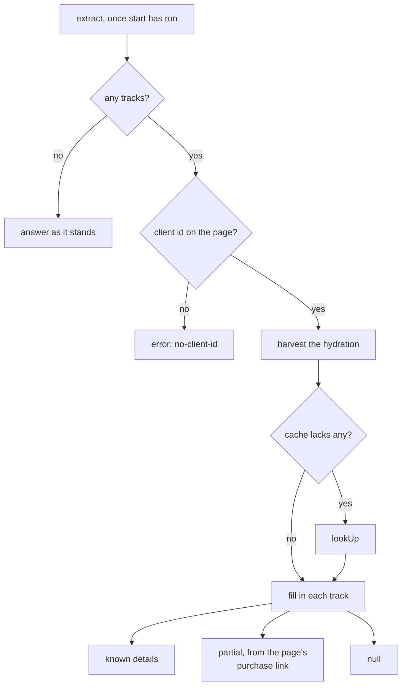
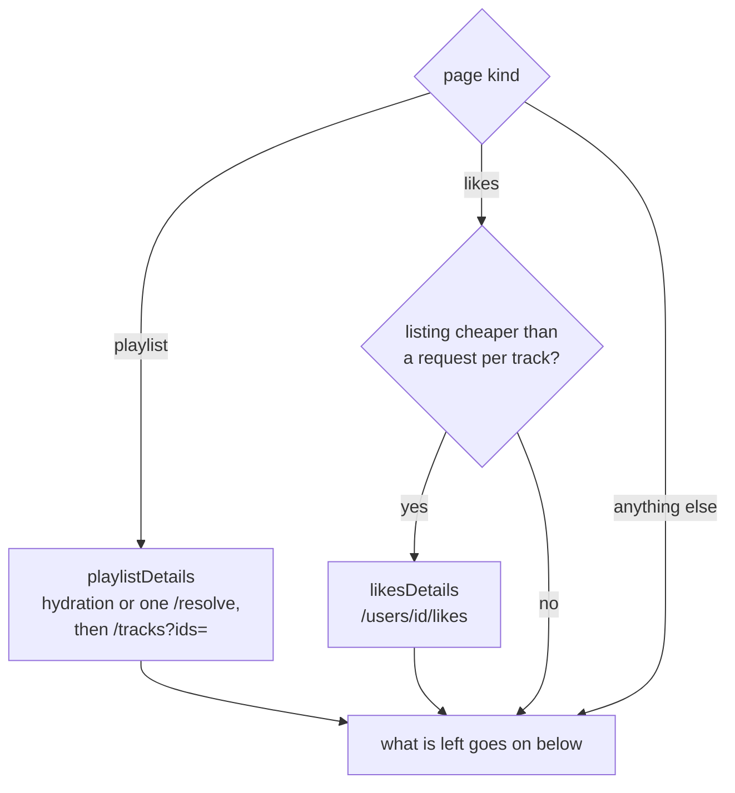
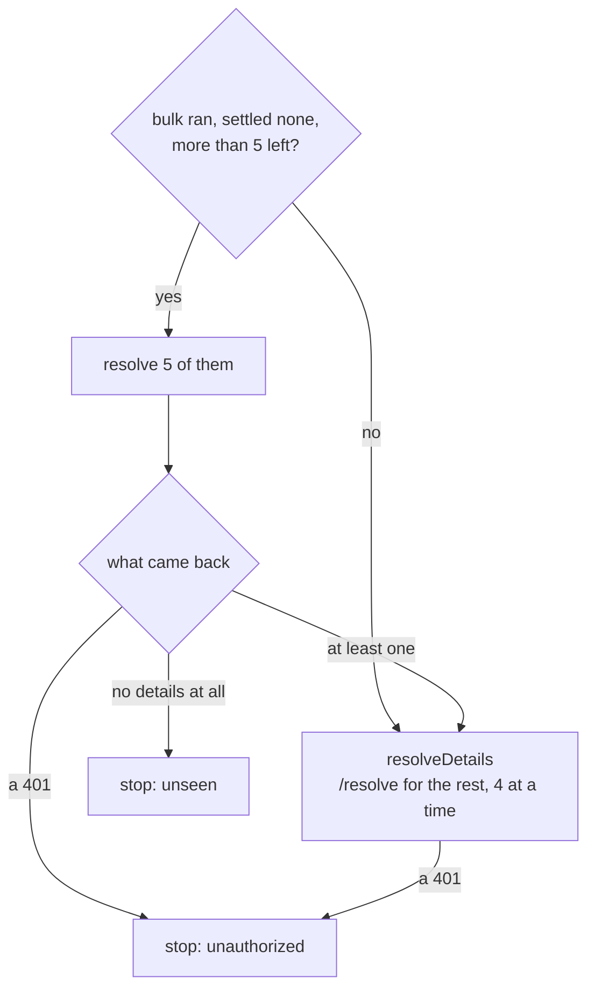
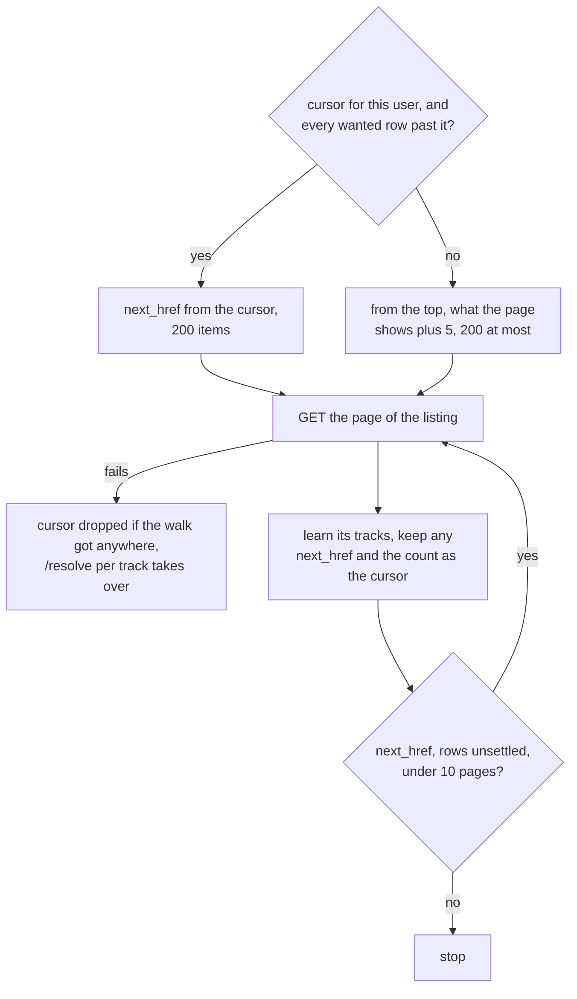
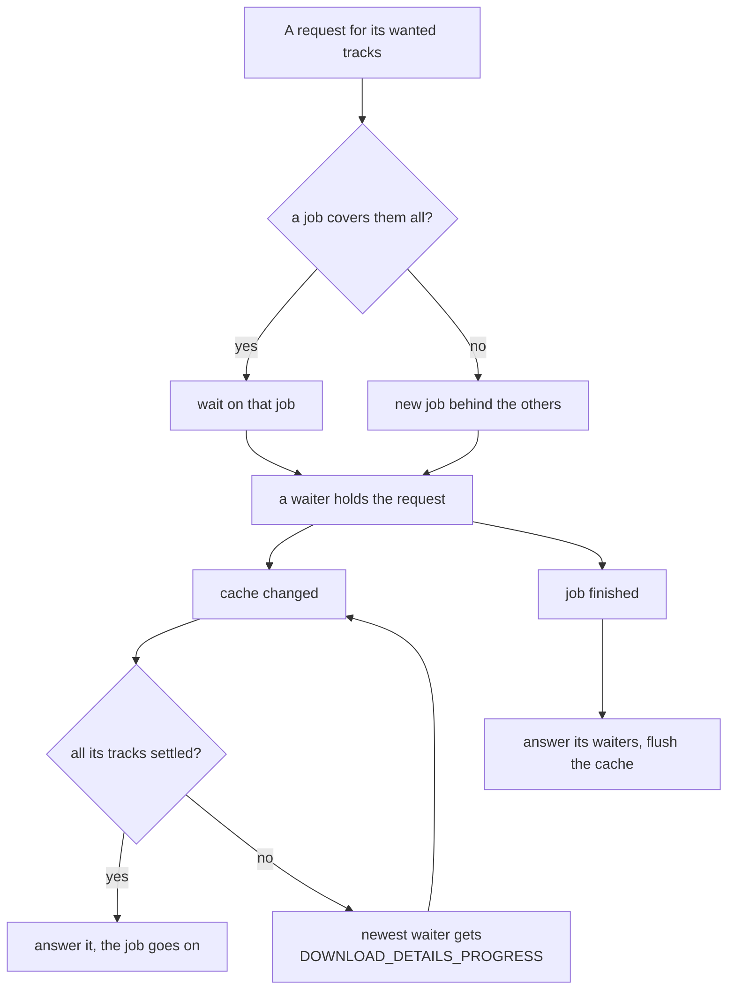
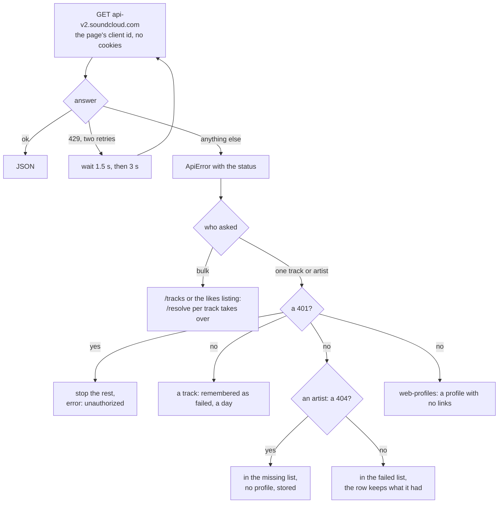
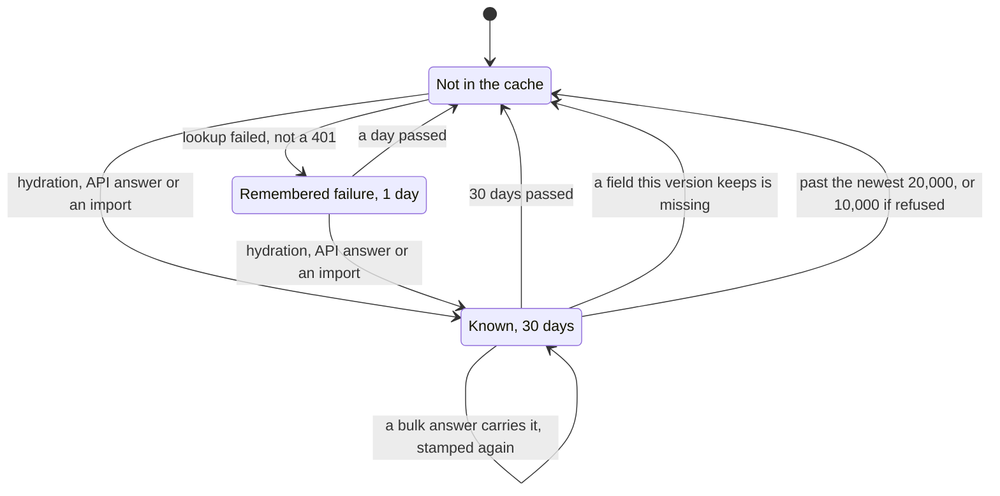
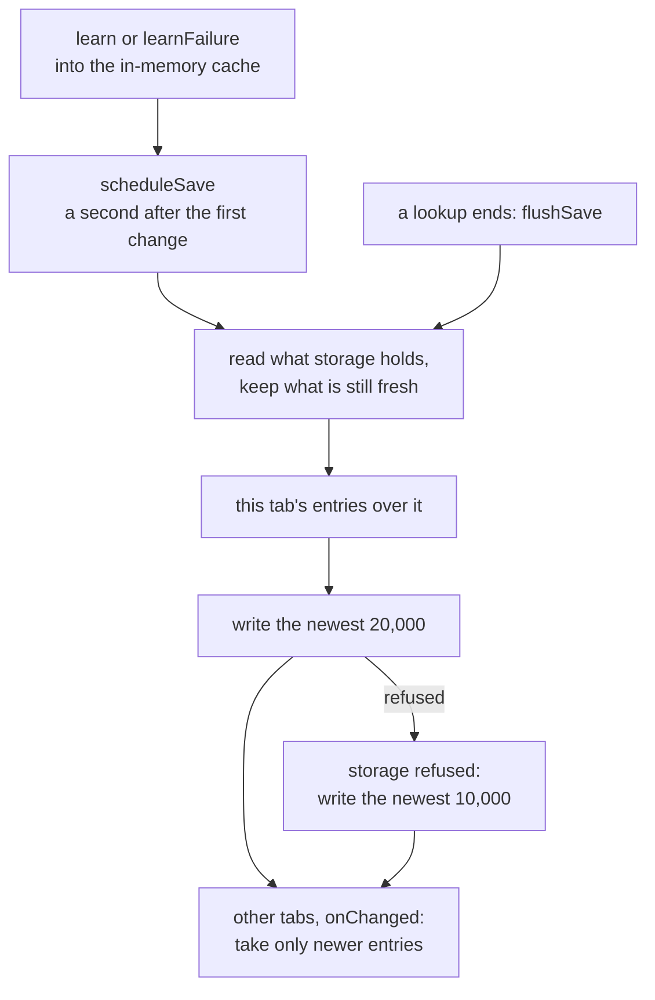

# localtoolbox diagrams: Lookups

RunJob, the likes listing, API failures and the details cache. The rest are listed in the [README](../../README.md#diagrams).

- [Free answers first](#free-answers-first)
- [One lookup step by step](#one-lookup-step-by-step)
- [Picking up the likes listing](#picking-up-the-likes-listing)
- [Joining a running lookup](#joining-a-running-lookup)
- [Asking the API and failing](#asking-the-api-and-failing)
- [Life of a details entry](#life-of-a-details-entry)
- [Writing the details cache back](#writing-the-details-cache-back)

## Free answers first

What `GET_DOWNLOAD_DETAILS` does before it asks SoundCloud anything, and how each track's answer is filled in afterwards.

Source: [`content.ts`](../../content.ts)

## One lookup step by step

`runJob`, starting with the bulk source for the page's kind.

Source: [`content.ts`](../../content.ts)

Then what it left. A page the anonymous API can't see stops after five rows.

Source: [`content.ts`](../../content.ts)

## Picking up the likes listing

`likesDetails` carries on from where the last walk of a user's likes stopped, as long as every row it wants lies past that point.

Source: [`content.ts`](../../content.ts)

## Joining a running lookup

One lookup runs at a time per tab. A request whose tracks are already covered joins and is answered as soon as they settle.

Source: [`content.ts`](../../content.ts)

## Asking the API and failing

`apiGet` is the one way to SoundCloud's API. What happens to a failure depends on who asked.

Source: [`content.ts`](../../content.ts)

## Life of a details entry

One entry under `details` in `chrome.storage.local`. Age isn't the only way an entry goes off.

Source: [`content.ts`](../../content.ts), [`state-transfer.ts`](../../state-transfer.ts)

## Writing the details cache back

Answers go into memory as they arrive and reach storage a moment later, merged with what other tabs have written.

Source: [`content.ts`](../../content.ts)
