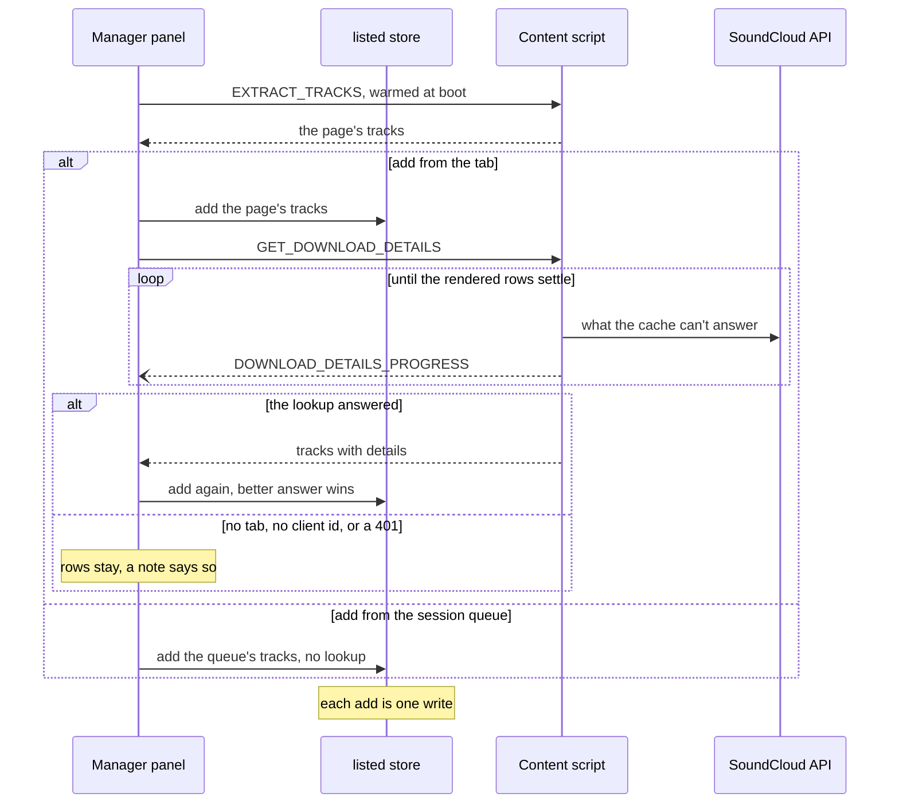
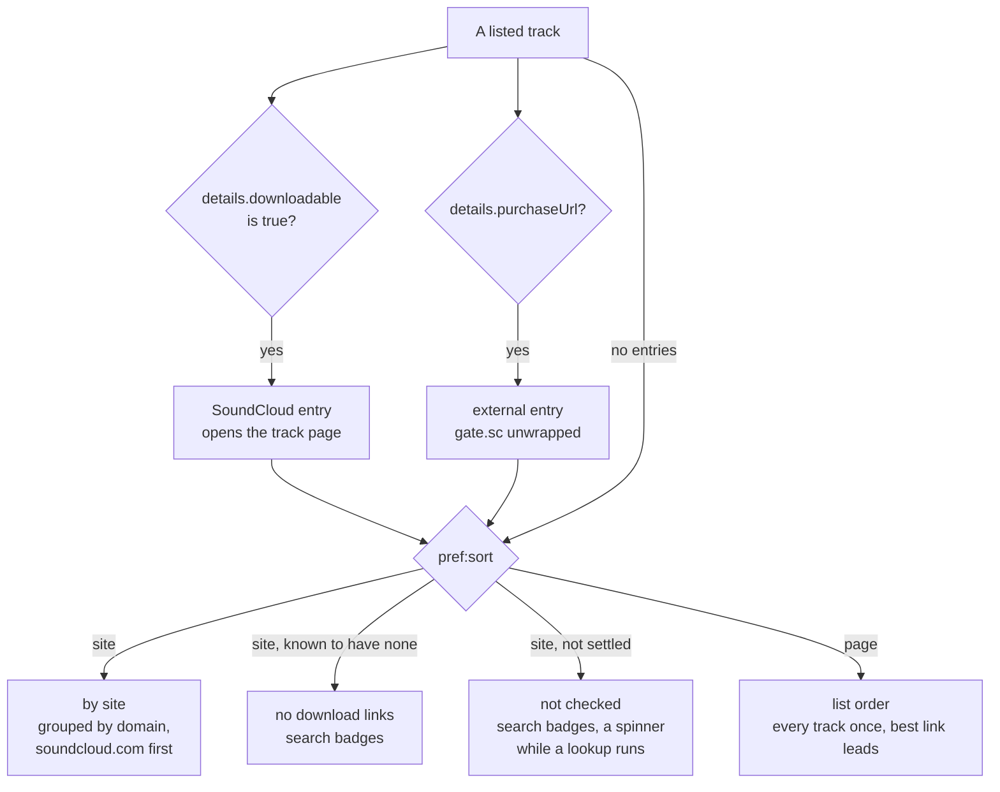
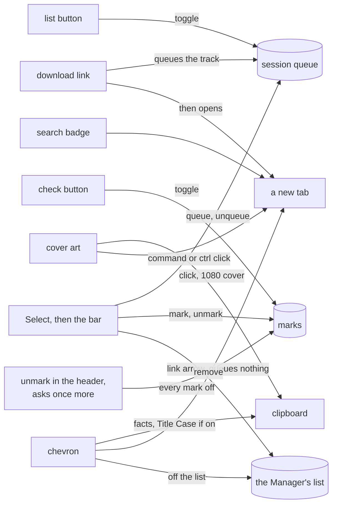
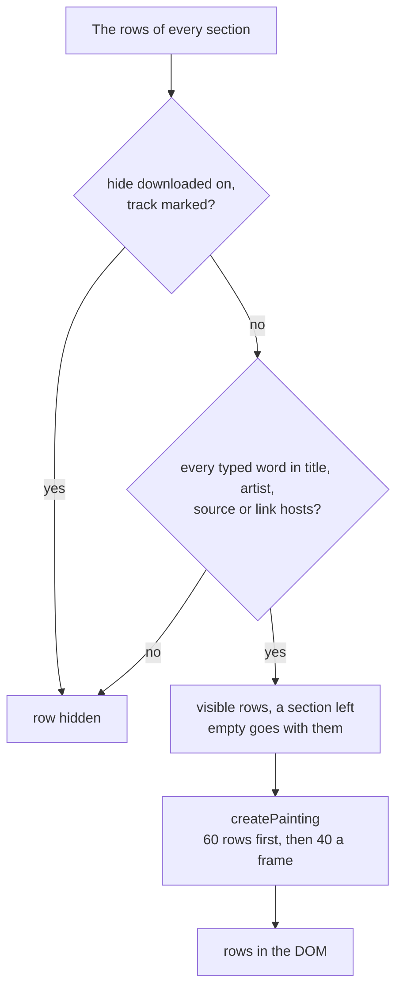
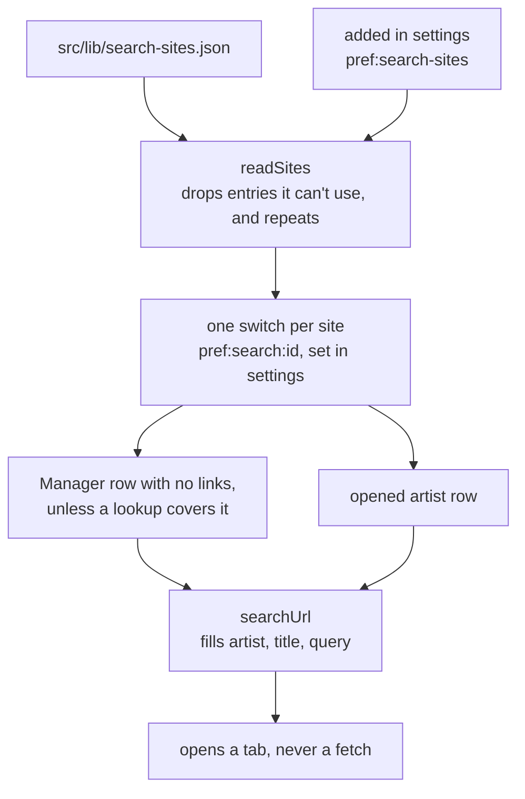

# localtoolbox diagrams: the Manager

Adding, filing and acting on rows, filters and search badges. The rest are listed in the [README](../../README.md#diagrams).

- [Adding to the Manager list](#adding-to-the-manager-list)
- [Filing a Manager row](#filing-a-manager-row)
- [What a Manager row can do](#what-a-manager-row-can-do)
- [Filtering and painting the Manager list](#filtering-and-painting-the-manager-list)
- [Search badges](#search-badges)

## Adding to the Manager list

Opening the panel only reads the page to label the button. Pressing **add** puts rows up first and asks SoundCloud second.

Source: [`src/tools/manager/Panel.svelte`](../../src/tools/manager/Panel.svelte), [`src/tools/manager/AddBar.svelte`](../../src/tools/manager/AddBar.svelte), [`src/tools/manager/listed.svelte.ts`](../../src/tools/manager/listed.svelte.ts), [`src/lib/tools.ts`](../../src/lib/tools.ts)

## Filing a Manager row

How a listed track turns into links, and which section it lands in.

Source: [`src/tools/manager/links.ts`](../../src/tools/manager/links.ts), [`src/tools/manager/Panel.svelte`](../../src/tools/manager/Panel.svelte)

## What a Manager row can do

Every action on a row and on a ticked batch, the header's **unmark**, and what each one writes.

Source: [`src/tools/manager/Panel.svelte`](../../src/tools/manager/Panel.svelte), [`src/lib/selection.svelte.ts`](../../src/lib/selection.svelte.ts), [`src/lib/artwork.ts`](../../src/lib/artwork.ts), [`src/lib/title-case.svelte.ts`](../../src/lib/title-case.svelte.ts)

## Filtering and painting the Manager list

Which rows reach the screen. The search is kept for the session and **hide downloaded** for good, under a key the Downloader shares.

Source: [`src/lib/list-filter.svelte.ts`](../../src/lib/list-filter.svelte.ts), [`src/lib/filter.ts`](../../src/lib/filter.ts), [`src/lib/painting.svelte.ts`](../../src/lib/painting.svelte.ts), [`src/tools/manager/links.ts`](../../src/tools/manager/links.ts), [`src/tools/manager/Panel.svelte`](../../src/tools/manager/Panel.svelte)

## Search badges

Sites are data, and adding one to the JSON file, or in settings, adds its badge and its switch.

Source: [`src/lib/search-sites.json`](../../src/lib/search-sites.json), [`src/lib/search-sites.ts`](../../src/lib/search-sites.ts), [`src/lib/search-sites.svelte.ts`](../../src/lib/search-sites.svelte.ts), [`src/lib/components/SearchSiteForm.svelte`](../../src/lib/components/SearchSiteForm.svelte), [`src/tools/manager/Panel.svelte`](../../src/tools/manager/Panel.svelte)
