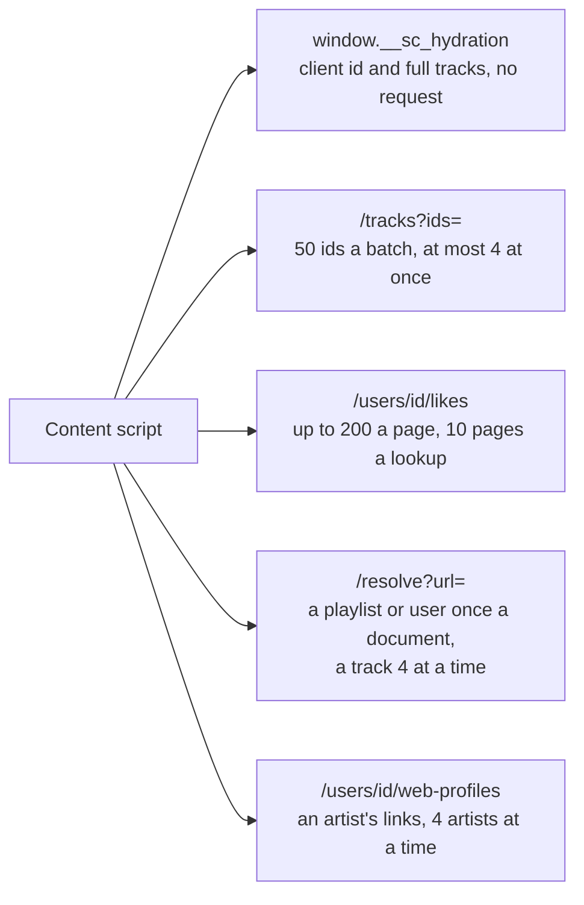
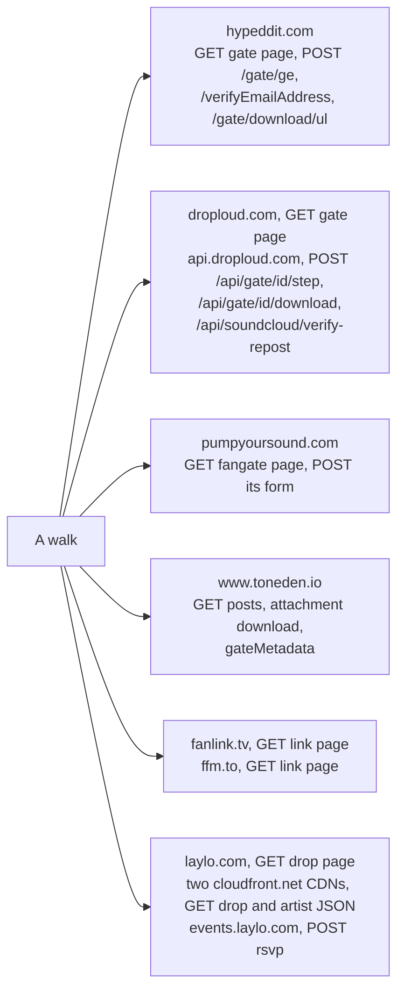
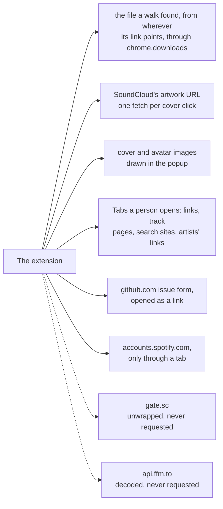

# localtoolbox diagrams: Outside requests

What each host is asked and what else leaves the browser. The rest are listed in the [README](../../README.md#diagrams).

- [What SoundCloud is asked](#what-soundcloud-is-asked)
- [What the gate hosts are asked](#what-the-gate-hosts-are-asked)
- [What else leaves the browser](#what-else-leaves-the-browser)

## What SoundCloud is asked

Every API request goes out from the content script, anonymous and `GET` only, because the API takes calls from `soundcloud.com` alone.

Source: [`content.ts`](../../content.ts)

## What the gate hosts are asked

One link at a time, from a panel or the offscreen page. Each host below is in `host_permissions`.

Source: [`src/manifest.json`](../../src/manifest.json), [`src/tools/third-party-downloads/sites/hypeddit.ts`](../../src/tools/third-party-downloads/sites/hypeddit.ts), [`src/tools/third-party-downloads/sites/droploud.ts`](../../src/tools/third-party-downloads/sites/droploud.ts), [`src/tools/third-party-downloads/sites/pumpyoursound.ts`](../../src/tools/third-party-downloads/sites/pumpyoursound.ts), [`src/tools/third-party-downloads/sites/toneden.ts`](../../src/tools/third-party-downloads/sites/toneden.ts), [`src/tools/third-party-downloads/sites/laylo.ts`](../../src/tools/third-party-downloads/sites/laylo.ts), [`src/tools/third-party-downloads/sites/featurefm.ts`](../../src/tools/third-party-downloads/sites/featurefm.ts)

## What else leaves the browser

The other ways out, and two addresses that are read but never requested.

Source: [`src/tools/third-party-downloads/save.ts`](../../src/tools/third-party-downloads/save.ts), [`src/lib/clipboard.ts`](../../src/lib/clipboard.ts), [`src/lib/components/Artwork.svelte`](../../src/lib/components/Artwork.svelte), [`src/lib/chrome.ts`](../../src/lib/chrome.ts), [`src/lib/bug-report.ts`](../../src/lib/bug-report.ts), [`src/tools/third-party-downloads/sites/index.ts`](../../src/tools/third-party-downloads/sites/index.ts), [`src/tools/third-party-downloads/sites/featurefm.ts`](../../src/tools/third-party-downloads/sites/featurefm.ts)
