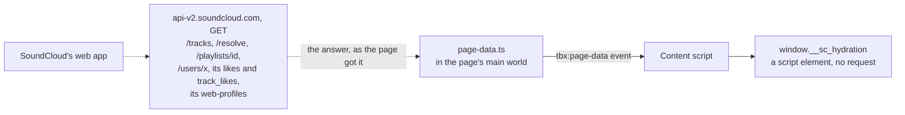
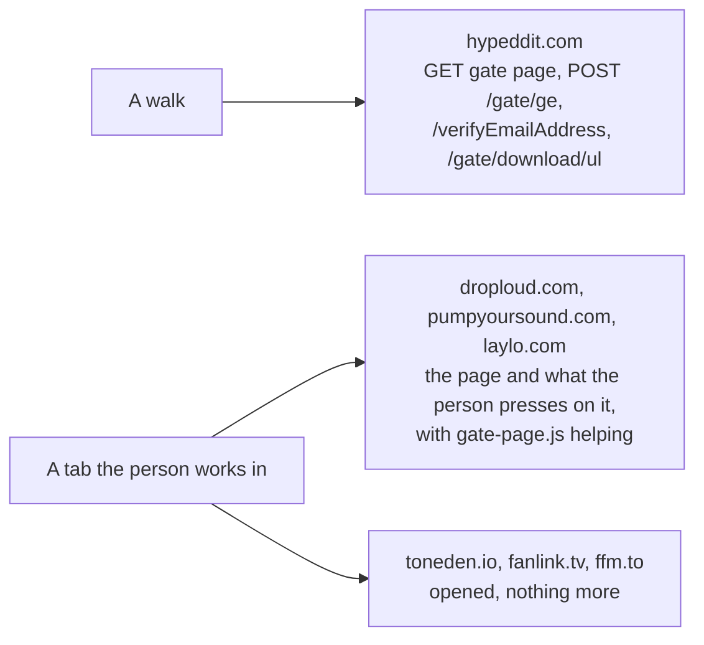
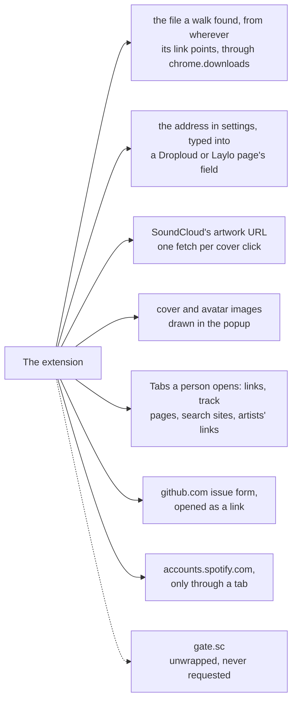

# localtoolbox diagrams: Outside requests

What is read from SoundCloud's own page, what each gate host is asked, and what else leaves the browser. The rest are listed in the [README](../../README.md#diagrams).

- [What is read from SoundCloud's page](#what-is-read-from-soundclouds-page)
- [What the gate hosts are asked](#what-the-gate-hosts-are-asked)
- [What else leaves the browser](#what-else-leaves-the-browser)

## What is read from SoundCloud's page

The extension sends SoundCloud's API nothing. The content script reads the JSON the page was served with, and `page-data.ts` passes on the answers to requests SoundCloud's own web app makes as it is browsed. Dotted lines are requests the page makes, listened to and never repeated.

Source: [`content.ts`](../../content.ts), [`page-data.ts`](../../page-data.ts)

## What the gate hosts are asked

Only Hypeddit is fetched, one link at a time, from a panel or the offscreen page; its host is the one in `host_permissions`. The other gate sites are opened as tabs a person works in.

Source: [`src/manifest.json`](../../src/manifest.json), [`src/tools/third-party-downloads/walks/hypeddit.ts`](../../src/tools/third-party-downloads/walks/hypeddit.ts), [`src/tools/third-party-downloads/sites/index.ts`](../../src/tools/third-party-downloads/sites/index.ts), [`src/tools/third-party-downloads/on-page.ts`](../../src/tools/third-party-downloads/on-page.ts), [`gate-page.ts`](../../gate-page.ts)

## What else leaves the browser

The other ways out, and an address that is read but never requested.

Source: [`src/tools/third-party-downloads/save.ts`](../../src/tools/third-party-downloads/save.ts), [`src/lib/clipboard.ts`](../../src/lib/clipboard.ts), [`src/lib/components/Artwork.svelte`](../../src/lib/components/Artwork.svelte), [`src/lib/chrome.ts`](../../src/lib/chrome.ts), [`src/lib/bug-report.ts`](../../src/lib/bug-report.ts), [`src/tools/third-party-downloads/sites/index.ts`](../../src/tools/third-party-downloads/sites/index.ts), [`gate-page.ts`](../../gate-page.ts)
