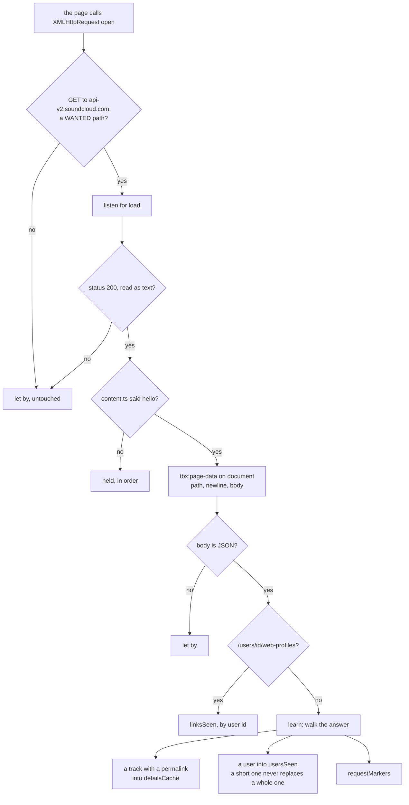
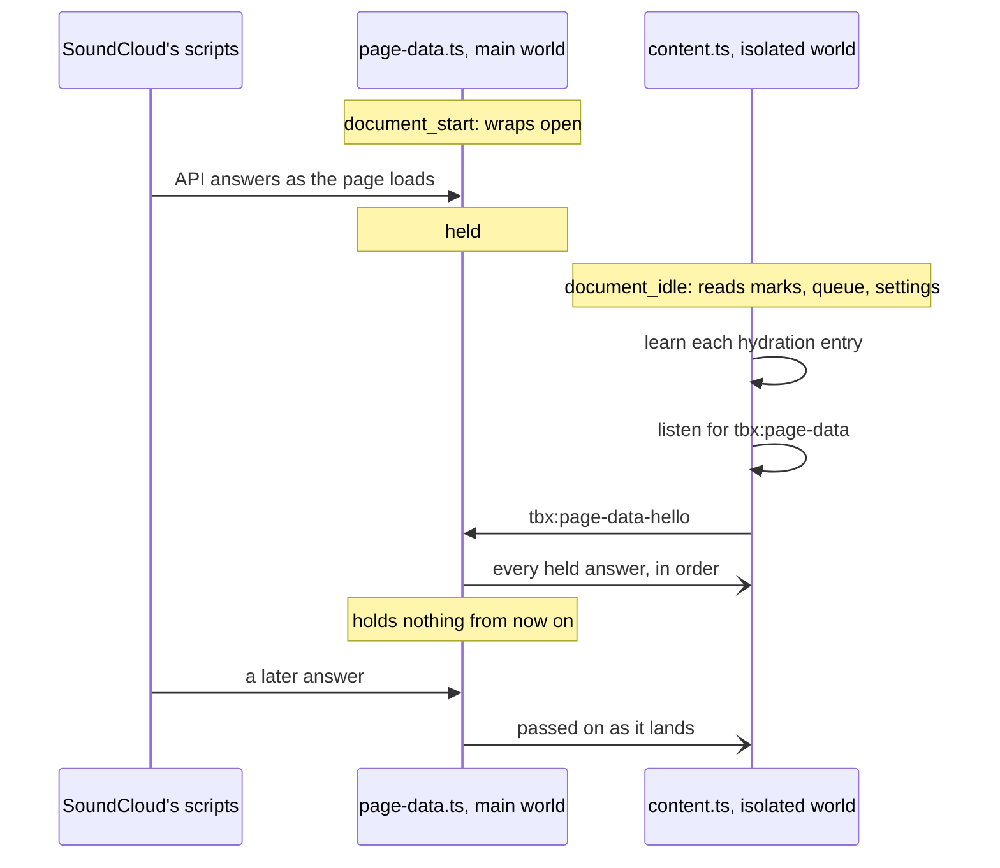
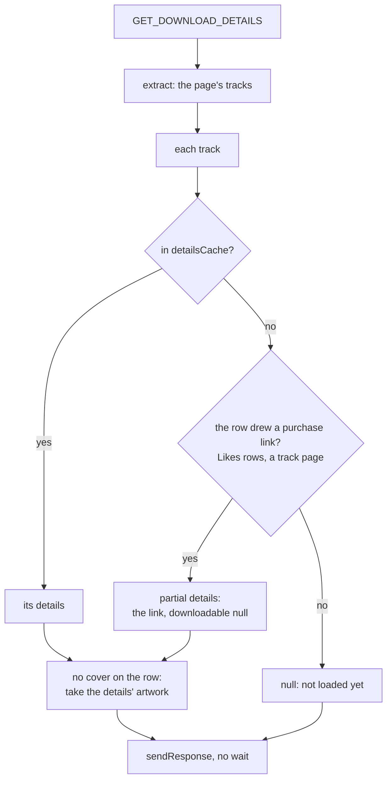
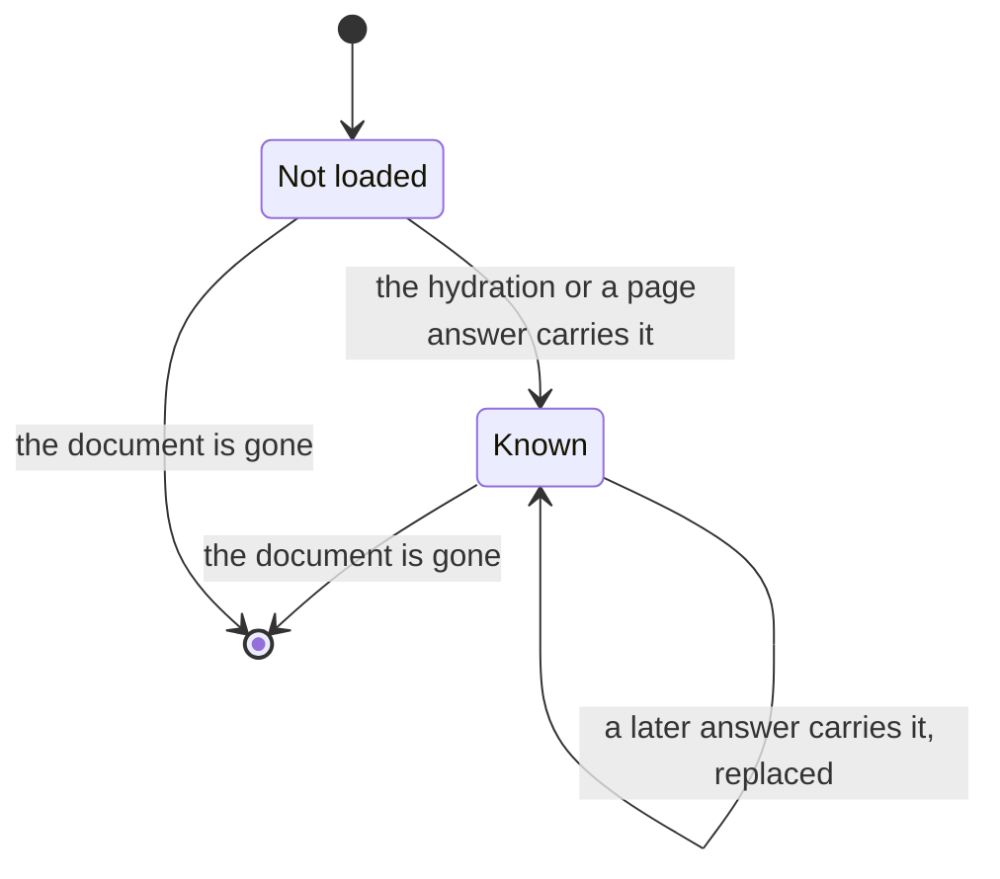
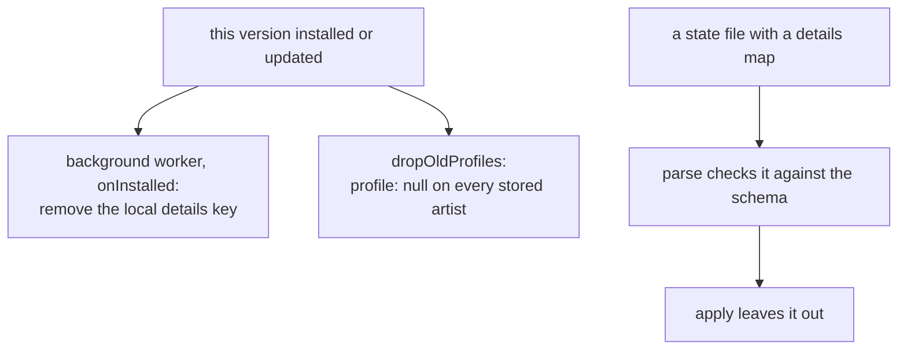
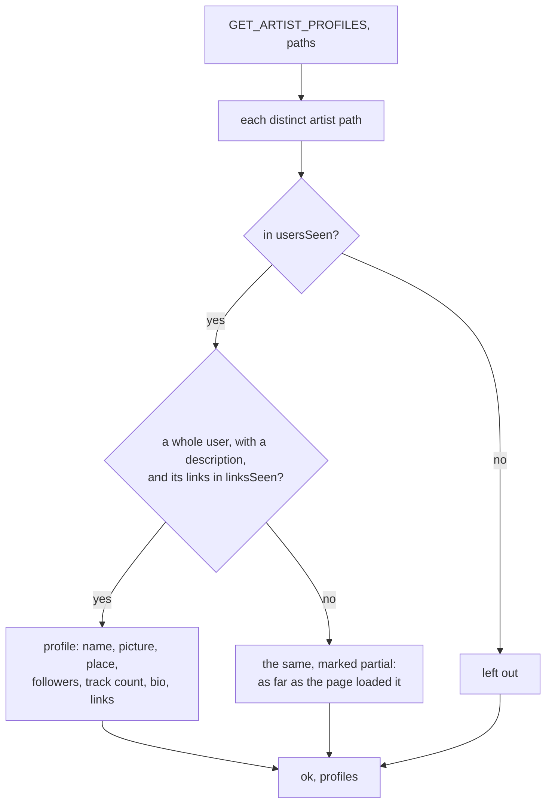

# localtoolbox diagrams: What the page has loaded

How the content script learns tracks and users from SoundCloud's own page, and what it answers with. The rest are listed in the [README](../../README.md#diagrams).

- [From the page's answer to the markers](#from-the-pages-answer-to-the-markers)
- [Saying hello](#saying-hello)
- [Answering for download details](#answering-for-download-details)
- [Life of a details entry](#life-of-a-details-entry)
- [What an older version left](#what-an-older-version-left)
- [Answering for artist profiles](#answering-for-artist-profiles)

## From the page's answer to the markers

SoundCloud's web app loads tracks and users from its API as the page is browsed. `page-data.ts` listens to those requests in the page's main world and passes each answer on as it was received. It makes no request and changes none.

Source: [`page-data.ts`](../../page-data.ts), [`content.ts`](../../content.ts)

The WANTED paths are `/tracks`, `/resolve`, `/playlists/<id>`, `/users/<x>`, and a user's `/likes`, `/track_likes` and `/web-profiles`. `learn` looks inside arrays and under `collection`, `tracks`, `track`, `playlist` and `user`, so a like, a listing, a playlist and every track's uploader are all reached. A playlist's bare `{ id }` stubs carry no permalink and are passed over.

## Saying hello

`page-data.ts` starts before SoundCloud's own scripts and `content.ts` after them, so the answers in between are held. Once the content script has read its storage, it learns the hydration, starts listening and says hello.

Source: [`page-data.ts`](../../page-data.ts), [`content.ts`](../../content.ts), [`src/manifest.json`](../../src/manifest.json)

## Answering for download details

`GET_DOWNLOAD_DETAILS` is answered at once from what the tab holds. Only the top frame answers.

Source: [`content.ts`](../../content.ts)

## Life of a details entry

One entry in `detailsCache`, which is the tab's memory and nothing else. In-app navigation keeps the document, so it keeps the entries; a reload or a closed tab ends them.

Source: [`content.ts`](../../content.ts)

## What an older version left

Older versions kept details for a month under `details` in `chrome.storage.local`, kept each listed artist's profile on the artists list for good, and exported both. All of it is let go.

Source: [`src/background.ts`](../../src/background.ts), [`src/tools/artists/old-profiles.ts`](../../src/tools/artists/old-profiles.ts), [`state-transfer.ts`](../../state-transfer.ts)

## Answering for artist profiles

`GET_ARTIST_PROFILES` answers at once with the accounts the page has loaded, of the paths asked about. Every track names its uploader in short; a profile page loads the whole user and its links.

Source: [`content.ts`](../../content.ts)
