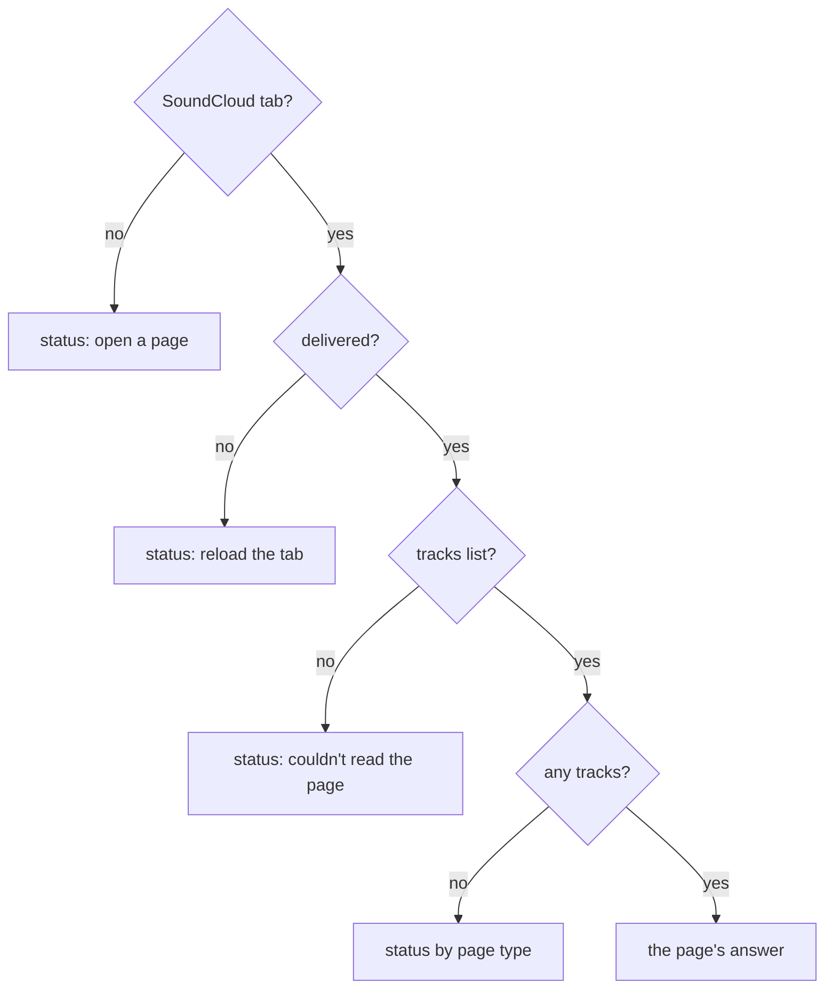
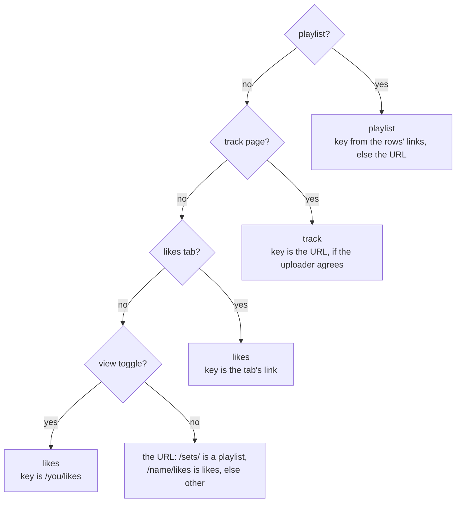
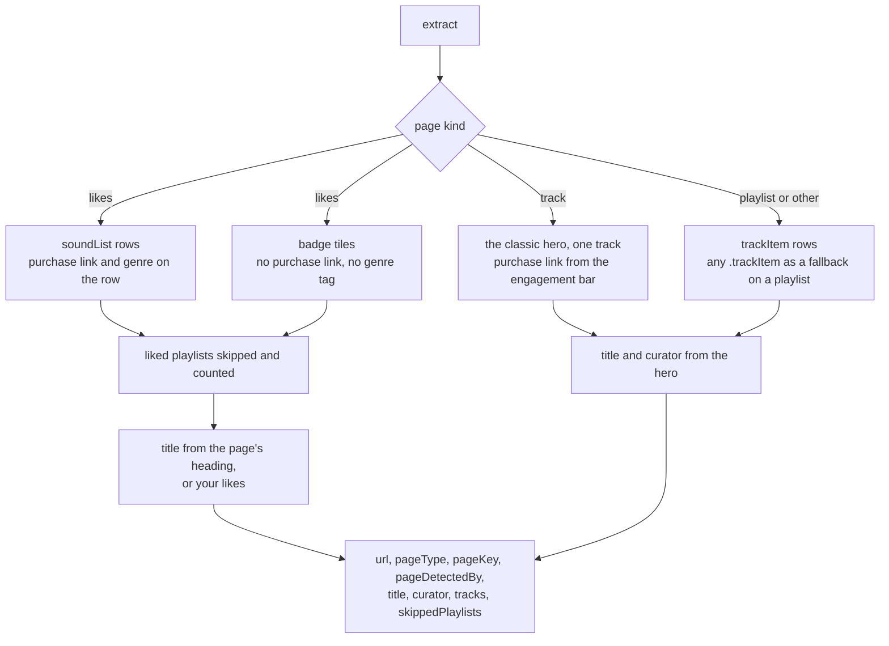
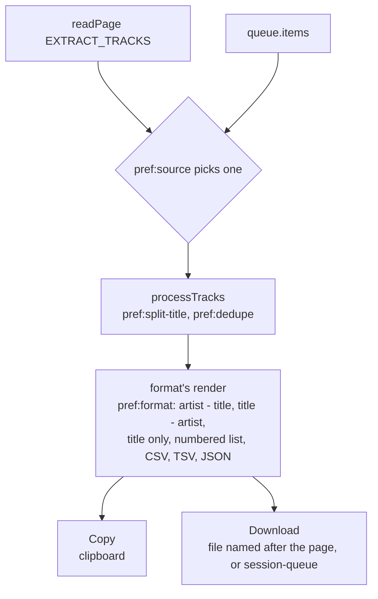

# localtoolbox diagrams: Reading pages

What the panels ask a tab, and playlist to text. The rest are listed in the [README](../../README.md#diagrams).

- [Reading the active tab](#reading-the-active-tab)
- [Telling which page is showing](#telling-which-page-is-showing)
- [Reading tracks by page kind](#reading-tracks-by-page-kind)
- [Turning tracks into text](#turning-tracks-into-text)

## Reading the active tab

What `readPage` hands a panel: the page's answer, or the sentence that says why there is none. A warmed read is this same read, started before the panel exists.

Source: [`src/lib/soundcloud.ts`](../../src/lib/soundcloud.ts), [`src/lib/chrome.ts`](../../src/lib/chrome.ts)

## Telling which page is showing

`detectPage` asks the rendered page in this order: the playlist layout, the track page, an active likes tab, the Library's view toggle. The URL is the last resort. A signed-in track page is the `other` page in the top document, because only its iframe holds the track.

Source: [`content.ts`](../../content.ts)

## Reading tracks by page kind

What `EXTRACT_TRACKS` reads from each kind of page. It asks SoundCloud nothing. A signed-in track page comes back with no track, since the top frame has no hero and the iframe does not answer.

Source: [`content.ts`](../../content.ts), [`src/lib/types.d.ts`](../../src/lib/types.d.ts)

## Turning tracks into text

The whole of the playlist to text tool. All of it runs in the popup, and the page is read on every opening, whichever source is chosen.

Source: [`src/tools/soundcloud-playlist-to-text/Panel.svelte`](../../src/tools/soundcloud-playlist-to-text/Panel.svelte), [`src/tools/soundcloud-playlist-to-text/formats.ts`](../../src/tools/soundcloud-playlist-to-text/formats.ts), [`src/lib/clipboard.ts`](../../src/lib/clipboard.ts)
