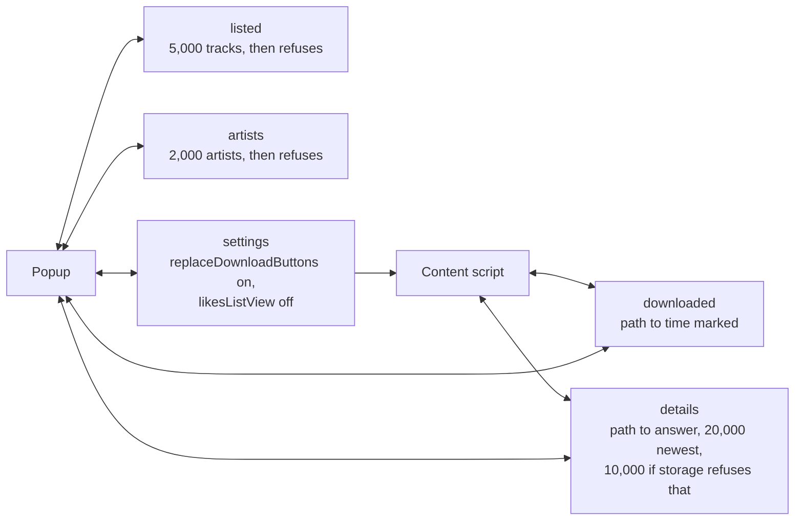
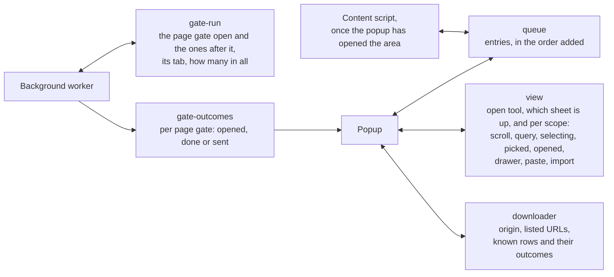
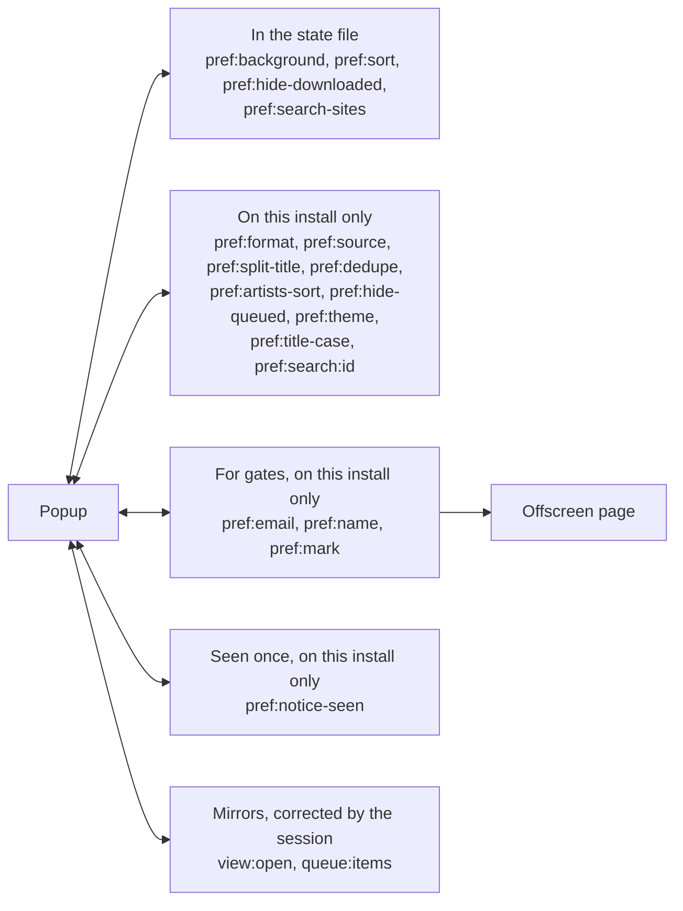
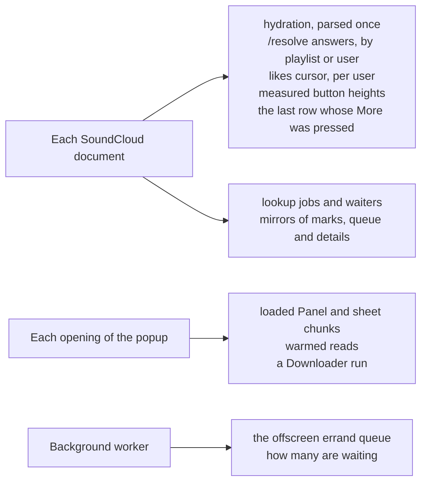
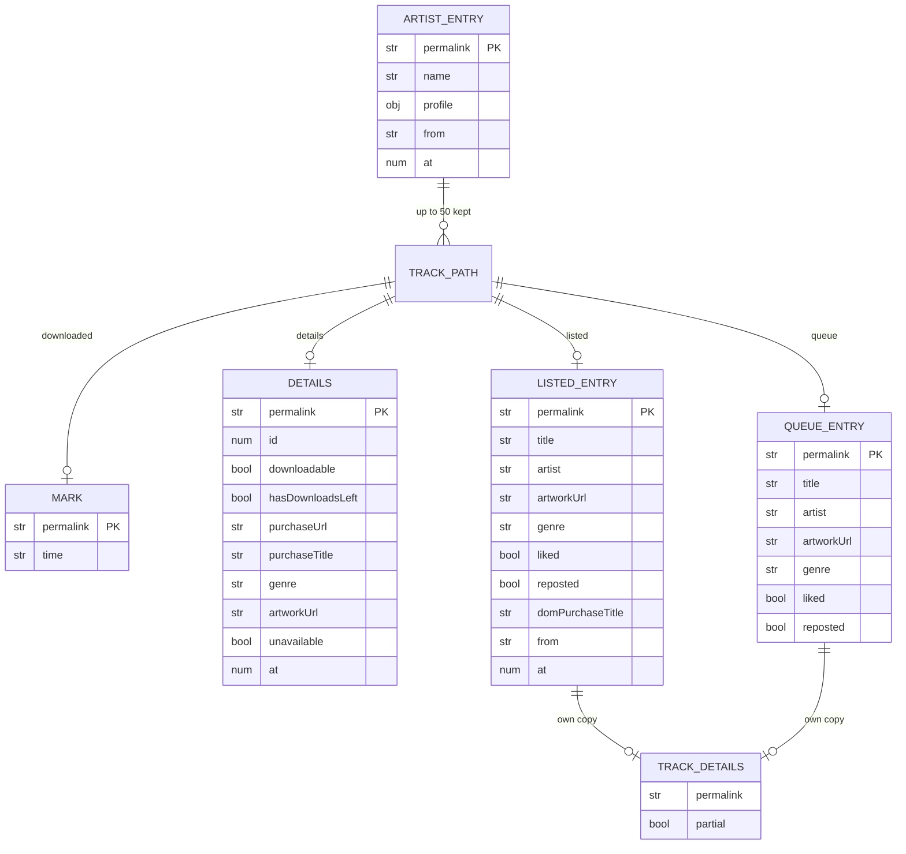
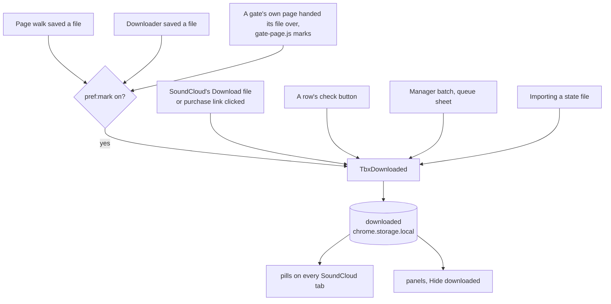
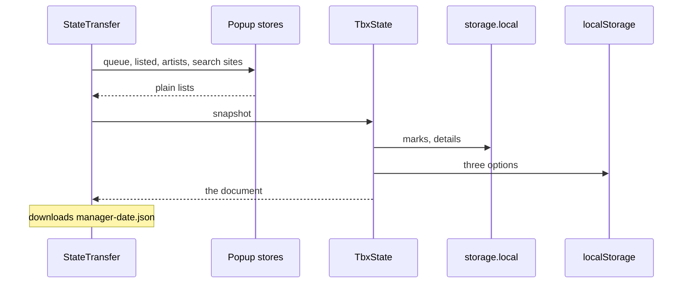
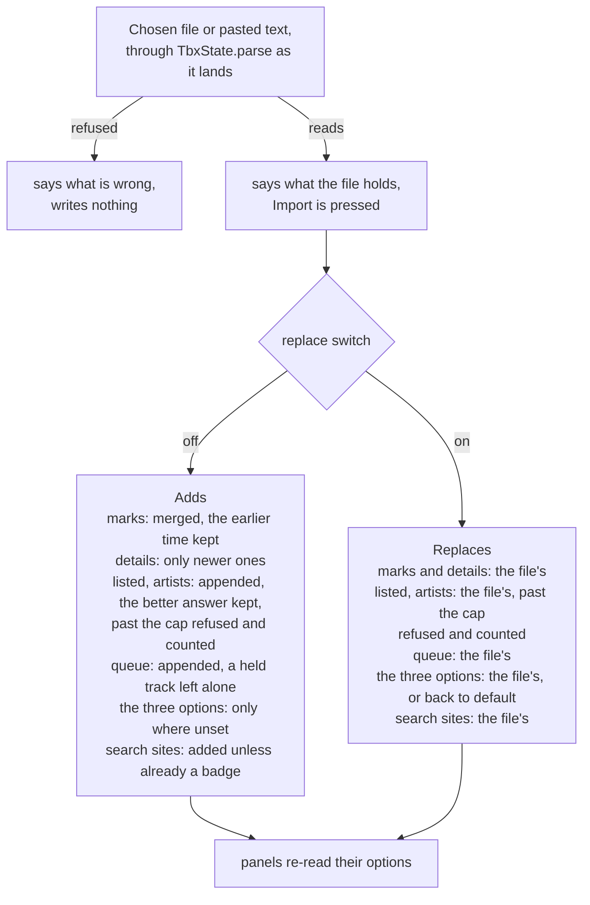
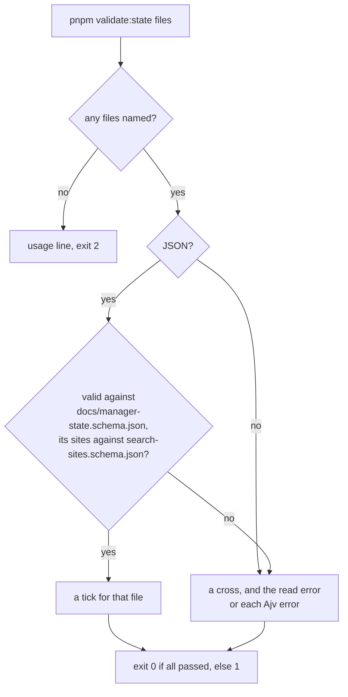

# localtoolbox diagrams: State

Every store, marks, export and import. The rest are listed in the [README](../../README.md#diagrams).

- [State kept for good](#state-kept-for-good)
- [State kept for the session](#state-kept-for-the-session)
- [Options and mirrors in localStorage](#options-and-mirrors-in-localstorage)
- [State held in memory](#state-held-in-memory)
- [Everything hangs off a path](#everything-hangs-off-a-path)
- [What makes a mark](#what-makes-a-mark)
- [Exporting the state file](#exporting-the-state-file)
- [Importing the state file](#importing-the-state-file)
- [Checking a state file by hand](#checking-a-state-file-by-hand)

## State kept for good

The `chrome.storage.local` keys, what each holds, and its limit. All of it goes with the extension. Everything but `settings` can be exported first.

Source: [`downloaded-store.ts`](../../downloaded-store.ts), [`content.ts`](../../content.ts), [`src/tools/manager/listed.svelte.ts`](../../src/tools/manager/listed.svelte.ts), [`src/tools/artists/artists.svelte.ts`](../../src/tools/artists/artists.svelte.ts), [`src/lib/settings.svelte.ts`](../../src/lib/settings.svelte.ts), [`state-transfer.ts`](../../state-transfer.ts)

## State kept for the session

The `chrome.storage.session` keys. They end when the browser closes, and a run in progress is never resumed.

Source: [`src/lib/queue.svelte.ts`](../../src/lib/queue.svelte.ts), [`src/lib/view.svelte.ts`](../../src/lib/view.svelte.ts), [`src/tools/third-party-downloads/walked.svelte.ts`](../../src/tools/third-party-downloads/walked.svelte.ts), [`src/tools/third-party-downloads/on-page.ts`](../../src/tools/third-party-downloads/on-page.ts)

## Options and mirrors in localStorage

The extension origin's own `localStorage`. The popup and the offscreen page share it, and a content script can't see it.

Source: [`src/lib/prefs.svelte.ts`](../../src/lib/prefs.svelte.ts), [`src/lib/downloader.svelte.ts`](../../src/lib/downloader.svelte.ts), [`src/lib/components/FirstRun.svelte`](../../src/lib/components/FirstRun.svelte), [`src/lib/view.svelte.ts`](../../src/lib/view.svelte.ts), [`src/lib/queue.svelte.ts`](../../src/lib/queue.svelte.ts), [`state-transfer.ts`](../../state-transfer.ts)

## State held in memory

What dies with the document, the popup or the worker.

Source: [`content.ts`](../../content.ts), [`src/lib/tools.ts`](../../src/lib/tools.ts), [`src/lib/soundcloud.ts`](../../src/lib/soundcloud.ts), [`src/background.ts`](../../src/background.ts)

## Everything hangs off a path

A track's permalink path is its identity in every store, and an artist's is the first segment of it. A details entry is either an answer or a remembered failure, which holds `unavailable` and `at` alone.

Source: [`src/lib/types.d.ts`](../../src/lib/types.d.ts), [`docs/manager-state.schema.json`](../manager-state.schema.json)

## What makes a mark

What puts a mark on a track. Clicking SoundCloud's own purchase link marks it on the spot, while opening a link from the Manager or through a replaced button queues it instead.

Source: [`downloaded-store.ts`](../../downloaded-store.ts), [`src/lib/downloaded.svelte.ts`](../../src/lib/downloaded.svelte.ts), [`content.ts`](../../content.ts), [`src/tools/third-party-downloads/Panel.svelte`](../../src/tools/third-party-downloads/Panel.svelte), [`src/offscreen.ts`](../../src/offscreen.ts), [`gate-page.ts`](../../gate-page.ts)

## Exporting the state file

What the popup holds goes in the file, so a queue kept only in memory is exported too.

Source: [`src/lib/components/StateTransfer.svelte`](../../src/lib/components/StateTransfer.svelte), [`state-transfer.ts`](../../state-transfer.ts), [`src/lib/clipboard.ts`](../../src/lib/clipboard.ts)

## Importing the state file

Adding is the default. Replacing is a switch that comes back off every time the popup does.

Source: [`state-transfer.ts`](../../state-transfer.ts), [`src/lib/components/StateTransfer.svelte`](../../src/lib/components/StateTransfer.svelte), [`downloaded-store.ts`](../../downloaded-store.ts), [`src/lib/queue.svelte.ts`](../../src/lib/queue.svelte.ts), [`src/tools/manager/listed.svelte.ts`](../../src/tools/manager/listed.svelte.ts), [`src/tools/artists/artists.svelte.ts`](../../src/tools/artists/artists.svelte.ts), [`src/lib/search-sites.svelte.ts`](../../src/lib/search-sites.svelte.ts), [`docs/manager-state.schema.json`](../manager-state.schema.json)

## Checking a state file by hand

`pnpm validate:state` holds a file to the same schema outside the browser. The popup's parser enforces that schema by hand, since a classic script can't import a validator.

Source: [`scripts/validate-state.mts`](../../scripts/validate-state.mts), [`docs/manager-state.schema.json`](../manager-state.schema.json), [`src/lib/search-sites.schema.json`](../../src/lib/search-sites.schema.json), [`state-transfer.ts`](../../state-transfer.ts)
