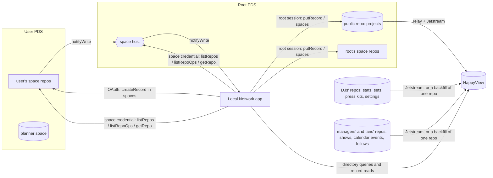

# Local Network

Promoters find local DJs who fit their shows. DJs (called _projects_: a solo DJ, a b2b duo, a group, or a collective) get a profile built around what promoters book on: sound, distance, slot, room size, and budget. Fans follow DJs and see where they play next.

All data lives on the AT Protocol. Public profiles are ordinary atproto records; everything private (requests, staff roles, the audit log, booking threads, personal planners) lives in [atproto spaces](https://atproto.com/blog/atproto-spaces-alpha), the protocol's permissioned-data extension. Published projects, the DJ stats, sets, press kits, shows and follows their managers and fans publish, and the few Bluesky and userinput.app records the site reads are indexed by [HappyView](https://happyview.dev), an AppView whose Lua scripts answer directory search and the show matcher and serve those records to the site. The app keeps its own SQLite index only for space data, and can rebuild it from the network. Every public record is read through HappyView, never straight from a PDS or Bluesky's AppView (see [Directory](#directory) for the few exceptions); writes go to the PDS.

> Atproto spaces is an alpha (released 2026). This app is built against `@atproto/*@0.0.0-spaces-alpha-20261022141228` and the [0016 spaces proposal](https://github.com/bluesky-social/proposals/tree/main/0016-permissioned-data). Expect breaking changes upstream; all versions are pinned.

## Features

### Dashboard

- Signing in lands on `/dashboard`, where every change to what a public page shows happens: each project you manage (`/dashboard/projects/<slug>`, with its profile, shows and press kits), your requests, booking threads, planner, and activity. Staff work in the staff console at `/admin`, on the same sidebar layout.
- Public pages only read, apart from Follow and Save. A project's managers get a Manage link to its dashboard there, and staff one to the staff console. A project that isn't public shows its managers and staff a "Not public yet" banner; everyone else gets a 404.

### Promoters

- Directory search by text, genre family (a search for "house" finds deep house and afro house), distance from a venue, fee tier, slot, format, and type.
- Show matcher: describe the night and get a ranked shortlist, scored on sound (40%), distance (25%), budget (15%), room size, slot, and booth setup, with the reasons for each match.
- Booking inquiries open a private thread (its own space) shared only with the project's managers, with show details up front and a status flow (open → negotiating → confirmed / declined / cancelled).
- A private planner (saved projects and shows with working lineups) in a personal space on the promoter's own PDS.

### DJs (projects)

- List a new project, or claim one an admin added. Several managers per project (crews, agents).
- When a project's managers change, a new manager joins its booking threads that are still being worked out or confirmed for an upcoming show, and a manager who leaves is taken out of all of them. The promoter always stays. The same step keeps the project's backstage and its press kit spaces to the current managers, leaving the people granted a press kit. The app repeats this at startup, every hour, and on the System page's bootstrap, so a change that failed part way still finishes. A thread follows the project named in the root's opening record, which the promoter can't rewrite, or for a thread opened before that record named one, in its `booking.create` audit entry (written by the app, and rebuilt only from the root's copy). A thread with neither, or where the two disagree, is left as it is.
- Acts, parties and venues each get a space under the root (no pages for them yet). Its people records say who's in it, in what role, with which capabilities, and whether they're hidden from everyone outside it. The root writes every record there, for someone who holds the capability the change needs or for staff, whose changes the audit log marks with their role. Someone always has to be left who can manage its people, unless staff decide otherwise. People come in by an invite to their account, an invite link, or a request to join that someone with people.manage approves, and choose then whether to be hidden. A link's token is shown once and only its hash is kept, and a link never lets anyone manage people. Invites last 30 days and links 7 unless their maker picks up to 90, and both go when their maker can no longer add people, unless staff made them. The space's members follow its people: everyone reads, and those with a capability that writes also write. The app repeats that at startup and every hour, so a member update that failed part way still finishes.
- Profiles cover genres, city and travel radius, set types and lengths, formats, room sizes, any number of fee levels (each a tier, with an optional label and range), links, playable SoundCloud/Mixcloud/YouTube mixes, highlights, photo.
- A mix can carry a tracklist: a mix report exported from [locallibrary](../locallibrary) (`locallibrary mix … --export`), shown at `/projects/<slug>/mixes/<n>` with the waveform and track lanes, tempo, key moves on the Camelot wheel, and every transition. `/mixes/preview` renders an export locally without uploading it.
- A mix can also link a set a manager published with locallibrary (`locallibrary sets publish`), picked from a list on the edit form. The profile shows when and where it was played, and says so if the set changed after it was linked.
- Private booking details (email, phone, rates, tech rider, hospitality) visible only to signed-in members.
- A project page shows how its DJs play: the playing stats and recent sets each manager publishes from locallibrary (`computer.localnetwork.dj.profile` and `dj.set`), read from HappyView when the page loads and streamed in, so a slow answer never holds the page up. The app stores none of it; a few minutes' cache in memory keeps busy pages from asking again.
- Press kits as records, which belong to the project, so all its managers share control of them. A project has up to 20 (`/dashboard/projects/<slug>/press-kits/new`), one per kind of booking. Each is a public `computer.localnetwork.epk` record in the root account's repo, holding the mixes and photos shown to everyone, plus a space of its own under the root holding the rest: a full bio, on-request mixes and photos, press quotes, contact and rider. Managers edit at `/dashboard/projects/<slug>/press-kits/<rkey>` through drafts kept in the project's backstage, a space under the root that only its current managers read and write, so each sees the others' work in progress and whether it's behind the published version. A draft saves only over the published version its form was opened on (otherwise the manager is asked to reload). Publishing a draft applies only the fields it changed, shows each field another manager published since next to the version the draft started from and lets the manager pick which of theirs to publish, and copies its photos into the root's repo so they outlive a manager leaving. People ask for access from `/projects/<slug>/press-kits/<rkey>`, with the form at `/dashboard/access/<slug>/<rkey>`; the rules approve them at once, send them for review, or don't take requests, per group (people they've booked with, people any of the managers follows on Bluesky, promoters, anyone signed in), with seven presets from open to closed. Any manager answers requests and adds or removes people at `/dashboard/projects/<slug>/press-kits/<rkey>/access`; the root writes each grant record and adds the person to the space. The editor has a press-photo checklist (3 or more photos, every orientation, 3,000 px, credited).
- Press kits made before the root held them stay in their maker's repo and space until the maker next opens the dashboard, which moves each to the root with the same key: photos, private part, grants and open requests first, the public record last, then the old record and space go with the maker's session, the only one that can delete them. A move that fails part way finishes on a later visit.
- `/projects/<slug>/press-kits` lists a project's press kits, then one put together from the profile, mixes, stats, sets and (for members) booking details. Both print or save as a PDF on white. Links from before press kits moved to the project (`/projects/<slug>/epk`, `/epk/<did>/<rkey>` and its photos) redirect there, since they sit in emails.
- Every claim and change is reviewed by a moderator, so profiles can't be hijacked.
- Managers announce upcoming shows (`/dashboard/projects/<slug>/shows/new`): name, date and times on the venue's clock, venue, city, and a ticket link. Each is a [`community.lexicon.calendar.event`](https://github.com/lexicon-community/lexicon) in the manager's own repo, so calendar apps like Smoke Signal can read it, plus a `computer.localnetwork.show` with the same record key that ties it to the project and copies what listings need. Times carry the venue's UTC offset, found from its coordinates, so the city has to be picked from the search. A confirmed booking thread offers "Announce this show", filled in from its show details. The announcing manager can edit (re-copying the event, marked rescheduled when the start moves), cancel, or delete a show. A new show's event and show are written together. The edit form carries the versions of the show and event it shows, and the save writes the event, then the show, each only over those versions, so a change made elsewhere since the form opened asks the manager to reload. A delete removes the event, then the show, so one that fails partway leaves the show listed to delete again. The project's dashboard page says when another app changed the event since.

### Fans

- Follow a project from its page with any Atmosphere account. The follow is a `computer.localnetwork.follow` record in the follower's own repo; unfollowing deletes it. The page shows the follower count.
- `/shows` lists upcoming shows by date near a city (picked with the same city search as the directory, and remembered in a cookie), or, under Following, the shows of the projects you follow, nearest first once you pick a city. A show drops off once it ends, or 12 hours after it starts when it has no end. There are no email or push notifications yet.

### Artists and charts

- `/artists/<mbid>` (or `/artists/name/<name>` for an artist sets give no MusicBrainz ID) shows who played an artist's tracks: each of their tracks that appears in a published set, with every play (the DJ and the projects they manage, the date, the venue and city, the kind of set, and how far into the set it starts, where the set knows), and their all-time supports. `/artists` finds them by name.
- `/charts` ranks tracks and artists by how many DJs supported them, for the last 30 days or a month, everywhere or in one city, counted like 1001Tracklists' Top 101 Producers: a DJ supports a track once however often they play it, a track charts once three DJs support it, and an artist gets at most five supports from one DJ, counting only tracks that chart.
- A DJ is an act: an active project, whose managers count as one (a crew whose members each publish the same gig counts once). A back-to-back set published by two acts counts for both. A set stops counting when its author no longer manages an active project.
- A track is its recording's MusicBrainz ID, else its ISRC, else its artist and title (any case or spacing). A play without an ID counts with the plays that have one when only one fits, so sets published before IDs were filled in still add up.
- Set tracklists on profiles and press kits link tracks with an MBID to MusicBrainz, and artists to their pages.

### Tools

- `/tools` lists Local Network's other tools, [locallibrary](../locallibrary) and [localtoolbox](../localtoolbox). Each has a page at `/tools/<id>` with what it does, how to install it, and its guides (its README and `docs/*.md`), which are bundled from the repo at build time. See [Tools' pages and hosts](#tools-pages-and-hosts).

### Bug reports

- "Report a bug" in the footer opens `/report`. Signed in, it posts the report from the person's own account to Local Network's space on [userinput.app](https://userinput.app) (an `app.userinput.discussion` record in their repo, tagged `bug` and `web`, with the page they came from and their browser), then links to it there. Signed out, or without `USERINPUT_SPACE`, it opens GitHub's website bug form with the page and browser filled in, and so does a report that fails to post, with what they wrote.
- Posting asks for one more OAuth scope, `repo:app.userinput.discussion?action=create`, the first time someone sends a report, not at sign-in: sessions from before it keep working, and the client metadata lists it so the PDS allows the request.

### Staff

- Admins add and edit projects directly, change visibility, manage managers, and grant moderator/admin roles.
- Admins verify project managers' accounts on Bluesky from the root account (`/admin/verifications`), which reads the verifications and the display names they compare from HappyView. Apps that trust the root show a badge while the account's handle and display name match the ones verified, so a rename shows as out of date until it's re-issued. An approved claim from the act's own account or a member, and each manager on a project's admin page, link straight to it. Bluesky's own app only shows verifications from accounts it has made trusted verifiers.
- Moderators review creates, claims, and changes with field-level diffs and stale-revision warnings. Nobody can review their own request.
- A complete audit log of every account's actions, with filters, per-entry detail, hash-chain verification, and JSONL export.
- System page: root spaces and policies, per-space and per-repo sync status, audit delivery backlog, HappyView status and script sync, one-click bootstrap/resync.

## How data is stored

| Data                                                                      | Where                                                             | Who writes                           | Who reads               |
| ------------------------------------------------------------------------- | ----------------------------------------------------------------- | ------------------------------------ | ----------------------- |
| Published projects (`computer.localnetwork.project`)                      | Root account's public repo                                        | Root, after admin action or approval | Everyone, via HappyView |
| DJ stats and sets (`computer.localnetwork.dj.profile`, `dj.set`)          | The DJ's own public repo                                          | The DJ, with locallibrary            | Everyone, via HappyView |
| rekordbox settings (`computer.localnetwork.locallibrary.settings`)        | The DJ's own public repo                                          | The DJ, with locallibrary            | Everyone, via HappyView |
| Requests (`computer.localnetwork.moderation.request`)                     | Requester's repo in the root's moderation space                   | The requester                        | Staff (via the app)     |
| Decisions                                                                 | Root's repo in the moderation space                               | Root                                 | Staff                   |
| Staff roles (`computer.localnetwork.staff.role`)                          | Root's repo in the staff space                                    | Root                                 | Staff                   |
| Verifications (`app.bsky.graph.verification`)                             | Root account's public repo                                        | Root, after admin action             | Everyone, via HappyView |
| Private booking details                                                   | Root's repo in the industry space                                 | Root                                 | Any signed-in account   |
| Audit entries (`computer.localnetwork.audit.entry`)                       | Both the actor's repo and the root's repo in the audit space      | Actor and root                       | Staff                   |
| Booking threads                                                           | One booking space per thread; each party writes in their own repo | Promoter and managers                | Thread members only     |
| Planner                                                                   | A personal planner space under the promoter's own DID             | The promoter                         | The promoter only       |
| Press kits (`computer.localnetwork.epk`)                                  | Root account's public repo                                        | Root, when a manager publishes       | Everyone, via HappyView |
| Shows (`community.lexicon.calendar.event` + `computer.localnetwork.show`) | The announcing manager's public repo                              | The manager                          | Everyone, via HappyView |
| Follows (`computer.localnetwork.follow`)                                  | The follower's public repo                                        | The follower                         | Everyone, via HappyView |
| Press kits' private part, requests and grants                             | One space per press kit under the root                            | Root (content, grants), askers       | Managers, granted       |
| Press kit drafts (`computer.localnetwork.epk.draft`)                      | Each manager's repo in the project's backstage space              | Managers                             | The project's managers  |
| People in acts, parties and venues (`computer.localnetwork.people.*`)     | One space per performer, party or venue under the root            | Root, for its people or staff        | Its people, staff       |
| Directory listing status (`computer.localnetwork.listing.status`)         | The same space                                                    | Root, after staff action             | Its people, staff       |
| Bluesky display names (`app.bsky.actor.profile`)                          | The account's own public repo                                     | The account, in any Bluesky app      | Admins, via HappyView   |
| Managers' Bluesky follows (`app.bsky.graph.follow`)                       | The manager's public repo                                         | The manager, in any Bluesky app      | The app, via HappyView  |
| The bug report space (`app.userinput.space`)                              | Its owner's public repo on userinput.app                          | userinput.app                        | The app, via HappyView  |

Space policies (`com.atproto.simplespace`):

| Space                   | Read policy                        | Write policy                                |
| ----------------------- | ---------------------------------- | ------------------------------------------- |
| audit                   | member list (staff)                | public (everyone records their own entries) |
| moderation              | member list (staff)                | public (everyone can file requests)         |
| staff                   | member list (staff)                | member list (root)                          |
| industry                | public (any authenticated account) | member list (root)                          |
| booking (per thread)    | member list (promoter + managers)  | member list                                 |
| planner (personal)      | member list (owner)                | member list                                 |
| epk (per press kit)     | member list (managers, granted)    | public (anyone can ask; only root's count)  |
| backstage (per project) | member list (managers)             | member list (managers)                      |
| performer, party, venue | member list (its people)           | member list (people who write)              |



### The audit log

Every action (sign-in/out, submissions, revisions, withdrawals, decisions, direct edits, visibility changes, manager and role changes, booking messages and status changes, planner changes, system bootstrap) is recorded:

1. Locally first, in an outbox row with a SHA-256 hash chain (`hash = sha256(canonical(entry ∪ {prev}))`).
2. In the actor's own repo inside the root's audit space, written with the actor's OAuth session.
3. In the root account's repo in the same space, with the same record key and the chain fields (`seq`, `prev`, `hash`).

Failed writes retry with exponential backoff. The syncer reads both copies back from the network and marks them _verified_ only if their content matches the chained entry; a copy edited later is flagged _failed_. If the local database is lost, the log is rebuilt from the root's chained copies. Denied attempts (e.g. a non-moderator trying to approve) are recorded with outcome `denied`. Booking message contents are never copied into the audit log, only metadata.

Accounts whose PDS doesn't run the spaces alpha can still sign in: the root files their requests and messages on their behalf (`onBehalfOf`), and their audit entries are marked "no spaces support".

### Mix tracklists

A tracklist is a JSON blob (`application/json`, at most 1 MB) on a mix in the project record, following the `locallibrary.mix-report` format, version 1 or 2 (schema in `src/lib/mix/schema.ts`). It moves like the photo: uploaded to the requester's PDS with the request, previewed by moderators from there (`/admin/requests/<rkey>/mixes/<n>`), then validated, re-serialized (dropping unknown fields), and uploaded to the root's repo on approval. A tracklist that is already published is kept by CID without being fetched again. Published tracklists are read with `com.atproto.sync.getBlob` from the root's PDS, validated, and cached in memory. The format carries no file paths, comments, or ratings; cover art is embedded as small `data:` images.

A mix can also link a set (`set`, a `com.atproto.repo.strongRef` to a `computer.localnetwork.dj.set` in a manager's own repo), alongside its tracklist. The edit form offers the project's managers' sets, which it reads from HappyView, and posts the set's URI and CID. When root publishes, each newly linked set must be one HappyView has, by a manager; the CID pins the version that was picked. The profile looks the sets up in HappyView and says when one has changed since it was linked (a different CID) or is gone. Only managers can link sets, so a new project's form has none to offer until it's approved.

### Sync

The app is a space syncer. For each watched space it asks the space host (the authority's PDS) for a space credential, sending a delegation token from the root's PDS and a fresh P-256 key the credential is bound to, and signs every request with that key (RFC 9421). It enumerates writers with `listRepos`, pulls each repo's oplog with `listRepoOps`, and checks the result against the repo's LtHash commit, falling back to a full download (`getRepo`, a STAR archive) when needed. Commits and records aren't signed: the repo host MACs each response with a secret shared for that one request, derived from the author's `#atproto_kem` key. When a MAC fails, the app refetches the author's DID document once, in case the key rotated. Accounts whose DID document has no KEM key can't be synced, and the system page says so. A deleted space is dropped with everything derived from it, however often the authority says so, and a space recreated under the same URI syncs from scratch. It registers for `notifyWrite` (verified with inter-service auth) and also polls. Records are validated against the lexicons, and authority rules are enforced: only root-authored decisions, roles, and details count, a press kit's grants count only from its space's authority and drafts only from the project's current managers, a booking thread's project comes from the root's opening record (or the root's audit copy of its creation) rather than the inquiry, and booking records from non-participants are ignored.

### Directory

Published projects, the DJ stats, sets, press kits, shows, calendar events and follows the site reads from other repos, and the other apps' records it reads are served by [HappyView](https://happyview.dev) 2.16, not the app. Each `lua/<nsid path>.lua` script is collected: a record script has HappyView follow Jetstream for that collection and decides what it keeps, and a query script answers that `computer.localnetwork.directory.*` query ([`lexicons/computer/localnetwork/directory/`](../../lexicons/computer/localnetwork/directory/)). Indexing another collection is one record script there, with its lexicon in the repo's [`lexicons/`](../../lexicons/) (another authority's copied in with `tools/lexicons.sh pull <nsid>`); the app picks up every file there. The scripts today:

- `project.lua` runs on every incoming project record and keeps only the root account's, since Jetstream filters by collection and anyone can write one.
- `dj/set.lua` keeps every account's sets (anyone can come to manage a project), and stores what the site shows (title, date, kind, venue, address, who it was played with, links, and the tracklist as written, with tempo, keys and transitions) plus each named track's title, artists, IDs and start, which the support queries count. Its address, sources and `createdAt` are kept as written, since locallibrary reads its own sets back before replacing them; set views leave out the sources and `createdAt`. The queries only read sets by accounts that manage one of the root's projects. MusicBrainz IDs are stored as bare lowercase UUIDs whether a set writes `mbid:<uuid>` or the UUID; placeholder credits (ID, Unknown Artist, Various Artists) aren't, and a set whose date isn't YYYY-MM-DD isn't kept.
- `dj/recording.lua` keeps every account's set recordings, which locallibrary uploads and a set's `recording` points at: the audio blob as written, how long it plays and `createdAt`, and nothing else. A recording without an audio blob isn't kept.
- `dj/profile.lua` and `locallibrary/settings.lua` keep every account's DJ stats and rekordbox settings as written, at the key `self`. `epk.lua` keeps press kits of the root's projects: the root's own, and legacy ones by an account that manages the project they name.
- Jetstream only brings records written after HappyView started keeping them, so the app has HappyView re-read the root's and the managers' sets, recordings, stats, press kits, calendar events and Bluesky profiles from their PDS: for each of them once per version of each one's record script (four at a time, retried until all start, the version kept in the app database), and when a project gains a manager and HappyView serves it (their follows too). The same goes, once per script version, for the follows of the managers of projects whose press kits read follows, the root's verifications, and the bug report space. The edit form's set picker also re-reads its accounts' sets when it opens (one backfill per account, at most every ten minutes); publishing a project's first press kit that reads follows re-reads its managers' follows; and a profile or the space HappyView doesn't have yet is re-read, and waited for, when it's needed.
- locallibrary reads its account's sets, recordings, stats and settings back from HappyView before replacing them, so it first calls `computer.localnetwork.directory.requestIndex`, a procedure this app answers itself (`src/routes/xrpc/`) with inter-service auth from the account's PDS. It has HappyView re-read those four collections from the caller's repo, and only theirs, under the picker's limit (each account and collection at most every ten minutes; a call in between answers from the last re-read), and waits up to 5 seconds: `indexed` says whether it finished.
- `show.lua` keeps only shows with coordinates by an account that manages the project they name, and only http(s) ticket links; `follow.lua` keeps only follows of the root's projects. Jetstream sends every account's calendar events, from every calendar app, so `community/lexicon/calendar/event.lua` keeps only events by an account that manages one of the root's projects, as written. It checks the author rather than a show naming the event, so it doesn't matter which of the two HappyView hears of first. Listings read each show's own copy; the event is for the announce form, and the show's strongRef to it says when it changed since.
- Other apps' records get gates too, since Jetstream sends every account's. `app/bsky/graph/verification.lua` keeps only the root's verifications. `app/bsky/actor/profile.lua` keeps only the display names (at the key `self`) of accounts the root has verified or that manage one of its projects, which verification statuses compare, so only project managers can be verified. `app/bsky/graph/follow.lua` keeps only the subject and date of follows by the managers of a project with a press kit that treats people they follow differently from anyone, since any of them following someone counts. `app/userinput/space.lua` keeps only `USERINPUT_SPACE`, whose version each bug report pins (record scripts get it beside `ROOT_DID`). Follows and profiles are busy: on 2026-10-24 Bluesky carried about 42 follow events and 1.3 profile changes a second. HappyView runs a gate for each, about 1.3 ms (profile, with 500 projects) of CPU on a laptop, nearly all of it HappyView's own cost per script run; the follow gate measured 0.6 ms before it joined press kits to their projects, and now does about as much work as the profile one, and 2.16 writes an event log row (about 455 bytes) for every run, kept or not, so those two collections add about 1.65 GB of event log a day, 49.5 GB at the default 30-day `event_log_retention_days`. HappyView 2.17 only writes that row with `verbose_event_logging` on ([f967630e](https://github.com/gamesgamesgamesgamesgames/happyview/commit/f967630e), [#113](https://github.com/gamesgamesgamesgamesgames/happyview/issues/113)); on 2.16, set `event_log_retention_days` to 1.
- `listShows` lists upcoming shows by project, near a place, or by the projects an account follows, and checks again that each show's announcer still manages its active project. `getShows` looks shows up by URI, and `getFollowStatus` counts a project's followers and finds an account's follow.
- `searchProjects`, `matchProjects`, `getProject`, `getProjects`, and `getStats` do the search, ranking, and lookups. Match results carry reason codes, which the app turns into text. `getSets` and `listSets` look up sets by URI and by account, without their tracks.
- `getRecords` (up to 25 URIs) and `listRecords` (one account's records of one collection, last record key first, with a cursor) read any record HappyView keeps, as its record script stored it, the way `com.atproto.repo.getRecord` and `listRecords` read a PDS. The app's `IndexedRepo` (`src/lib/server/happyview/indexed.ts`) wraps them for the DJ stats and sets on project pages, press kits and their managers' follows, shows and their calendar events, verifications and display names, and the bug report space. A HappyView that's down reads as nothing for pages that list them, and fails a read that a change or an access decision depends on (opening one press kit, counting a project's press kits, moving legacy ones, syncing their spaces' members, a press kit's "people you follow" rule, editing a show, verifying, posting a bug report). A press kit draft and a show edit save only over the versions their form was opened on, and publishing a press kit or re-issuing a verification swaps on the version HappyView serves, so none overwrites a change the person hasn't seen: they're asked to reload.
- `getCharts`, `getArtist`, and `searchArtists` count supports. They group every stored play by track and artist in SQL on each request (about a third of a second for 2,000 sets of 25 tracks on a laptop), so no counts are kept anywhere; the app reuses an answer for a minute, and the pages may be cached for as long.
- The genre taxonomy and fee tiers are generated into the scripts from `src/lib/taxonomy/`, so TypeScript stays the source of truth.

With `HAPPYVIEW_API_KEY` set, the app uploads whichever scripts and lexicons changed when it boots (scripts first, so the record gate is in place before ingestion starts), then has HappyView re-read the root's repo and waits for that to finish, and then each manager's shows, one repo at a time. After publishing a project, a show, a follow, or a press kit it waits (up to 5 seconds) for HappyView to index it, so the next page shows it; when a show or its calendar event, a follow, or a press kit doesn't show up in time, HappyView re-reads that collection from that one account's repo. The directory queries are lexicons too, so `pnpm lexicons:publish` publishes a new one with the rest (see [Deploying](#deploying)).

The app reads public records only from HappyView, never straight from a PDS (`com.atproto.repo.getRecord` or `listRecords`, `com.atproto.sync.getRecord` or `getRepo`) or from Bluesky's AppView. The reads that can't go through it:

- Space records and their blobs, which the app syncs from the space hosts itself (see [Sync](#sync)).
- Blobs in public repos: project images (`/media/<did>/<cid>`) and tracklists, with `com.atproto.sync.getBlob`, until HappyView serves blobs.
- The root's own projects when deciding who's in a booking thread (opening one, and the hourly manager sync), since a directory that's behind could let a removed manager back in.
- DID and handle resolution, OAuth, and the root's session.
- HappyView's own re-reads of a repo (`/admin/backfill`, see above), which it makes from the account's PDS.
- Tooling: the integration tests, the dev network, and `pnpm lexicons:publish`.

`pnpm exec ast-grep scan` at the repo root fails any other read: its [`no-direct-pds-read`](../../tools/ast-grep/rules/no-direct-pds-read.yml) rule lists these, and the lines of app code it allows carry an `ast-grep-ignore` comment saying why.

## Getting started

Requirements: Node.js 24 (`.node-version` at the repo root; with [fnm](https://github.com/Schniz/fnm), `fnm install && fnm use`), [pnpm](https://pnpm.io/installation), and Docker (or OrbStack), running, for the local HappyView.

The app lives in `apps/web` of a pnpm workspace whose root is the repo root. Run the commands below in `apps/web`; `pnpm install` there installs the whole workspace and the git hooks. The repo root forwards `dev`, `build`, `check`, `lint`, `format`, `test`, `knip`, and `verify` here.

```bash
pnpm install
pnpm dev
```

`pnpm dev` starts a local, spaces-enabled AT Protocol network (PLC directory + alpha PDS, root and demo accounts, published lexicons, 12 demo projects, and a stand-in for the userinput.app space that bug reports post to), a HappyView container fed by a local Jetstream stand-in, and the app wired to them. It also writes `.env.local`. Open http://127.0.0.1:5173 and sign in with a handle. The PDS asks for the password:

| Handle      | Password    | Role                                                                                                                                                                   |
| ----------- | ----------- | ---------------------------------------------------------------------------------------------------------------------------------------------------------------------- |
| `ada.test`  | `ada-pass`  | admin (via `ADMIN_DIDS`)                                                                                                                                               |
| `milo.test` | `milo-pass` | regular; make them a moderator under Staff                                                                                                                             |
| `neon.test` | `neon-pass` | DJ, manages two demo projects, has three sets and four shows, and made Neon Tide's Radio press kit the old way, so it moves to the root on their first dashboard visit |
| `pat.test`  | `pat-pass`  | promoter, follows both of neon's projects                                                                                                                              |

`harbour.test`, `pirate.test`, and `glasshouse.test` (passwords `harbour-pass` and so on) manage Harbour Lights, Pirate Signal, and Glasshouse and have sets of their own, so `/charts` has tracks several DJs played.

The network is temporary; Ctrl-C stops it, and restarting resets everything (and the dev database). To restart the app without resetting the network, run `pnpm dev:network` in one terminal and `pnpm dev:app` in another.

## Scripts

| Script                              | What it does                                                              |
| ----------------------------------- | ------------------------------------------------------------------------- |
| `pnpm dev`                          | Local atproto network, HappyView, and the dev server                      |
| `pnpm dev:network` / `pnpm dev:app` | The network and HappyView only / the dev server only (reads `.env.local`) |
| `pnpm build` / `pnpm start`         | Production build (adapter-node) / run it                                  |
| `pnpm check`                        | `svelte-check` with TypeScript 6                                          |
| `pnpm lint`                         | Oxlint with type-aware rules (tsgolint) and the anti-slop plugin          |
| `pnpm format` / `pnpm format:check` | Oxfmt                                                                     |
| `pnpm test`                         | Unit tests (Node) + component tests (Vitest browser mode, Chromium)       |
| `pnpm test:integration`             | Full flows against an in-process spaces PDS and a HappyView container     |
| `pnpm test:coverage`                | Unit + component + story + integration tests with `@vitest/coverage-v8`   |
| `pnpm test:build`                   | Production build, checked for sourcemaps and the client bundle budget     |
| `pnpm storybook`                    | The design system in Storybook, at localhost:6006                         |
| `pnpm test:storybook`               | Every story rendered in Chromium; an accessibility violation fails it     |
| `pnpm build-storybook`              | Static Storybook in `storybook-static/`                                   |
| `pnpm test:e2e`                     | Playwright (desktop browsers and phones) on an isolated network, axe      |
| `pnpm test:lighthouse`              | Lighthouse CI on the production build (`lighthouserc.cjs`)                |
| `pnpm knip`                         | Unused files, exports, and dependencies                                   |
| `pnpm lexicons:publish`             | Publish lexicons from the root account and check or set their DNS         |
| `pnpm verify`                       | CI's quick checks, in order                                               |

Pull requests run the e2e tests in Chromium only (`pnpm test:e2e --project chromium`); the other browsers and the phones run weekly.

Git hooks (lefthook, from the root `lefthook.yml`) format and lint staged files on commit and run type checks and unit tests on push.

## Design system

`src/lib/ui/` holds the design system the site is built on: dark ink surfaces, white type, Instrument Sans for words and JetBrains Mono for data, and no brand accent, since colour comes only from DJ data. The tokens live in `packages/tokens/theme.css`, which localtoolbox shares, and `src/lib/ui/theme.css` adds the fonts and Tailwind plugins on top; `packages/tokens/data-colors.css` is generated from `packages/tokens/colors.json` (a test fails when it's stale and says how to regenerate it). Each component has stories beside it, and **Patterns/Homepage** builds the product homepage from them. `pnpm storybook` to browse it. `src/routes/layout.css` imports the theme for the whole site; its shared classes (`btn-primary`, `input`, `card`, `chip`, `table-base` and the rest) live in the shared theme so a plain form button and the `Button` component draw the same way. Printed pages switch the same tokens to light values (localtoolbox's light theme uses them too).

## Configuration

See [`.env.example`](.env.example) for every option. The essentials:

- `PUBLIC_URL`: the app's origin. OAuth client metadata (`/oauth-client-metadata.json`) and the syncer's `did:web` (`/.well-known/did.json`) are derived from it. Loopback URLs use an atproto loopback OAuth client.
- `ROOT_IDENTIFIER` / `ROOT_PASSWORD`: the Local Network root account. **Use a dedicated account and its account password.** In the alpha, `com.atproto.space.getDelegationToken` requires a full-access session, so app passwords cannot mint space credentials (the app explains this in its logs if you try).
- `ADMIN_DIDS`: accounts that are always admins. Everyone else is managed in-app.
- `HAPPYVIEW_URL`: the HappyView instance that serves the directory. Use its public URL: HappyView only answers the host its own `PUBLIC_URL` names. If HappyView is down, the app still starts, and pages that need projects say the directory is offline.
- `HAPPYVIEW_API_KEY`: a HappyView API key with `lexicons:read`, `lexicons:create`, `scripts:read`, `scripts:manage`, `backfill:create`, and `backfill:read`. Optional; without it, upload the lexicons and scripts yourself, the set picker only lists sets HappyView heard about over Jetstream, and `requestIndex` answers `indexed: false` without re-reading anything.
- `LOCALLIBRARY_HOST`: [locallibrary's own host](#tools-pages-and-hosts) (default `locallibrary.localnetwork.computer`).
- `USERINPUT_SPACE`: Local Network's space on [userinput.app](https://userinput.app), as `at://<did>/app.userinput.space/<rkey>`. See [Bug reports](#bug-reports). Optional; without it, "Report a bug" opens GitHub's issue form.
- `GOOGLE_CLIENT_ID` / `GOOGLE_CLIENT_SECRET`, `MIXCLOUD_CLIENT_ID` / `MIXCLOUD_CLIENT_SECRET`, `SOUNDCLOUD_CLIENT_ID` / `SOUNDCLOUD_CLIENT_SECRET`: Local Network's clients at the services locallibrary plugins sign in to through the [token exchange](#token-exchange). Optional; a service without both answers that it isn't set up yet.

## Deploying

1. Create the root account on a PDS that runs the spaces alpha (e.g. `ghcr.io/bluesky-social/atproto:pds-spaces-alpha`).
2. Publish the lexicons (`pnpm lexicons:publish` publishes every tool's, all of the repo's `lexicons/computer/`) and their `_lexicon` TXT records in the `localnetwork.computer` zone. With `CLOUDFLARE_API_TOKEN` (Zone > DNS > Edit on that zone only) the script creates or fixes those records through the Cloudflare API and prints what it changed; it's safe to rerun, and it only touches `did=` TXT values at `_lexicon` names. Without the token it prints the missing ones for you to add by hand and exits non-zero until DNS serves them all. The variables can also live in `.env`. The lexicons are `computer.localnetwork.*` (`src/lib/nsid.ts` and the repo's [`lexicons/`](../../lexicons/)), so there's one record per sub-namespace (`_lexicon.localnetwork.computer`, `_lexicon.space.localnetwork.computer`, and so on). PDSes resolve the app's permission set (`computer.localnetwork.permissions`) and the space type declarations while authorizing OAuth requests and again on every token refresh, so sign-in fails with `invalid_scope` until they resolve. **Publish before every deploy that changes them**, the permission set above all: a PDS grants a sign-in the set it last resolved, so if the app goes first, people sign in without the new permissions (the app asks them to sign in again when a follow or announcement needs one). locallibrary writes `computer.localnetwork.locallibrary.*` (its own) and `computer.localnetwork.dj.*` (DJ profiles and sets, shared by Local Network's tools); keep this app's lexicons out of `locallibrary.*`, and reuse the `dj.*` defs rather than redefining tracks or sets.
   ```bash
   ROOT_IDENTIFIER=localnetwork.computer ROOT_PASSWORD=… CLOUDFLARE_API_TOKEN=… pnpm lexicons:publish
   ```
3. Run HappyView 2.16 (`ghcr.io/gamesgamesgamesgamesgames/happyview:2.16.0`, SQLite on a volume) at `https://happyview.localnetwork.computer`, log in to its dashboard first (the first login becomes its admin), create an API key with the permissions above, and set `event_log_retention_days` to 1 under its settings (see [Directory](#directory)).
4. Run the container at `https://localnetwork.computer` (`PUBLIC_URL`) with a persistent volume for `/data`. Build it from the repo root, which holds the workspace and lockfile, with `apps/web/Dockerfile`:
   ```bash
   docker build -f apps/web/Dockerfile -t localnetwork .
   ```
   ```bash
   docker run -p 3000:3000 -v localnetwork-data:/data --env-file .env localnetwork
   ```
   To try an image first, `apps/web/scripts/docker-smoke.sh localnetwork` (from the repo root) runs it against the local network with an empty volume and fetches a few pages, as CI does.
5. Run **one** instance (SQLite and in-process background jobs). Back up `/data`: it holds OAuth sessions and the audit outbox; everything else can be re-synced from atproto.
6. Point `locallibrary.localnetwork.computer` at the same deployment (a DNS record, plus the custom domain on your host) for [its client document](#tools-pages-and-hosts).

`/healthz` reports database, root-account, and HappyView status.

### Tools' pages and hosts

Each tool has an entry in `src/lib/tools/` (name, tagline, what it does, install steps) and a page at `/tools/<id>`. Its guides are the tool's own `README.md` and `docs/*.md` in `apps/<tool>/`, bundled at build time and rendered on the server with GitHub's heading ids. Links to the tool's other guides stay on this site, links to other files in the repo go to GitHub, and raw HTML in the Markdown shows as text. Adding a tool is one file there, listed in `src/lib/tools/index.ts`, plus the steps in [Adding an app or plugin](../../.github/NEW_PROJECT.md).

A tool with a host of its own lists it in its entry, and this app answers that host before anything else runs, so it works even while the app isn't configured. `/` redirects (308) to the tool's page on `PUBLIC_URL` (`https://localnetwork.computer` when it isn't set), `/oauth-client-metadata.json` serves the tool's OAuth client document if it has one, and every other path is a 404.

[locallibrary](../locallibrary) signs people in with their Atmosphere accounts as `https://locallibrary.localnetwork.computer/oauth-client-metadata.json` (`LOCALLIBRARY_HOST` changes the host). That document is separate from this app's own `/oauth-client-metadata.json`, which describes the Local Network web client; a native app needs a client that redirects to `127.0.0.1`. It lists every scope locallibrary may ask for: `atproto` to sign in, its publishing permission set (`include:computer.localnetwork.locallibraryPublishing`, which grants create/update on `computer.localnetwork.locallibrary.settings`, `computer.localnetwork.dj.profile`, `computer.localnetwork.dj.set` and `computer.localnetwork.dj.recording`), `blob:audio/*` to upload a set's recording (a permission set can't grant blobs, so sign-in asks for it directly), and `repo:app.userinput.discussion?action=create` for `locallibrary bug`.

locallibrary writes the document; after changing its scopes, regenerate it here before releasing the locallibrary version that asks for them:

```bash
locallibrary account client-metadata -o src/lib/tools/locallibrary/oauth-client-metadata.json
```

Until the host answers, locallibrary signs in as a local development app instead (servers ask about it every time).

### Token exchange

Some services a locallibrary plugin signs in to (Mixcloud, SoundCloud, Google) want a client secret when a sign-in's code is traded for tokens, or when they're refreshed, and a secret can't ship inside an app people download. A plugin's account names `https://localnetwork.computer/api/token-exchange/<service>` as its `token_exchange` instead of a `token_url`, and locallibrary posts that address what it would have sent the service, as JSON. This app adds its client id and secret for the service from the environment, sends the request on the way the service takes it, and answers what the service answered.

The services are in [`src/lib/server/token-exchange/services.json`](src/lib/server/token-exchange/services.json) (schema beside it): each one's token endpoint, how it takes a request (`form`, the usual POST, or `query`, Mixcloud's GET), and the environment variables holding its client id and secret. Adding a service is an entry there and its two variables. The exchange sends nothing anywhere but those token endpoints, logs which service and grant and the status, never a code, token or secret, reads at most 64 KiB of a request or an answer, and counts against the per-address write limit. Until a service's variables are set, it answers `503` with `temporarily_unavailable`, which locallibrary shows as the reason the sign-in failed. Regenerate the schema after changing what an entry has with `SCHEMA_BLESS=1 pnpm -C apps/web vitest run --project server src/lib/server/token-exchange/services.test.ts`.

## Security notes

- OAuth uses DPoP-bound tokens and granular scopes: a permission set ([`permissions.json`](../../lexicons/computer/localnetwork/permissions.json), requested as `include:computer.localnetwork.permissions`) with write-only access to the user's own repos in the audit, moderation, booking, and backstage spaces and a self-authority planner space, and to the shows and follows in their public repo (plus deleting press kits made before the root held them, as they move), plus blob uploads limited to PNG, JPEG, and WebP avatars and JSON tracklists, and calendar events (`repo:community.lexicon.calendar.event`, asked for on its own since a permission set can only grant its own namespace). The PDS grants the set as the scopes it lists. Accounts without spaces support are asked for `atproto` plus the show, follow, and calendar event writes, and fall back to plain `atproto` if their PDS refuses those; they, and anyone who approves only part of the request, have the root account write their space records on their behalf. Sessions granted before the app asked for a new space or blob scope are sent back through sign-in on their next page load. Show, follow, and calendar event writes are asked for when they're needed instead, with a one-click "Sign in again"; a PDS that still won't grant them after that gets a plain "your account's server doesn't allow this yet". Posting bug reports to userinput.app is asked for separately, when someone first sends one, and only allows creating `app.userinput.discussion` records. Nothing lets the app read other users' data with a user's session; shared spaces are read with credentials issued to the root authority.
- Browser sessions are opaque random tokens stored as SHA-256 hashes; cookies are `HttpOnly`, `SameSite=Lax`, and `Secure` on HTTPS.
- CSP with per-request nonces, `frame-ancestors 'none'`, `nosniff`, strict referrer policy, HSTS on HTTPS, and SvelteKit's CSRF origin checks.
- Service endpoints from DID documents are checked against private address ranges in production (SSRF guard).
- Uploaded images are type- and magic-byte-checked and capped at 1 MB for avatars and 5 MB for press kit photos. Stored images are served only if their blob's type is one their lexicon accepts (PNG, JPEG or WebP), since a PDS doesn't check, with a sandboxing CSP and `nosniff`. ast-grep's [`stored-type-response`](../../tools/ast-grep/rules/stored-type-response.yml) rule fails any other response that takes its content type from data.
- Rate limits on sign-in, writes, and city search.
- The [token exchange](#token-exchange) only sends requests to the token endpoints `services.json` lists, and never logs what it relays.
- Spaces are access control, not end-to-end encryption: the hosting PDSes and this app can read the data they handle.

## Project layout

```
lua/                            HappyView scripts: the record gates and the directory queries, one file per NSID
scripts/                        dev-network (local atproto network), publish-lexicons, seed data, mix-fixture
scripts/lib/                    Local HappyView container and Jetstream stand-in
src/lib/                        Shared code: matching, genre taxonomy, geo, formatting, components
src/lib/headline.json           The homepage headline's words ("<verb> your <noun>."), to edit by hand
src/lib/ui/                     The design system: theme tokens, components and their stories
src/lib/server/atproto/         Identity, OAuth, root session, repo clients, space credentials, service auth
src/lib/server/audit/           Hash-chained audit log with dual atproto delivery
src/lib/server/happyview/       HappyView client, script bundling, and boot sync
src/lib/server/services/        Projects, requests, staff, bookings, planner
src/lib/server/sync/            Space syncer and record projections
src/lib/server/token-exchange/  The token exchange for locallibrary plugins, and the services it signs in to
src/lib/server/tools/           The tools' own hosts, and their guides rendered to HTML
src/lib/tools/                  The tools: one entry per tool, with its guides bundled from apps/<tool>/
src/routes/                     SvelteKit 3 pages, form actions, and endpoints
tests/integration/              Flows against an in-process spaces PDS and a HappyView container
tests/e2e/                      Playwright
.storybook/                     Storybook config; stories render with src/lib/ui/theme.css only
```

## Known limitations

- Oxfmt doesn't format `.svelte` files yet; it formats everything else.
- The spaces alpha has no relay: sync load falls on PDSes, mitigated by notifications and incremental oplog sync.
- Account deactivation/deletion events arrive on the firehose, which this app doesn't subscribe to yet.
- The directory scripts query HappyView's SQLite directly, so the HappyView instance must use SQLite, not Postgres.
- HappyView drops a Jetstream cursor older than 72 hours. The boot backfill recovers new and changed projects after a longer outage, but not deletions (nothing deletes projects today).
