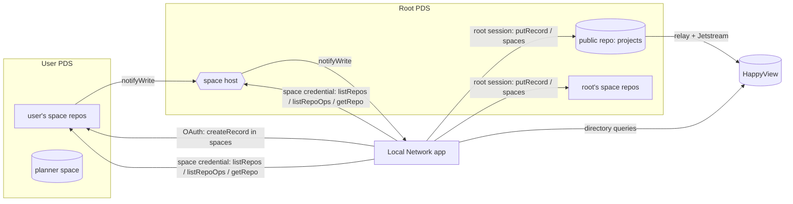

# Local Network

Promoters find local DJs who fit their shows. DJs (called _projects_: a solo DJ, a b2b duo, a group, or a collective) get a profile built around what promoters book on: sound, distance, slot, room size, and budget.

All data lives on the AT Protocol. Public profiles are ordinary atproto records; everything private (requests, staff roles, the audit log, booking threads, personal planners) lives in [atproto spaces](https://atproto.com/blog/atproto-spaces-alpha), the protocol's permissioned-data extension. Published projects are indexed by [HappyView](https://happyview.dev), an AppView whose Lua scripts answer directory search and the show matcher. The app keeps its own SQLite index only for space data, and can rebuild it from the network.

> Atproto spaces is an alpha (released 2026). This app is built against `@atproto/*@0.0.0-spaces-alpha-20261001173819` and the [0016 spaces proposal](https://github.com/bluesky-social/proposals/tree/main/0016-permissioned-data). Expect breaking changes upstream; all versions are pinned.

## Features

### Promoters

- Directory search by text, genre family (a search for "house" finds deep house and afro house), distance from a venue, fee tier, slot, format, and type.
- Show matcher: describe the night and get a ranked shortlist, scored on sound (40%), distance (25%), budget (15%), room size, slot, and booth setup, with the reasons for each match.
- Booking inquiries open a private thread (its own space) shared only with the project's managers, with show details up front and a status flow (open → negotiating → confirmed / declined / cancelled).
- A private planner (saved projects and shows with working lineups) in a personal space on the promoter's own PDS.

### DJs (projects)

- List a new project, or claim one an admin added. Several managers per project (crews, agents).
- Profiles cover genres, city and travel radius, set types and lengths, formats, room sizes, fee tier and range, links, playable SoundCloud/Mixcloud/YouTube mixes, highlights, photo.
- A mix can carry a tracklist: a mix report exported from [locallibrary](../locallibrary) (`locallibrary mix … --export`), shown at `/projects/<slug>/mixes/<n>` with the waveform and track lanes, tempo, key moves on the Camelot wheel, and every transition. `/mixes/preview` renders an export locally without uploading it.
- Private booking details (email, phone, rates, tech rider, hospitality) visible only to signed-in members.
- Every claim and change is reviewed by a moderator, so profiles can't be hijacked.

### Tools

- `/tools` lists Local Network's other tools, [locallibrary](../locallibrary) and [localtoolbox](../localtoolbox). Each has a page at `/tools/<id>` with what it does, how to install it, and its guides (its README and `docs/*.md`), which are bundled from the repo at build time. See [Tools' pages and hosts](#tools-pages-and-hosts).

### Staff

- Admins add and edit projects directly, change visibility, manage managers, and grant moderator/admin roles.
- Moderators review creates, claims, and changes with field-level diffs and stale-revision warnings. Nobody can review their own request.
- A complete audit log of every account's actions, with filters, per-entry detail, hash-chain verification, and JSONL export.
- System page: root spaces and policies, per-space and per-repo sync status, audit delivery backlog, HappyView status and script sync, one-click bootstrap/resync.

## How data is stored

| Data                                                  | Where                                                             | Who writes                           | Who reads             |
| ----------------------------------------------------- | ----------------------------------------------------------------- | ------------------------------------ | --------------------- |
| Published projects (`computer.localnetwork.project`)  | Root account's public repo                                        | Root, after admin action or approval | Everyone              |
| Requests (`computer.localnetwork.moderation.request`) | Requester's repo in the root's moderation space                   | The requester                        | Staff (via the app)   |
| Decisions                                             | Root's repo in the moderation space                               | Root                                 | Staff                 |
| Staff roles (`computer.localnetwork.staff.role`)      | Root's repo in the staff space                                    | Root                                 | Staff                 |
| Private booking details                               | Root's repo in the industry space                                 | Root                                 | Any signed-in account |
| Audit entries (`computer.localnetwork.audit.entry`)   | Both the actor's repo and the root's repo in the audit space      | Actor and root                       | Staff                 |
| Booking threads                                       | One booking space per thread; each party writes in their own repo | Promoter and managers                | Thread members only   |
| Planner                                               | A personal planner space under the promoter's own DID             | The promoter                         | The promoter only     |

Space policies (`com.atproto.simplespace`):

| Space                | Read policy                        | Write policy                                |
| -------------------- | ---------------------------------- | ------------------------------------------- |
| audit                | member list (staff)                | public (everyone records their own entries) |
| moderation           | member list (staff)                | public (everyone can file requests)         |
| staff                | member list (staff)                | member list (root)                          |
| industry             | public (any authenticated account) | member list (root)                          |
| booking (per thread) | member list (promoter + managers)  | member list                                 |
| planner (personal)   | member list (owner)                | member list                                 |



### The audit log

Every action (sign-in/out, submissions, revisions, withdrawals, decisions, direct edits, visibility changes, manager and role changes, booking messages and status changes, planner changes, system bootstrap) is recorded:

1. Locally first, in an outbox row with a SHA-256 hash chain (`hash = sha256(canonical(entry ∪ {prev}))`).
2. In the actor's own repo inside the root's audit space, written with the actor's OAuth session.
3. In the root account's repo in the same space, with the same record key and the chain fields (`seq`, `prev`, `hash`).

Failed writes retry with exponential backoff. The syncer reads both copies back from the network and marks them _verified_ only if their content matches the chained entry; a copy edited later is flagged _failed_. If the local database is lost, the log is rebuilt from the root's chained copies. Denied attempts (e.g. a non-moderator trying to approve) are recorded with outcome `denied`. Booking message contents are never copied into the audit log, only metadata.

Accounts whose PDS doesn't run the spaces alpha can still sign in: the root files their requests and messages on their behalf (`onBehalfOf`), and their audit entries are marked "no spaces support".

### Mix tracklists

A tracklist is a JSON blob (`application/json`, at most 1 MB) on a mix in the project record, following the `locallibrary.mix-report` format, version 1 or 2 (schema in `src/lib/mix/report.ts`). It moves like the photo: uploaded to the requester's PDS with the request, previewed by moderators from there (`/admin/requests/<rkey>/mixes/<n>`), then validated, re-serialized (dropping unknown fields), and uploaded to the root's repo on approval. A tracklist that is already published is kept by CID without being fetched again. Published tracklists are read with `com.atproto.sync.getBlob` from the root's PDS, validated, and cached in memory. The format carries no file paths, comments, or ratings; cover art is embedded as small `data:` images.

### Sync

The app is a space syncer. For each watched space it mints a space credential (delegation token from the root's PDS, exchanged at the space host with an RFC 9421 HTTP message signature bound to a fresh P-256 key), enumerates writers with `listRepos`, pulls each repo's oplog with `listRepoOps`, and verifies the result against the author's signed LtHash commit, falling back to a full verified CAR download (`getRepo`) when needed. It registers for `notifyWrite` (verified with inter-service auth) and also polls. Records are validated against the lexicons, and authority rules are enforced: only root-authored decisions, roles, and details count, and booking records from non-participants are ignored.

### Directory

Published projects are served by [HappyView](https://happyview.dev) 2.16, not the app. HappyView follows Jetstream for `computer.localnetwork.project` records and answers the `computer.localnetwork.directory.*` queries ([`lexicons/computer/localnetwork/directory/`](../../lexicons/computer/localnetwork/directory/)) with Lua scripts in `lua/`:

- `project.lua` runs on every incoming record and keeps only the root account's, since Jetstream filters by collection and anyone can write one.
- `searchProjects`, `matchProjects`, `getProject`, `getProjects`, and `getStats` do the search, ranking, and lookups. Match results carry reason codes, which the app turns into text.
- The genre taxonomy and fee tiers are generated into the scripts from `src/lib/taxonomy/`, so TypeScript stays the source of truth.

With `HAPPYVIEW_API_KEY` set, the app uploads whichever scripts and lexicons changed when it boots (scripts first, so the record gate is in place before ingestion starts), then has HappyView re-read the root's repo and waits for that to finish. After publishing a project it waits (up to 5 seconds) for HappyView to index the new version, so the next page shows it.

## Getting started

Requirements: Node.js 24 (see `.node-version` at the repo root), pnpm 12, and Docker (or OrbStack) for the local HappyView.

The app lives in `apps/web` of a pnpm workspace whose root is the repo root. Run the commands below in `apps/web`; `pnpm install` there installs the whole workspace and the git hooks. The repo root forwards `dev`, `build`, `check`, `lint`, `format`, `test`, `knip`, and `verify` here.

```bash
pnpm install
```

Start a local, spaces-enabled AT Protocol network (PLC directory + alpha PDS, root and demo accounts, published lexicons, 12 demo projects) and a HappyView container fed by a local Jetstream stand-in. It writes `.env.local`:

```bash
pnpm dev:network
```

In another terminal:

```bash
pnpm dev
```

Open http://127.0.0.1:5173 and sign in with a handle. The PDS asks for the password:

| Handle      | Password    | Role                                       |
| ----------- | ----------- | ------------------------------------------ |
| `ada.test`  | `ada-pass`  | admin (via `ADMIN_DIDS`)                   |
| `milo.test` | `milo-pass` | regular; make them a moderator under Staff |
| `neon.test` | `neon-pass` | DJ, manages two demo projects              |
| `pat.test`  | `pat-pass`  | promoter                                   |

The network is temporary; restarting it resets everything (and the dev database).

## Scripts

| Script                              | What it does                                                          |
| ----------------------------------- | --------------------------------------------------------------------- |
| `pnpm dev` / `pnpm dev:network`     | Dev server / local atproto network and HappyView                      |
| `pnpm build` / `pnpm start`         | Production build (adapter-node) / run it                              |
| `pnpm check`                        | `svelte-check` with TypeScript 6                                      |
| `pnpm lint`                         | Oxlint with type-aware rules (tsgolint) and the anti-slop plugin      |
| `pnpm format` / `pnpm format:check` | Oxfmt                                                                 |
| `pnpm test`                         | Unit tests (Node) + component tests (Vitest browser mode, Chromium)   |
| `pnpm test:integration`             | Full flows against an in-process spaces PDS and a HappyView container |
| `pnpm test:coverage`                | Unit + component + integration with `@vitest/coverage-v8`             |
| `pnpm test:build`                   | Production build, checked for sourcemaps and the client bundle budget |
| `pnpm test:e2e`                     | Playwright (desktop browsers and phones) on an isolated network, axe  |
| `pnpm test:lighthouse`              | Lighthouse CI on the production build (`lighthouserc.cjs`)            |
| `pnpm knip`                         | Unused files, exports, and dependencies                               |
| `pnpm lexicons:publish`             | Publish lexicons from the root account and check or set their DNS     |
| `pnpm verify`                       | CI's quick checks, in order                                           |

Pull requests run the e2e tests in Chromium only (`pnpm test:e2e --project chromium`); the other browsers and the phones run weekly.

Git hooks (lefthook, from the root `lefthook.yml`) format and lint staged files on commit and run type checks and unit tests on push.

## Configuration

See [`.env.example`](.env.example) for every option. The essentials:

- `PUBLIC_URL`: the app's origin. OAuth client metadata (`/oauth-client-metadata.json`) and the syncer's `did:web` (`/.well-known/did.json`) are derived from it. Loopback URLs use an atproto loopback OAuth client.
- `ROOT_IDENTIFIER` / `ROOT_PASSWORD`: the Local Network root account. **Use a dedicated account and its account password.** In the alpha, `com.atproto.space.getDelegationToken` requires a full-access session, so app passwords cannot mint space credentials (the app explains this in its logs if you try).
- `ADMIN_DIDS`: accounts that are always admins. Everyone else is managed in-app.
- `HAPPYVIEW_URL`: the HappyView instance that serves the directory. Use its public URL: HappyView only answers the host its own `PUBLIC_URL` names. If HappyView is down, the app still starts, and pages that need projects say the directory is offline.
- `HAPPYVIEW_API_KEY`: a HappyView API key with `lexicons:read`, `lexicons:create`, `scripts:read`, `scripts:manage`, `backfill:create`, and `backfill:read`. Optional; without it, upload the lexicons and scripts yourself.
- `LOCALLIBRARY_HOST`: [locallibrary's own host](#tools-pages-and-hosts) (default `locallibrary.localnetwork.computer`).

## Deploying

1. Create the root account on a PDS that runs the spaces alpha (e.g. `ghcr.io/bluesky-social/atproto:pds-spaces-alpha`).
2. Publish the lexicons (`pnpm lexicons:publish` publishes every tool's, all of the repo's `lexicons/computer/`) and their `_lexicon` TXT records in the `localnetwork.computer` zone. With `CLOUDFLARE_API_TOKEN` (Zone > DNS > Edit on that zone only) the script creates or fixes those records through the Cloudflare API and prints what it changed; it's safe to rerun, and it only touches `did=` TXT values at `_lexicon` names. Without the token it prints the missing ones for you to add by hand and exits non-zero until DNS serves them all. The variables can also live in `.env`. The lexicons are `computer.localnetwork.*` (`src/lib/nsid.ts` and the repo's [`lexicons/`](../../lexicons/)), so there's one record per sub-namespace (`_lexicon.localnetwork.computer`, `_lexicon.space.localnetwork.computer`, and so on). PDSes resolve the space type declarations while authorizing OAuth requests, so sign-in fails with `invalid_scope` until they resolve. locallibrary writes `computer.localnetwork.locallibrary.*` (its own) and `computer.localnetwork.dj.*` (DJ profiles and sets, shared by Local Network's tools); keep this app's lexicons out of `locallibrary.*`, and reuse the `dj.*` defs rather than redefining tracks or sets.
   ```bash
   ROOT_IDENTIFIER=localnetwork.computer ROOT_PASSWORD=… CLOUDFLARE_API_TOKEN=… pnpm lexicons:publish
   ```
3. Run HappyView 2.16 (`ghcr.io/gamesgamesgamesgamesgames/happyview:2.16.0`, SQLite on a volume) at `https://happyview.localnetwork.computer`, log in to its dashboard first (the first login becomes its admin), and create an API key with the permissions above.
4. Run the container at `https://localnetwork.computer` (`PUBLIC_URL`) with a persistent volume for `/data`. Build it from the repo root, which holds the workspace and lockfile, with `apps/web/Dockerfile`:
   ```bash
   docker build -f apps/web/Dockerfile -t localnetwork .
   ```
   ```bash
   docker run -p 3000:3000 -v localnetwork-data:/data --env-file .env localnetwork
   ```
   To try an image first, `apps/web/scripts/docker-smoke.sh localnetwork` (from the repo root) runs it against the local network with an empty volume and fetches a few pages, as CI does.
5. Run **one** instance (SQLite and in-process background jobs). Back up `/data`: it holds OAuth sessions and the audit outbox; everything else can be re-synced from atproto.
6. Point `locallibrary.localnetwork.computer` at the same deployment (a DNS record, plus the custom domain on your host) for [its client document](#tools-pages-and-hosts).

`/healthz` reports database, root-account, and HappyView status.

### Tools' pages and hosts

Each tool has an entry in `src/lib/tools/` (name, tagline, what it does, install steps) and a page at `/tools/<id>`. Its guides are the tool's own `README.md` and `docs/*.md` in `apps/<tool>/`, bundled at build time and rendered on the server with GitHub's heading ids. Links to the tool's other guides stay on this site, links to other files in the repo go to GitHub, and raw HTML in the Markdown shows as text. Adding a tool is one file there, listed in `src/lib/tools/index.ts`.

A tool with a host of its own lists it in its entry, and this app answers that host before anything else runs, so it works even while the app isn't configured. `/` redirects (308) to the tool's page on `PUBLIC_URL` (`https://localnetwork.computer` when it isn't set), `/oauth-client-metadata.json` serves the tool's OAuth client document if it has one, and every other path is a 404.

[locallibrary](../locallibrary) signs people in with their Atmosphere accounts as `https://locallibrary.localnetwork.computer/oauth-client-metadata.json` (`LOCALLIBRARY_HOST` changes the host). That document is separate from this app's own `/oauth-client-metadata.json`, which describes the Local Network web client; a native app needs a client that redirects to `127.0.0.1`. It lists every scope locallibrary may ask for: `atproto` to sign in, and create/update on the records it publishes (`computer.localnetwork.locallibrary.settings`, `computer.localnetwork.dj.profile` and `computer.localnetwork.dj.set`).

locallibrary writes the document; after changing its scopes, regenerate it here before releasing the locallibrary version that asks for them:

```bash
locallibrary account client-metadata -o src/lib/tools/locallibrary/oauth-client-metadata.json
```

Until the host answers, locallibrary signs in as a local development app instead (servers ask about it every time).

## Security notes

- OAuth uses DPoP-bound tokens and granular scopes: write-only access to the user's own repos in the audit, moderation, and booking spaces, a self-authority planner space, and blob uploads limited to PNG, JPEG, and WebP avatars and JSON tracklists. Accounts without spaces support are asked for plain `atproto` only; they, and anyone who approves only part of the request, have the root account write on their behalf. Sessions granted before the app asked for a new scope are sent back through sign-in to approve it. Nothing lets the app read other users' data with a user's session; shared spaces are read with credentials issued to the root authority.
- Browser sessions are opaque random tokens stored as SHA-256 hashes; cookies are `HttpOnly`, `SameSite=Lax`, and `Secure` on HTTPS.
- CSP with per-request nonces, `frame-ancestors 'none'`, `nosniff`, strict referrer policy, HSTS on HTTPS, and SvelteKit's CSRF origin checks.
- Service endpoints from DID documents are checked against private address ranges in production (SSRF guard).
- Uploaded images are type- and magic-byte-checked and capped at 1 MB; images are served from a dedicated route with a locked-down CSP.
- Rate limits on sign-in, writes, and city search.
- Spaces are access control, not end-to-end encryption: the hosting PDSes and this app can read the data they handle.

## Project layout

```
lua/                            HappyView scripts: the project record gate and the directory queries
scripts/                        dev-network (local atproto network), publish-lexicons, seed data, mix-fixture
scripts/lib/                    Local HappyView container and Jetstream stand-in
src/lib/                        Shared code: matching, genre taxonomy, geo, formatting, components
src/lib/server/atproto/         Identity, OAuth, root session, repo clients, space credentials, service auth
src/lib/server/audit/           Hash-chained audit log with dual atproto delivery
src/lib/server/happyview/       HappyView client, script bundling, and boot sync
src/lib/server/services/        Projects, requests, staff, bookings, planner
src/lib/server/sync/            Space syncer and record projections
src/lib/server/tools/           The tools' own hosts, and their guides rendered to HTML
src/lib/tools/                  The tools: one entry per tool, with its guides bundled from apps/<tool>/
src/routes/                     SvelteKit 3 pages, form actions, and endpoints
tests/integration/              Flows against an in-process spaces PDS and a HappyView container
tests/e2e/                      Playwright
```

## Known limitations

- Oxfmt doesn't format `.svelte` files yet; it formats everything else.
- The spaces alpha has no relay: sync load falls on PDSes, mitigated by notifications and incremental oplog sync.
- Account deactivation/deletion events arrive on the firehose, which this app doesn't subscribe to yet.
- The directory scripts query HappyView's SQLite directly, so the HappyView instance must use SQLite, not Postgres.
- HappyView drops a Jetstream cursor older than 72 hours. The boot backfill recovers new and changed projects after a longer outage, but not deletions (nothing deletes projects today).
