# Local Network

Promoters find local DJs who fit their shows. DJs (called _projects_: a solo DJ, a b2b duo, a group, or a collective) get a profile built around what promoters book on: sound, distance, slot, room size, and budget. Fans follow DJs and see where they play next.

All data lives on the AT Protocol. Public profiles are ordinary atproto records; everything else (requests, staff roles, the audit log, booking threads, personal planners) lives in [atproto spaces](https://atproto.com/blog/atproto-spaces-alpha), the protocol's permissioned-data extension, where each space's read policy decides who can read it. Published projects, the DJ stats, sets, press kits, shows and follows their managers and fans publish, and the few Bluesky and userinput.app records the site reads are indexed by [HappyView](https://happyview.dev), an AppView whose Lua scripts answer directory search and the show matcher and serve those records to the site. The app keeps its own SQLite index only for space data, and can rebuild it from the network. Every public record is read through HappyView, never straight from a PDS or Bluesky's AppView (see [Directory](#directory) for the few exceptions); writes go to the PDS.

> Atproto spaces is an alpha (released 2026). This app is built against `@atproto/*@0.0.0-spaces-alpha-20261029171913` and the [0016 spaces proposal](https://github.com/bluesky-social/proposals/tree/main/0016-permissioned-data). Expect breaking changes upstream; all versions are pinned.

## Features

### Signing in

- `/login` says why someone is there from where they'll go next ("to follow Neon Tide", "to book Neon Tide"), takes one handle, and suggests up to five accounts as they type. The suggestions come from Bluesky's AppView (`app.bsky.actor.searchActorsTypeahead`) through `/api/actors`, so visitors' keystrokes never leave this server, repeats are answered from a ten-minute in-memory cache, and the CSP keeps `connect-src 'self'`. HappyView can't answer them: it only keeps the display names of accounts this site lists.
- "Make an account" (`/login/create`) lists the hosts in [`src/lib/hosts.json`](src/lib/hosts.json) (schema beside it) and starts sign-up at the one picked (OAuth `prompt=create`), which sends the new account straight back. On the dev network its own PDS comes first.
- "How signing in works" lists what the app can and can't do in plain words, from [`src/lib/sign-in.ts`](src/lib/sign-in.ts); a test fails if a scope the app asks for isn't explained there.

### Dashboard

- Signing in lands on `/dashboard`, where every change to what a public page shows happens: each project you manage (`/dashboard/projects/<slug>`, with its profile, shows and press kits), your inbox, requests, booking threads, planner, activity, and the records the root holds on your behalf (`/dashboard/data`). Staff work in the staff console at `/admin`, on the same sidebar layout.
- The inbox (`/dashboard/inbox`) tells each participant in a booking thread about a new inquiry, message or status change from someone else in it, with a count of unread items in the sidebar. An item names the project, never which of its managers wrote, and holds none of what was written. Opening an item, or its thread, marks it read. Read items go after 90 days and unread ones after 180. People can also have new items emailed: the address comes from their account's host, read only after they approve it, and nothing goes to it until they open a link we email it, which works for a day. New items wait two minutes so a burst goes as one email. Anything older than six hours when it's indexed stays on the site. They can also have them sent as Bluesky DMs from the root account, a minute apart at most; when Bluesky chat says the root can't DM them yet, the settings page asks them to allow DMs from people they follow and to follow the root. The site asks chat alone, not the AppView, so it doesn't know which of the two is missing. `/dashboard/inbox/settings` turns each on and off, picks what gets sent, and sends a test.
- People edit their profile at `/dashboard/profile`: the basics, and the DJ and promoter sections they turn on, each adding its own fields (the project form is built from the same basics and performer fields). Turning a section off asks first, since saving deletes what was in it. The profile goes to the account's own repo with its session, over the version the form opened on. A session from before profiles is offered "Sign in again" when the page opens. Someone without a profile gets a card on `/dashboard` to make one from their Bluesky name and picture, read once from their own repo. The sections decide the dashboard sidebar: a DJ's projects, and a promoter's planner (everything shows until there's a profile, and projects someone manages always do).
- A DJ asks staff to list them in Find DJs from their profile editor, once their profile has the DJ section on: a `list` request in the moderation space that names their profile and the version they asked with. Staff review it at `/admin/requests` like any other, seeing the profile as it is now, with a note when it changed since the request and when the same account manages a solo project, which would put them in Find DJs twice. Approving writes the root's `computer.localnetwork.listing.profile` for them and has HappyView read their profile again; `/admin/listings/<did>` (staff's Manage link on a profile) shows the listing and takes them out again. Both are audited.
- Public pages only read, apart from Follow and Save. A project's managers get a Manage link to its dashboard there, and staff one to the staff console. A project that isn't public shows its managers and staff a "Not public yet" banner; everyone else gets a 404.
- Every account has a profile page at `/@<handle>`, showing its `computer.localnetwork.profile`: its basics, the performer and promoter sections it turned on, the DJ stats and sets it publishes, and the active projects it manages. A DID with a verified handle, and a handle in any other form, redirect there; an account without a verified handle has its page at `/@<did>`. An account without a profile record still gets a page, with its Bluesky display name when the directory keeps one (else its handle), the projects it plays in, and a line saying it hasn't set up a profile; only an address that names no account is a 404. Handles across the site link to these pages. The owner gets a Manage link to their profile editor, and staff one to its Find DJs listing (`/admin/listings/<did>`).

### Promoters

- Directory search (Find DJs, `/projects`) over active projects and the DJs staff list, together, by text, genre family (a search for "house" finds deep house and afro house), distance from a venue, fee tier, slot, format, and type. A listed DJ counts as a solo DJ, found by the genres their profile names or else the ones they play most, and a solo project they manage alone gives way to their profile.
- Show matcher: describe the night and get a ranked shortlist, scored on sound (40%), distance (25%), budget (15%), room size, slot, and booth setup, with the reasons for each match.
- Booking inquiries open a private thread (its own space) shared only with the project's managers, with show details up front and a status flow (open → negotiating → confirmed / declined / cancelled). Managers negotiate, confirm or decline; the promoter can confirm once a manager has answered, or withdraw; either side can cancel a confirmed booking. The server refuses any other change (`src/lib/bookings.ts`).
- A private planner (saved projects and shows with working lineups) in a personal space on the promoter's own PDS. Inquiring from a planner show fills the inquiry in from the show's details.

### DJs (projects)

- List a new project, or claim one an admin added. Several managers per project (crews, agents).
- When a project's managers change, a new manager joins its booking threads that are still being worked out or confirmed for an upcoming show, and a manager who leaves is taken out of all of them. The promoter always stays. The same step keeps the project's backstage, its press kit request space and its press kit spaces to the current managers, leaving the people granted a press kit. The app repeats this at startup, every hour, and on the System page's bootstrap, so a change that failed part way still finishes. A thread follows the project named in the root's opening record, which the promoter can't rewrite, or for a thread opened before that record named one, in its `booking.create` audit entry (written by the app, and rebuilt only from the root's copy). A thread with neither, or where the two disagree, is left as it is.
- Acts, parties and venues each get a space under the root (no pages for them yet). Its people records say who's in it, in what role, with which capabilities, and whether they're hidden from everyone outside it. The root writes every record there, for someone who holds the capability the change needs or for staff, whose changes the audit log marks with their role. Someone always has to be left who can manage its people, unless staff decide otherwise. The space's members follow its people: everyone reads, and those with a capability that writes also write. The app repeats that at startup and every hour, so a member update that failed part way still finishes.
- People come into one by an invite to their account, an invite link, or a request to join that someone with people.manage approves, and choose then whether to be hidden. A link's token is shown once and only its hash is kept, and a link never lets anyone manage people. Invites last 30 days and links 7 unless their maker picks up to 90, someone can have 50 open in a space at once, and both go when their maker can no longer add people, unless staff made them.
- When staff list one, the root writes a `computer.localnetwork.listing` record to its public repo with what its public page shows and the people in a listed role (an act's members, a party's hosts and cohosts) who haven't hidden. It's rewritten only when that changes, and checked every hour. No kind has a public page yet, so nothing is listed. Staff see every space and its people, hidden ones marked, at `/admin/spaces`, where they add and remove people, change roles, and list or unlist it.
- Profiles cover genres, city and travel radius, set types and lengths, formats, room sizes, any number of fee levels (each a tier, with an optional label and range), links, playable SoundCloud/Mixcloud/YouTube mixes, highlights, photo.
- A mix can carry a tracklist: a mix report exported from [locallibrary](../locallibrary) (`locallibrary mix … --export`), shown at `/projects/<slug>/mixes/<n>` with the waveform and track lanes, tempo, key moves on the Camelot wheel, and every transition. `/mixes/preview` renders an export locally without uploading it.
- A mix can also link a set a manager published with locallibrary (`locallibrary sets publish`), picked from a list on the edit form. The profile shows when and where it was played, and says so if the set changed after it was linked.
- Sets with a recording play on the site, with the tracklist following along and a track's start to jump to. The server picks what plays when someone presses Play (`/sets/<did>/<rkey>/player.json`): the set's `recording` record first (an `fm.plyr.track`, whose file comes from plyr.fm's CDN, or plyr's own player when the track is gated; or a `computer.localnetwork.dj.recording` on the DJ's PDS, streamed through `/media/audio/<did>/<cid>`), then its links (archive.org downloads play directly, SoundCloud, Mixcloud, YouTube and plyr.fm in their own players). Audio the page plays itself always wins over a platform's player. SoundCloud's and Mixcloud's widget APIs let the tracklist follow those players too. `/sets/<did>/<rkey>/chapters.json` serves the tracklist as Podcasting 2.0 JSON chapters.
- Private booking details (email, phone, rates, tech rider, hospitality), shown to the project's managers and staff on its pages, and to everyone else only inside a press kit they've been let into, so each look at them leaves a receipt.
- The project form and the booking inquiry keep unsent changes as a draft in the browser (`localStorage`, per account), so a reload or a trip to another page doesn't lose them. Files have to be picked again, and the draft goes once the form is sent, discarded, or back to its saved values, or its account signs out (the sign-out response sets an `ln_signed_out` cookie naming the account, and the next page load drops its drafts, so it works even if Sign out was pressed before the page's scripts ran).
- A project page shows how its DJs play: the playing stats and recent sets each manager publishes from locallibrary (`computer.localnetwork.dj.profile` and `dj.set`), read from HappyView when the page loads and streamed in, so a slow answer never holds the page up. The app stores none of it; a few minutes' cache in memory keeps busy pages from asking again.
- Press kits as records, which belong to the project, so all its managers share control of them. A project has up to 20 (`/dashboard/projects/<slug>/press-kits/new`), one per kind of booking. Each is a public `computer.localnetwork.epk` record in the root account's repo, holding the mixes and photos shown to everyone, plus a space of its own under the root holding the rest: a full bio, on-request mixes and photos, press quotes, contact and rider. Managers edit at `/dashboard/projects/<slug>/press-kits/<rkey>` through drafts kept in the project's backstage, a space under the root that only its current managers read and write, so each sees the others' work in progress and whether it's behind the published version. A draft saves only over the published version its form was opened on (otherwise the manager is asked to reload). Publishing a draft applies only the fields it changed, shows each field another manager published since next to the version the draft started from and lets the manager pick which of theirs to publish, and copies its photos into the root's repo so they outlive a manager leaving. People ask for access from `/projects/<slug>/press-kits/<rkey>`, with the form at `/dashboard/access/<slug>/<rkey>`; the rules approve them at once, send them for review, or don't take requests, per group (people they've booked with, people any of the managers follows on Bluesky, promoters, anyone signed in), with seven presets from open to closed. Requests go into the project's request space, a space under the root that only its current managers read, so nobody asking or let in sees anyone else's request. Any manager answers requests and adds or removes people at `/dashboard/projects/<slug>/press-kits/<rkey>/access`; the root adds the person to the press kit's space and writes the grant record into the request space, so nobody let in sees who else is. At startup, the app moves grant records and requests left in a press kit's space from before into the request space (grants copied as the root, requests as the root on the asker's behalf with their answer, the old records deleted), then stops that space taking anyone's writes. The editor has a press-photo checklist (3 or more photos, every orientation, 3,000 px, credited).
- Press kits made before the root held them stay in their maker's repo and space until the maker next opens the dashboard, which moves each to the root with the same key: photos, private part, grants and open requests first, the public record last, then the old record and space go with the maker's session, the only one that can delete them. A move that fails part way finishes on a later visit.
- Receipts of press kit views. Each time someone let into a press kit opens it (once per person and press kit every 30 minutes at most), the audit log records a view with the root as its actor and an HMAC of the viewer's DID under a random salt, never the DID. The DID and the salt stay in the app's database, and the project's managers see who viewed which press kit, and when, at `/dashboard/projects/<slug>/press-kits`, where any of them can delete one. Receipts expire after `EPK_VIEW_RETENTION_DAYS` (90 by default), checked every hour. Deleting one drops the DID and the salt, so the hash chain still verifies but no longer says who viewed. Only views through the site get receipts: the people let in are members of the press kit's space, so they can still read its private part (not the booking details) with another atproto client.
- `/projects/<slug>/press-kits` lists a project's press kits, then one put together from the profile, mixes, stats, sets and (for its managers) booking details. Both print or save as a PDF on white. Links from before press kits moved to the project (`/projects/<slug>/epk`, `/epk/<did>/<rkey>` and its photos) redirect there, since they sit in emails.
- Every claim and change is reviewed by a moderator, so profiles can't be hijacked.
- Managers announce upcoming shows (`/dashboard/projects/<slug>/shows/new`): name, date and times on the venue's clock, venue, city, and a ticket link. Each is a [`community.lexicon.calendar.event`](https://github.com/lexicon-community/lexicon) in the manager's own repo, so calendar apps like Smoke Signal can read it, plus a `computer.localnetwork.show` with the same record key that ties it to the project and copies what listings need. Times carry the venue's UTC offset, found from its coordinates, so the city has to be picked from the search. A confirmed booking thread offers "Announce this show", filled in from its show details. The announcing manager can edit (re-copying the event, marked rescheduled when the start moves), cancel, or delete a show. A new show's event and show are written together. The edit form carries the versions of the show and event it shows, and the save writes the event, then the show, each only over those versions, so a change made elsewhere since the form opened asks the manager to reload. A delete removes the event, then the show, so one that fails partway leaves the show listed to delete again. The project's dashboard page says when another app changed the event since.

### Fans

- Follow a project from its page with any Atmosphere account. The follow is a `computer.localnetwork.follow` record in the follower's own repo; unfollowing deletes it. The page shows the follower count.
- `/shows` lists upcoming shows by date near a city (picked with the same city search as the directory, and remembered in a cookie), or, under Following, the shows of the projects you follow, nearest first once you pick a city. A show drops off once it ends, or 12 hours after it starts when it has no end. There are no email or push notifications for shows yet.

### Artists and charts

- `/artists/<mbid>` (or `/artists/name/<name>` for an artist sets give no MusicBrainz ID) shows who played an artist's tracks: each of their tracks that appears in a published set, with every play (the DJ and the projects they manage, the date, the venue and city, the kind of set, and how far into the set it starts, where the set knows), and their all-time supports. `/artists` finds them by name.
- `/charts` ranks tracks and artists by how many DJs supported them, for the last 30 days or a month, everywhere or in one city, counted like 1001Tracklists' Top 101 Producers: a DJ supports a track once however often they play it, a track charts once three DJs support it, and an artist gets at most five supports from one DJ, counting only tracks that chart.
- A DJ is an act: an active project, whose managers count as one (a crew whose members each publish the same gig counts once). A back-to-back set published by two acts counts for both. A set stops counting when its author no longer manages an active project.
- A track is its recording's MusicBrainz ID, else its ISRC, else its artist and title (any case or spacing). A play without an ID counts with the plays that have one when only one fits, so sets published before IDs were filled in still add up.
- Set tracklists on profiles and press kits link tracks with an MBID to MusicBrainz, and artists to their pages.

### Tools

- `/tools` lists Local Network's other tools, [locallibrary](../locallibrary) and [localtoolbox](../localtoolbox). Each has a page at `/tools/<id>` that shows what it does as hot cues on a real track's waveform, each with a capture of the tool at work, then how to install it and its guides, which are bundled from the repo at build time: its README and `docs/*.md`, or only `docs/*.md` led by `docs/overview.md` when the README is written for developers, as localtoolbox's is. A guide with four or more sections opens on a list of them. See [Tools' pages and hosts](#tools-pages-and-hosts).

### Bug reports

- "Report a bug" in the footer opens `/report`. Signed in, it posts the report from the person's own account to Local Network's space on [userinput.app](https://userinput.app) (an `app.userinput.discussion` record in their repo, tagged `bug` and `web`, with the page they came from and their browser), then links to it there. Signed out (where the link reads "Report a bug on GitHub"), or without `USERINPUT_SPACE`, it opens GitHub's website bug form with the page and browser filled in, and so does a report that fails to post, with what they wrote.
- Posting asks for one more OAuth scope, `repo:app.userinput.discussion?action=create`, the first time someone sends a report, not at sign-in: sessions from before it keep working, and the client metadata lists it so the PDS allows the request.

### Staff

- Admins add and edit projects directly, change visibility, manage managers, and grant moderator/admin roles.
- Admins verify project managers' accounts on Bluesky from the root account (`/admin/verifications`), which reads the verifications and the display names they compare from HappyView. Apps that trust the root show a badge while the account's handle and display name match the ones verified, so a rename shows as out of date until it's re-issued. An approved claim from the act's own account or a member, and each manager on a project's admin page, link straight to it. Bluesky's own app only shows verifications from accounts it has made trusted verifiers.
- Moderators review creates, claims, and changes with field-level diffs and stale-revision warnings. Nobody can review their own request.
- A complete audit log of every account's actions, with filters, per-entry detail, hash-chain verification, and JSONL export.
- System page: root spaces and policies, per-space and per-repo sync status, audit delivery backlog, HappyView status and script sync, one-click bootstrap/resync.

## How data is stored

| Data                                                                      | Where                                                             | Who writes                           | Who reads               |
| ------------------------------------------------------------------------- | ----------------------------------------------------------------- | ------------------------------------ | ----------------------- |
| Published projects (`computer.localnetwork.project`)                      | Root account's public repo                                        | Root, after admin action or approval | Everyone, via HappyView |
| DJ stats and sets (`computer.localnetwork.dj.profile`, `dj.set`)          | The DJ's own public repo                                          | The DJ, with locallibrary            | Everyone, via HappyView |
| rekordbox settings (`computer.localnetwork.locallibrary.settings`)        | The DJ's own public repo                                          | The DJ, with locallibrary            | Everyone, via HappyView |
| Requests (`computer.localnetwork.moderation.request`)                     | Requester's repo in the root's moderation space                   | Requester, or root on their behalf   | Staff (via the app)     |
| Decisions                                                                 | Root's repo in the moderation space                               | Root                                 | Staff                   |
| Staff roles (`computer.localnetwork.staff.role`)                          | Root's repo in the staff space                                    | Root                                 | Staff                   |
| Verifications (`app.bsky.graph.verification`)                             | Root account's public repo                                        | Root, after admin action             | Everyone, via HappyView |
| Private booking details                                                   | Root's repo in the industry space                                 | Root                                 | Staff (others via app)  |
| Audit entries (`computer.localnetwork.audit.entry`)                       | Both the actor's repo and the root's repo in the audit space      | Actor and root                       | Staff                   |
| Booking threads                                                           | One booking space per thread; each party writes in their own repo | Each party, or root on their behalf  | Thread members only     |
| Planner                                                                   | A personal planner space under the promoter's own DID             | The promoter                         | The promoter only       |
| Press kits (`computer.localnetwork.epk`)                                  | Root account's public repo                                        | Root, when a manager publishes       | Everyone, via HappyView |
| Shows (`community.lexicon.calendar.event` + `computer.localnetwork.show`) | The announcing manager's public repo                              | The manager                          | Everyone, via HappyView |
| Follows (`computer.localnetwork.follow`)                                  | The follower's public repo                                        | The follower                         | Everyone, via HappyView |
| Press kits' private part                                                  | One space per press kit under the root                            | Root                                 | Managers, granted       |
| Press kit requests (`computer.localnetwork.epk.request`)                  | The project's request space under the root                        | Askers, or root on their behalf      | The project's managers  |
| Press kit grants (`computer.localnetwork.epk.grant`)                      | The project's request space under the root                        | Root, when a manager lets someone in | The project's managers  |
| Press kit drafts (`computer.localnetwork.epk.draft`)                      | Each manager's repo in the project's backstage space              | Managers, or root on their behalf    | The project's managers  |
| Press kit view receipts                                                   | The app's database only                                           | The app                              | The project's managers  |
| People in acts, parties and venues (`computer.localnetwork.people.*`)     | One space per performer, party or venue under the root            | Root, for its people or staff        | Members (staff via app) |
| Directory listing status (`computer.localnetwork.listing.status`)         | The same space                                                    | Root, after staff action             | Members (staff via app) |
| Bluesky display names (`app.bsky.actor.profile`)                          | The account's own public repo                                     | The account, in any Bluesky app      | Admins, via HappyView   |
| Managers' Bluesky follows (`app.bsky.graph.follow`)                       | The manager's public repo                                         | The manager, in any Bluesky app      | The app, via HappyView  |
| The bug report space (`app.userinput.space`)                              | Its owner's public repo on userinput.app                          | userinput.app                        | The app, via HappyView  |

Space policies (every space is a `com.atproto.memberspace.policy` with `publicRead: false`; a public write policy is `publicWrite: true`):

| Space                     | Read policy                       | Write policy                                |
| ------------------------- | --------------------------------- | ------------------------------------------- |
| audit                     | member list (staff)               | public (everyone records their own entries) |
| moderation                | member list (staff)               | public (everyone can file requests)         |
| staff                     | member list (staff)               | member list (root)                          |
| industry                  | member list (staff)               | member list (root)                          |
| booking (per thread)      | member list (promoter + managers) | member list                                 |
| planner (personal)        | member list (owner)               | member list                                 |
| epk (per press kit)       | member list (managers, granted)   | member list (root)                          |
| epkRequests (per project) | member list (managers)            | public (anyone can ask)                     |
| backstage (per project)   | member list (managers)            | member list (managers)                      |
| performer, party, venue   | member list (its people)          | member list (people who write)              |

### Where writes go

The app writes with each person's OAuth session or the root's session, and locallibrary writes to the DJ's own repo.

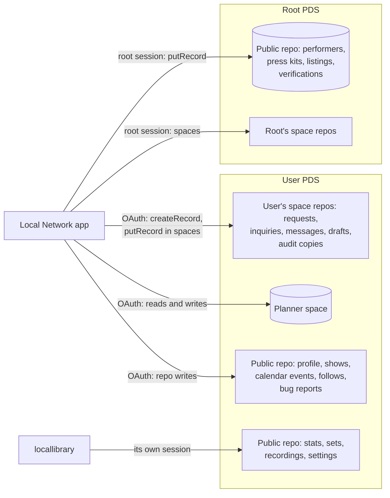

Source: [`src/lib/server/services/own-repo.ts`](src/lib/server/services/own-repo.ts), [`src/lib/server/atproto/repo-client.ts`](src/lib/server/atproto/repo-client.ts), [`src/lib/server/services/planner.ts`](src/lib/server/services/planner.ts)

### Where reads come from

Most space records come back through the app's own sync, and public records through HappyView. The app reads a press kit's private part and planners straight from their space, and a few public reads go straight to a PDS (see [Directory](#directory)).

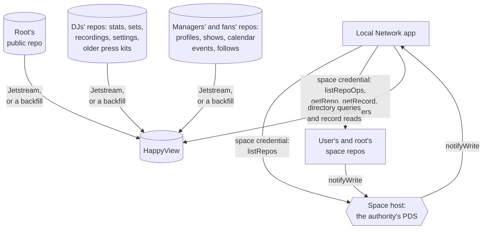

Source: [`src/lib/server/sync/engine.ts`](src/lib/server/sync/engine.ts), [`src/lib/server/atproto/credentials.ts`](src/lib/server/atproto/credentials.ts), [`src/lib/server/happyview/client.ts`](src/lib/server/happyview/client.ts), [`src/routes/xrpc/com.atproto.space.notifyWrite/+server.ts`](src/routes/xrpc/com.atproto.space.notifyWrite/+server.ts)

### The audit log

Every action (sign-in/out, submissions, revisions, withdrawals, decisions, direct edits, visibility changes, manager and role changes, booking messages and status changes, planner changes, system bootstrap) is recorded:

1. Locally first, in an outbox row with a SHA-256 hash chain (`hash = sha256(canonical(entry ∪ {prev}))`).
2. In the actor's own repo inside the root's audit space, written with the actor's OAuth session.
3. In the root account's repo in the same space, with the same record key and the chain fields (`seq`, `prev`, `hash`).

Failed writes retry with exponential backoff. The syncer reads both copies back from the network and marks them _verified_ only if their content matches the chained entry; a copy edited later is flagged _failed_. If the local database is lost, the log is rebuilt from the root's chained copies. Denied attempts (e.g. a non-moderator trying to approve) are recorded with outcome `denied`. Booking message contents are never copied into the audit log, only metadata. A press kit view (`epk.view`) names no viewer: its details hold an HMAC of the viewer's DID under a salt only the app's receipt has, so deleting or expiring the receipt leaves the entry, and the chain, as they were.

Accounts whose PDS doesn't run the spaces alpha can still sign in: the root files their requests and messages on their behalf (`onBehalfOf`), and their audit entries are marked "no spaces support". They see what the root holds for them at `/dashboard/data` (requests, booking inquiries and messages, press kit requests and drafts) and can delete any of it, one at a time or a kind at once. The server deletes a record only when both the index and the record itself name the signed-in account in `onBehalfOf`, and records a `record.delete` audit entry. An open request then leaves the index, as if withdrawn; a decided one keeps its row without what it said (`deletedAt`), so its decision stands and a declined press kit request can't be asked again; a booking message leaves its thread. Audit entries can't be deleted there, since the root's copies form the hash chain, and neither can booking status changes, which set the thread's status for both sides.

### Mix tracklists

A tracklist is a JSON blob (`application/json`, at most 1 MB) on a mix in the project record, following the `locallibrary.mix-report` format, version 1 or 2 (schema in `src/lib/mix/schema.ts`). It moves like the photo: uploaded to the requester's PDS with the request, previewed by moderators from there (`/admin/requests/<rkey>/mixes/<n>`), then validated, re-serialized (dropping unknown fields), and uploaded to the root's repo on approval. A tracklist that is already published is kept by CID without being fetched again. Published tracklists are read with `com.atproto.sync.getBlob` from the root's PDS, validated, and cached in memory. The format carries no file paths, comments, or ratings; cover art is embedded as small `data:` images.

A mix can also link a set (`set`, a `com.atproto.repo.strongRef` to a `computer.localnetwork.dj.set` in a manager's own repo), alongside its tracklist. The edit form offers the project's managers' sets, which it reads from HappyView, and posts the set's URI and CID. When root publishes, each newly linked set must be one HappyView has, by a manager; the CID pins the version that was picked. The profile looks the sets up in HappyView and says when one has changed since it was linked (a different CID) or is gone. Only managers can link sets, so a new project's form has none to offer until it's approved.

A mix whose link is a plyr.fm track (`https://plyr.fm/track/<id>`) also gets a `recording` (a strongRef to the track's `fm.plyr.track` record) when root publishes. The app asks plyr.fm's API for the track's record and keeps it only when it's in a manager's repo, so the DJ hosts the audio. A link that's already published keeps its recording without asking again, and any other mix has none. The tracklist page plays the mix's recording first, then its linked set's, then its link, so the tracklist follows a plyr.fm mix in the page's own player.

### Sync

The app is a space syncer. For each watched space it asks the space host (the authority's PDS) for a space credential, sending a delegation token from the root's PDS and a fresh P-256 key the credential is bound to, and signs every request with that key (RFC 9421). It enumerates writers with `listRepos`, pulls each repo's oplog with `listRepoOps`, and checks the result against the repo's LtHash commit, falling back to a full download (`getRepo`, a STAR archive) when needed. Commits and records aren't signed: the repo host MACs each response with a secret shared for that one request, derived from the author's `#atproto_kem` key. When a MAC fails, the app refetches the author's DID document once, in case the key rotated. Accounts whose DID document has no KEM key can't be synced, and the system page says so. A deleted space is dropped with everything derived from it, however often the authority says so, and a space recreated under the same URI syncs from scratch. A repo that fails doesn't hold back the others: the pass carries on through the space's later pages, and the repo is retried on its own, after a minute at first and at most an hour once it keeps failing. It registers for `notifyWrite` (verified with inter-service auth) and also polls. Records are validated against the lexicons, and authority rules are enforced: only root-authored decisions, roles, and details count, a press kit's grants count only from their space's authority (in a project's request space, only for a press kit of that project) and drafts only from the project's current managers, a booking thread's project comes from the root's opening record (or the root's audit copy of its creation) rather than the inquiry, and booking records from non-participants are ignored.

### Directory

Published projects, the DJ stats, sets, press kits, shows, calendar events and follows the site reads from other repos, and the other apps' records it reads are served by [HappyView](https://happyview.dev) 2.16, not the app. Each `lua/<nsid path>.lua` script is collected: a record script has HappyView follow Jetstream for that collection and decides what it keeps, and a query script answers that `computer.localnetwork.directory.*` query ([`lexicons/computer/localnetwork/directory/`](../../lexicons/computer/localnetwork/directory/)). Indexing another collection is one record script there, with its lexicon in the repo's [`lexicons/`](../../lexicons/) (another authority's copied in with `tools/lexicons.sh pull <nsid>`); the app picks up every file there. The scripts today:

- `project.lua` runs on every incoming project record and keeps only the root account's, since Jetstream filters by collection and anyone can write one.
- `dj/set.lua` keeps every account's sets (anyone can come to manage a project), and stores what the site shows (title, date, kind, venue, address, who it was played with, links, and the tracklist as written, with tempo, keys and transitions) plus each named track's title, artists, IDs and start, which the support queries count. Its address, sources and `createdAt` are kept as written, since locallibrary reads its own sets back before replacing them; set views leave out the sources and `createdAt`. The queries only read sets by accounts that manage one of the root's projects. MusicBrainz IDs are stored as bare lowercase UUIDs whether a set writes `mbid:<uuid>` or the UUID; placeholder credits (ID, Unknown Artist, Various Artists) aren't, and a set whose date isn't YYYY-MM-DD isn't kept.
- `dj/recording.lua` keeps every account's set recordings, which locallibrary uploads and a set's `recording` points at: the audio blob as written, how long it plays and `createdAt`, and nothing else. A recording without an audio blob isn't kept.
- `profile.lua` keeps every account's Local Network profile at the key `self`, as written, when each field the site reads has the type it expects. `listing/profile.lua` keeps only the root's DJ listings, each keyed by the DID it names.
- `dj/profile.lua` and `locallibrary/settings.lua` keep every account's DJ stats and rekordbox settings as written, at the key `self`. `epk.lua` keeps press kits of the root's projects: the root's own, and legacy ones by an account that manages the project they name.
- Jetstream only brings records written after HappyView started keeping them, so the app has HappyView re-read the root's and the managers' sets, recordings, stats, press kits, calendar events, profiles and Bluesky profiles from their PDS: for each of them once per version of each one's record script (four at a time, retried until all start, the version kept in the app database), and when a project gains a manager and HappyView serves it (their follows too). The same goes, once per script version, for the follows of the managers of projects whose press kits read follows, the root's verifications and DJ listings, and the bug report space. The edit form's set picker also re-reads its accounts' sets when it opens (one backfill per account, at most every ten minutes); publishing a project's first press kit that reads follows re-reads its managers' follows; and a profile or the space HappyView doesn't have yet is re-read, and waited for, when it's needed.
- locallibrary reads its account's sets, recordings, stats and settings back from HappyView before replacing them, so it first calls `computer.localnetwork.directory.requestIndex`, a procedure this app answers itself (`src/routes/xrpc/`) with inter-service auth from the account's PDS. It has HappyView re-read those four collections from the caller's repo, and only theirs, under the picker's limit (each account and collection at most every ten minutes; a call in between answers from the last re-read), and waits up to 5 seconds: `indexed` says whether it finished.
- `show.lua` keeps only shows with coordinates by an account that manages the project they name, and only http(s) ticket links; `follow.lua` keeps only follows of the root's projects. Jetstream sends every account's calendar events, from every calendar app, so `community/lexicon/calendar/event.lua` keeps only events by an account that manages one of the root's projects, as written. It checks the author rather than a show naming the event, so it doesn't matter which of the two HappyView hears of first. Listings read each show's own copy; the event is for the announce form, and the show's strongRef to it says when it changed since.
- Other apps' records get gates too, since Jetstream sends every account's. `app/bsky/graph/verification.lua` keeps only the root's verifications. `app/bsky/actor/profile.lua` keeps only the display names (at the key `self`) of accounts the root has verified or that manage one of its projects, which verification statuses compare, so only project managers can be verified. `app/bsky/graph/follow.lua` keeps only the subject and date of follows by the managers of a project with a press kit that treats people they follow differently from anyone, since any of them following someone counts. `app/userinput/space.lua` keeps only `USERINPUT_SPACE`, whose version each bug report pins (record scripts get it beside `ROOT_DID`). Follows and profiles are busy: on 2026-10-24 Bluesky carried about 42 follow events and 1.3 profile changes a second. HappyView runs a gate for each, about 1.3 ms (profile, with 500 projects) of CPU on a laptop, nearly all of it HappyView's own cost per script run; the follow gate measured 0.6 ms before it joined press kits to their projects, and now does about as much work as the profile one, and 2.16 writes an event log row (about 455 bytes) for every run, kept or not, so those two collections add about 1.65 GB of event log a day, 49.5 GB at the default 30-day `event_log_retention_days`. HappyView 2.17 only writes that row with `verbose_event_logging` on ([f967630e](https://github.com/gamesgamesgamesgamesgames/happyview/commit/f967630e), [#113](https://github.com/gamesgamesgamesgamesgames/happyview/issues/113)); on 2.16, set `event_log_retention_days` to 1.
- `listShows` lists upcoming shows by project, near a place, or by the projects an account follows, and checks again that each show's announcer still manages its active project. `getShows` looks shows up by URI, and `getFollowStatus` counts a project's followers and finds an account's follow.
- `searchProjects`, `matchProjects`, `getProject`, `getProjects`, and `getStats` do the search, ranking, and lookups. `searchPerformers` searches active projects and listed DJs together: a DJ counts when the root lists them and their profile has the performer section on, as a solo act, by the genres their DJ stats say they play most when the section names none. Both searches share their filters and ranking (`lua/lib/directory.lua`). Match results carry reason codes, which the app turns into text. `getProject` with `counts` also counts the project's press kits and upcoming shows, so the project's pages hold that much room for them while they stream in. `getSets` and `listSets` look up sets by URI and by account, without their tracks.
- `getRecords` (up to 25 URIs) and `listRecords` (one account's records of one collection, last record key first, with a cursor) read any record HappyView keeps, as its record script stored it, the way `com.atproto.repo.getRecord` and `listRecords` read a PDS. The app's `IndexedRepo` (`src/lib/server/happyview/indexed.ts`) wraps them for the DJ stats and sets on project pages, press kits and their managers' follows, shows and their calendar events, verifications and display names, and the bug report space. A HappyView that's down reads as nothing for pages that list them, and fails a read that a change or an access decision depends on (opening one press kit, counting a project's press kits, moving legacy ones, syncing their spaces' members, a press kit's "people you follow" rule, editing a show, verifying, posting a bug report). A press kit draft and a show edit save only over the versions their form was opened on, and publishing a press kit or re-issuing a verification swaps on the version HappyView serves, so none overwrites a change the person hasn't seen: they're asked to reload.
- `getCharts`, `getArtist`, and `searchArtists` count supports. They group every stored play by track and artist in SQL on each request (about a third of a second for 2,000 sets of 25 tracks on a laptop), so no counts are kept anywhere; the app reuses an answer for a minute, and the pages may be cached for as long.
- The genre taxonomy and fee tiers are generated into the scripts from `src/lib/taxonomy/`, so TypeScript stays the source of truth.

With `HAPPYVIEW_API_KEY` set, the app uploads whichever scripts and lexicons changed when it boots (scripts first, so the record gate is in place before ingestion starts), then has HappyView re-read the root's repo and waits for that to finish, and then each manager's shows, one repo at a time. After publishing a project, a show, a follow, or a press kit it waits (up to 5 seconds) for HappyView to index it, so the next page shows it; when a show or its calendar event, a follow, or a press kit doesn't show up in time, HappyView re-reads that collection from that one account's repo. The directory queries are lexicons too, so `pnpm lexicons:publish` publishes a new one with the rest (see [Deploying](#deploying)).

The app reads public records only from HappyView, never straight from a PDS (`com.atproto.repo.getRecord` or `listRecords`, `com.atproto.sync.getRecord` or `getRepo`) or from Bluesky's AppView. The reads that can't go through it:

- Space records and their blobs, which the app syncs from the space hosts itself (see [Sync](#sync)).
- Blobs in public repos: project images and profile avatars (`/media/<did>/<cid>`), tracklists and recordings (`/media/audio/<did>/<cid>`), with `com.atproto.sync.getBlob`, until HappyView serves blobs. Another account's avatar is served only when it's the one its indexed profile names, through the guarded fetch below.
- The root's own projects when deciding who's in a booking thread (opening one, and the hourly manager sync), since a directory that's behind could let a removed manager back in.
- DID and handle resolution, OAuth, and the root's session.
- HappyView's own re-reads of a repo (`/admin/backfill`, see above), which it makes from the account's PDS.
- Tooling: the integration tests, the dev network, and `pnpm lexicons:publish`.

`pnpm exec ast-grep scan` at the repo root fails any other read: its [`no-direct-pds-read`](../../tools/ast-grep/rules/no-direct-pds-read.yml) rule lists these, and the lines of app code it allows carry an `ast-grep-ignore` comment saying why.

## Getting started

Requirements: Node.js 24 (`.node-version` at the repo root; with [fnm](https://github.com/Schniz/fnm), `fnm install && fnm use`), [pnpm](https://pnpm.io/installation), and Docker (or OrbStack), running, for the local HappyView.

The app lives in `apps/web` of a pnpm workspace whose root is the repo root. Run the commands below in `apps/web`; `pnpm install` there installs the whole workspace and the git hooks. The repo root forwards `dev`, `build`, `check`, `lint`, `format`, `test`, `knip`, and `verify` here.

```bash
pnpm install
pnpm dev
```

`pnpm dev` starts a local, spaces-enabled AT Protocol network (PLC directory + alpha PDS, root and demo accounts, published lexicons, 12 demo projects, and a stand-in for the userinput.app space that bug reports post to), a HappyView container fed by a local Jetstream stand-in, and the app wired to them. It also writes `.env.local`. Open http://127.0.0.1:5173 and sign in with a handle. The PDS asks for the password:

| Handle      | Password    | Role                                                                                                                                                                                                   |
| ----------- | ----------- | ------------------------------------------------------------------------------------------------------------------------------------------------------------------------------------------------------ |
| `ada.test`  | `ada-pass`  | admin (via `ADMIN_DIDS`)                                                                                                                                                                               |
| `milo.test` | `milo-pass` | regular; make them a moderator under Staff                                                                                                                                                             |
| `neon.test` | `neon-pass` | DJ with a profile at `/@neon.test`, manages two demo projects, has three sets and four shows, and made Neon Tide's Radio press kit the old way, so it moves to the root on their first dashboard visit |
| `pat.test`  | `pat-pass`  | promoter, follows both of neon's projects                                                                                                                                                              |

`harbour.test`, `pirate.test`, and `glasshouse.test` (passwords `harbour-pass` and so on) manage Harbour Lights, Pirate Signal, and Glasshouse and have sets of their own, so `/charts` has tracks several DJs played.

The network is temporary; Ctrl-C stops it, and restarting resets everything (and the dev database). To restart the app without resetting the network, run `pnpm dev:network` in one terminal and `pnpm dev:app` in another.

## Scripts

| Script                              | What it does                                                                                 |
| ----------------------------------- | -------------------------------------------------------------------------------------------- |
| `pnpm dev`                          | Local atproto network, HappyView, and the dev server                                         |
| `pnpm dev:network` / `pnpm dev:app` | The network and HappyView only / the dev server only (reads `.env.local`)                    |
| `pnpm build` / `pnpm start`         | Production build (adapter-node) / run it                                                     |
| `pnpm check`                        | `svelte-check` with TypeScript 6                                                             |
| `pnpm lint`                         | Oxlint with type-aware rules (tsgolint) and the anti-slop plugin                             |
| `pnpm format` / `pnpm format:check` | Oxfmt                                                                                        |
| `pnpm test`                         | Unit tests (Node) + component tests (Vitest browser mode, Chromium)                          |
| `pnpm test:integration`             | Full flows against an in-process spaces PDS and a HappyView container                        |
| `pnpm test:coverage`                | Unit + component + story + integration tests with `@vitest/coverage-v8`                      |
| `pnpm test:build`                   | Production build, checked for sourcemaps and the client JS budgets                           |
| `pnpm storybook`                    | The design system in Storybook, at localhost:6006                                            |
| `pnpm test:storybook`               | Every story rendered in Chromium; an accessibility violation fails it                        |
| `pnpm build-storybook`              | Static Storybook in `storybook-static/`                                                      |
| `pnpm test:e2e`                     | Playwright (desktop browsers and phones) on an isolated network, axe                         |
| `pnpm test:lighthouse`              | Lighthouse CI on the production build (`lighthouserc.cjs`)                                   |
| `pnpm test:lighthouse:full`         | Lighthouse on every page, phone and desktop, against its history ([Lighthouse](#lighthouse)) |
| `pnpm knip`                         | Unused files, exports, and dependencies                                                      |
| `pnpm lexicons:publish`             | Publish lexicons from the root account and check or set their DNS                            |
| `pnpm db:backup`                    | Back the database up to the bucket now ([Backups](#backups))                                 |
| `pnpm db:backups`                   | List the bucket's backups                                                                    |
| `pnpm db:restore <key> [path]`      | Restore a backup (or `latest`) over the database, or to `path`                               |
| `pnpm verify`                       | CI's quick checks, in order                                                                  |

Pull requests run the e2e tests in Chromium only (`pnpm test:e2e --project chromium`); the other browsers and the phones run weekly.

### Lighthouse

[`lighthouse/pages.json`](lighthouse/pages.json) lists the pages Lighthouse measures, each signed out or signed in as `neon.test` (`dj`) or `ada.test` (`admin`). Pull requests that change what the pages are built from measure the ones marked `pr` against the budgets in `lighthouserc.cjs`. `pnpm test:lighthouse:full` measures all of them on a phone and a desktop, three runs each, and keeps each page's medians in `lighthouse-history.jsonl`. Each run is held against the median of the last five recorded runs, and against the twenty before those to catch a slow creep. A regression past a metric's tolerance (in [`scripts/lib/lighthouse.ts`](scripts/lib/lighthouse.ts)) fails the run, as does a bad result: a failed run, a page that redirected or answered an error, or a failed budget (signed-in pages have no SEO budget, since search engines never see them). Runs that spread wide, and a new Lighthouse or a faster or slower machine, are noted too.

The Web scheduled workflow does the same weekly, one job per form factor, and keeps main's history as its `lighthouse-history` artifact. A week that changed nothing the website is built from skips it, and only uploads the history again so it doesn't expire. Its report is in the run's summary, with every run's report in the `lighthouse-mobile` and `lighthouse-desktop` artifacts.

To find the commit behind a regression, record a baseline of only the pages that moved on the last good commit (each history line names its commit), then let `git bisect` measure each commit against it, failing only on a regression (commits from before this suite landed lack its scripts):

```bash
git checkout <good>
pnpm build && pnpm exec tsx scripts/lighthouse.ts --page /charts && node scripts/lighthouse-history.ts --record --history lighthouse-history-bisect.jsonl
git bisect start <bad> <good>
git bisect run sh -c 'pnpm build && pnpm exec tsx scripts/lighthouse.ts --page /charts && node scripts/lighthouse-history.ts --history lighthouse-history-bisect.jsonl --regressions-only'
```

Git hooks (lefthook, from the root `lefthook.yml`) format and lint staged files on commit and run type checks and unit tests on push.

## Design system

`src/lib/ui/` holds the design system the site is built on: dark ink surfaces, white type, Instrument Sans for words and JetBrains Mono for data, and no brand accent, since colour comes only from DJ data. The tokens live in `packages/tokens/theme.css`, which localtoolbox shares, and `src/lib/ui/theme.css` adds the fonts and Tailwind plugins on top; `packages/tokens/data-colors.css` is generated from `packages/tokens/colors.json` (a test fails when it's stale and says how to regenerate it). Each component has stories beside it. **Patterns/Homepage** renders the real homepage and layout with the seed data, **Patterns/Tools** the Tools pages with the real captures, and **Proposals/Homepage** holds section ideas that aren't on the site. `pnpm storybook` to browse it. `src/routes/layout.css` imports the theme for the whole site; its shared classes (`btn-primary`, `input`, `card`, `chip`, `table-base` and the rest) live in the shared theme so a plain form button and the `Button` component draw the same way. Printed pages switch the same tokens to light values (localtoolbox's light theme uses them too).

## Configuration

See [`.env.example`](.env.example) for every option. The essentials:

- `PUBLIC_URL`: the app's origin. OAuth client metadata (`/oauth-client-metadata.json`) and the syncer's `did:web` (`/.well-known/did.json`) are derived from it. Loopback URLs use an atproto loopback OAuth client.
- `ROOT_IDENTIFIER` / `ROOT_PASSWORD`: the Local Network root account. **Use a dedicated account and its account password.** In the alpha, `com.atproto.space.getDelegationToken` requires a full-access session, so app passwords cannot mint space credentials (the app explains this in its logs if you try).
- `ADMIN_DIDS`: accounts that are always admins. Everyone else is managed in-app.
- `HAPPYVIEW_URL`: the HappyView instance that serves the directory. Use its public URL: HappyView only answers the host its own `PUBLIC_URL` names. If HappyView is down, the app still starts, and pages that need projects say the directory is offline.
- `HAPPYVIEW_API_KEY`: a HappyView API key with `lexicons:read`, `lexicons:create`, `scripts:read`, `scripts:manage`, `backfill:create`, and `backfill:read`. Optional; without it, upload the lexicons and scripts yourself, the set picker only lists sets HappyView heard about over Jetstream, and `requestIndex` answers `indexed: false` without re-reading anything.
- `LOCALLIBRARY_HOST`: [locallibrary's own host](#tools-pages-and-hosts) (default `locallibrary.localnetwork.computer`).
- `USERINPUT_SPACE`: Local Network's space on [userinput.app](https://userinput.app), as `at://<did>/app.userinput.space/<rkey>`. See [Bug reports](#bug-reports). Optional; without it, "Report a bug" opens GitHub's issue form.
- `RESEND_API_KEY` (and optionally `EMAIL_FROM`, `EMAIL_PROVIDER`): sends inbox email through [Resend](https://resend.com) for people who turn it on. Optional; in production without it, email is off and the settings page says so. Outside production, email goes to the log.
- `DM_PROVIDER` (and optionally `CHAT_SERVICE_DID`): `bluesky` sends inbox DMs from the root account through Bluesky chat. Off in production until set; first check that Bluesky's relay and AppView know the root account and that it can call `chat.bsky.convo.getConvoAvailability`. Outside production, DMs go to the log.
- `ACTOR_SEARCH`: where sign-in's account suggestions come from, `bluesky` (the default) or `none`.
- `GOOGLE_CLIENT_ID` / `GOOGLE_CLIENT_SECRET`, `MIXCLOUD_CLIENT_ID` / `MIXCLOUD_CLIENT_SECRET`, `SOUNDCLOUD_CLIENT_ID` / `SOUNDCLOUD_CLIENT_SECRET`: Local Network's clients at the services locallibrary plugins sign in to through the [token exchange](#token-exchange). Optional; a service without both answers that it isn't set up yet.

## Deploying

1. Create the root account on a PDS that runs the spaces alpha (e.g. `ghcr.io/bluesky-social/atproto:pds-spaces-alpha`).
2. Publish the lexicons (`pnpm lexicons:publish` publishes every tool's, all of the repo's `lexicons/computer/`) and their `_lexicon` TXT records in the `localnetwork.computer` zone. With `CLOUDFLARE_API_TOKEN` (Zone > DNS > Edit on that zone only) the script creates or fixes those records through the Cloudflare API and prints what it changed; it's safe to rerun, and it only touches `did=` TXT values at `_lexicon` names. Without the token it prints the missing ones for you to add by hand and exits non-zero until DNS serves them all. The variables can also live in `.env`. The lexicons are `computer.localnetwork.*` (`src/lib/nsid.ts` and the repo's [`lexicons/`](../../lexicons/)), so there's one record per sub-namespace (`_lexicon.localnetwork.computer`, `_lexicon.space.localnetwork.computer`, and so on). PDSes resolve the app's permission set (`computer.localnetwork.permissions`) and the space type declarations while authorizing OAuth requests and again on every token refresh, so sign-in fails with `invalid_scope` until they resolve. **Publish before every deploy that changes them**, the permission set above all: a PDS grants a sign-in the set it last resolved, so if the app goes first, people sign in without the new permissions (the app asks them to sign in again when a follow or announcement needs one). locallibrary writes `computer.localnetwork.locallibrary.*` (its own) and `computer.localnetwork.dj.*` (DJ profiles and sets, shared by Local Network's tools); keep this app's lexicons out of `locallibrary.*`, and reuse the `dj.*` defs rather than redefining tracks or sets.
   ```bash
   ROOT_IDENTIFIER=localnetwork.computer ROOT_PASSWORD=… CLOUDFLARE_API_TOKEN=… pnpm lexicons:publish
   ```
3. Run HappyView 2.16 (`ghcr.io/gamesgamesgamesgamesgames/happyview:2.16.0`, SQLite on a volume) at `https://happyview.localnetwork.computer`, log in to its dashboard first (the first login becomes its admin), create an API key with the permissions above, and set `event_log_retention_days` to 1 under its settings (see [Directory](#directory)).
4. Run the container at `https://localnetwork.computer` (`PUBLIC_URL`) with a persistent volume for `/data`. Build it from the repo root, which holds the workspace and lockfile, with `apps/web/Dockerfile`:
   ```bash
   docker build -f apps/web/Dockerfile -t localnetwork .
   ```
   ```bash
   docker run -p 3000:3000 -v localnetwork-data:/data --env-file .env localnetwork
   ```
   To try an image first, `pnpm -C apps/web test:docker` runs the one tagged `localnetwork` against the local network with an empty volume and fetches a few pages, as CI does.
5. Run **one** instance (SQLite and in-process background jobs). Give it a bucket for [backups](#backups) of `/data`: it holds OAuth sessions, the audit outbox, and records that exist nowhere else.
6. Point `locallibrary.localnetwork.computer` at the same deployment (a DNS record, plus the custom domain on your host) for [its client document](#tools-pages-and-hosts).

`/healthz` reports database, root-account, HappyView, and backup status (`backup` is `stale` with no backup in two days, `off` without a bucket). It answers 200 either way.

### Backups

With `BACKUP_S3_BUCKET` and the other `BACKUP_S3_*` variables set ([`.env.example`](.env.example)), the app backs the database up once a UTC day, on its hourly check after midnight. It copies the database with SQLite's online backup, which stays consistent while the app writes, checks the copy's integrity, and uploads it gzipped as `localnetwork-db/<time>.sqlite.gz`. Then it deletes the backups it no longer keeps: it keeps the newest of each of the last `BACKUP_KEEP_DAILY` days (7) and `BACKUP_KEEP_WEEKLY` weeks (8), and never touches other files in the bucket. It also checks when the app starts, so a deploy doesn't skip a day. A failed backup is logged and tried again an hour later, and the System page shows the last backup's time and the last failure's reason. In production the bucket is `localnetwork-backups`, which [`.railway/railway.ts`](../../.railway/railway.ts) defines and passes to the service.

`pnpm db:backup` takes one now and `pnpm db:backups` lists them, reading the same variables (from `.env.local` and `.env` too). To restore production, run the script in the running container, then restart it, since the app keeps some state in memory:

```bash
railway ssh --service localnetwork -- node scripts/db-backup.ts list
railway ssh --service localnetwork -- node scripts/db-backup.ts restore latest   # or a key from the list
railway service restart --service localnetwork --yes
```

A restore downloads the backup, checks its integrity, keeps the database it replaces as `localnetwork.db.before-restore` beside it, and writes the backup in with the same online backup, so it's safe while the app has the database open. `pnpm db:restore <key> data/copy.db` restores to another path instead, to look at a backup locally.

### Tools' pages and hosts

Each tool has an entry in `src/lib/tools/` (name, tagline, one to eight things it does with a capture for each, install steps) and a page at `/tools/<id>`. The captures in `src/lib/tools/captures/`, and the demo track their hot cues sit on, come from `pnpm atstore` at the repo root ([packages/atstore](../../packages/atstore)); the build turns them into AVIF and WebP at the widths they're shown at, and the page offers only those, with one JPEG or PNG as the fallback. The hot cues draw the track the way the tool's own world does: rekordbox's coloured overview for locallibrary, SoundCloud's flat bars for localtoolbox (`lookOf` in `HotCues.svelte`). A tool's guides are its own `README.md` and `docs/*.md` in `apps/<tool>/` (localtoolbox leaves out its README, which is for developers, and leads with `docs/overview.md`), bundled at build time and rendered on the server with GitHub's heading ids. Links to the tool's other guides stay on this site, links to other files in the repo go to GitHub, and raw HTML in the Markdown shows as text. Adding a tool is one file there, listed in `src/lib/tools/index.ts`, plus the steps in [Adding an app or plugin](../../.github/NEW_PROJECT.md).

A tool with a host of its own lists it in its entry, and this app answers that host before anything else runs, so it works even while the app isn't configured. `/` redirects (308) to the tool's page on `PUBLIC_URL` (`https://localnetwork.computer` when it isn't set), `/oauth-client-metadata.json` serves the tool's OAuth client document if it has one, and every other path is a 404.

[locallibrary](../locallibrary) signs people in with their Atmosphere accounts as `https://locallibrary.localnetwork.computer/oauth-client-metadata.json` (`LOCALLIBRARY_HOST` changes the host). That document is separate from this app's own `/oauth-client-metadata.json`, which describes the Local Network web client; a native app needs a client that redirects to `127.0.0.1`. It lists every scope locallibrary may ask for: `atproto` to sign in, its publishing permission set (`include:computer.localnetwork.locallibraryPublishing`, which grants create/update on `computer.localnetwork.locallibrary.settings` and `computer.localnetwork.dj.profile`, and create/update/delete on `computer.localnetwork.dj.set` and `computer.localnetwork.dj.recording`), `blob:audio/*` to upload a set's recording (a permission set can't grant blobs, so sign-in asks for it directly), and `repo:app.userinput.discussion?action=create` for `locallibrary bug`.

locallibrary writes the document; after changing its scopes, regenerate it here before releasing the locallibrary version that asks for them:

```bash
locallibrary account client-metadata -o src/lib/tools/locallibrary/oauth-client-metadata.json
```

Until the host answers, locallibrary signs in as a local development app instead (servers ask about it every time).

### Token exchange

Some services a locallibrary plugin signs in to (Mixcloud, SoundCloud, Google) want a client secret when a sign-in's code is traded for tokens, or when they're refreshed, and a secret can't ship inside an app people download. A plugin's account names `https://localnetwork.computer/api/token-exchange/<service>` as its `token_exchange` instead of a `token_url`, and locallibrary posts that address what it would have sent the service, as JSON. This app adds its client id and secret for the service from the environment, sends the request on the way the service takes it, and answers what the service answered. It refuses a `redirect_uri` other than locallibrary's listener, `http://127.0.0.1:<port>/callback` or `http://[::1]:<port>/callback`, so a code sent to another site with Local Network's client can't be traded for that account's tokens.

The services are in [`src/lib/server/token-exchange/services.json`](src/lib/server/token-exchange/services.json) (schema beside it): each one's token endpoint, how it takes a request (`form`, the usual POST, or `query`, Mixcloud's GET), and the environment variables holding its client id and secret. Adding a service is an entry there and its two variables. The exchange sends nothing anywhere but those token endpoints, logs which service and grant and the status, never a code, token or secret, reads at most 64 KiB of a request or an answer, and counts against the per-address write limit. Until a service's variables are set, it answers `503` with `temporarily_unavailable`, which locallibrary shows as the reason the sign-in failed. Regenerate the schema after changing what an entry has with `SCHEMA_BLESS=1 pnpm -C apps/web vitest run --project server src/lib/server/token-exchange/services.test.ts`.

## Security notes

- OAuth uses DPoP-bound tokens and granular scopes: a permission set ([`permissions.json`](../../lexicons/computer/localnetwork/permissions.json), requested as `include:computer.localnetwork.permissions`) with write-only access to the user's own repos in the audit, moderation, booking, backstage, press kit request, and performer spaces and a self-authority planner space, and to the profile, shows and follows in their public repo and updates to their sets (plus deleting press kits made before the root held them, as they move), plus blob uploads limited to PNG, JPEG, and WebP avatars and JSON tracklists, and calendar events and RSVPs (`repo:community.lexicon.calendar.event` and `.rsvp`, asked for on their own since a permission set can only grant its own namespace). The PDS grants the set as the scopes it lists. The shared spaces it grants writes to are the root's only: `did:web:root.invalid` in the file stands for the root, and each network's root publishes the set with its own DID there (`pnpm lexicons:publish` for production; the dev network and the integration tests publish their own). Accounts without spaces support are asked for `atproto` plus the profile, show, follow, and calendar event writes and the blob uploads, and fall back to plain `atproto` if their PDS refuses those; they, and anyone who approves only part of the request, have the root account write their space records on their behalf. Sessions granted before the app asked for a new space or blob scope are sent back through sign-in on their next page load. Profile, show, follow, calendar event and RSVP writes, set updates, and drafts in a performer's space are asked for when they're needed instead, with a one-click "Sign in again"; a PDS that still won't grant them after that gets a plain "your account's server doesn't allow this yet". Posting bug reports to userinput.app is asked for separately, when someone first sends one, and only allows creating `app.userinput.discussion` records. Nothing lets the app read other users' data with a user's session; shared spaces are read with credentials issued to the root authority.
- Browser sessions are opaque random tokens stored as SHA-256 hashes; cookies are `HttpOnly`, `SameSite=Lax`, and `Secure` on HTTPS, except `ln_signed_out`, which holds only the DIDs whose drafts to drop and is read by the page's scripts.
- CSP with per-request nonces, `frame-ancestors 'none'`, `nosniff`, strict referrer policy, HSTS on HTTPS, and SvelteKit's CSRF origin checks.
- Every request to a host from a DID document goes through `@atproto-labs/fetch-node`'s safe fetch in production: no redirects, HTTPS only, and no private or loopback address, checked as it connects so DNS can't swap the address after. Resolving a DID or handle and fetching another account's avatar use the default port only, with responses up to 2 MB. Space credential calls, space sync, blob downloads and streamed recordings from a PDS, and everything the OAuth client sends (identity lookups, PDS and authorization server metadata, authorization and token requests, session requests) allow any port and have no size or time cap of their own, since callers bound what they read and how long they wait. The OAuth client sets no time limit on session requests, so the app gives each of its requests 30 seconds. The OAuth client leaves its requests to follow redirects, so the app makes them refuse redirects instead. ast-grep's [`no-unguarded-fetch`](../../tools/ast-grep/rules/no-unguarded-fetch.yml) rule fails a plain or passed-in `fetch` in any function that reads such a host. did:web hosts and handles that are IP addresses, carry a port, or use `localhost` or a reserved TLD are refused before any request, and `/@<handle>` lookups that find no account are rate-limited per IP.
- Links people wrote into their own records (profiles, sets, press kits, shows, requests) are only made clickable when they're http(s) addresses (`src/lib/web-url.ts`).
- Uploaded images are type- and magic-byte-checked and capped at 1 MB for avatars and 5 MB for press kit photos. Stored images are served only if their blob's type is one their lexicon accepts (PNG, JPEG or WebP), since a PDS doesn't check, with a sandboxing CSP and `nosniff`.
- `/media/audio/<did>/<cid>` streams only a blob that an indexed `computer.localnetwork.dj.recording` of an active project's manager references, as the type and size that record declares, with Range answered by the app since `getBlob` ignores it. The type and size limits are the lexicon's own (`audio/*` or `video/mp4`, at most 300 MiB); `video/mp4` is what a PDS calls an M4A it can't tell is audio, so it goes out as `audio/mp4`. It stores nothing, and sends a locked-down CSP and `nosniff`. The page CSP allows media only from the site, plyr.fm's CDN and archive.org's download hosts, images only from the site and Bluesky's avatar CDN (for sign-in's account suggestions), and scripts only from SoundCloud's and Mixcloud's widget hosts besides its own.
- ast-grep's [`stored-type-response`](../../tools/ast-grep/rules/stored-type-response.yml) rule fails any response that takes its content type from data, outside the two helpers that check it for stored images and recordings.
- Rate limits on sign-in, writes, city search, and account suggestions.
- The [token exchange](#token-exchange) only sends requests to the token endpoints `services.json` lists, and never logs what it relays.
- Spaces are access control, not end-to-end encryption: the hosting PDSes and this app can read the data they handle.

## Project layout

```
lua/                            HappyView scripts: the record gates and the directory queries, one file per NSID
scripts/                        dev-network (local atproto network), publish-lexicons, seed data, mix-fixture, db-backup
scripts/lib/                    Local HappyView container and Jetstream stand-in
src/lib/                        Shared code: matching, genre taxonomy, geo, formatting, components
src/lib/headline.json           The homepage headline's words ("<verb> your <noun>."), to edit by hand
src/lib/hosts.json              The hosts "Make an account" offers, to edit by hand
src/lib/ui/                     The design system: theme tokens, components and their stories
src/lib/server/atproto/         Identity, OAuth, root session, repo clients, space credentials, service auth
src/lib/server/audit/           Hash-chained audit log with dual atproto delivery
src/lib/server/backup/          Daily database backups to a bucket, and restoring them
src/lib/server/happyview/       HappyView client, script bundling, and boot sync
src/lib/server/services/        Projects, requests, staff, bookings, planner
src/lib/server/sync/            Space syncer and record projections
src/lib/server/token-exchange/  The token exchange for locallibrary plugins, and the services it signs in to
src/lib/server/tools/           The tools' own hosts, and their guides rendered to HTML
src/lib/tools/                  The tools: one entry per tool, with its guides bundled from apps/<tool>/
src/lib/server/meta.ts          What each public page tells link previews and search engines, returned by its load as `meta`
src/lib/server/meta-records.ts  The records behind a public page, written into its head as at-tags (`at:canonical`, `at:alternate`, `at:author`)
src/lib/server/structured-data.ts  The schema.org structured data (JSON-LD) a performer, profile, mix or artist page adds to its `meta`
src/lib/og/cards/               The link-preview pictures (1200×630), one Svelte component each, with their stories
src/lib/server/og/              Draws them as PNGs for src/routes/og/, keeping recent ones in memory
src/routes/                     SvelteKit 3 pages, form actions, and endpoints
tests/integration/              Flows against an in-process spaces PDS and a HappyView container
tests/e2e/                      Playwright
.storybook/                     Storybook config; stories render with src/lib/ui/theme.css, and the homepage's with the layout's CSS
```

## Known limitations

- Oxfmt doesn't format `.svelte` files yet; it formats everything else.
- The spaces alpha has no relay: sync load falls on PDSes, mitigated by notifications and incremental oplog sync.
- Account deactivation/deletion events arrive on the firehose, which this app doesn't subscribe to yet.
- The directory scripts query HappyView's SQLite directly, so the HappyView instance must use SQLite, not Postgres.
- HappyView drops a Jetstream cursor older than 72 hours. The boot backfill recovers new and changed projects after a longer outage, but not deletions (nothing deletes projects today).

## Diagrams

These diagrams cover what the app does, as drawn from the code. Website code says `project` for what these call a performer.

- [Where writes go](#where-writes-go)
- [Where reads come from](#where-reads-come-from)
- [Architecture](#architecture)
- [Deployment](#deployment)
- [External services](#external-services)
- [What the browser reaches](#what-the-browser-reaches)
- [Where state lives](#where-state-lives)
- [Local tables: bookings and press kits](#local-tables-bookings-and-press-kits)
- [Local tables: shared spaces](#local-tables-shared-spaces)
- [Local tables: audit and sync](#local-tables-audit-and-sync)
- [Local tables: inbox](#local-tables-inbox)
- [Request path](#request-path)
- [Page loads and form actions](#page-loads-and-form-actions)
- [Response caching](#response-caching)
- [Error paths](#error-paths)
- [Rate limits](#rate-limits)
- [Route families](#route-families)
- [Public pages](#public-pages)
- [Dashboard routes](#dashboard-routes)
- [Staff console routes](#staff-console-routes)
- [Endpoints](#endpoints)
- [Smaller pages and endpoints](#smaller-pages-and-endpoints)
- [Sign-in sequence](#sign-in-sequence)
- [Scope fallback](#scope-fallback)
- [Optional scope opt-in](#optional-scope-opt-in)
- [Who writes a record](#who-writes-a-record)
- [Browser session lifecycle](#browser-session-lifecycle)
- [Root account session](#root-account-session)
- [Token exchange flow](#token-exchange-flow)
- [Tool hosts](#tool-hosts)
- [Site roles](#site-roles)
- [Capabilities by role](#capabilities-by-role)
- [Space types](#space-types)
- [Space credentials](#space-credentials)
- [Reads outside the sync](#reads-outside-the-sync)
- [Space sync pass](#space-sync-pass)
- [Repo sync lifecycle](#repo-sync-lifecycle)
- [Write notifications](#write-notifications)
- [Record projections](#record-projections)
- [Member list upkeep](#member-list-upkeep)
- [Startup](#startup)
- [Scheduled jobs](#scheduled-jobs)
- [Directory sync](#directory-sync)
- [HappyView re-reads](#happyview-re-reads)
- [requestIndex](#requestindex)
- [HappyView record gates](#happyview-record-gates)
- [Directory queries](#directory-queries)
- [Profiles and DJ listings](#profiles-and-dj-listings)
- [Moderation requests](#moderation-requests)
- [Request lifecycle](#request-lifecycle)
- [Performer status](#performer-status)
- [Search and the show matcher](#search-and-the-show-matcher)
- [Planner flow](#planner-flow)
- [Booking inquiry](#booking-inquiry)
- [Booking thread messages](#booking-thread-messages)
- [Booking lifecycle](#booking-lifecycle)
- [Press kit drafts and publishing](#press-kit-drafts-and-publishing)
- [Press kit access rules](#press-kit-access-rules)
- [Press kit grant lifecycle](#press-kit-grant-lifecycle)
- [Press kit views and receipts](#press-kit-views-and-receipts)
- [Press kit moves](#press-kit-moves)
- [Deleting a press kit](#deleting-a-press-kit)
- [Announcing a show](#announcing-a-show)
- [Follows and the shows list](#follows-and-the-shows-list)
- [Inbox delivery](#inbox-delivery)
- [Delivery lifecycle](#delivery-lifecycle)
- [Inbox and delivery retention](#inbox-and-delivery-retention)
- [Email and DM channels](#email-and-dm-channels)
- [Mix tracklist flow](#mix-tracklist-flow)
- [Linking a set to a mix](#linking-a-set-to-a-mix)
- [DJ stats on a page](#dj-stats-on-a-page)
- [Sets and recordings](#sets-and-recordings)
- [Charts and artist pages](#charts-and-artist-pages)
- [Bug report flow](#bug-report-flow)
- [Audit delivery](#audit-delivery)
- [Audit copy lifecycle](#audit-copy-lifecycle)
- [Staff actions](#staff-actions)
- [Bluesky verifications](#bluesky-verifications)
- [Records the root holds](#records-the-root-holds)
- [People in shared spaces](#people-in-shared-spaces)
- [Public listings](#public-listings)
- [Backup and restore](#backup-and-restore)
- [Link previews and page heads](#link-previews-and-page-heads)

### Architecture

The app, what it stores, and the services it depends on.

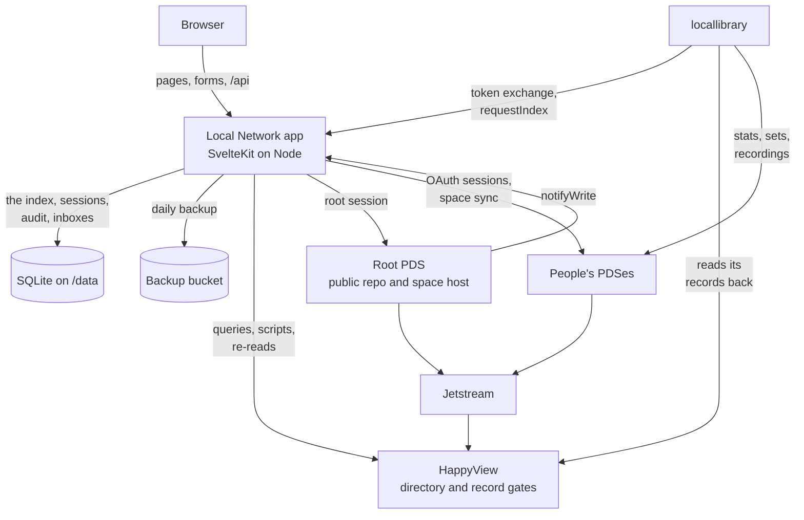

Source: [`src/lib/server/app.ts`](src/lib/server/app.ts), [`src/lib/server/happyview/client.ts`](src/lib/server/happyview/client.ts), [`src/routes/xrpc/com.atproto.space.notifyWrite/+server.ts`](src/routes/xrpc/com.atproto.space.notifyWrite/+server.ts)

### Deployment

How the website reaches production on Railway. HappyView and the root's PDS run outside this Railway project.

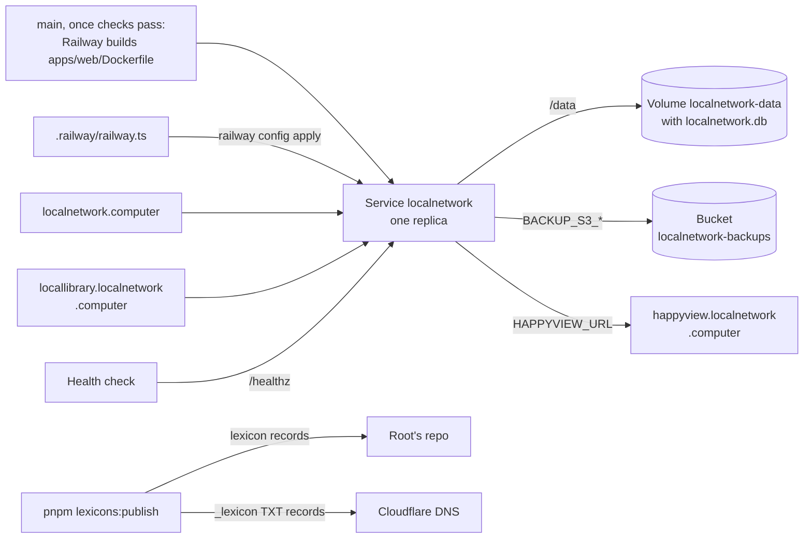

Source: [`../../.railway/railway.ts`](../../.railway/railway.ts), [`Dockerfile`](Dockerfile), [`scripts/publish-lexicons.ts`](scripts/publish-lexicons.ts)

### External services

What the server calls, and why.

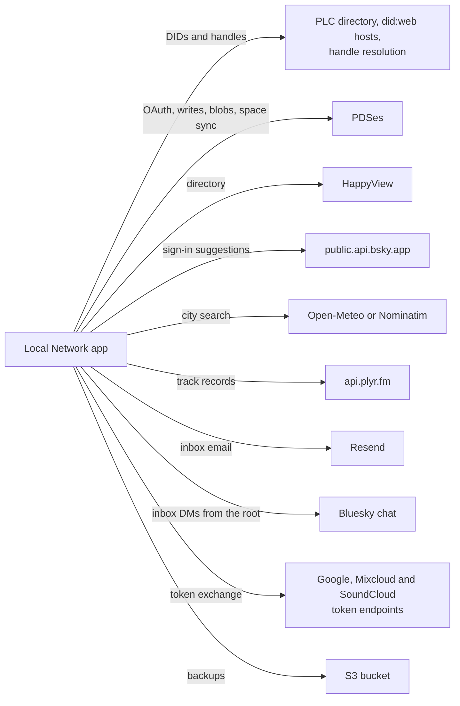

Source: [`src/lib/server/atproto/identity.ts`](src/lib/server/atproto/identity.ts), [`src/lib/server/actor-search.ts`](src/lib/server/actor-search.ts), [`src/lib/server/geocode.ts`](src/lib/server/geocode.ts), [`src/lib/server/plyr.ts`](src/lib/server/plyr.ts), [`src/lib/server/notifications/email.ts`](src/lib/server/notifications/email.ts), [`src/lib/server/notifications/dm.ts`](src/lib/server/notifications/dm.ts), [`src/lib/server/token-exchange/services.json`](src/lib/server/token-exchange/services.json), [`src/lib/server/backup/store.ts`](src/lib/server/backup/store.ts)

### What the browser reaches

Where a page's browser goes besides this site. The CSP lists the audio, script, frame and image hosts.

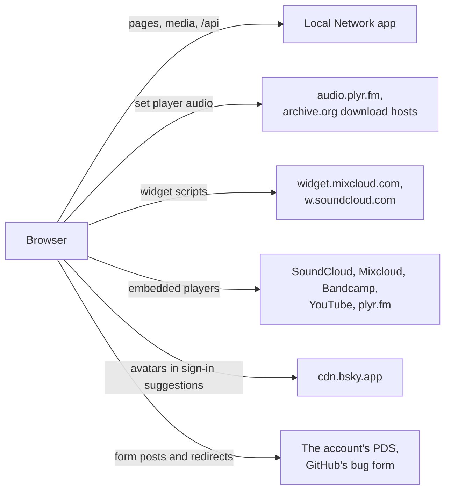

Source: [`vite.config.ts`](vite.config.ts), [`src/lib/bug-report.ts`](src/lib/bug-report.ts)

### Where state lives

Every place the app keeps something, and what rebuilds it.

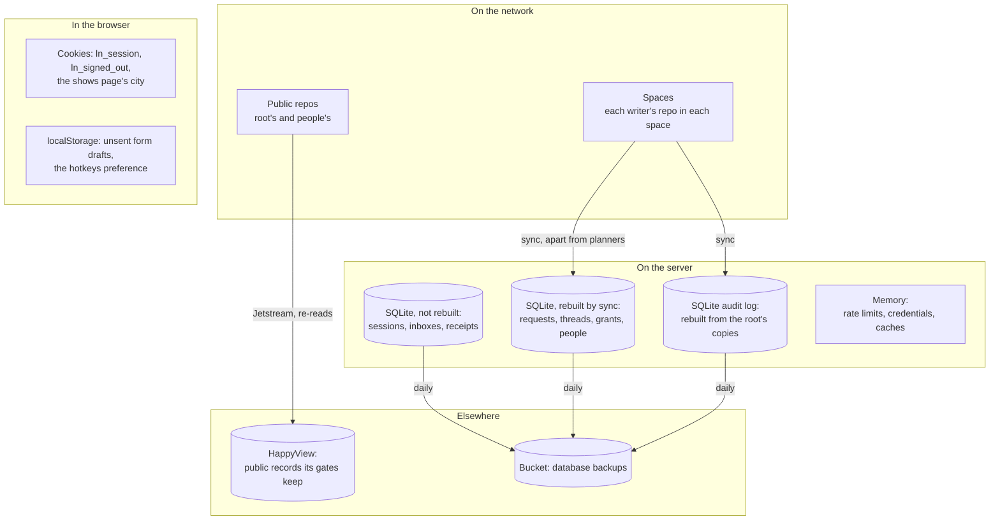

Source: [`src/lib/server/db/schema.ts`](src/lib/server/db/schema.ts), [`src/lib/server/sync/engine.ts`](src/lib/server/sync/engine.ts), [`src/lib/form-draft.svelte.ts`](src/lib/form-draft.svelte.ts), [`src/lib/server/shows-place.ts`](src/lib/server/shows-place.ts)

### Local tables: bookings and press kits

The tables that index booking threads, and press kit requests and grants. Only the link from participants to threads is a foreign key; the other lines are columns the rows share.

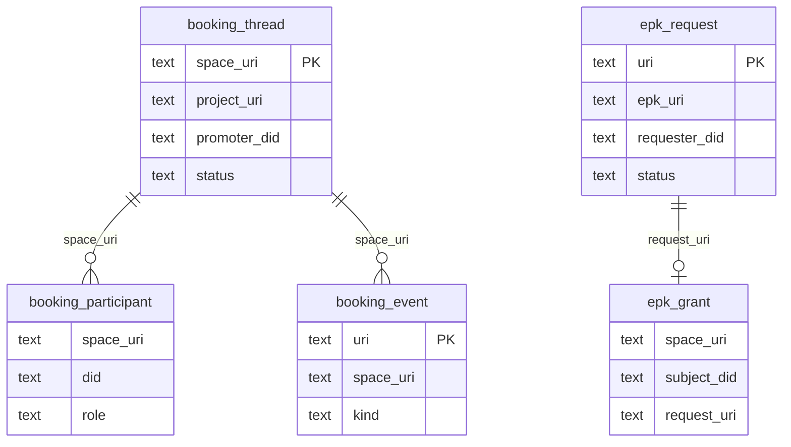

Source: [`src/lib/server/db/schema.ts`](src/lib/server/db/schema.ts), [`src/lib/server/db/migrations.ts`](src/lib/server/db/migrations.ts)

### Local tables: shared spaces

The tables that index performer, party and venue spaces. Each line is a column the rows share.

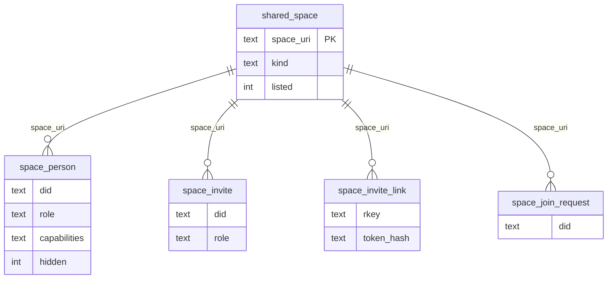

Source: [`src/lib/server/db/schema.ts`](src/lib/server/db/schema.ts), [`src/lib/server/services/shared-spaces.ts`](src/lib/server/services/shared-spaces.ts)

### Local tables: audit and sync

The tables behind the audit log and the syncer. Each line is a column the rows share.

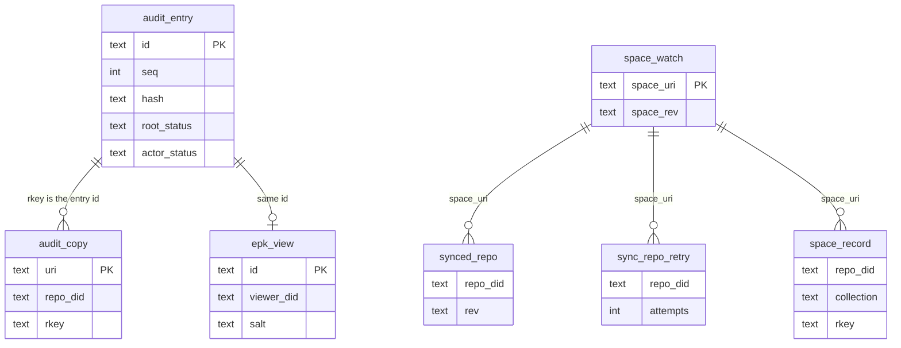

Source: [`src/lib/server/db/schema.ts`](src/lib/server/db/schema.ts), [`src/lib/server/audit/log.ts`](src/lib/server/audit/log.ts), [`src/lib/server/sync/engine.ts`](src/lib/server/sync/engine.ts)

### Local tables: inbox

The tables behind the inbox. Deliveries have a foreign key to their item, and the channel is looked up by DID and channel.

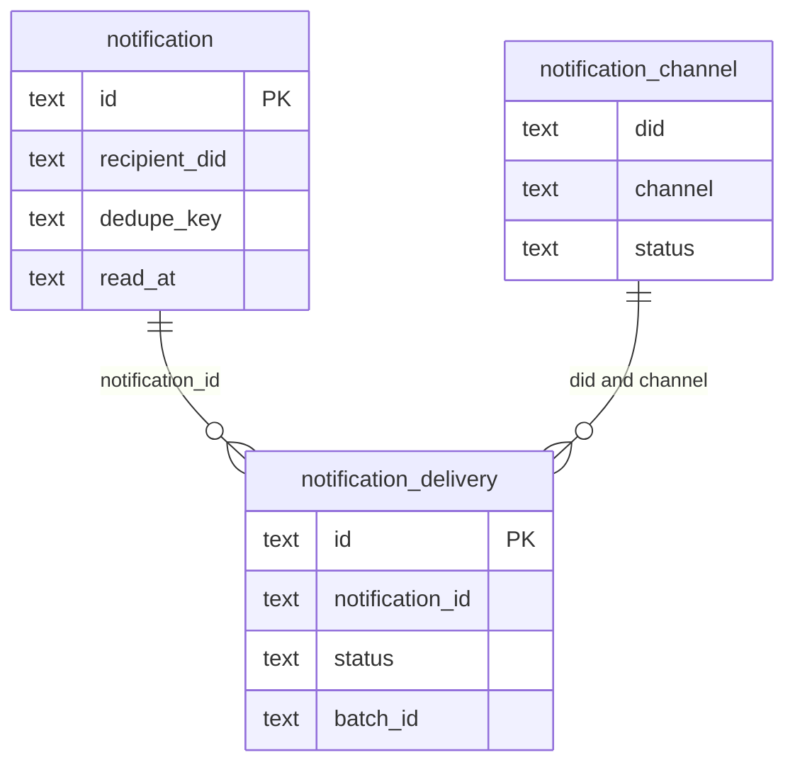

Source: [`src/lib/server/db/schema.ts`](src/lib/server/db/schema.ts), [`src/lib/server/notifications/outbox.ts`](src/lib/server/notifications/outbox.ts)

### Request path

What runs for each request, in order. SvelteKit makes its origin check before the `handle` hook.

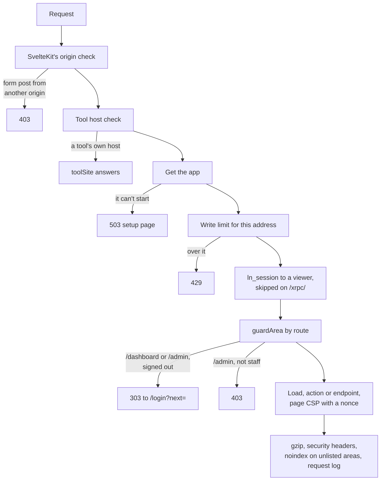

Source: [`src/hooks.server.ts`](src/hooks.server.ts), [`src/lib/server/http.ts`](src/lib/server/http.ts), [`src/lib/server/compress.ts`](src/lib/server/compress.ts), [`vite.config.ts`](vite.config.ts)

### Page loads and form actions

How a page gets its data, and how a form changes something. Layouts and the page load run alongside each other, unless a load awaits `parent()`, so the `handle` hook does the guarding.

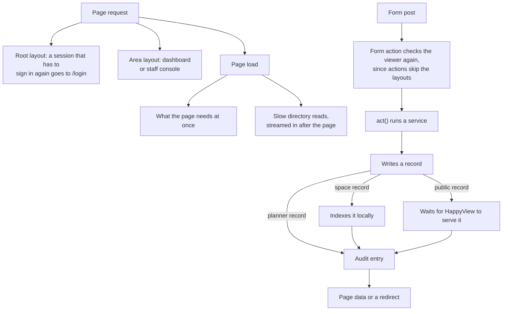

Source: [`src/routes/+layout.server.ts`](src/routes/+layout.server.ts), [`src/routes/dashboard/+layout.server.ts`](src/routes/dashboard/+layout.server.ts), [`src/lib/server/manage.ts`](src/lib/server/manage.ts), [`src/lib/server/http.ts`](src/lib/server/http.ts)

### Response caching

What each response lets a browser or a shared cache keep. Pages that show the same thing to everyone use `cacheBriefly`.

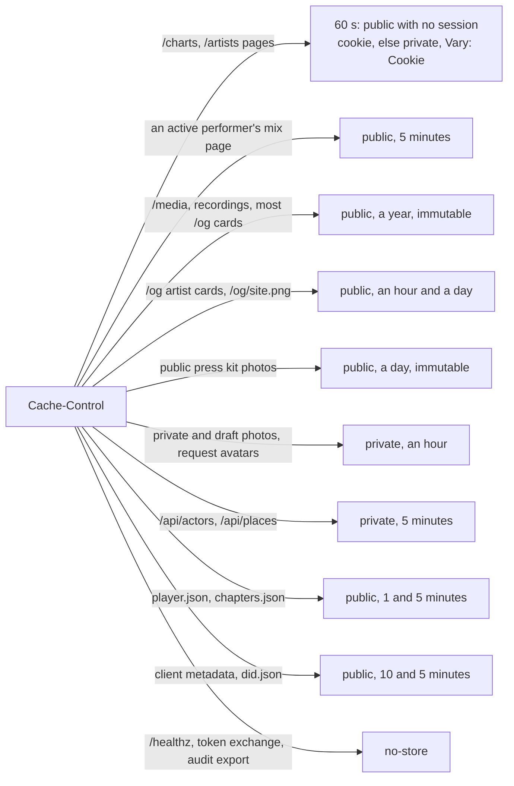

Source: [`src/lib/server/http.ts`](src/lib/server/http.ts), [`src/routes/charts/+page.server.ts`](src/routes/charts/+page.server.ts), [`src/routes/projects/[slug]/mixes/[n]/+page.server.ts`](src/routes/projects/[slug]/mixes/[n]/+page.server.ts), [`src/routes/media/[did]/[cid]/+server.ts`](src/routes/media/[did]/[cid]/+server.ts), [`src/lib/server/og/serve.ts`](src/lib/server/og/serve.ts), [`src/routes/projects/[slug]/press-kits/[rkey]/photos/[cid]/+server.ts`](src/routes/projects/[slug]/press-kits/[rkey]/photos/[cid]/+server.ts), [`src/routes/api/places/+server.ts`](src/routes/api/places/+server.ts), [`src/routes/sets/[did]/[rkey]/player.json/+server.ts`](src/routes/sets/[did]/[rkey]/player.json/+server.ts)

### Error paths

What each kind of failure turns into.

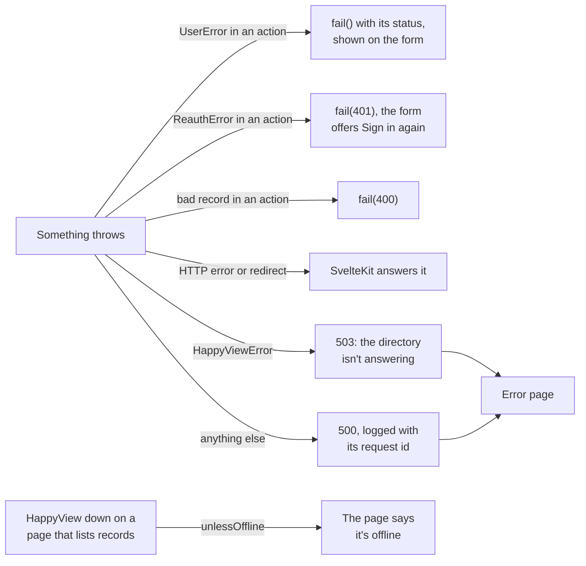

Source: [`src/hooks.server.ts`](src/hooks.server.ts), [`src/lib/server/http.ts`](src/lib/server/http.ts), [`src/lib/server/core.ts`](src/lib/server/core.ts), [`src/lib/server/happyview/offline.ts`](src/lib/server/happyview/offline.ts)

### Rate limits

Every token bucket the app sets. They're held in memory, so a restart resets them.

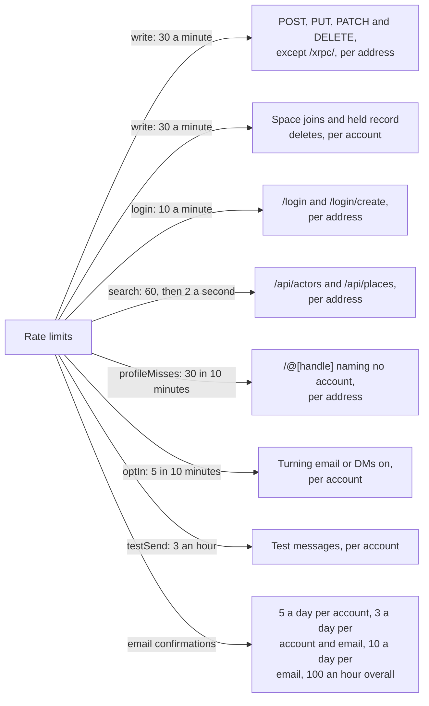

Source: [`src/lib/server/app.ts`](src/lib/server/app.ts), [`src/lib/server/rate-limit.ts`](src/lib/server/rate-limit.ts), [`src/lib/server/profile-page.ts`](src/lib/server/profile-page.ts), [`src/lib/server/notifications/channels.ts`](src/lib/server/notifications/channels.ts)

### Route families

Who can reach each family of routes.

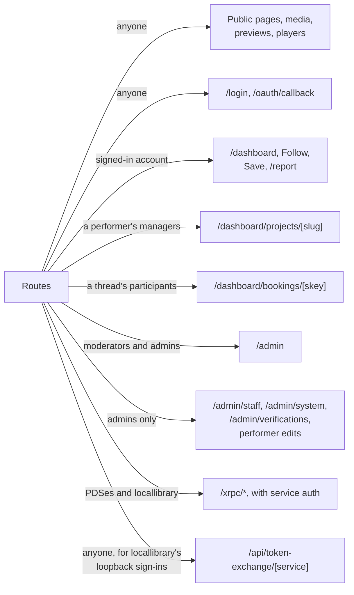

Source: [`src/lib/server/http.ts`](src/lib/server/http.ts), [`src/lib/server/manage.ts`](src/lib/server/manage.ts), [`src/lib/server/services/bookings.ts`](src/lib/server/services/bookings.ts), [`src/routes/admin/+layout.server.ts`](src/routes/admin/+layout.server.ts)

### Public pages

The pages anyone can read. A performer that isn't active shows only to its managers and staff; everyone else gets a 404.

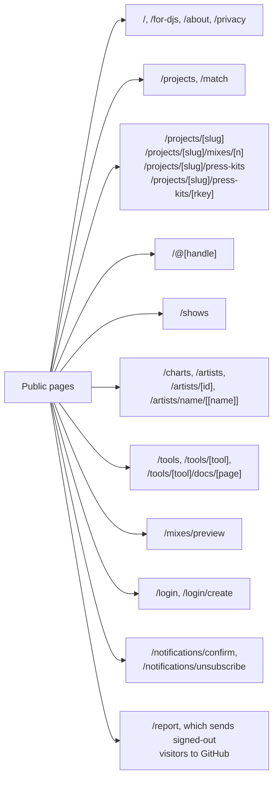

Source: [`src/routes/projects/[slug]/+page.server.ts`](src/routes/projects/[slug]/+page.server.ts), [`src/lib/server/project-page.ts`](src/lib/server/project-page.ts), [`src/routes/report/+page.server.ts`](src/routes/report/+page.server.ts), [`src/lib/server/http.ts`](src/lib/server/http.ts)

### Dashboard routes

Everything under `/dashboard`. The server hook turns away anyone signed out; pages narrow it from there.

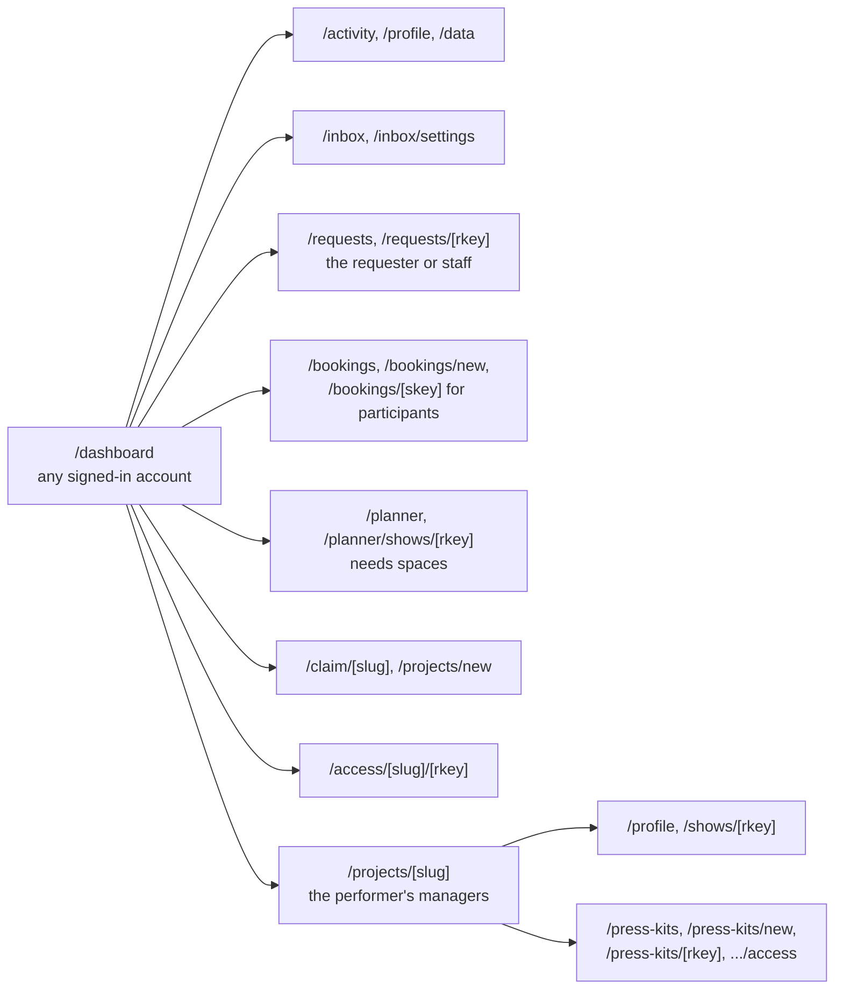

Source: [`src/routes/dashboard/+layout.server.ts`](src/routes/dashboard/+layout.server.ts), [`src/routes/dashboard/projects/[slug]/+layout.server.ts`](src/routes/dashboard/projects/[slug]/+layout.server.ts), [`src/routes/dashboard/requests/[rkey]/+page.server.ts`](src/routes/dashboard/requests/[rkey]/+page.server.ts), [`src/lib/server/planner-page.ts`](src/lib/server/planner-page.ts)

### Staff console routes

Everything under `/admin`, by the guard each page or action uses. Services that act for a viewer check the role again.

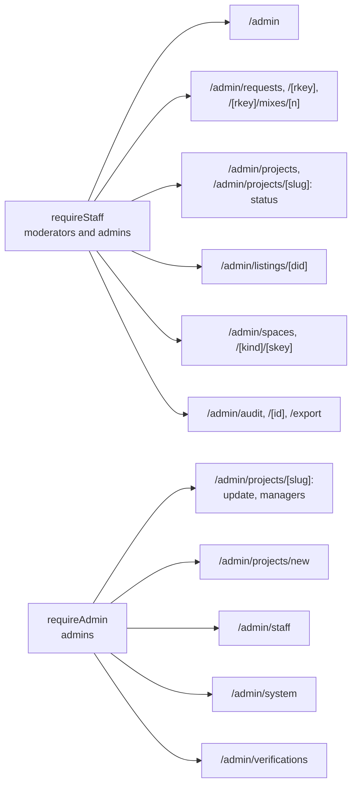

Source: [`src/routes/admin/+layout.server.ts`](src/routes/admin/+layout.server.ts), [`src/routes/admin/projects/[slug]/+page.server.ts`](src/routes/admin/projects/[slug]/+page.server.ts), [`src/routes/admin/system/+page.server.ts`](src/routes/admin/system/+page.server.ts), [`src/routes/admin/staff/+page.server.ts`](src/routes/admin/staff/+page.server.ts), [`src/routes/admin/verifications/+page.server.ts`](src/routes/admin/verifications/+page.server.ts)

### Endpoints

Routes that answer data rather than a page. [Smaller pages and endpoints](#smaller-pages-and-endpoints) has the redirects and `/healthz`.

```mermaid
flowchart LR
  Ep["Endpoints"]
  Ep --> Media["/media/[did]/[cid]<br/>/media/audio/[did]/[cid]"]
  Ep --> Kit["Press kit photos, private ones<br/>for managers and people granted"]
  Ep --> Sets["/sets/[did]/[rkey]/<br/>player.json, chapters.json"]
  Ep --> Og["/og/*.png"]
  Ep --> Api["/api/actors, /api/places,<br/>/api/token-exchange/[service]"]
  Ep --> Docs["/oauth-client-metadata.json<br/>/.well-known/did.json"]
  Ep --> Session["/oauth/callback,<br/>POST /logout"]
  Ep --> Xrpc["/xrpc: notifyWrite,<br/>notifySpaceDeleted,<br/>directory.requestIndex"]
  Ep --> Signed["Viewer checked: dashboard<br/>photos, request avatars,<br/>/admin/audit/export"]
```

Source: [`src/routes/media/[did]/[cid]/+server.ts`](src/routes/media/[did]/[cid]/+server.ts), [`src/routes/media/audio/[did]/[cid]/+server.ts`](src/routes/media/audio/[did]/[cid]/+server.ts), [`src/routes/sets/[did]/[rkey]/player.json/+server.ts`](src/routes/sets/[did]/[rkey]/player.json/+server.ts), [`src/routes/og/site.png/+server.ts`](src/routes/og/site.png/+server.ts), [`src/routes/api/actors/+server.ts`](src/routes/api/actors/+server.ts), [`src/routes/epk/[did]/[rkey]/+server.ts`](src/routes/epk/[did]/[rkey]/+server.ts), [`src/routes/healthz/+server.ts`](src/routes/healthz/+server.ts), [`src/routes/.well-known/did.json/+server.ts`](src/routes/.well-known/did.json/+server.ts)

### Smaller pages and endpoints

What the small routes do, beside the flows above.

```mermaid
flowchart LR
  Small["Small routes"]
  Small -- "/dashboard/activity" --> A["The viewer's own audit<br/>entries, 50 a page"]
  Small -- "/projects/[slug]/epk" --> B["308 to its press kits"]
  Small -- "/epk/[did]/[rkey] and its photos" --> C["Finds the press kit, 308 to<br/>its page, or 404"]
  Small -- "/sets/[did]/[rkey]/chapters.json" --> D["The set's tracklist as<br/>Podcasting 2.0 chapters"]
  Small -- "/api/actors" --> E["Bluesky's typeahead, kept<br/>10 minutes in memory"]
  Small -- "/healthz" --> F["200, with HappyView<br/>and backup status"]
  Small -- "/for-djs" --> G["Static page with its meta"]
```

Source: [`src/routes/dashboard/activity/+page.server.ts`](src/routes/dashboard/activity/+page.server.ts), [`src/routes/projects/[slug]/epk/+server.ts`](src/routes/projects/[slug]/epk/+server.ts), [`src/lib/server/epk-page.ts`](src/lib/server/epk-page.ts), [`src/routes/sets/[did]/[rkey]/chapters.json/+server.ts`](src/routes/sets/[did]/[rkey]/chapters.json/+server.ts), [`src/lib/server/actor-search.ts`](src/lib/server/actor-search.ts), [`src/routes/healthz/+server.ts`](src/routes/healthz/+server.ts), [`src/routes/for-djs/+page.server.ts`](src/routes/for-djs/+page.server.ts)

### Sign-in sequence

Signing in with an Atmosphere account. `/login/create` takes the same path with `prompt=create`. A rate limit or a handle that can't be found stays on the form.

```mermaid
sequenceDiagram
  participant B as Browser
  participant A as App
  participant P as Account's PDS
  participant D as SQLite
  B->>A: POST /login with a handle
  A->>A: Rate limit, resolve the handle
  A->>D: Save OAuth state
  A->>P: Start authorization with the widest scopes
  A-->>B: 303 to the PDS
  B->>P: Approve or decline
  P-->>B: Redirect to /oauth/callback
  B->>A: GET /oauth/callback
  alt Declined
    A-->>B: 303 to /login?error=denied
  else Anything else fails
    A-->>B: 303 to /login?error=login
  else Approved
    A->>P: Trade the code for DPoP-bound tokens
    A->>D: Save OAuth session, grant and account
    A->>D: Store the SHA-256 of a new web session
    A->>D: Audit auth.login
    A-->>B: Set ln_session, 303 to next
  end
```

Source: [`src/routes/login/+page.server.ts`](src/routes/login/+page.server.ts), [`src/routes/oauth/callback/+server.ts`](src/routes/oauth/callback/+server.ts), [`src/lib/server/atproto/oauth.ts`](src/lib/server/atproto/oauth.ts), [`src/lib/server/auth/session.ts`](src/lib/server/auth/session.ts)

### Scope fallback

What sign-in asks for and what it settles on. Opting in later works differently: see [Optional scope opt-in](#optional-scope-opt-in).

```mermaid
flowchart TD
  Full["Ask for full: blobs, calendar events,<br/>RSVPs, the permission set"]
  Full -- "scope refused" --> Base["Ask for base: profile, shows,<br/>follows, calendar events, blobs"]
  Base -- "scope refused" --> Minimal["Ask for atproto alone"]
  Full -- "accepted" --> Grant["The grant"]
  Base -- "accepted" --> Grant
  Minimal --> Grant
  Grant -- "covers every<br/>space write" --> Capable["spacesCapable: writes spaces<br/>with their own session"]
  Grant -- "doesn't" --> Behalf["Root writes space records<br/>on their behalf"]
  Capable --> Step["Public record and step-up scopes don't count.<br/>A public write that lacks one asks for sign-in;<br/>nothing writes with the step-up scopes yet"]
```

Source: [`src/lib/server/atproto/oauth.ts`](src/lib/server/atproto/oauth.ts), [`../../lexicons/computer/localnetwork/permissions.json`](../../lexicons/computer/localnetwork/permissions.json)

### Optional scope opt-in

How email and bug reports ask for one more scope after sign-in. It keeps what the account already granted and never asks below the tier it signed in with, so a refusal leaves the account as it was.

```mermaid
sequenceDiagram
  participant B as Browser
  participant A as App
  participant P as Account's PDS
  B->>A: Email on in settings,<br/>or Allow on /report
  opt Email, with the scope already granted
    A->>P: getSession for the address
    A-->>B: Link sent, or email on, and it stops here<br/>unless the address could not be read
  end
  A->>P: Authorize from full down to their tier,<br/>each with the scope
  alt PDS refuses every form
    A-->>B: Their server doesn't allow it
  else
    A-->>B: 303 to the PDS
    B->>P: Approve or decline
    P-->>B: Redirect to /oauth/callback
    B->>A: GET /oauth/callback
    alt Email declined
      A-->>B: 303 to settings?email=declined
    else Bug reports declined
      A-->>B: 303 to /login?error=denied
    else Approved
      A->>A: Record the grant,<br/>read the address for email
      A-->>B: 303 back where it started
    end
  end
```

Source: [`src/routes/dashboard/inbox/settings/+page.server.ts`](src/routes/dashboard/inbox/settings/+page.server.ts), [`src/routes/report/+page.server.ts`](src/routes/report/+page.server.ts), [`src/routes/oauth/callback/+server.ts`](src/routes/oauth/callback/+server.ts), [`src/lib/server/atproto/oauth.ts`](src/lib/server/atproto/oauth.ts), [`src/lib/server/notifications/channels.ts`](src/lib/server/notifications/channels.ts)

### Who writes a record

Which account's session makes a write. Public repos have no fallback, since nobody can write there for someone else.

```mermaid
flowchart LR
  Write["A write for someone"]
  Write -- "shared space" --> Capable["spacesCapable, with<br/>a live session?"]
  Capable -- "yes" --> Own["Their session,<br/>their repo in the space"]
  Capable -- "no" --> Root["Root's session, root's repo,<br/>onBehalfOf names them"]
  Write -- "their public repo" --> Session["Session holds<br/>the scope?"]
  Session -- "yes" --> Public["Their session"]
  Session -- "no" --> Again["Sign in again. If that didn't<br/>help: your account's server<br/>doesn't allow this yet"]
  Write -- "planner space" --> Planner["spacesCapable?"]
  Planner -- "yes" --> Mine["Their session"]
  Planner -- "no" --> Off["Planner unavailable"]
  Write -- "root's repo or<br/>root-only space" --> Only["Root's session"]
```

Source: [`src/lib/server/services/own-repo.ts`](src/lib/server/services/own-repo.ts), [`src/lib/server/services/planner.ts`](src/lib/server/services/planner.ts)

### Browser session lifecycle

A web session from sign-in to sign-out. `POST /logout` audits first, waiting up to five seconds, then revokes the OAuth session and sets `ln_signed_out`.

```mermaid
stateDiagram-v2
  [*] --> SignedOut
  SignedOut --> SignedIn: OAuth callback sets ln_session
  SignedIn --> SignedIn: signing in again replaces it
  SignedIn --> MustSignIn: the app now asks for more space scopes
  MustSignIn --> SignedIn: signs in again
  SignedIn --> SignedOut: SESSION_DAYS pass (30 by default), cookie deleted
  SignedIn --> SignedOut: POST /logout
```

Source: [`src/lib/server/auth/session.ts`](src/lib/server/auth/session.ts), [`src/lib/server/app.ts`](src/lib/server/app.ts), [`src/routes/logout/+server.ts`](src/routes/logout/+server.ts), [`src/hooks.server.ts`](src/hooks.server.ts)

### Root account session

How the root account signs in at startup. Its session lives in `kv`, tied to a slow hash of `ROOT_PASSWORD`, so changing the password forces a fresh sign-in.

```mermaid
flowchart TD
  Start["Connect the root"] --> Resolve["Resolve ROOT_IDENTIFIER to a DID"]
  Resolve --> Print["scrypt fingerprint of ROOT_PASSWORD"]
  Print --> Saved["root_session in kv, with the<br/>same fingerprint and DID?"]
  Saved -- "yes" --> Resume["Resume it"]
  Saved -- "no, or it won't resume" --> Login["Sign in with the password"]
  Resume --> Client["One root client for the process:<br/>writes, delegation tokens, chat"]
  Login --> Client
  Client -- "session created or refreshed" --> Store["Written to kv"]
  Client -- "session expired" --> Clear["Deleted from kv"]
```

Source: [`src/lib/server/atproto/root.ts`](src/lib/server/atproto/root.ts), [`src/lib/server/atproto/repo-client.ts`](src/lib/server/atproto/repo-client.ts)

### Token exchange flow

How a locallibrary plugin gets tokens from a service that wants a client secret.

```mermaid
sequenceDiagram
  participant L as locallibrary
  participant A as App
  participant S as Service token endpoint
  L->>A: POST /api/token-exchange/[service] as JSON
  alt Unknown service, over 64 KiB, or not a grant
    A-->>L: 404, 413 or 400
  else redirect_uri isn't locallibrary's listener
    A-->>L: 400 invalid_request
  else Service's variables aren't set
    A-->>L: 503 temporarily_unavailable
  else Refresh at a service that has none
    A-->>L: 400 unsupported_grant_type
  else
    A->>S: Same grant plus client id and secret
    S-->>A: Tokens or an error
    A-->>L: The service's answer, no-store
    A-->>L: 502 if it didn't answer properly
  end
```

Source: [`src/routes/api/token-exchange/[service]/+server.ts`](src/routes/api/token-exchange/[service]/+server.ts), [`src/lib/server/token-exchange/exchange.ts`](src/lib/server/token-exchange/exchange.ts), [`src/lib/server/token-exchange/services.json`](src/lib/server/token-exchange/services.json)

### Tool hosts

What a tool's own host answers. It runs before the app loads, so it works while the app isn't configured.

```mermaid
flowchart TD
  In["Request to a tool's host"] --> Method{"GET or HEAD?"}
  Method -- "no" --> Refused["405"]
  Method -- "yes" --> Path{"Which path?"}
  Path -- "/oauth-client-metadata.json" --> Doc["The tool's OAuth client document"]
  Path -- "/" --> Move["308 to /tools/[tool]<br/>on PUBLIC_URL"]
  Path -- "anything else" --> Missing["404"]
```

Source: [`src/lib/server/tools/site.ts`](src/lib/server/tools/site.ts), [`src/lib/tools/index.ts`](src/lib/tools/index.ts)

### Site roles

The roles the site itself knows, and how someone gets each.

```mermaid
flowchart TD
  Visitor["Visitor"] -- "signs in" --> Account["Signed-in account"]
  Account -- "create or claim approved,<br/>or an admin adds them" --> Manager["Manager of a performer:<br/>on its managers list, at most 10"]
  Account -- "sends an inquiry" --> Asker["Promoter side of a thread"]
  Account -- "grant" --> Reader["Reader of a press kit's private part"]
  Account -- "staff.role from an admin" --> Mod["Moderator: reviews requests,<br/>hides performers, lists DJs,<br/>changes who's in a space,<br/>reads the audit log"]
  Account -- "staff.role, or ADMIN_DIDS" --> Admin["Admin: all that, plus direct edits,<br/>staff, verifications, System page"]
```

Source: [`src/lib/server/services/staff.ts`](src/lib/server/services/staff.ts), [`src/lib/server/app.ts`](src/lib/server/app.ts), [`src/lib/server/services/requests.ts`](src/lib/server/services/requests.ts), [`src/lib/server/services/project-admin.ts`](src/lib/server/services/project-admin.ts)

### Capabilities by role

The starting capabilities of each role in a performer, party or venue space. `page.edit`, `presskits.manage`, `shows.manage` and `events.manage` also make someone a writing member. No page uses these roles yet except the staff console.

```mermaid
flowchart LR
  Performer["performer space"] --> PM["member, listed:<br/>page.edit, people.manage, listing.request,<br/>presskits.manage, bookings.answer, shows.manage"]
  Performer --> PN["manager:<br/>page.edit, listing.request, presskits.manage,<br/>bookings.answer, shows.manage"]
  Party["party space"] --> H["host, listed:<br/>page.edit, people.manage, listing.request, events.manage,<br/>bookings.send, guests.manage, guests.checkin"]
  Party --> C["cohost, listed:<br/>all of host's but people.manage"]
  Party --> D["door:<br/>guests.checkin"]
  Venue["venue space"] --> O["owner:<br/>page.edit, people.manage,<br/>venue.approve, venue.block"]
  Venue --> B["booker:<br/>venue.approve"]
```

Source: [`src/lib/capabilities.ts`](src/lib/capabilities.ts), [`src/lib/server/services/shared-spaces.ts`](src/lib/server/services/shared-spaces.ts)

### Space types

Every kind of space, what creates it, and how the app reads it.

```mermaid
flowchart LR
  App["App"]
  App -- "bootstrap" --> Four["audit, moderation,<br/>staff, industry"]
  App -- "a booking inquiry" --> Booking["booking,<br/>one per thread"]
  App -- "first press kit publish" --> Epk["epk,<br/>one per press kit"]
  App -- "first request or grant" --> Requests["epkRequests,<br/>one per performer"]
  App -- "first draft saved" --> Backstage["backstage,<br/>one per performer"]
  App -- "SharedSpaces.create,<br/>no page calls it yet" --> Shared["performer, party, venue"]
  App -- "first planner read or write" --> Planner["planner, under the<br/>person's own DID"]
  Four --> Watch["Syncer watches it,<br/>reading with the<br/>root's credential"]
  Booking --> Watch
  Epk --> Watch
  Requests --> Watch
  Backstage --> Watch
  Shared --> Watch
  Planner --> Session["Read with their session,<br/>no copy kept"]
```

Source: [`src/lib/server/bootstrap.ts`](src/lib/server/bootstrap.ts), [`src/lib/server/atproto/spaces.ts`](src/lib/server/atproto/spaces.ts), [`src/lib/server/services/space-members.ts`](src/lib/server/services/space-members.ts), [`src/lib/server/services/bookings.ts`](src/lib/server/services/bookings.ts), [`src/lib/server/services/planner.ts`](src/lib/server/services/planner.ts)

### Space credentials

How the app syncs a space. The root's session gets a delegation token, the space host trades it for a credential, and each repo host proves its answer with a MAC.

```mermaid
sequenceDiagram
  participant A as App
  participant R as Root PDS
  participant H as Space host
  participant W as Writer's repo host
  A->>R: getDelegationToken with the root's session
  R-->>A: Delegation token
  A->>A: New P-256 key, kept in memory
  A->>H: getSpaceCredential with the token and key id
  H-->>A: Credential bound to that key
  A->>H: listRepos, signed with the key
  H-->>A: Writers and their revs
  A->>W: listRepoOps, signed, with a one-time KEM share
  W-->>A: Ops and a commit with a MAC
  A->>A: Check the MAC and the LtHash
  alt MAC fails
    A->>A: Refresh the writer's DID document, read once more
  else Credential rejected
    A->>H: Mint a fresh credential, retry once
  end
```

Source: [`src/lib/server/atproto/credentials.ts`](src/lib/server/atproto/credentials.ts), [`src/lib/server/sync/engine.ts`](src/lib/server/sync/engine.ts), [`src/lib/server/atproto/repo-client.ts`](src/lib/server/atproto/repo-client.ts)

### Reads outside the sync

What the app reads from a space directly, without going through the local copy.

```mermaid
flowchart LR
  Reads["Direct space reads"]
  Reads -- "a press kit's private part" --> R1["getRecord with the root's space<br/>credential, checked against its MAC"]
  Reads -- "private and draft photos, proposed<br/>avatars and tracklists" --> R2["getBlob with the root's<br/>space credential"]
  Reads -- "the root's own records: grants,<br/>people, opening records" --> R3["Root session: listSpaceRecords,<br/>getSpaceRecord"]
  Reads -- "who's in a space" --> R4["Root session: listMembers"]
  Reads -- "planners" --> R5["The person's OAuth session"]
  Reads -- "a legacy press kit's records" --> R6["Its maker's OAuth session"]
```

Source: [`src/lib/server/app.ts`](src/lib/server/app.ts), [`src/lib/server/atproto/credentials.ts`](src/lib/server/atproto/credentials.ts), [`src/lib/server/services/epk.ts`](src/lib/server/services/epk.ts), [`src/lib/server/services/requests.ts`](src/lib/server/services/requests.ts), [`src/lib/server/services/manager-spaces.ts`](src/lib/server/services/manager-spaces.ts), [`src/lib/server/services/planner.ts`](src/lib/server/services/planner.ts), [`src/lib/server/services/epk-legacy.ts`](src/lib/server/services/epk-legacy.ts)

### Space sync pass

One pass over one space. A second request while it runs queues one more pass.

```mermaid
flowchart TD
  Trigger["Poll, notifyWrite, or watchSpace"] --> List["registerNotify if it's due, then<br/>listRepos from spaceRev, 500 a page"]
  List -- "authority says<br/>it's gone" --> Drop["Drop the local copy<br/>and what came from it"]
  List --> Ops["Each repo that's behind, 4 at a time<br/>across all spaces: listRepoOps since local rev"]
  List -- "never synced" --> Star["getRepo: verified STAR archive"]
  Ops -- "fails, not on a MAC<br/>or credential" --> Star
  Ops --> Apply["Transaction: space_record, synced_repo"]
  Star --> Apply
  Apply --> Project["Project each change.<br/>A failure is logged, not retried"]
  Project --> Due["Repos whose retry is due,<br/>then save spaceRev"]
```

Source: [`src/lib/server/sync/engine.ts`](src/lib/server/sync/engine.ts)

### Repo sync lifecycle

One writer's repo in one space. A failure stays in `sync_repo_retry`, since `listRepos` won't list that repo again until it changes.

```mermaid
stateDiagram-v2
  [*] --> Unsynced
  Unsynced --> Synced: full download verifies
  Unsynced --> Failing: read fails
  Synced --> Synced: oplog matches the commit
  Synced --> Synced: oplog fails, full download verifies
  Synced --> Failing: read fails
  Failing --> Failing: fails again, wait doubles from 1 minute to 1 hour
  Failing --> Synced: retry works
  Synced --> [*]: space dropped
  Failing --> [*]: space dropped
```

Source: [`src/lib/server/sync/engine.ts`](src/lib/server/sync/engine.ts), [`src/lib/server/db/schema.ts`](src/lib/server/db/schema.ts)

### Write notifications

How a write reaches the app without waiting for the poll, with `SYNC_NOTIFY` on. Without it, or if registering fails, writes wait for the poll.

```mermaid
sequenceDiagram
  participant W as Writer's PDS
  participant H as Space host
  participant A as App
  A->>H: registerNotify with the space credential
  W->>H: notifyWrite, service auth from the writer
  H->>A: GET /.well-known/did.json to find the syncer
  H->>A: POST notifyWrite, service auth from the authority
  A->>A: Check audience, method and issuer
  alt Bad space
    A-->>H: 400
  else Check fails
    A-->>H: 401
  else Space isn't watched
    A-->>H: 404
  else Watched
    A-->>H: 200
    A->>A: Sync the space in the background
  end
  H->>A: POST notifySpaceDeleted when a space goes
  A->>A: Drop the local copy
```

Source: [`src/routes/xrpc/com.atproto.space.notifyWrite/+server.ts`](src/routes/xrpc/com.atproto.space.notifyWrite/+server.ts), [`src/routes/xrpc/com.atproto.space.notifySpaceDeleted/+server.ts`](src/routes/xrpc/com.atproto.space.notifySpaceDeleted/+server.ts), [`src/routes/.well-known/did.json/+server.ts`](src/routes/.well-known/did.json/+server.ts), [`src/lib/server/atproto/service-auth.ts`](src/lib/server/atproto/service-auth.ts)

### Record projections

Where each synced record lands. Every record is checked against its lexicon first, and an invalid one is skipped. A delete takes its row with it, except that a deleted open request reads as withdrawn and a deleted audit copy marks the entry failed.

```mermaid
flowchart LR
  Sync["Synced change"]
  Sync -- "audit.entry" --> A1["audit_copy, and marks the<br/>entry verified or failed"]
  Sync -- "moderation.request" --> A2["request"]
  Sync -- "moderation.decision,<br/>root only" --> A3["request's decision"]
  Sync -- "staff.role, root only" --> A4["staff_role"]
  Sync -- "project.details, root only" --> A5["project_details"]
  Sync -- "booking.inquiry, message, status,<br/>participants and the root" --> A6["booking_thread, booking_event,<br/>inbox items"]
  Sync -- "epk.request, and epk.grant<br/>from the authority only" --> A7["epk_request, epk_grant"]
  Sync -- "epk.draft in a backstage" --> A8["epk_draft"]
  Sync -- "people.*, listing.status,<br/>root only" --> A9["shared space tables,<br/>then its listing"]
```

Source: [`src/lib/server/sync/projections.ts`](src/lib/server/sync/projections.ts), [`src/lib/server/services/bookings.ts`](src/lib/server/services/bookings.ts), [`src/lib/server/services/epk.ts`](src/lib/server/services/epk.ts)

### Member list upkeep

What keeps each space's member list right. Manager and shared space runs compare with the live list, so a run that failed part way is finished by the next. The staff run only adds current staff, so a failed removal stays.

```mermaid
flowchart TD
  Publish["A publish that changes managers"] --> Managers["ManagerSpaces.sync"]
  Hourly["Startup, hourly, System page"] --> All["reconcileManagerSpaces,<br/>from the root's own repo"]
  All --> Managers
  Managers --> Threads["Booking spaces: leavers go,<br/>new managers join live threads,<br/>the promoter stays"]
  Managers --> Back["backstage: read and write"]
  Managers --> Asks["epkRequests: read"]
  Managers --> Kits["epk spaces: read,<br/>granted people stay"]
  Hourly --> Shared["SharedSpaces:<br/>members follow people records"]
  People["A change to a space's people"] --> Shared
  Boot["Startup, System page"] --> Staff["Staff added to audit, moderation,<br/>staff and industry spaces"]
  Threads -. "only with a root record<br/>naming the performer" .-> Root["Opening record or<br/>booking.create audit entry"]
```

Source: [`src/lib/server/services/manager-spaces.ts`](src/lib/server/services/manager-spaces.ts), [`src/lib/server/services/space-members.ts`](src/lib/server/services/space-members.ts), [`src/lib/server/services/shared-spaces.ts`](src/lib/server/services/shared-spaces.ts), [`src/lib/server/services/staff.ts`](src/lib/server/services/staff.ts)

### Startup

What happens when the process starts. A failed start leaves the setup page up, and the next request tries again.

```mermaid
flowchart TD
  Init["init hook, or the first request"] --> Db["Open SQLite, run migrations"]
  Db --> Root["Connect the root account,<br/>reusing its saved session"]
  Root --> Wire["Build the services"]
  Wire --> Dir["Directory sync"]
  Dir --> Boot["bootstrap, in the background"]
  Dir --> Timers["Start the scheduled jobs,<br/>resume notification delivery"]
  Boot --> Spaces["ensureRootSpaces,<br/>list every space, watch them"]
  Spaces --> Members["Reconcile staff, manager<br/>and shared space members"]
  Members --> Sync["syncAll"]
  Sync --> Listings["listings.reconcile"]
  Listings --> Moves["moveKitSpaces"]
```

Source: [`src/hooks.server.ts`](src/hooks.server.ts), [`src/lib/server/app.ts`](src/lib/server/app.ts), [`src/lib/server/bootstrap.ts`](src/lib/server/bootstrap.ts), [`src/lib/server/db/migrations.ts`](src/lib/server/db/migrations.ts)

### Scheduled jobs

The jobs the app schedules, all in one process. A job still running skips its next turn.

```mermaid
flowchart LR
  Poll["SYNC_POLL_INTERVAL_MS,<br/>60 s by default"] --> P1["sync: syncAll, or bootstrap<br/>until that has worked"]
  Poll --> P2["directory-sync: retry a failed sync,<br/>else script re-reads"]
  Quick["15 s"] --> Q1["audit-retry: 25 due entries"]
  Quick --> Q2["notification-delivery, also<br/>woken when an item comes due"]
  Hour["1 hour"] --> H1["oauth-state-cleanup"]
  Hour --> H2["manager-spaces"]
  Hour --> H3["shared-spaces"]
  Hour --> H4["listings"]
  Hour --> H5["epk-view-expiry"]
  Hour --> H6["inbox-retention"]
  Hour --> H7["db-backup, with a bucket:<br/>once a UTC day"]
```

Source: [`src/lib/server/app.ts`](src/lib/server/app.ts), [`src/lib/server/backup/backups.ts`](src/lib/server/backup/backups.ts), [`src/lib/server/services/epk-views.ts`](src/lib/server/services/epk-views.ts), [`src/lib/server/notifications/notifier.ts`](src/lib/server/notifications/notifier.ts)

### Directory sync

What `syncDirectory` does with `HAPPYVIEW_API_KEY` set, at boot and from the System page. A failed upload or root re-read is kept for the System page and retried. The re-reads after it only log a failure.

```mermaid
flowchart TD
  Compare["Compare scripts and lexicons<br/>with what HappyView stores"] --> Scripts["Upload changed scripts first,<br/>so the gate is in place"]
  Scripts --> Lexicons["Upload changed lexicons,<br/>one at a time"]
  Lexicons --> Root["Re-read the root's performers,<br/>wait up to 30 s"]
  Root --> Shows["Each manager's shows,<br/>one repo at a time, in the background"]
  Root --> Refresh["refreshRecords: older records,<br/>once per script version"]
  Refresh --> Kv["Version kept in kv<br/>once every re-read has started"]
```

Source: [`src/lib/server/happyview/sync.ts`](src/lib/server/happyview/sync.ts), [`src/lib/server/happyview/bundle.ts`](src/lib/server/happyview/bundle.ts), [`src/lib/server/happyview/refresh.ts`](src/lib/server/happyview/refresh.ts), [`src/lib/server/app.ts`](src/lib/server/app.ts)

### HappyView re-reads

What makes the app ask HappyView to read a repo again through `/admin/backfill`. Jetstream only brings new writes, so these fill the gaps.

```mermaid
flowchart LR
  Backfill["/admin/backfill"]
  Backfill -- "new record script" --> R1["That collection, per<br/>manager and root"]
  Backfill -- "new record script" --> R2["Follows press kits read,<br/>root's verifications and<br/>DJ listings, bug report space"]
  Backfill -- "a performer gains a manager,<br/>once HappyView serves it" --> R3["Their records and follows"]
  Backfill -- "boot" --> R4["The root's performers,<br/>each manager's shows"]
  Backfill -- "the set picker opens" --> R5["Their sets, every<br/>10 minutes at most"]
  Backfill -- "requestIndex" --> R6["The caller's<br/>four collections"]
  Backfill -- "a late write, except a performer's,<br/>an InvalidSwap on a press kit, show<br/>or verification, or a record HappyView lacks" --> R7["That collection<br/>from that account"]
  Backfill -- "a first press kit<br/>that reads follows" --> R8["Its managers' follows"]
  Backfill -- "staff list a DJ" --> R9["Their profile"]
```

Source: [`src/lib/server/happyview/refresh.ts`](src/lib/server/happyview/refresh.ts), [`src/lib/server/happyview/backfills.ts`](src/lib/server/happyview/backfills.ts), [`src/lib/server/happyview/indexed.ts`](src/lib/server/happyview/indexed.ts), [`src/lib/server/services/projects.ts`](src/lib/server/services/projects.ts), [`src/lib/server/services/sets.ts`](src/lib/server/services/sets.ts), [`src/lib/server/services/epk.ts`](src/lib/server/services/epk.ts)

### requestIndex

locallibrary asks for its own records to be read again before it replaces them.

```mermaid
sequenceDiagram
  participant L as locallibrary
  participant A as App
  participant H as HappyView
  L->>A: POST directory.requestIndex<br/>with service auth
  A->>A: Check audience,<br/>method and signature
  alt Check fails
    A-->>L: 401
  else
    par sets, recordings, stats, settings, all at once
      A->>H: Backfill the issuer's repo,<br/>unless done in the last 10 minutes
      A->>H: Wait up to 5 s
    end
    A-->>L: indexed: true when all finished,<br/>false without HAPPYVIEW_API_KEY
  end
```

Source: [`src/routes/xrpc/computer.localnetwork.directory.requestIndex/+server.ts`](src/routes/xrpc/computer.localnetwork.directory.requestIndex/+server.ts), [`src/lib/server/happyview/request-index.ts`](src/lib/server/happyview/request-index.ts), [`src/lib/server/happyview/backfills.ts`](src/lib/server/happyview/backfills.ts)

### HappyView record gates

What each record script keeps of what Jetstream sends. Anyone can write these collections, so the gates decide what the directory holds.

```mermaid
flowchart LR
  Jet["Jetstream"]
  Jet -- "the root's only" --> Root["project, listing.profile,<br/>verification"]
  Jet -- "every account's" --> All["profile, dj.set, dj.recording,<br/>dj.profile, locallibrary.settings"]
  Jet -- "accounts that manage<br/>the root's performers" --> Managers["calendar event, and show when<br/>it names a performer they manage"]
  Jet -- "managers, and accounts<br/>the root verified" --> Names["Bluesky display names"]
  Jet -- "press kits of the<br/>root's performers" --> Kits["The root's, and a<br/>manager's older ones"]
  Jet -- "of the root's performers" --> Follows["computer.localnetwork.follow"]
  Jet -- "managers of a performer whose<br/>press kit reads follows" --> Bsky["Bluesky follows"]
  Jet -- "USERINPUT_SPACE alone" --> Input["app.userinput.space"]
```

Source: [`lua/computer/localnetwork/project.lua`](lua/computer/localnetwork/project.lua), [`lua/computer/localnetwork/show.lua`](lua/computer/localnetwork/show.lua), [`lua/computer/localnetwork/epk.lua`](lua/computer/localnetwork/epk.lua), [`lua/computer/localnetwork/follow.lua`](lua/computer/localnetwork/follow.lua), [`lua/app/bsky/actor/profile.lua`](lua/app/bsky/actor/profile.lua), [`lua/app/bsky/graph/follow.lua`](lua/app/bsky/graph/follow.lua), [`lua/app/userinput/space.lua`](lua/app/userinput/space.lua), [`src/lib/server/happyview/bundle.ts`](src/lib/server/happyview/bundle.ts)

### Directory queries

Which query answers which page. All of them are Lua scripts on HappyView, and `getRecords` and `listRecords` also back `IndexedRepo`.

```mermaid
flowchart LR
  Pages["Pages and services"]
  Pages -- "home, staff overview" --> Q1["getStats"]
  Pages -- "home, dashboard sidebar,<br/>staff's performers" --> Q10["searchProjects"]
  Pages -- "/projects" --> Q2["searchPerformers"]
  Pages -- "/match" --> Q3["matchProjects"]
  Pages -- "performer pages, dashboard" --> Q4["getProject, getProjects"]
  Pages -- "/shows, performer pages" --> Q5["listShows"]
  Pages -- "waiting on a show write" --> Q11["getShows"]
  Pages -- "mixes, the set picker" --> Q6["getSets, listSets"]
  Pages -- "Follow button" --> Q7["getFollowStatus"]
  Pages -- "/charts, /artists" --> Q8["getCharts, getArtist,<br/>searchArtists"]
  Pages -- "stats, press kits, profiles,<br/>verifications, bug report space" --> Q9["getRecords, listRecords"]
```

Source: [`src/lib/server/happyview/client.ts`](src/lib/server/happyview/client.ts), [`src/lib/server/happyview/indexed.ts`](src/lib/server/happyview/indexed.ts), [`src/lib/server/services/projects.ts`](src/lib/server/services/projects.ts), [`src/lib/server/services/performers.ts`](src/lib/server/services/performers.ts), [`src/lib/server/services/shows.ts`](src/lib/server/services/shows.ts), [`src/lib/server/services/supports.ts`](src/lib/server/services/supports.ts)

### Profiles and DJ listings

How someone gets a profile, and how a DJ gets into Find DJs.

```mermaid
flowchart TD
  First["No profile yet: a card on /dashboard,<br/>filled from their Bluesky profile"] --> Edit["/dashboard/profile"]
  Edit --> Save["Writes computer.localnetwork.profile<br/>to their repo over the version the form opened"]
  Save --> Wait["Waits up to 5 s for HappyView to serve it"]
  Wait --> Page["/@[handle] shows it,<br/>sections decide the sidebar"]
  Edit -- "DJ section on" --> Ask["list request in the moderation space"]
  Ask --> Review["Staff review the profile as it is now"]
  Review -- "approved" --> Listing["Root writes listing.profile,<br/>HappyView re-reads the profile"]
  Listing --> Find["searchPerformers shows them"]
  Find --> Out["/admin/listings/[did] can take them out"]
  Find --> Off["Turning the DJ section off hides<br/>them too, the listing stays"]
```

Source: [`src/lib/server/services/profiles.ts`](src/lib/server/services/profiles.ts), [`src/routes/dashboard/profile/+page.server.ts`](src/routes/dashboard/profile/+page.server.ts), [`src/lib/server/services/dj-listings.ts`](src/lib/server/services/dj-listings.ts), [`src/routes/admin/listings/[did]/+page.server.ts`](src/routes/admin/listings/[did]/+page.server.ts)

### Moderation requests

A request from filing to decision. `create`, `claim` and `update` publish a performer; `list` lists a DJ.

```mermaid
sequenceDiagram
  participant R as Requester
  participant A as App
  participant S as Moderation space
  participant T as Staff
  participant P as Root's repo
  R->>A: Send the form
  A->>S: Request in their repo,<br/>files as blobs
  Note over A,S: Without spaces, the root files it<br/>with onBehalfOf
  A->>A: Index it,<br/>audit request.submit
  T->>A: Open /admin/requests/[rkey]
  A->>S: Read proposed files<br/>with the space credential
  T->>A: Decide
  alt Approved
    A->>S: Copy and check<br/>avatar and tracklists
    A->>P: Publish the performer<br/>or the DJ listing
  end
  A->>S: Root writes the decision
  A->>A: Audit the decision
```

Source: [`src/lib/server/services/requests.ts`](src/lib/server/services/requests.ts), [`src/routes/admin/requests/[rkey]/+page.server.ts`](src/routes/admin/requests/[rkey]/+page.server.ts), [`src/routes/dashboard/projects/new/+page.server.ts`](src/routes/dashboard/projects/new/+page.server.ts), [`src/routes/dashboard/claim/[slug]/+page.server.ts`](src/routes/dashboard/claim/[slug]/+page.server.ts)

### Request lifecycle

The status of a moderation request. Nobody can decide their own, and only staff decide. A rejection or a call for changes needs a reason. A `list` request can't be revised, so changes requested on one end in a withdrawal.

```mermaid
stateDiagram-v2
  [*] --> pending: submitted
  pending --> pending: requester revises (not a list request)
  pending --> approved: staff approve
  pending --> rejected: staff reject
  pending --> changes_requested: staff ask for changes
  changes_requested --> pending: requester revises (not a list request)
  pending --> withdrawn: requester withdraws, or their record is deleted
  changes_requested --> withdrawn: requester withdraws, or their record is deleted
  approved --> [*]
  rejected --> [*]
  withdrawn --> [*]
```

Source: [`src/lib/server/services/requests.ts`](src/lib/server/services/requests.ts), [`src/lib/server/sync/projections.ts`](src/lib/server/sync/projections.ts), [`src/lib/server/db/schema.ts`](src/lib/server/db/schema.ts)

### Performer status

The `status` on a `computer.localnetwork.project` record. Moderators can hide and show a performer; only admins can archive.

```mermaid
stateDiagram-v2
  [*] --> active: request approved, or an admin adds it
  active --> hidden: staff
  hidden --> active: staff
  active --> archived: admin
  hidden --> archived: admin
  archived --> active: staff
  archived --> hidden: staff
```

Source: [`src/lib/server/services/project-admin.ts`](src/lib/server/services/project-admin.ts), [`src/lib/types.ts`](src/lib/types.ts), [`src/routes/admin/projects/[slug]/+page.server.ts`](src/routes/admin/projects/[slug]/+page.server.ts)

### Search and the show matcher

How a promoter finds a performer and starts a booking.

```mermaid
flowchart TD
  Find["/projects: Find DJs"] --> Search["searchPerformers:<br/>active performers and listed DJs"]
  Match["/match: describe the night"] --> Rank["matchProjects: ranked,<br/>with reason codes"]
  City["City search"] --> Places["/api/places, cached in SQLite"]
  Places --> Find
  Places --> Match
  Search --> Dj["/@[handle] for a listed DJ"]
  Search --> Page["/projects/[slug]"]
  Rank --> Page
  Rank --> Dated["Inquire from a result:<br/>/dashboard/bookings/new with the night's date"]
  Rank --> Night["Save the night and ticked DJs<br/>as a planned show"]
  Page --> Save["Save to the planner"]
  Page --> Inquire["/dashboard/bookings/new"]
```

Source: [`src/routes/projects/+page.server.ts`](src/routes/projects/+page.server.ts), [`src/routes/match/+page.server.ts`](src/routes/match/+page.server.ts), [`src/lib/server/services/performers.ts`](src/lib/server/services/performers.ts), [`src/lib/server/geocode.ts`](src/lib/server/geocode.ts), [`lua/lib/directory.lua`](lua/lib/directory.lua)

### Planner flow

The promoter's private planner. The space is under their own DID, so it needs a PDS with spaces.

```mermaid
flowchart TD
  Save["Save on a performer's page"] --> Client{"spacesCapable,<br/>with a session?"}
  Night["/match: Save show to planner"] --> Client
  Show["/dashboard/planner/shows/[rkey]"] --> Client
  Show --> Inquire["Inquire from a planned show,<br/>filled in from its details"]
  Client -- "no" --> Off["Planner unavailable"]
  Client -- "yes" --> Ensure["Create the planner space if it's missing"]
  Ensure --> Records["planner.save and planner.show<br/>in their own repo"]
  Records --> Audit["Audit planner.*"]
  Page["/dashboard/planner"] --> Read["Reads them with their session"]
  Read --> Names["Names performers from HappyView"]
```

Source: [`src/lib/server/services/planner.ts`](src/lib/server/services/planner.ts), [`src/lib/server/planner-page.ts`](src/lib/server/planner-page.ts), [`src/routes/dashboard/bookings/new/+page.server.ts`](src/routes/dashboard/bookings/new/+page.server.ts)

### Booking inquiry

Opening a booking thread. It reads the performer from the root's own repo, so a new manager is already in the thread.

```mermaid
sequenceDiagram
  participant B as Promoter
  participant A as App
  participant R as Root's repo
  participant S as Thread's space
  participant D as SQLite
  B->>A: Send the inquiry
  A->>R: Performer record
  A->>S: Root creates the space,<br/>adds promoter, managers
  A->>D: Thread and<br/>participant rows
  A->>S: Root writes the<br/>opening status record
  A->>S: Inquiry in the<br/>promoter's repo
  Note over A,S: Without spaces, the root<br/>writes it with onBehalfOf
  alt A write fails
    A->>S: Delete the space
    A-->>B: Not sent
  else Sent
    A->>D: Index the inquiry,<br/>inbox items
    A->>A: Watch the space,<br/>audit booking.create
    A-->>B: The thread
  end
```

Source: [`src/lib/server/services/bookings.ts`](src/lib/server/services/bookings.ts), [`src/routes/dashboard/bookings/new/+page.server.ts`](src/routes/dashboard/bookings/new/+page.server.ts), [`src/routes/dashboard/bookings/[skey]/+page.server.ts`](src/routes/dashboard/bookings/[skey]/+page.server.ts)

### Booking thread messages

What happens in a thread once it's open.

```mermaid
sequenceDiagram
  participant P as Participant
  participant A as App
  participant S as Thread's space
  participant D as SQLite
  P->>A: Open /dashboard/bookings/[skey]
  A->>D: Mark their inbox items<br/>for it read
  alt Not a participant
    A-->>P: 404
  else Participant
    A->>D: Thread and events,<br/>leaving out the root's
    A-->>P: The thread
  end
  P->>A: Send a message
  A->>S: Message in their repo, or<br/>the root's with onBehalfOf
  A->>D: Index it, inbox items for<br/>the other participants
  A->>D: Audit booking.message,<br/>its length, never its text
  Note over P,A: A confirmed thread offers<br/>managers Announce this show
```

Source: [`src/lib/server/services/bookings.ts`](src/lib/server/services/bookings.ts), [`src/routes/dashboard/bookings/[skey]/+page.server.ts`](src/routes/dashboard/bookings/[skey]/+page.server.ts), [`src/routes/dashboard/bookings/[skey]/+page.svelte`](src/routes/dashboard/bookings/[skey]/+page.svelte), [`src/routes/dashboard/+layout.server.ts`](src/routes/dashboard/+layout.server.ts)

### Booking lifecycle

The status of a booking thread. The site refuses any other change with a 409 and audits it as denied. A status record a participant writes to the space from elsewhere is indexed without that check.

```mermaid
stateDiagram-v2
  [*] --> open: inquiry sent
  open --> negotiating: manager
  open --> confirmed: manager, or promoter once a manager wrote
  open --> declined: manager
  open --> cancelled: promoter withdraws
  negotiating --> confirmed: either side
  negotiating --> declined: manager
  negotiating --> cancelled: promoter withdraws
  confirmed --> cancelled: either side
  declined --> [*]
  cancelled --> [*]
```

Source: [`src/lib/bookings.ts`](src/lib/bookings.ts), [`src/lib/server/services/bookings.ts`](src/lib/server/services/bookings.ts)

### Press kit drafts and publishing

How managers change a press kit. Drafts stay in the backstage until one is published.

```mermaid
sequenceDiagram
  participant M as Manager
  participant A as App
  participant B as Backstage space
  participant R as Root's repo
  participant K as Press kit's space
  M->>A: Save, over the version<br/>the form opened on
  A->>B: epk.draft: changed fields<br/>and what they replace
  M->>A: Publish
  A->>A: Compare each field<br/>with what's published now
  alt Another manager changed the field
    A-->>M: Conflict, pick a<br/>side per field
  else
    A->>R: Copy new photos,<br/>put epk over the live CID
    A->>A: Wait up to 5 s<br/>for HappyView
    A->>K: Root writes epk.content
    A->>B: Delete the draft
    A->>A: Audit epk.save
  end
```

Source: [`src/lib/server/services/epk-drafts.ts`](src/lib/server/services/epk-drafts.ts), [`src/lib/server/services/epk-fields.ts`](src/lib/server/services/epk-fields.ts), [`src/routes/dashboard/projects/[slug]/press-kits/[rkey]/+page.server.ts`](src/routes/dashboard/projects/[slug]/press-kits/[rkey]/+page.server.ts)

### Press kit access rules

What happens when someone asks to see a press kit's private part. They get the most open rule of the audiences they're in.

```mermaid
flowchart TD
  Ask["/dashboard/access/[slug]/[rkey]"]
  Ask -- "manager or granted" --> See["They see it already"]
  Ask --> Audiences["Audiences: bookedWith, following,<br/>promoters, anyone"]
  Audiences -- "most open rule: none" --> Closed["Not taking requests"]
  Audiences -- "review" --> Pending["epk.request in the performer's<br/>request space, waits for a manager"]
  Audiences -- "auto" --> Auto["epk.request, then a grant at once<br/>(a legacy press kit's waits for its move)"]
  Pending -- "manager approves" --> Grant["Root adds them to the press kit's space<br/>and writes epk.grant to the request space"]
  Auto --> Grant
  Invite["A manager invites them"] --> Grant
```

Source: [`src/lib/epk.ts`](src/lib/epk.ts), [`src/lib/server/services/epk.ts`](src/lib/server/services/epk.ts), [`src/routes/dashboard/access/[slug]/[rkey]/+page.server.ts`](src/routes/dashboard/access/[slug]/[rkey]/+page.server.ts), [`src/routes/dashboard/projects/[slug]/press-kits/[rkey]/access/+page.server.ts`](src/routes/dashboard/projects/[slug]/press-kits/[rkey]/access/+page.server.ts)

### Press kit grant lifecycle

Where someone stands with one press kit. Someone declined can't ask again, but a manager can still invite them.

```mermaid
stateDiagram-v2
  [*] --> NoGrant
  NoGrant --> Pending: asks, rule is review
  NoGrant --> Granted: asks, rule is auto
  NoGrant --> Granted: a manager invites them
  Pending --> Granted: a manager approves
  Pending --> Declined: a manager declines
  Pending --> NoGrant: their request record is deleted
  Granted --> NoGrant: a manager removes them
  Declined --> Granted: a manager invites them
  Granted --> Declined: removed after a decline
```

Source: [`src/lib/server/services/epk.ts`](src/lib/server/services/epk.ts), [`src/lib/server/db/schema.ts`](src/lib/server/db/schema.ts), [`src/lib/epk.ts`](src/lib/epk.ts)

### Press kit views and receipts

What opening a press kit reads, and the receipt it leaves. A manager's own view leaves no receipt.

```mermaid
flowchart TD
  Open["/projects/[slug]/press-kits/[rkey]"] --> Public["Public record from HappyView"]
  Public --> State{"accessState"}
  State -- "manager" --> Content["Private part, read with the<br/>root's space credential"]
  State -- "granted" --> Receipt{"Viewed in the<br/>last 30 minutes?"}
  State -- "anyone else" --> Teaser["Public part, and how to ask"]
  Receipt -- "no" --> Audit["Audit epk.view: root as actor,<br/>HMAC of the viewer's DID under a salt"]
  Audit --> Row["epk_view: the DID and the salt"]
  Row --> Content
  Receipt -- "yes" --> Content
  Row --> Managers["Managers see it at<br/>/dashboard/projects/[slug]/press-kits"]
  Row --> Expire["Deleted by a manager, or<br/>after EPK_VIEW_RETENTION_DAYS"]
```

Source: [`src/routes/projects/[slug]/press-kits/[rkey]/+page.server.ts`](src/routes/projects/[slug]/press-kits/[rkey]/+page.server.ts), [`src/lib/server/services/epk-views.ts`](src/lib/server/services/epk-views.ts), [`src/lib/server/services/epk.ts`](src/lib/server/services/epk.ts)

### Press kit moves

Two moves for press kits made under older rules. Both can stop part way and finish on the next try.

```mermaid
flowchart TD
  Visit["Its maker opens the dashboard"] --> Legacy["Legacy press kit in their repo"]
  Legacy --> Copy["Copy to the root under the same key:<br/>photos, private part, grants, open requests"]
  Copy --> Public["Public record last, in the root's repo"]
  Public --> Old["Maker's session deletes the old<br/>record and space"]
  Boot["Startup"] --> Spaces["Press kit spaces under the root"]
  Spaces --> Grants["Grants move to the request space"]
  Grants --> Asks["Requests move there, as the root<br/>on the asker's behalf"]
  Asks --> Close["The press kit's space stops<br/>taking public writes"]
```

Source: [`src/lib/server/services/epk-legacy.ts`](src/lib/server/services/epk-legacy.ts), [`src/lib/server/services/epk-space-move.ts`](src/lib/server/services/epk-space-move.ts), [`src/routes/dashboard/+layout.server.ts`](src/routes/dashboard/+layout.server.ts)

### Deleting a press kit

Any of the performer's managers can delete a press kit the root holds. The space goes first, so a delete that fails part way can be run again.

```mermaid
flowchart TD
  Ask["Delete in the press kit's editor"] --> Check["A manager of the performer,<br/>and not a legacy press kit"]
  Check --> Space["Root deletes the press kit's space,<br/>which puts everyone out of it"]
  Space --> Records["Root deletes the requests it wrote<br/>for people, and the grant records"]
  Records --> Public["Root deletes the epk record"]
  Public --> Wait["Waits for HappyView to stop serving it"]
  Wait --> Index["Forgets the local rows"]
  Index --> Audit["Audit epk.delete"]
```

Source: [`src/lib/server/services/epk.ts`](src/lib/server/services/epk.ts), [`src/routes/dashboard/projects/[slug]/press-kits/[rkey]/+page.server.ts`](src/routes/dashboard/projects/[slug]/press-kits/[rkey]/+page.server.ts)

### Announcing a show

A show is two records with the same key in the manager's own repo. A confirmed booking thread can prefill the form.

```mermaid
sequenceDiagram
  participant M as Manager
  participant A as App
  participant P as Manager's PDS
  participant H as HappyView
  M->>A: Send the announce form
  A->>A: Active performer, they manage it, venue's UTC offset
  alt New show
    A->>P: applyWrites: calendar event and show together
  else Edit
    A->>H: Versions still the ones the form showed?
    A->>P: putRecord event, then show, each over its version
  end
  A->>H: Wait up to 5 s for both
  opt Not served in time
    A->>H: Re-read that collection
  end
  A->>A: Audit show.save
```

Source: [`src/lib/server/services/shows.ts`](src/lib/server/services/shows.ts), [`src/lib/server/forms/announce.ts`](src/lib/server/forms/announce.ts), [`src/routes/dashboard/projects/[slug]/shows/[rkey]/+page.server.ts`](src/routes/dashboard/projects/[slug]/shows/[rkey]/+page.server.ts), [`src/lib/server/venue-time.ts`](src/lib/server/venue-time.ts)

### Follows and the shows list

Following a performer, and what that does to `/shows`.

```mermaid
flowchart TD
  Button["Follow on a performer's page"] --> Signed{"Signed in?"}
  Signed -- "no" --> Login["/login, then back"]
  Signed -- "yes" --> Active{"Performer active?"}
  Active -- "no" --> Gone["404"]
  Active -- "yes" --> Write["computer.localnetwork.follow<br/>in the follower's repo"]
  Write --> Wait["Wait for getFollowStatus to show it"]
  Wait --> Audit["Audit follow.create"]
  Shows["/shows"] --> View{"Which view?"}
  View -- "default" --> Near["listShows near a city,<br/>kept in a cookie"]
  View -- "Following" --> Followed["listShows of followed performers"]
  Write -. "read by" .-> Followed
```

Source: [`src/lib/server/services/follows.ts`](src/lib/server/services/follows.ts), [`src/routes/projects/[slug]/+page.server.ts`](src/routes/projects/[slug]/+page.server.ts), [`src/routes/shows/+page.server.ts`](src/routes/shows/+page.server.ts), [`src/lib/server/shows-place.ts`](src/lib/server/shows-place.ts), [`lua/computer/localnetwork/directory/listShows.lua`](lua/computer/localnetwork/directory/listShows.lua)

### Inbox delivery

How a booking event reaches someone. Items and their deliveries are written in one transaction, and booking events are the only source so far.

```mermaid
flowchart TD
  Event["Booking record indexed,<br/>from a write or a sync"]
  Event -- "over 14 days old" --> Skip["Nothing"]
  Event --> Item["notification: one per other<br/>participant, once per record"]
  Item --> Site["/dashboard/inbox and<br/>the sidebar count"]
  Item -- "over 6 hours old, or<br/>no active channel on the topic" --> Stays["Stays on the site"]
  Item --> Delivery["notification_delivery,<br/>due after the channel's window"]
  Delivery --> Batch["Outbox: up to 20 items per person<br/>and channel, read ones left out"]
  Batch --> Email["Resend,<br/>2 minute window"]
  Batch --> Dm["Bluesky DM from the root,<br/>1 minute window"]
```

Source: [`src/lib/server/notifications/notifier.ts`](src/lib/server/notifications/notifier.ts), [`src/lib/server/notifications/outbox.ts`](src/lib/server/notifications/outbox.ts), [`src/lib/server/notifications/email.ts`](src/lib/server/notifications/email.ts), [`src/lib/server/notifications/dm.ts`](src/lib/server/notifications/dm.ts), [`src/lib/server/notifications/kinds.ts`](src/lib/server/notifications/kinds.ts)

### Delivery lifecycle

One item on its way out by one channel. A batch keeps its items and key through every retry, so a service that dedupes on the key sends it once.

```mermaid
stateDiagram-v2
  [*] --> pending
  pending --> skipped: read already, or channel off or paused
  pending --> sending: claimed in a batch
  sending --> sent: service took it
  sending --> pending: retryable, under 8 attempts
  sending --> failed: gave up, refused, or rejected
  sending --> pending: cut off by a restart
  sent --> [*]
  skipped --> [*]
  failed --> [*]
```

Source: [`src/lib/server/notifications/outbox.ts`](src/lib/server/notifications/outbox.ts), [`src/lib/server/db/schema.ts`](src/lib/server/db/schema.ts)

### Inbox and delivery retention

How long inbox items and deliveries last. The hourly `inbox-retention` job deletes them. An item's age counts from when it was made, and opening it or its thread marks it read.

```mermaid
flowchart LR
  Job["inbox-retention"]
  Job -- "read, over 90 days old" --> Item["Delete the item"]
  Job -- "unread, over 180 days old" --> Item
  Item --> Cascade["Its deliveries go with it"]
  Job -- "sent, failed or skipped,<br/>untouched for 30 days" --> Delivery["Delete the delivery"]
```

Source: [`src/lib/server/notifications/notifier.ts`](src/lib/server/notifications/notifier.ts), [`src/lib/server/notifications/outbox.ts`](src/lib/server/notifications/outbox.ts), [`src/lib/server/db/migrations.ts`](src/lib/server/db/migrations.ts)

### Email and DM channels

One person's email or DM channel. No row means it's off, and turning either off deletes the row. Waiting for the link is `paused` with the reason `email_unverified`.

```mermaid
stateDiagram-v2
  [*] --> Off
  Off --> WaitingForLink: email on
  Off --> Active: DMs on, chat can deliver
  Off --> Paused: host or chat says no
  WaitingForLink --> Active: opens the link in a day
  Active --> WaitingForLink: new address at sign-in
  Active --> Paused: refused, or host unconfirms
  Paused --> WaitingForLink: host confirms
  Paused --> Active: fixed, turned on again
  Active --> Off: off or unsubscribed
  Paused --> Off: off or unsubscribed
  WaitingForLink --> Off: off or unsubscribed
```

Source: [`src/lib/server/notifications/channels.ts`](src/lib/server/notifications/channels.ts), [`src/routes/dashboard/inbox/settings/+page.server.ts`](src/routes/dashboard/inbox/settings/+page.server.ts), [`src/routes/notifications/confirm/+page.server.ts`](src/routes/notifications/confirm/+page.server.ts), [`src/routes/notifications/unsubscribe/+page.server.ts`](src/routes/notifications/unsubscribe/+page.server.ts)

### Mix tracklist flow

How a tracklist gets from locallibrary onto a performer's page.

```mermaid
flowchart TD
  Export["locallibrary mix ... --export"] --> Form["Performer form, at most 1 MB"]
  Export --> Preview["/mixes/preview, in the browser only"]
  Export --> Profile["/dashboard/profile: blob in their own repo"]
  Form --> Blob["Blob in the requester's PDS,<br/>with the request"]
  Blob --> Review["Staff preview at<br/>/admin/requests/[rkey]/mixes/[n]"]
  Review -- "approved" --> Check["Validate and re-serialize"]
  Check -- "valid" --> Root["Blob in the root's repo,<br/>on the mix"]
  Check -- "invalid or unreadable" --> Without["Publishes the mix without it"]
  Root --> Page["/projects/[slug]/mixes/[n]:<br/>getBlob, validated, cached in memory"]
  Admin["An admin's direct edit"] --> Root
```

Source: [`src/lib/server/services/requests.ts`](src/lib/server/services/requests.ts), [`src/lib/server/services/tracklists.ts`](src/lib/server/services/tracklists.ts), [`src/lib/mix/schema.ts`](src/lib/mix/schema.ts), [`src/lib/server/services/project-admin.ts`](src/lib/server/services/project-admin.ts), [`src/routes/projects/[slug]/mixes/[n]/+page.server.ts`](src/routes/projects/[slug]/mixes/[n]/+page.server.ts)

### Linking a set to a mix

How a mix links a set a manager published, and what the page says afterwards. A mix on someone's own profile goes to their repo unchecked.

```mermaid
flowchart TD
  Form["A performer form"] --> Picker["Set picker: the managers' sets from HappyView,<br/>re-read every 10 minutes at most"]
  Picker --> Post["Form posts the set's URI and CID"]
  Post -- "a manager's edit" --> Review["Update request,<br/>until staff approve it"]
  Post -- "an admin's direct edit" --> Publish["Root publishes: each new link is checked"]
  Review --> Publish
  Publish -- "not a dj.set, not a manager's,<br/>or HappyView lacks it" --> Refused["Error on the staff form<br/>or the approval"]
  Publish --> Pinned["The mix keeps a strongRef,<br/>pinning that version"]
  Pinned --> Page["The page looks it up with getSets"]
  Page -- "another CID" --> Changed["Says the set changed"]
  Page -- "gone" --> Gone["Says it's gone"]
  Page -- "HappyView down" --> Links["Shows the mix's own link"]
```

Source: [`src/lib/server/services/sets.ts`](src/lib/server/services/sets.ts), [`src/lib/server/services/projects.ts`](src/lib/server/services/projects.ts), [`src/routes/dashboard/projects/[slug]/profile/+page.server.ts`](src/routes/dashboard/projects/[slug]/profile/+page.server.ts), [`src/routes/projects/[slug]/+page.server.ts`](src/routes/projects/[slug]/+page.server.ts)

### DJ stats on a page

How a performer page or a profile gets the stats and recent sets DJs publish. The app stores none of it.

```mermaid
flowchart TD
  Page["Performer page or /@[handle]"] --> Fresh["Every account cached,<br/>under 5 minutes old?"]
  Fresh -- "yes" --> Now["Rendered with the page"]
  Fresh -- "no" --> Stream["Streamed in after the page"]
  Stream --> Stats["dj.profile from getRecords"]
  Stream --> Sets["25 latest dj.set per account<br/>from listRecords"]
  Stats --> Cache["Kept in memory,<br/>200 accounts at most"]
  Sets --> Cache
```

Source: [`src/lib/server/services/dj.ts`](src/lib/server/services/dj.ts), [`src/lib/server/project-page.ts`](src/lib/server/project-page.ts), [`src/lib/server/profile-page.ts`](src/lib/server/profile-page.ts)

### Sets and recordings

What plays when someone presses Play. Audio the page plays itself wins over a platform's player. A mix checks its own recording first, then its linked set, then its link.

```mermaid
flowchart TD
  Publish["locallibrary publishes dj.set<br/>and dj.recording to the DJ's repo"] --> HV["HappyView keeps them"]
  Play["Play: /sets/[did]/[rkey]/player.json"] --> Set["Set record from HappyView"]
  HV --> Set
  Set --> Recording{"Its recording?"}
  Recording -- "fm.plyr.track" --> Plyr["api.plyr.fm: file on audio.plyr.fm,<br/>or plyr's player if it's gated"]
  Recording -- "dj.recording by an<br/>active performer's manager" --> Stream["/media/audio/[did]/[cid]"]
  Recording -- "none, or it won't resolve" --> Links["Its links: archive.org plays directly,<br/>others in their own players"]
  Stream --> Blob["getBlob from the DJ's PDS,<br/>Range answered by the app, nothing stored"]
```

Source: [`src/lib/server/services/recordings.ts`](src/lib/server/services/recordings.ts), [`src/lib/server/media/audio.ts`](src/lib/server/media/audio.ts), [`src/routes/media/audio/[did]/[cid]/+server.ts`](src/routes/media/audio/[did]/[cid]/+server.ts), [`src/routes/sets/[did]/[rkey]/player.json/+server.ts`](src/routes/sets/[did]/[rkey]/player.json/+server.ts), [`src/lib/server/plyr.ts`](src/lib/server/plyr.ts)

### Charts and artist pages

Support counts come straight from the sets HappyView keeps, and nothing stores them. A listed DJ who manages no active performer doesn't count. With HappyView down, the pages say so.

```mermaid
flowchart TD
  Sets["dj.set records of active performers' managers,<br/>each named track kept by the gate"] --> Sql["Lua queries group plays in SQL"]
  Sql --> Charts["getCharts"]
  Sql --> Artist["getArtist"]
  Sql --> Search["searchArtists"]
  Charts --> Memo["App reuses an answer for a minute"]
  Artist --> Memo
  Search --> Memo
  Memo --> P1["/charts"]
  Memo --> P2["/artists/[id], /artists/name/[[name]]"]
  Memo --> P3["/artists"]
```

Source: [`src/lib/server/services/supports.ts`](src/lib/server/services/supports.ts), [`src/routes/charts/+page.server.ts`](src/routes/charts/+page.server.ts), [`lua/computer/localnetwork/directory/getCharts.lua`](lua/computer/localnetwork/directory/getCharts.lua), [`lua/computer/localnetwork/directory/getArtist.lua`](lua/computer/localnetwork/directory/getArtist.lua)

### Bug report flow

Where "Report a bug" goes. A report that goes to userinput.app comes from the person's own account.

```mermaid
flowchart TD
  Link["/report"] --> Ready{"Signed in, with<br/>USERINPUT_SPACE set?"}
  Ready -- "no" --> Github["GitHub's bug form, prefilled"]
  Ready -- "yes" --> Scope{"Session allows<br/>posting?"}
  Scope -- "no" --> Allow["Sign in again for<br/>app.userinput.discussion"]
  Allow --> Form["The form"]
  Scope -- "yes" --> Form
  Form --> Pin["Current space version from HappyView"]
  Pin --> Post["app.userinput.discussion in their repo,<br/>tagged bug and web"]
  Post -- "posted" --> There["Link to it on userinput.app"]
  Post -- "failed" --> Github
```

Source: [`src/routes/report/+page.server.ts`](src/routes/report/+page.server.ts), [`src/lib/server/services/bug-reports.ts`](src/lib/server/services/bug-reports.ts), [`src/lib/bug-report.ts`](src/lib/bug-report.ts)

### Audit delivery

How one action becomes a chained entry and two copies.

```mermaid
sequenceDiagram
  participant S as Service
  participant L as AuditLog
  participant D as SQLite
  participant R as Root's copy
  participant U as Actor's copy
  S->>L: record
  L->>D: Next seq, hash over<br/>the previous hash
  L->>R: Write to the audit space<br/>with the chain fields
  alt Actor has spaces, and isn't the root
    L->>U: Write with their session,<br/>same key
  end
  L->>D: Copy statuses, next attempt
  loop Every 15 s for what's due
    L->>R: Retry
    L->>U: Retry
    Note over L,U: Each pending copy, from 5 s doubling<br/>to an hour, 12 attempts by default
  end
  R-->>D: Sync reads the copy<br/>back and compares it
  U-->>D: Sync reads the copy<br/>back and compares it
```

Source: [`src/lib/server/audit/log.ts`](src/lib/server/audit/log.ts), [`src/lib/server/audit/chain.ts`](src/lib/server/audit/chain.ts), [`src/lib/server/sync/projections.ts`](src/lib/server/sync/projections.ts)

### Audit copy lifecycle

The status of one copy of an entry. If the database is lost, entries come back from the root's copies: the root's copy as verified, the actor's as pending until sync finds it.

```mermaid
stateDiagram-v2
  [*] --> pending: the root's copy, or an actor with spaces
  [*] --> self: the actor is the root
  [*] --> unsupported: the actor has no spaces
  pending --> written: write works
  pending --> pending: retry
  pending --> failed: 12 attempts
  pending --> verified: sync finds a match
  written --> verified: sync finds a match
  failed --> verified: sync finds a match
  written --> failed: copy differs or is deleted
  verified --> failed: copy differs or is deleted
```

Source: [`src/lib/server/audit/log.ts`](src/lib/server/audit/log.ts), [`src/lib/server/db/schema.ts`](src/lib/server/db/schema.ts), [`src/lib/server/sync/projections.ts`](src/lib/server/sync/projections.ts)

### Staff actions

What each part of the staff console changes. Changes to records go in the audit log.

```mermaid
flowchart LR
  Console["Staff console"]
  Console -- "/admin/requests" --> T1["Decision, and the performer<br/>or listing it publishes"]
  Console -- "/admin/projects" --> T2["Performer records in the root's repo,<br/>booking details in the industry space"]
  Console -- "/admin/listings/[did]" --> T3["Deletes listing.profile"]
  Console -- "/admin/spaces" --> T4["People records,<br/>list and unlist"]
  Console -- "/admin/staff" --> T5["staff.role, and membership<br/>of the four root spaces"]
  Console -- "/admin/verifications" --> T6["app.bsky.graph.verification<br/>in the root's repo"]
  Console -- "/admin/system" --> T7["Bootstrap, resync,<br/>retry audit delivery"]
  Console -- "/admin/audit" --> T8["Read only: filter, verify<br/>the chain, export JSONL"]
```

Source: [`src/routes/admin/+layout.server.ts`](src/routes/admin/+layout.server.ts), [`src/lib/server/services/staff.ts`](src/lib/server/services/staff.ts), [`src/lib/server/services/verifications.ts`](src/lib/server/services/verifications.ts), [`src/lib/server/services/project-admin.ts`](src/lib/server/services/project-admin.ts), [`src/lib/server/services/requests.ts`](src/lib/server/services/requests.ts)

### Bluesky verifications

How an admin verifies a manager's account from the root. Apps that trust the root show a badge while the handle and display name still match.

```mermaid
flowchart TD
  Claim["An approved claim from the act's<br/>own account or a member"] -- "link" --> Verify["/admin/verifications"]
  Manager["A manager on /admin/projects/[slug]"] -- "link" --> Verify
  Verify --> Admin["requireAdmin: 403 for anyone else"]
  Admin --> Who["Manages a performer,<br/>or is verified already?"]
  Who -- "no" --> Refused["Only project managers can be verified"]
  Who -- "yes" --> Live["Handle from their DID document,<br/>display name from HappyView"]
  Live -- "either is missing,<br/>or nothing changed" --> Stop["Error on the form"]
  Live --> Write["Root writes the verification,<br/>a re-issue over the version HappyView serves"]
  Write --> Wait["Waits for HappyView, audits it"]
  Admin -- "revoke" --> Delete["Root deletes each one it issued<br/>for them, audits it"]
```

Source: [`src/lib/server/services/verifications.ts`](src/lib/server/services/verifications.ts), [`src/routes/admin/verifications/+page.server.ts`](src/routes/admin/verifications/+page.server.ts), [`src/routes/admin/requests/[rkey]/+page.server.ts`](src/routes/admin/requests/[rkey]/+page.server.ts), [`src/routes/admin/projects/[slug]/+page.server.ts`](src/routes/admin/projects/[slug]/+page.server.ts)

### Records the root holds

How someone deletes what the root wrote for them at `/dashboard/data`. Audit entries and booking status changes aren't offered.

```mermaid
flowchart TD
  Pick["One record, or a kind at once"] --> Limit["Per-account write limit"]
  Limit --> Check["Do the index and the record's<br/>onBehalfOf both name them?"]
  Check -- "no" --> No["That isn't one of yours"]
  Check -- "yes" --> Delete["Root deletes the record"]
  Delete -- "a decided request" --> Keep["Row stays without its content,<br/>so the decision stands"]
  Delete -- "anything else" --> Gone["Row goes"]
  Keep --> Audit["Audit record.delete"]
  Gone --> Audit
```

Source: [`src/lib/server/services/held-records.ts`](src/lib/server/services/held-records.ts), [`src/routes/dashboard/data/+page.server.ts`](src/routes/dashboard/data/+page.server.ts)

### People in shared spaces

How people join a performer, party or venue space. `SpaceJoins` and the self-service parts of `SharedSpaces` exist without pages; today only the staff console adds, changes and removes people. No page starts a space yet either: `SharedSpaces.create`, which adds its first person, has no caller.

```mermaid
flowchart TD
  Staff["Staff, at /admin/spaces"] --> Person["people.person, written by the root"]
  Invite["Invite to an account, 30 days"] -- "accepted" --> Person
  Link["Invite link, 7 days, token hashed,<br/>never people.manage"] -- "opened" --> Person
  Ask["Request to join"] -- "people.manage approves" --> Person
  Person --> Members["Members follow people:<br/>everyone reads, writers write"]
  Person --> Listing["Public listing refreshed"]
  Person --> Audit["Audit people.*"]
```

Source: [`src/lib/server/services/shared-spaces.ts`](src/lib/server/services/shared-spaces.ts), [`src/lib/server/services/space-joins.ts`](src/lib/server/services/space-joins.ts), [`src/routes/admin/spaces/[kind]/[skey]/+page.server.ts`](src/routes/admin/spaces/[kind]/[skey]/+page.server.ts)

### Public listings

How a listed act, party or venue would reach the directory. No kind has a public page yet, so nothing is listed.

```mermaid
flowchart TD
  Status["Staff list or unlist:<br/>listing.status in the space"] --> Refresh["ListingWriter.refresh"]
  People["A people record syncs"] --> Refresh
  Hourly["Startup and hourly reconcile"] --> Refresh
  Refresh --> Source{"Listed, with a<br/>page to show?"}
  Source -- "no" --> Delete["Delete any listing"]
  Source -- "yes" --> Build["Public fields, plus people in a<br/>listed role who haven't hidden"]
  Build --> Same{"Differs from<br/>the published one?"}
  Same -- "no" --> Skip["No write"]
  Same -- "yes" --> Put["Root writes computer.localnetwork.listing"]
```

Source: [`src/lib/server/services/listings.ts`](src/lib/server/services/listings.ts), [`src/lib/server/sync/projections.ts`](src/lib/server/sync/projections.ts), [`../../docs/adr/0003-profiles-in-repos-performers-in-spaces.md`](../../docs/adr/0003-profiles-in-repos-performers-in-spaces.md)

### Backup and restore

The database's daily backup and how it comes back. See [Backups](#backups).

```mermaid
flowchart TD
  Check["Startup and hourly: runIfDue"] --> Due{"None yet this UTC day?"}
  Due -- "no" --> Wait["Next hour"]
  Due -- "yes" --> Copy["SQLite online backup to a temp file"]
  Copy --> Integrity["Integrity check, gzip"]
  Integrity --> Upload["localnetwork-db/[time].sqlite.gz"]
  Upload --> Prune["Delete past BACKUP_KEEP_DAILY<br/>and BACKUP_KEEP_WEEKLY"]
  Copy -- "any step fails" --> Status["Logged, shown on the System page,<br/>tried again next hour"]
  Restore["scripts/db-backup.ts restore"] --> Download["Download, gunzip, integrity check"]
  Download --> Keep["Keep the old one as<br/>localnetwork.db.before-restore"]
  Keep --> Write["Write in with online backup,<br/>then restart the app"]
```

Source: [`src/lib/server/backup/backups.ts`](src/lib/server/backup/backups.ts), [`src/lib/server/backup/retention.ts`](src/lib/server/backup/retention.ts), [`scripts/db-backup.ts`](scripts/db-backup.ts)

### Link previews and page heads

What a public page tells crawlers and link previews.

```mermaid
flowchart TD
  Load["A public page's load"] --> Meta["meta: title, description,<br/>preview image"]
  Load -- "listed in search" --> Records["meta-records: at:canonical,<br/>at:alternate, at:author"]
  Load -- "listed in search" --> Json["JSON-LD: performer, press kit,<br/>profile, mix, artist"]
  Records --> Head["crawlerHead"]
  Json --> Head
  Head --> Hook["Server hook swaps it for the<br/>marker in app.html"]
  Meta -- "a profile's picture" --> Avatar["/media/[did]/[cid]"]
  Meta -- "other pages" --> Card["/og/... PNG"]
  Card --> Cached{"Kept in memory?"}
  Cached -- "yes" --> Png["Served"]
  Cached -- "no" --> Draw["Drawn from a Svelte card, then kept,<br/>or 503 when too many are waiting"]
  Draw --> Png
```

Source: [`src/lib/server/meta.ts`](src/lib/server/meta.ts), [`src/lib/server/meta-records.ts`](src/lib/server/meta-records.ts), [`src/lib/server/structured-data.ts`](src/lib/server/structured-data.ts), [`src/lib/server/crawler-head.ts`](src/lib/server/crawler-head.ts), [`src/lib/server/og/serve.ts`](src/lib/server/og/serve.ts), [`src/hooks.server.ts`](src/hooks.server.ts)
