# Local Network

Promoters find local DJs who fit their shows. DJs (called _projects_: a solo DJ, a b2b duo, a group, or a collective) get a profile built around what promoters book on: sound, distance, slot, room size, and budget. Fans follow DJs and see where they play next, and anyone can follow a person.

All data lives on the AT Protocol. Public profiles are ordinary atproto records; everything else (requests, staff roles, the audit log, booking threads, personal planners) lives in [atproto spaces](https://atproto.com/blog/atproto-spaces-alpha), the protocol's permissioned-data extension, where each space's read policy decides who can read it. Published projects, the DJ stats, sets, press kits, shows and follows their managers and fans publish, and the few Bluesky and userinput.app records the site reads are indexed by [HappyView](https://happyview.dev), an AppView whose Lua scripts answer directory search and the show matcher and serve those records to the site. The app keeps its own SQLite index for space data, which it can rebuild from the network, alongside what exists only there (sessions, notifications, press kit view receipts and the geocode cache). Every public record is read through HappyView, never straight from a PDS or Bluesky's AppView (see [Directory](#directory) for the few exceptions); writes go to the PDS.

> Atproto spaces is an alpha (released 2026). This app is built against `@atproto/*@0.0.0-spaces-alpha-20261124235736` and the [0016 spaces proposal](https://github.com/bluesky-social/proposals/tree/main/0016-permissioned-data). Expect breaking changes upstream; all versions are pinned.

## Features

Each feature has a file in [`docs/features/`](docs/features/), in a folder for each part of the site:

- [Signing in](docs/features/signing-in/)
- [Dashboard](docs/features/dashboard/)
- [Promoters](docs/features/promoters/)
- [DJs (projects)](docs/features/djs/)
- [Fans](docs/features/fans/)
- [Artists and charts](docs/features/artists-and-charts/)
- [Tools](docs/features/tools/)
- [Bug reports](docs/features/bug-reports/)
- [Flags](docs/features/flags/)
- [Staff](docs/features/staff/)

## How data is stored

| Data                                                                      | Where                                                             | Who writes                           | Who reads               |
| ------------------------------------------------------------------------- | ----------------------------------------------------------------- | ------------------------------------ | ----------------------- |
| Published projects (`computer.localnetwork.project`)                      | Root account's public repo                                        | Root, after admin action or approval | Everyone, via HappyView |
| DJ stats and sets (`computer.localnetwork.dj.profile`, `dj.set`)          | The DJ's own public repo                                          | The DJ, with locallibrary            | Everyone, via HappyView |
| rekordbox settings (`computer.localnetwork.locallibrary.settings`)        | The DJ's own public repo                                          | The DJ, with locallibrary            | Everyone, via HappyView |
| Requests (`computer.localnetwork.moderation.request`)                     | Requester's repo in the root's moderation space                   | Requester, or root on their behalf   | Staff (via the app)     |
| Decisions                                                                 | Root's repo in the moderation space                               | Root                                 | Staff                   |
| Staff roles (`computer.localnetwork.staff.role`)                          | Root's repo in the staff space                                    | Root                                 | Staff                   |
| Verifications (`app.bsky.graph.verification`)                             | Root account's public repo                                        | Root, after admin action             | Everyone, via HappyView |
| Private booking details                                                   | Root's repo in the industry space                                 | Root                                 | Staff (others via app)  |
| Audit entries (`computer.localnetwork.audit.entry`)                       | Both the actor's repo and the root's repo in the audit space      | Actor and root                       | Staff                   |
| Booking threads                                                           | One booking space per thread; each party writes in their own repo | Each party, or root on their behalf  | Thread members only     |
| Planner                                                                   | A personal planner space under the promoter's own DID             | The promoter                         | The promoter only       |
| Press kits (`computer.localnetwork.epk`)                                  | Root account's public repo                                        | Root, when a manager publishes       | Everyone, via HappyView |
| Shows (`community.lexicon.calendar.event` + `computer.localnetwork.show`) | The announcing manager's public repo                              | The manager                          | Everyone, via HappyView |
| Follows (`computer.localnetwork.follow`)                                  | The follower's public repo                                        | The follower                         | Everyone, via HappyView |
| Press kits' private part                                                  | One space per press kit under the root                            | Root                                 | Managers, granted       |
| Press kit requests (`computer.localnetwork.epk.request`)                  | The project's request space under the root                        | Askers, or root on their behalf      | The project's managers  |
| Press kit grants (`computer.localnetwork.epk.grant`)                      | The project's request space under the root                        | Root, when a manager lets someone in | The project's managers  |
| Press kit drafts (`computer.localnetwork.epk.draft`)                      | Each manager's repo in the project's backstage space              | Managers, or root on their behalf    | The project's managers  |
| Press kit view receipts                                                   | The app's database only                                           | The app                              | The project's managers  |
| People in acts, parties and venues (`computer.localnetwork.people.*`)     | One space per performer, party or venue under the root            | Root, for its people or staff        | Members (staff via app) |
| Directory listing status (`computer.localnetwork.listing.status`)         | The same space                                                    | Root, after staff action             | Members (staff via app) |
| Who a performer is (`computer.localnetwork.performer`)                    | The performer's space, at the key `self`                          | Root, for page.edit holders or staff | Members (staff via app) |
| A performer's booking details (`computer.localnetwork.performer.details`) | One booking details space per performer under the root            | Root                                 | Via the app only        |
| Venues (`computer.localnetwork.venue`)                                    | The venue's space, at the key `self`                              | Root, for anyone signed in or staff  | Members (staff via app) |
| Parties (`computer.localnetwork.party`)                                   | The party's space, at the key `self`                              | Root, for page.edit holders or staff | Members (staff via app) |
| Events (`computer.localnetwork.event`)                                    | The party's space                                                 | Root, for events.manage or staff     | Members (staff via app) |
| Venue approvals (`computer.localnetwork.venue.approval`)                  | The venue's space                                                 | Root, for venue.approve or staff     | Members (staff via app) |
| Bluesky display names and pronouns (`app.bsky.actor.profile`)             | The account's own public repo                                     | The account, in any Bluesky app      | Everyone, via HappyView |
| Managers' Bluesky follows (`app.bsky.graph.follow`)                       | The manager's public repo                                         | The manager, in any Bluesky app      | The app, via HappyView  |
| The bug report space (`app.userinput.space`)                              | Its owner's public repo on userinput.app                          | userinput.app                        | The app, via HappyView  |

Space policies (every space is a `com.atproto.memberspace.policy` with `publicRead: false`; a public write policy is `publicWrite: true`):

| Space                     | Read policy                       | Write policy                                |
| ------------------------- | --------------------------------- | ------------------------------------------- |
| audit                     | member list (staff)               | public (everyone records their own entries) |
| moderation                | member list (staff)               | public (everyone can file requests)         |
| staff                     | member list (staff)               | member list (root)                          |
| industry                  | member list (staff)               | member list (root)                          |
| booking (per thread)      | member list (promoter + managers) | member list                                 |
| planner (personal)        | member list (owner)               | member list                                 |
| epk (per press kit)       | member list (managers, granted)   | member list (root)                          |
| epkRequests (per project) | member list (managers)            | public (anyone can ask)                     |
| backstage (per project)   | member list (managers)            | member list (managers)                      |
| performer, party, venue   | member list (its people)          | member list (people who write)              |

### Where writes go

The app writes with each person's OAuth session or the root's session, and locallibrary writes to the DJ's own repo.

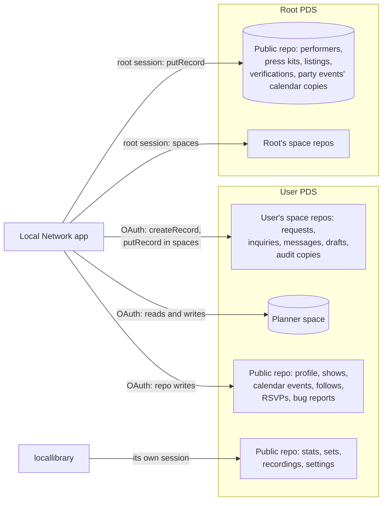

Source: [`src/lib/server/services/own-repo.ts`](src/lib/server/services/own-repo.ts), [`src/lib/server/atproto/repo-client.ts`](src/lib/server/atproto/repo-client.ts), [`src/lib/server/services/planner.ts`](src/lib/server/services/planner.ts)

### Where reads come from

Most space records come back through the app's own sync, and public records through HappyView. The app reads a press kit's private part and planners straight from their space, and a few public reads go straight to a PDS (see [Directory](#directory)).

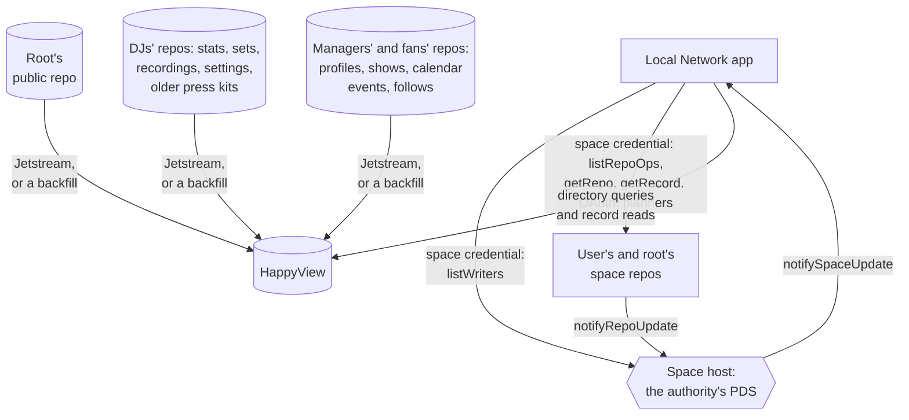

Source: [`src/lib/server/sync/engine.ts`](src/lib/server/sync/engine.ts), [`src/lib/server/atproto/credentials.ts`](src/lib/server/atproto/credentials.ts), [`src/lib/server/happyview/client.ts`](src/lib/server/happyview/client.ts), [`src/routes/xrpc/com.atproto.space.notifySpaceUpdate/+server.ts`](src/routes/xrpc/com.atproto.space.notifySpaceUpdate/+server.ts)

### The audit log

Every action (sign-in/out, submissions, revisions, withdrawals, decisions, direct edits, visibility changes, manager and role changes, booking messages and status changes, planner changes, system bootstrap) is recorded:

1. Locally first, in an outbox row with a SHA-256 hash chain (`hash = sha256(canonical(entry ∪ {prev}))`).
2. In the actor's own repo inside the root's audit space, written with the actor's OAuth session.
3. In the root account's repo in the same space, with the same record key and the chain fields (`seq`, `prev`, `hash`).

Failed writes retry with exponential backoff. The syncer reads both copies back from the network and marks them _verified_ only if their content matches the chained entry; a copy edited later is flagged _failed_. If the local database is lost, the log is rebuilt from the root's chained copies. Denied attempts (e.g. a non-moderator trying to approve) are recorded with outcome `denied`. Booking message contents are never copied into the audit log, only metadata. A press kit view (`epk.view`) names no viewer: its details hold an HMAC of the viewer's DID under a salt only the app's receipt has, so deleting or expiring the receipt leaves the entry, and the chain, as they were. Staff opening a page they aren't one of the people of in edit mode (Edit as staff) write a `page.editAsStaff` entry before the editor draws, and a page save lists each field it changed with its value before and after, as a revised request does.

Accounts whose PDS doesn't run the spaces alpha can still sign in: the root files their requests and messages on their behalf (`onBehalfOf`), and their audit entries are marked "no spaces support". They see what the root holds for them at `/dashboard/account/data` (requests, booking inquiries and messages, press kit access requests and drafts) and can delete any of it, one at a time or a kind at once. The server deletes a record only when both the index and the record itself name the signed-in account in `onBehalfOf`, and records a `record.delete` audit entry. An open request then leaves the index, as if withdrawn; a decided one keeps its row without what it said (`deletedAt`), so its decision stands and a declined press kit request can't be asked again; a booking message leaves its thread. Audit entries can't be deleted there, since the root's copies form the hash chain, and neither can booking status changes, which set the thread's status for both sides.

### Mix tracklists

A tracklist is a JSON blob (`application/json`, at most 1 MB) on a mix in the project record, following the `locallibrary.mix-report` format, version 1 or 2 (schema in `src/lib/mix/schema.ts`). It moves like the photo: uploaded to the requester's PDS with the request, previewed by moderators from there (`/admin/requests/<rkey>/mixes/<n>`), then validated, re-serialized (dropping unknown fields), and uploaded to the root's repo on approval. A tracklist that is already published is kept by CID without being fetched again. Published tracklists are read with `com.atproto.sync.getBlob` from the root's PDS, validated, and cached in memory. The format carries no file paths, comments, or ratings; cover art is embedded as small `data:` images.

A mix can also link a set (`set`, a `com.atproto.repo.strongRef` to a `computer.localnetwork.dj.set` in a manager's own repo), alongside its tracklist. The edit form offers the project's managers' sets, which it reads from HappyView, and posts the set's URI and CID. When root publishes, each newly linked set must be one HappyView has, by a manager; the CID pins the version that was picked. The profile looks the sets up in HappyView and says when one has changed since it was linked (a different CID) or is gone. Only managers can link sets, so a new project's form has none to offer until it's approved.

A mix whose link is a plyr.fm track (`https://plyr.fm/track/<id>`) also gets a `recording` (a strongRef to the track's `fm.plyr.track` record) when root publishes. The app asks plyr.fm's API for the track's record and keeps it only when it's in a manager's repo, so the DJ hosts the audio. A link that's already published keeps its recording without asking again, and any other mix has none. The tracklist page plays the mix's recording first, then its linked set's, then its link, so the tracklist follows a plyr.fm mix in the page's own player.

### Sync

The app is a space syncer. For each watched space it asks the space host (the authority's PDS) for a space credential with `authorizeSpaceSync`, sending a fresh delegation token from the root's PDS and the `did:key` of a new P-256 key the credential is bound to, and signs every request with that key (RFC 9421). It enumerates writers with `listWriters`, pulls each repo's oplog with `listRepoOps`, and checks the result against the repo's LtHash commit, falling back to a full download (`getRepo`, a STAR archive, read up to 256 MiB) when needed. A record nested deeper than 32 levels is left out of the local copy, whichever way it arrives. A repo the listing says left the writer set (a member removed, or no longer allowed to write) keeps the records already synced from it. Commits and records aren't signed: the repo host MACs the commit or record header of each response (an HTTP message signature) with a secret shared for that one request, derived from the author's `#atproto_kem` key. When a MAC fails, the app refetches the author's DID document once, in case the key rotated. Accounts whose DID document has no KEM key can't be synced, and the system page says so. A deleted space is dropped with everything derived from it, however often the authority says so, and a space recreated under the same URI syncs from scratch. A repo that fails doesn't hold back the others: the pass carries on through the space's later pages, and the repo is retried on its own, after a minute at first and at most an hour once it keeps failing. A writer whose account is taken down, suspended, or deactivated is skipped the same way without failing the pass, and the system page shows why. A space whose authority is taken down or deactivated is only suspended, so its local copy stays. A record whose projection into the app's tables fails, such as an inquiry read while the directory is down, waits on the same schedule and shows on the system page until it goes through ([ADR 0009](../../docs/adr/0009-synced-records-queue-for-projection.md)). It also registers for each watched space's updates, and polls. Each credential request names the app's `PUBLIC_URL` and a random token the app keeps for that space; the host checks both with `confirmRegistration` before registering, and the registration lasts as long as the credential, so polling keeps it up. The host posts each update to `notifySpaceUpdate` with that token, and the app syncs the space. A notice that the space was deleted or the registration lapsed makes the app ask for a fresh credential first, and only the authority refusing it with `SpaceDeleted` drops the space. A host that can't confirm the endpoint leaves the space on polling. Records are validated against the lexicons, and authority rules are enforced: only root-authored decisions, roles, and details count, a press kit's grants count only from their space's authority (in a project's request space, only for a press kit of that project) and drafts only from the project's current managers, a booking thread's project comes from the root's opening record (or the root's audit copy of its creation) rather than the inquiry, the show announced from it only from the root's status records, booking records from non-participants are ignored, and a booking status record counts only when the thread's rules allow its author that move ([ADR 0008](../../docs/adr/0008-booking-status-follows-the-rules-not-record-dates.md)).

### Directory

Published projects, the DJ stats, sets, press kits, shows, calendar events, follows and RSVPs the site reads from other repos, and the other apps' records it reads are served by [HappyView](https://happyview.dev) 3, not the app. Production uses Local Network's hosted instance, on 3.0.0-beta.14 for now; the host picks its upgrades. The scripts follow v3's contract: each defines `handle(input, ctx)` and loads JSON, SQL and record reads with `require("internal.json")`, `require("happyview.sql")` and `require("happyview.db")`, so the instance needs the `happyview-lua` interpreter and the `happyview-sql` and `happyview-db` library plugins. On the hosted instance, HappyProto's shared Network store holds the records of every collection we index and runs our record scripts over them, and SQL over `happyview_records` runs on its Postgres. Reads there are fast only by account, so every query filters on `did`, and SQL its parser can't read (`WITH ... AS MATERIALIZED`) is refused. Each `lua/<nsid path>.lua` script is collected: a record script has HappyView follow Jetstream for that collection and decides what it keeps, and a query script answers that `computer.localnetwork.directory.*` query ([`lexicons/computer/localnetwork/directory/`](../../lexicons/computer/localnetwork/directory/)). Indexing another collection is one record script there. Our lexicons are in [`lexicons/computer/`](../../lexicons/computer/); another authority's comes from the network, pinned in [`lexicons/network.json`](../../lexicons/network.json) and installed by `pnpm lexicons:install` ([`lexicons/README.md`](../../lexicons/README.md)). The app uploads only ours to HappyView, and on boot has it track the other authorities' it needs as network lexicons, ingesting the records of those a record script handles; the app picks up every file in both. The scripts today:

- `project.lua` runs on every incoming project record and keeps only the root account's, since Jetstream filters by collection and anyone can write one.
- `dj/set.lua` keeps every account's sets (anyone can come to manage a project), and stores what the site shows (title, date, kind, venue, address, who it was played with, links, and the tracklist as written, with tempo, keys and transitions) plus each named track's title, artists, IDs and start, which the support queries count. Its address, sources and `createdAt` are kept as written, since locallibrary reads its own sets back before replacing them; set views leave out the sources and `createdAt`. The queries only read sets by accounts that manage one of the root's projects. MusicBrainz IDs are stored as bare lowercase UUIDs whether a set writes `mbid:<uuid>` or the UUID; placeholder credits (ID, Unknown Artist, Various Artists) aren't, and a set whose date isn't YYYY-MM-DD isn't kept.
- `dj/recording.lua` keeps every account's set recordings, which locallibrary uploads and a set's `recording` points at: the audio blob as written, how long it plays and `createdAt`, and nothing else. A recording without an audio blob isn't kept.
- `profile.lua` keeps every account's Local Network profile at the key `self`, as written, when each field the site reads has the type it expects. `listing/profile.lua` keeps only the root's DJ listings, each keyed by the DID it names.
- `dj/profile.lua` and `locallibrary/settings.lua` keep every account's DJ stats and rekordbox settings as written, at the key `self`. `epk.lua` keeps press kits of the root's projects: the root's own, and legacy ones by an account that manages the project they name.
- Jetstream only brings records written after HappyView started keeping them, so the app has HappyView re-read the root's and the managers' sets, recordings, stats, press kits, calendar events, profiles and Bluesky profiles from their PDS: for each of them once per version of each one's record script (one job per 500 accounts per collection, retried until all start, the version kept in the app database), and when a project gains a manager and HappyView serves it (their follows too). The same goes, once per script version, for the follows of the managers of projects whose press kits read follows, the root's verifications and DJ listings, and the bug report space. The edit form's set picker also re-reads its accounts' sets when it opens (one backfill for all of them, each account at most every ten minutes); publishing a project's first press kit that reads follows re-reads its managers' follows; and a profile or the space HappyView doesn't have yet is re-read, and waited for, when it's needed. The `pauseBackfills` flag stops all of these without a deploy, including the ones that follow one change (a new manager, a late write, a first press kit, a DJ listing). Only the root's own performers are still re-read at boot, since the directory lists nothing without them.
- locallibrary reads its account's sets, recordings, stats and settings back from HappyView before replacing them, so it first calls `computer.localnetwork.directory.requestIndex`, a procedure this app answers itself (`src/routes/xrpc/`) with inter-service auth from the account's PDS. It has HappyView re-read those four collections from the caller's repo, and only theirs, under the picker's limit (each account and collection at most every ten minutes; a call in between answers from the last re-read), and waits up to 5 seconds: `indexed` says whether it finished. While the `pauseRequestIndex` flag is on, it answers `indexed: false` without re-reading anything.
- `show.lua` keeps only shows with coordinates and an RFC 3339 start time by an account that manages the project they name, and only http(s) ticket links; `follow.lua` keeps only follows of the root's projects and of the profiles HappyView keeps, leaving out an account following its own. Jetstream sends every account's calendar events, from every calendar app, so `community/lexicon/calendar/event.lua` keeps only the root's (party events' public copies) and events by an account that manages one of the root's projects, as written. It checks the author rather than a show naming the event, so it doesn't matter which of the two HappyView hears of first. Listings read each show's own copy; the event is for the announce form, and the show's strongRef to it says when it changed since. `community/lexicon/calendar/rsvp.lua` keeps RSVPs from any calendar app to the root's calendar events, by the subject's URI, with just the event and the answer.
- Other apps' records get gates too, since Jetstream sends every account's. `app/bsky/graph/verification.lua` keeps only the root's verifications. `app/bsky/actor/profile.lua` keeps every account's Bluesky profile (at the key `self`) as written: the hosted instance backfills all of them and keeps them current, so an account that becomes a manager, gets verified or makes a profile here later already has one. The site reads only the display names and pronouns: profile pages show the pronouns and verification statuses compare the names. Saving a profile has HappyView re-read that account's Bluesky profile. The profile form shows the pronouns but can't change them yet. `app/bsky/graph/follow.lua` keeps only the subject and date of follows by the managers of a project with a press kit that treats people they follow differently from anyone, since any of them following someone counts. `app/userinput/space.lua` keeps only `USERINPUT_SPACE`, whose version each bug report pins (record scripts get it beside `ROOT_DID`). Follows and profiles are busy: on 2026-10-24 Bluesky carried about 42 follow events and 1.3 profile changes a second. HappyView runs a script for each, which cost about 1.3 ms of CPU on a laptop under HappyView 2, nearly all of it HappyView's own cost per script run; the profile script now only checks the record key. The follow gate first looks up the root projects the follower manages, which ends it for nearly every follow. On the shared store a gate only hides records it has run over, so an account's raw follows show up in `listRecords` until it has; the site only reads follows by manager, for press kits that read them. HappyView 3 writes an event log row for each run only with verbose event logging on, so keep that off.
- `listShows` lists upcoming shows by project, near a place, or by the projects an account follows, and checks again that each show's announcer still manages its active project. `getShows` looks shows up by URI, `getFollowStatus` counts a project's or a profile's followers and finds an account's follow, and `getRsvpStatus` counts who's going to and interested in a party event, each account once by its latest RSVP, and finds an account's RSVPs to it. Anyone can follow or RSVP, so those counts page through `happyview.db` rather than SQL keyed by account.
- `searchProjects`, `matchProjects`, `getProject`, `getProjects`, and `getStats` do the search, ranking, and lookups. `searchPerformers` searches active projects and listed DJs together: a DJ counts when the root lists them and their profile has the performer section on, as a solo act, by the genres their DJ stats say they play most when the section names none. Both searches share their filters and ranking (`lua/lib/directory.lua`). Match results carry reason codes, which the app turns into text. `getProject` with `counts` also counts the project's press kits and upcoming shows, so the project's pages hold that much room for them while they stream in. `getSets` and `listSets` look up sets by URI and by account, without their tracks.
- `getRecords` (up to 25 URIs) and `listRecords` (one account's records of one collection, last record key first, with a cursor) read any record HappyView keeps, as its record script stored it, the way `com.atproto.repo.getRecord` and `listRecords` read a PDS. For calendar events, the bug report space and DJ stats, a record HappyView lacks is read from the account's own PDS instead (`lua/lib/pds.lua`, through the `happyview-http` library plugin), without being stored or gated, so those don't wait for a backfill. The app's `IndexedRepo` (`src/lib/server/happyview/indexed.ts`) wraps them for the DJ stats and sets on project pages, press kits and their managers' follows, shows and their calendar events, verifications and display names, and the bug report space. A HappyView that's down reads as nothing for pages that list them, and fails a read that a change or an access decision depends on (opening one press kit, counting a project's press kits, moving legacy ones, syncing their spaces' members, a press kit's "people you follow" rule, editing a show, verifying, posting a bug report). A press kit draft and a show edit save only over the versions their form was opened on, and publishing a press kit or re-issuing a verification swaps on the version HappyView serves, so none overwrites a change the person hasn't seen: they're asked to reload.
- `getCharts`, `getArtist`, and `searchArtists` count supports. They group every stored play by track and artist in SQL on each request (about a third of a second for 2,000 sets of 25 tracks on a laptop, measured on SQLite), so no counts are kept anywhere; the app reuses an answer for a minute, and the pages may be cached for as long.
- HappyView also follows Jetstream's account events. It removes the records of an account that's deleted, taken down or suspended, but keeps a deactivated account's, and a taken-down account's records come back only with a re-read. So the app asks an account's PDS whether it's active (`com.atproto.sync.getRepoStatus`) and keeps each answer in memory for half an hour (`src/lib/server/atproto/account-status.ts`, [ADR 0020](../../docs/adr/0020-inactive-accounts-are-asked-of-their-pds.md)). `searchPerformers`, `getCharts`, `getArtist`, `searchArtists`, `getSets` and `listShows` take an `inactive` list of up to 100 DIDs and leave out those accounts' sets, shows and listed profiles, along with a solo project that gives way to such a profile. The app sends the deactivated, taken-down and suspended ones among the managers and listed DJs (HappyView already dropped a deleted account's records), checked eight at a time in the background once the list is half an hour old, so pages never wait on it. After a restart, inactive accounts can show until the first check finishes, usually within seconds. An inactive answer is checked against a freshly fetched DID document, so an account that just moved PDS isn't taken for deleted or deactivated. A PDS that can't be asked leaves the account as last seen, or active. When a taken-down or suspended account is active again, the app has HappyView re-read its records.
- The genre taxonomy and fee tiers are generated into the scripts from `src/lib/taxonomy/`, so TypeScript stays the source of truth.

With `HAPPYVIEW_API_KEY` set, the app uploads whichever of its scripts and lexicons changed when it boots (scripts first, so the record gate is in place before ingestion starts), has HappyView track the other authorities' lexicons it needs that it doesn't yet (`POST /admin/network-lexicons`, which resolves them from the network and replaces a copy uploaded by hand), then has HappyView re-read the root's repo and waits for that to finish, and then every manager's shows in one batch. After publishing a project, a show, a follow, an RSVP, or a press kit it waits (up to 5 seconds) for HappyView to index it, so the next page shows it; when a show or its calendar event, a follow, an RSVP, or a press kit doesn't show up in time, HappyView re-reads that collection from that one account's repo. The directory queries are lexicons too, so `pnpm lexicons:publish` publishes a new one with the rest (see [Deploying](#deploying)).

The app reads public records only from HappyView, never straight from a PDS (`com.atproto.repo.getRecord` or `listRecords`, `com.atproto.sync.getRecord` or `getRepo`) or from Bluesky's AppView. The reads that can't go through it:

- Space records and their blobs, which the app syncs from the space hosts itself (see [Sync](#sync)).
- Blobs in public repos: project images and profile avatars (`/media/<did>/<cid>`), tracklists and recordings (`/media/audio/<did>/<cid>`), with `com.atproto.sync.getBlob`, until HappyView serves blobs. Another account's avatar is served only when it's the one its indexed profile names, through the guarded fetch below.
- The root's own projects when deciding who's in a booking thread (opening one, and the hourly manager sync), since a directory that's behind could let a removed manager back in.
- DID and handle resolution, OAuth, and the root's session.
- Whether an account is active (`com.atproto.sync.getRepoStatus` on its PDS), which HappyView doesn't serve (see above).
- HappyView's own re-reads of a repo (`/admin/backfill`, see above), which it makes from the account's PDS.
- Tooling: the integration tests, the dev network, and `pnpm lexicons:publish`.

`pnpm exec ast-grep scan` at the repo root fails any other read: its [`no-direct-pds-read`](../../tools/ast-grep/rules/no-direct-pds-read.yml) rule lists these, and the lines of app code it allows carry an `ast-grep-ignore` comment saying why.

## Getting started

Requirements: Node.js 24 (`.node-version` at the repo root; with [fnm](https://github.com/Schniz/fnm), `fnm install && fnm use`), [pnpm](https://pnpm.io/installation), and Docker (or OrbStack), running, for the local HappyView.

The app lives in `apps/web` of a pnpm workspace whose root is the repo root. Run the commands below in `apps/web`; `pnpm install` there installs the whole workspace and the git hooks. The repo root forwards `dev`, `build`, `check`, `lint`, `format`, `test`, and `verify` here.

```bash
pnpm install
pnpm dev
```

`pnpm dev` starts a local, spaces-enabled AT Protocol network (PLC directory + alpha PDS, root and demo accounts, published lexicons, 12 demo projects, and a stand-in for the userinput.app space that bug reports post to), a HappyView container on a Postgres one, fed by a local Jetstream stand-in, with its Lua and SQL plugins (the first run downloads them into `node_modules/.cache`), and the app wired to them. It also writes `.env.local`. Open http://127.0.0.1:5173 and sign in with a handle. The PDS asks for the password:

| Handle      | Password    | Role                                                                                                                                                                                                   |
| ----------- | ----------- | ------------------------------------------------------------------------------------------------------------------------------------------------------------------------------------------------------ |
| `ada.test`  | `ada-pass`  | admin (via `ADMIN_DIDS`)                                                                                                                                                                               |
| `milo.test` | `milo-pass` | regular; make them a moderator under Staff                                                                                                                                                             |
| `neon.test` | `neon-pass` | DJ with a profile at `/@neon.test`, manages two demo projects, has three sets and four shows, and made Neon Tide's Radio press kit the old way, so it moves to the root on their first dashboard visit |
| `pat.test`  | `pat-pass`  | promoter, follows both of neon's projects                                                                                                                                                              |

`harbour.test`, `pirate.test`, and `glasshouse.test` (passwords `harbour-pass` and so on) manage Harbour Lights, Pirate Signal, and Glasshouse and have sets of their own, so `/charts` has tracks several DJs played. Every other demo project has a manager too (`velvet.test`, `tunde.test` and so on; the dev network prints them all). Each manager got there through a claim ada.test approved, and each solo project's DJ claimed it as themselves.

Inbox email and DMs go to the log locally, and bug reports to the stand-in space, once their flags (`inboxEmail`, `inboxDm`, `userinputReports`) are on for you: turn them on at `/admin/flags` as ada.test, or start with `FLAG_OVERRIDES=inboxEmail=on,inboxDm=on,userinputReports=on`.

The network is temporary; Ctrl-C stops it, and restarting resets everything (and the dev database). To restart the app without resetting the network, run `pnpm dev:network` in one terminal and `pnpm dev:app` in another.

## Scripts

| Script                              | What it does                                                                                   |
| ----------------------------------- | ---------------------------------------------------------------------------------------------- |
| `pnpm dev`                          | Local atproto network, HappyView, and the dev server                                           |
| `pnpm dev:network` / `pnpm dev:app` | The network and HappyView only / the dev server only (reads `.env.local`)                      |
| `pnpm build` / `pnpm start`         | Production build (adapter-node) / run it                                                       |
| `pnpm check`                        | `svelte-check` with TypeScript 6, after `pnpm lexicons:types`                                  |
| `pnpm lint`                         | Oxlint with type-aware rules (tsgolint) and the anti-slop plugin, then the story check         |
| `pnpm i18n:check`                   | `inlang check` on the message catalogs ([Translation](#translation))                           |
| `pnpm format` / `pnpm format:check` | Oxfmt                                                                                          |
| `pnpm test`                         | Unit tests (Node) + component tests (Vitest browser mode, Chromium)                            |
| `pnpm test:integration`             | Full flows against an in-process spaces PDS and a HappyView container                          |
| `pnpm test:coverage`                | Unit + component + story + integration tests with `@vitest/coverage-v8`                        |
| `pnpm test:build`                   | Production build, checked for sourcemaps and measured for the client bundle budgets            |
| `pnpm storybook`                    | The design system in Storybook, at localhost:6006                                              |
| `pnpm test:storybook`               | Every story in Chromium, then again at a phone's width; a WCAG 2.2 AA violation fails it       |
| `pnpm build-storybook`              | Static Storybook in `storybook-static/`                                                        |
| `pnpm test:e2e`                     | Playwright (desktop browsers and phones) on an isolated network, axe                           |
| `pnpm test:lighthouse`              | Lighthouse CI on the production build (`lighthouserc.cjs`)                                     |
| `pnpm test:lighthouse:full`         | Lighthouse on every page, phone and desktop, against its history ([Lighthouse](#lighthouse))   |
| `pnpm fuzz`                         | Jazzer.js on the byte parsers, 30 seconds a target ([Fuzzing](#fuzzing))                       |
| `pnpm -w knip`                      | Unused files, exports, and dependencies across the repo (the root `knip.jsonc`)                |
| `pnpm lexicons:publish`             | Publish lexicons from the root account and check or set their DNS                              |
| `pnpm lexicons:install`             | Install the other authorities' lexicons from the network, as `lexicons/network.json` pins them |
| `pnpm lexicons:update`              | Move those pins to what their authorities publish now                                          |
| `pnpm lexicons:types`               | Types from the lexicons in `src/lib/lexicons` (git-ignored), to check the readers against      |
| `pnpm db:backup`                    | Back the database up to the bucket now ([Backups](#backups))                                   |
| `pnpm db:backups`                   | List the bucket's backups                                                                      |
| `pnpm db:restore <key> [path]`      | Restore a backup (or `latest`) over the database, or to `path`                                 |
| `pnpm verify`                       | CI's quick checks, in order                                                                    |

Pull requests run the e2e tests in Chromium only (`pnpm test:e2e --project chromium`); the other browsers and the phones run weekly.

### Fuzzing

`fuzz/` holds [Jazzer.js](https://github.com/CodeIntelligenceTesting/jazzer.js) targets for the parsers that read raw bytes from outside: `mix-report` (`parseMixReportText`), `image` (`sniffImage` and the press kit's photo size) and `range` (`parseRange`). Each throws when the parser breaks a rule its callers rely on, and libFuzzer mutates its seeds (`seeds` in the target) looking for an input that does. [`scripts/fuzz.ts`](scripts/fuzz.ts) bundles them with esbuild, since Jazzer instruments JavaScript only, and runs them in turn:

```bash
pnpm fuzz                                              # every target, 30 seconds each
pnpm fuzz --seconds 300 range                          # one target, five minutes
pnpm fuzz range --input fuzz/artifacts/range/crash-…   # replay a crash
```

What reaches new code is kept in `fuzz/corpus/<target>/` and a crash's input in `fuzz/artifacts/<target>/` (both ignored by git). A crash is a bug in the parser: fix it there and add the input as a test beside the parser's others. The Web scheduled workflow runs each target for five minutes, keeping the corpus between runs, and uploads the input of any crash as its `web-fuzz-artifacts` artifact.

### Lighthouse

[`lighthouse/pages.json`](lighthouse/pages.json) lists the pages Lighthouse measures, each signed out or signed in as `neon.test` (`dj`) or `ada.test` (`admin`). Pull requests that change what the pages are built from measure the ones marked `pr` against the budgets in `lighthouserc.cjs`, five runs each: timing on each metric's median, and layout shift on the worst run. Merge queue groups check the same pages for layout shift, accessibility, best practices and SEO, which don't depend on the runner's speed. `pnpm test:lighthouse:full` measures all of them on a phone and a desktop, three runs each, and keeps each page's medians in `lighthouse-history.jsonl`. Each run is held against the median of the last five recorded runs, and against the twenty before those to catch a slow creep. A regression past a metric's tolerance (in [`scripts/lib/lighthouse.ts`](scripts/lib/lighthouse.ts)) fails the run, as does a bad result: a failed run, a page that redirected or answered an error, or a failed budget (signed-in pages have no SEO budget, since search engines never see them). Runs that spread wide, and a new Lighthouse or a faster or slower machine, are noted too.

The Web scheduled workflow does the same weekly, one job per form factor, and keeps main's history as its `lighthouse-history` artifact. A week that changed nothing the website is built from skips it, and only uploads the history again so it doesn't expire. Its report is in the run's summary, with every run's report in the `lighthouse-mobile` and `lighthouse-desktop` artifacts.

To find the commit behind a regression, record a baseline of only the pages that moved on the last good commit (each history line names its commit), then let `git bisect` measure each commit against it, failing only on a regression (commits from before this suite landed lack its scripts):

```bash
git checkout <good>
pnpm build && pnpm exec tsx scripts/lighthouse.ts --page /charts && node scripts/lighthouse-history.ts --record --history lighthouse-history-bisect.jsonl
git bisect start <bad> <good>
git bisect run sh -c 'pnpm build && pnpm exec tsx scripts/lighthouse.ts --page /charts && node scripts/lighthouse-history.ts --history lighthouse-history-bisect.jsonl --regressions-only'
```

Git hooks (lefthook, from the root `lefthook.yml`) format and lint staged files on commit and run type checks and unit tests on push.

## Design system

`src/lib/ui/` holds the design system the site is built on: dark ink surfaces, white type, Instrument Sans for words and JetBrains Mono for data, and no brand accent, since colour comes only from DJ data. The tokens live in `packages/tokens/theme.css`, which localtoolbox shares, and `src/lib/ui/theme.css` adds the fonts and Tailwind plugins on top; `packages/tokens/data-colors.css` is generated from `packages/tokens/colors.json` (a test fails when it's stale and says how to regenerate it). Each component has stories beside it: `pnpm lint` fails on a component in `src/lib/` that no story imports, unless `.storybook/story-exemptions.json` lists it with why. Stories pick their width from `src/lib/testing/viewports.ts` (phone, tablet, desktop); `test:storybook` draws every story at the phone width too, except those tagged `desktop-only`, and a story's play function can check what a form submits with `submit` from `src/lib/testing/submits.ts`. **Patterns/Homepage** renders the real homepage and layout with the seed data, **Patterns/Tools** the Tools pages with the real captures, **Terminal** locallibrary's terminal widgets from the bytes its tests write to `src/lib/tui/captures/` (see locallibrary's CONTRIBUTING.md; `pnpm lint` fails on a capture no story shows), and **Proposals/Homepage** holds section ideas that aren't on the site. `pnpm storybook` to browse it. `src/routes/layout.css` imports the theme for the whole site; its shared classes (`btn-primary`, `input`, `card`, `chip`, `table-base` and the rest) live in the shared theme so a plain form button and the `Button` component draw the same way. Printed pages switch the same tokens to light values (localtoolbox's light theme uses them too).

## Configuration

See [`.env.example`](.env.example) for every option. The essentials:

- `PUBLIC_URL`: the app's origin. OAuth client metadata (`/oauth-client-metadata.json`) and the app's `did:web` (`/.well-known/did.json`) are derived from it, and space hosts send update notifications to it. Loopback URLs use an atproto loopback OAuth client.
- `ROOT_IDENTIFIER` / `ROOT_PASSWORD`: the Local Network root account. **Use a dedicated account and its account password.** Space methods refuse app passwords ("Bad token scope").
- `ADMIN_DIDS`: accounts that are always admins. Everyone else is managed in-app.
- `HAPPYVIEW_URL`: the HappyView instance that serves the directory. Use its public URL: HappyView only answers the host its own `PUBLIC_URL` names. If HappyView is down, the app still starts, and pages that need projects say the directory is offline.
- `HAPPYVIEW_API_KEY`: a HappyView API key with `lexicons:read`, `lexicons:create`, `scripts:read`, `scripts:manage`, `backfill:create`, `backfill:read`, `stats:read`, `dead-letters:read`, and `metrics:read`. Optional; without it, upload the lexicons and scripts yourself, the set picker only lists sets HappyView heard about over Jetstream, and `requestIndex` answers `indexed: false` without re-reading anything.
- `HAPPYVIEW_CLIENT_KEY` and `HAPPYVIEW_CLIENT_SECRET`: a HappyView API client's key and secret, sent with each directory query (`X-Client-Key`, `X-Client-Secret`) so it counts as that client's. Optional, set together; needed once the instance refuses anonymous XRPC calls.
- `LOCALLIBRARY_HOST`: [locallibrary's own host](#tools-pages-and-hosts) (default `locallibrary.localnetwork.computer`).
- `USERINPUT_SPACE`: Local Network's space on [userinput.app](https://userinput.app), as `at://<did>/app.userinput.space/<rkey>`. See [Bug reports](docs/features/bug-reports/). Optional; without it, "Report a bug" opens GitHub's issue form. With it, reports go there only for accounts `userinputReports` is on for.
- `RESEND_API_KEY` (and optionally `EMAIL_FROM`, `EMAIL_PROVIDER`): sends inbox email through [Resend](https://resend.com) for people who turn it on and `inboxEmail` is on for. Optional; in production without it, email is off and the settings page says so. Outside production, email goes to the log.
- `DM_PROVIDER` (and optionally `CHAT_SERVICE_DID`): `bluesky` sends inbox DMs from the root account through Bluesky chat, to accounts `inboxDm` is on for. Off in production until set; first check that Bluesky's relay and AppView know the root account and that it can call `chat.bsky.convo.getConvoAvailability`. Outside production, DMs go to the log.
- `ACTOR_SEARCH`: where sign-in's account suggestions come from, `bluesky` (the default) or `none`.
- `GOOGLE_CLIENT_ID` / `GOOGLE_CLIENT_SECRET`, `MIXCLOUD_CLIENT_ID` / `MIXCLOUD_CLIENT_SECRET`, `SOUNDCLOUD_CLIENT_ID` / `SOUNDCLOUD_CLIENT_SECRET`: Local Network's clients at the services locallibrary plugins sign in to through the [token exchange](#token-exchange). Optional; a service without both answers that it isn't set up yet.

## Deploying

1. Create the root account on a PDS that runs the spaces alpha (e.g. `ghcr.io/bluesky-social/atproto:pds-spaces-alpha`).
2. Publish the lexicons (`pnpm lexicons:publish` publishes every tool's, all of the repo's `lexicons/computer/`) and their `_lexicon` TXT records in the `localnetwork.computer` zone. With `CLOUDFLARE_API_TOKEN` (Zone > DNS > Edit on that zone only) the script creates or fixes those records through the Cloudflare API and prints what it changed; it's safe to rerun, and it only touches `did=` TXT values at `_lexicon` names. Without the token it prints the missing ones for you to add by hand and exits non-zero until DNS serves them all. The variables can also live in `.env`. The lexicons are `computer.localnetwork.*` (`src/lib/nsid.ts` and the repo's [`lexicons/`](../../lexicons/)), so there's one record per sub-namespace (`_lexicon.localnetwork.computer`, `_lexicon.space.localnetwork.computer`, and so on). PDSes resolve the app's permission set (`computer.localnetwork.permissions`) and the space type declarations while authorizing OAuth requests and again on every token refresh, so sign-in fails with `invalid_scope` until they resolve. **Publish before every deploy that changes them**, the permission set above all: a PDS grants a sign-in the set it last resolved, so if the app goes first, people sign in without the new permissions (the app asks them to sign in again when a follow or announcement needs one). locallibrary writes `computer.localnetwork.locallibrary.*` (its own) and `computer.localnetwork.dj.*` (DJ profiles and sets, shared by Local Network's tools); keep this app's lexicons out of `locallibrary.*`, and reuse the `dj.*` defs rather than redefining tracks or sets.
   ```bash
   ROOT_IDENTIFIER=localnetwork.computer ROOT_PASSWORD=… CLOUDFLARE_API_TOKEN=… pnpm lexicons:publish
   ```
3. The directory is Local Network's hosted HappyView at `https://localnetwork.hpy.at`, which is its `PUBLIC_URL` and so `HAPPYVIEW_URL`. Create an API key in its dashboard with the permissions above for `HAPPYVIEW_API_KEY`: the app uploads its lexicons and scripts and starts its re-reads on boot (see [Directory](#directory)). The instance needs the `happyview-lua`, `happyview-sql` and `happyview-db` plugins, and if it refuses anonymous XRPC calls, an API client for `HAPPYVIEW_CLIENT_KEY` and `HAPPYVIEW_CLIENT_SECRET`. Before pointing `HAPPYVIEW_URL` at another instance, `ROOT_IDENTIFIER=localnetwork.computer HAPPYVIEW_API_KEY=<new key> pnpm happyview:parity <current url> <new url>` syncs the new one the way the app would and lists every directory query the two answer differently (`--compare-only` skips the sync and needs no key).
4. Run the container at `https://localnetwork.computer` (`PUBLIC_URL`) with a persistent volume for `/data`. Build it from the repo root, which holds the workspace and lockfile, with `apps/web/Dockerfile`:
   ```bash
   docker build -f apps/web/Dockerfile -t localnetwork .
   ```
   ```bash
   docker run -p 3000:3000 -v localnetwork-data:/data --env-file .env localnetwork
   ```
   To try an image first, `pnpm -C apps/web test:docker` runs the one tagged `localnetwork` against the local network with an empty volume and fetches a few pages, as CI does.
5. Run **one** instance (SQLite and in-process background jobs). Give it a bucket for [backups](#backups) of `/data`: it holds OAuth sessions, the audit outbox, and records that exist nowhere else ([Where state lives](#where-state-lives)).
6. Point `locallibrary.localnetwork.computer` at the same deployment (a DNS record, plus the custom domain on your host) for [its client document](#tools-pages-and-hosts).

`/healthz` reports database, root-account, HappyView, and backup status (`backup` is `stale` with no backup in two days, `off` without a bucket). It answers 200 either way.

### Logs

The app logs through [evlog](https://www.evlog.dev), one line per request or background job ([ADR 0007](../../docs/adr/0007-one-log-line-per-request-or-job.md)). In production that's JSON on stdout, so `railway logs --service localnetwork --filter "@level:warn"` finds warnings and `--filter "space sync failed"` finds a message. What happened along the way is in the line's `notes`, and its first error in `error`. `LOG_LEVEL` sets the lowest level written.

### Backups

With `BACKUP_S3_BUCKET` and the other `BACKUP_S3_*` variables set ([`.env.example`](.env.example)), the app backs the database up once a UTC day, on its hourly check after midnight. It copies the database with SQLite's online backup, which stays consistent while the app writes, checks the copy's integrity, and uploads it gzipped as `localnetwork-db/<time>.sqlite.gz`. Then it deletes the backups it no longer keeps: it keeps the newest of each of the last `BACKUP_KEEP_DAILY` days (7) and `BACKUP_KEEP_WEEKLY` weeks (8), and never touches other files in the bucket. It also checks when the app starts, so a deploy doesn't skip a day. A failed backup is logged and tried again an hour later, and the System page shows the last backup's time and the last failure's reason. In production the bucket is `localnetwork-backups`, which [`.railway/railway.ts`](../../.railway/railway.ts) defines and passes to the service.

`pnpm db:backup` takes one now and `pnpm db:backups` lists them, reading the same variables (from `.env.local` and `.env` too). To restore production, run the script in the running container, then restart it, since the app keeps some state in memory:

```bash
railway ssh --service localnetwork -- node scripts/db-backup.ts list
railway ssh --service localnetwork -- node scripts/db-backup.ts restore latest   # or a key from the list
railway service restart --service localnetwork --yes
```

A restore downloads the backup, checks its integrity, keeps the database it replaces as `localnetwork.db.before-restore` beside it, and writes the backup in with the same online backup, so it's safe while the app has the database open. Flags come back as the backup had them until the first sync reads the staff space again, and the member rounds at boot run before it. So `pauseReconcilers` holds through a restore only if it was on when the backup was taken; turn it on again from its page once the app is up. `pnpm db:restore <key> data/copy.db` restores to another path instead, to look at a backup locally.

### Tools' pages and hosts

Each tool has an entry in `src/lib/tools/` (name, tagline, one to eight things it does with a capture for each, install steps) and a page at `/tools/<id>`. The captures in `src/lib/tools/captures/`, and the demo track their hot cues sit on, come from `pnpm atstore` at the repo root ([packages/atstore](../../packages/atstore)); the build turns them into AVIF and WebP at the widths they're shown at, and the page offers only those, with one JPEG or PNG as the fallback. The hot cues draw the track the way the tool's own world does: rekordbox's coloured overview for locallibrary, SoundCloud's flat bars for localtoolbox (`lookOf` in `HotCues.svelte`), and a cue's number picks it from anywhere on the page while the site's shortcuts are on. `/tools` gives each tool a section of its own, led by its `pitch`: locallibrary as its hot cues, localtoolbox as its own toolbar menu (`ToolboxMenu.svelte`, which copies the extension's menu from `apps/localtoolbox/src/lib/tools.ts`) with its marks on SoundCloud's pages apart. A tool's guides are its own `README.md`, `docs/*.md` and `CHANGELOG.md` in `apps/<tool>/` (localtoolbox leaves out its README, which is for developers, and leads with `docs/overview.md`; locallibrary's changelog starts at its first version, leaving out the notes for maintainers), bundled at build time and rendered on the server with GitHub's heading ids. Links to the tool's other guides stay on this site, links to other files in the repo go to GitHub, and raw HTML in the Markdown shows as text. Adding a tool is one file there, listed in `src/lib/tools/index.ts`, plus the steps in [Adding an app or plugin](../../.github/NEW_PROJECT.md).

A tool with a host of its own lists it in its entry, and this app answers that host before anything else runs, so it works even while the app isn't configured. `/` redirects (308) to the tool's page on `PUBLIC_URL` (`https://localnetwork.computer` when it isn't set), `/oauth-client-metadata.json` serves the tool's OAuth client document if it has one, and every other path is a 404.

[locallibrary](../locallibrary) signs people in with their Atmosphere accounts as `https://locallibrary.localnetwork.computer/oauth-client-metadata.json` (`LOCALLIBRARY_HOST` changes the host). That document is separate from this app's own `/oauth-client-metadata.json`, which describes the Local Network web client; a native app needs a client that redirects to `127.0.0.1`. It lists every scope locallibrary may ask for: `atproto` to sign in, its publishing permission set (`include:computer.localnetwork.locallibraryPublishing`, which grants create/update on `computer.localnetwork.locallibrary.settings` and `computer.localnetwork.dj.profile`, and create/update/delete on `computer.localnetwork.dj.set` and `computer.localnetwork.dj.recording`), `blob:audio/*` to upload a set's recording (a permission set can't grant blobs, so sign-in asks for it directly), `repo:app.userinput.discussion?action=create` for `locallibrary bug`, and `rpc?aud=*&lxm=computer.localnetwork.directory.requestIndex&lxm=computer.localnetwork.flags.getFlags`, which every sign-in asks for, so locallibrary can call this app's `requestIndex` and `getFlags` with a service token.

locallibrary writes the document; after changing its scopes, regenerate it here before releasing the locallibrary version that asks for them:

```bash
locallibrary account client-metadata -o src/lib/tools/locallibrary/oauth-client-metadata.json
```

Until the host answers, locallibrary signs in as a local development app instead (servers ask about it every time).

### Token exchange

Some services a locallibrary plugin signs in to (Mixcloud, SoundCloud, Google) want a client secret when a sign-in's code is traded for tokens, or when they're refreshed, and a secret can't ship inside an app people download. A plugin's account names `https://localnetwork.computer/api/token-exchange/<service>` as its `token_exchange` instead of a `token_url`, and locallibrary posts that address what it would have sent the service, as JSON. This app adds its client id and secret for the service from the environment, sends the request on the way the service takes it, and answers what the service answered. It refuses a `redirect_uri` other than locallibrary's listener, `http://127.0.0.1:<port>/callback` or `http://[::1]:<port>/callback`, so a code sent to another site with Local Network's client can't be traded for that account's tokens.

The services are in [`src/lib/server/token-exchange/services.json`](src/lib/server/token-exchange/services.json) (schema beside it): each one's token endpoint, how it takes a request (`form`, the usual POST, or `query`, Mixcloud's GET), and the environment variables holding its client id and secret. Adding a service is an entry there and its two variables. The exchange sends nothing anywhere but those token endpoints, logs which service and grant and the status, never a code, token or secret, reads at most 64 KiB of a request or an answer, and counts against the per-address write limit. Until a service's variables are set, it answers `503` with `temporarily_unavailable`, which locallibrary shows as the reason the sign-in failed. Regenerate the schema after changing what an entry has with `SCHEMA_BLESS=1 pnpm -C apps/web vitest run --project server src/lib/server/token-exchange/services.test.ts`.

## Security notes

- OAuth uses DPoP-bound tokens and granular scopes: a permission set ([`permissions.json`](../../lexicons/computer/localnetwork/permissions.json), requested as `include:computer.localnetwork.permissions`) with write-only access to the user's own repos in the audit, moderation, booking, backstage, press kit request, and performer spaces and a self-authority planner space, and to the profile, shows and follows in their public repo and updates to their sets (plus deleting press kits made before the root held them, as they move), plus blob uploads limited to PNG, JPEG, and WebP avatars and JSON tracklists, and calendar events and RSVPs (`repo:community.lexicon.calendar.event` and `.rsvp`, asked for on their own since a permission set can only grant its own namespace). The PDS grants the set as the scopes it lists. The shared spaces it grants writes to are the root's only: `did:web:root.invalid` in the file stands for the root, and each network's root publishes the set with its own DID there (`pnpm lexicons:publish` for production; the dev network and the integration tests publish their own). Accounts without spaces support are asked for `atproto` plus the profile, show, follow, calendar event and RSVP writes and the blob uploads, and fall back to plain `atproto` if their PDS refuses those; they, and anyone who approves only part of the request, have the root account write their space records on their behalf. Sessions granted before the app asked for a new space or blob scope are sent back through sign-in on their next page load. Profile, show, follow, calendar event and RSVP writes, set updates, and drafts in a performer's space are asked for when they're needed instead, with a one-click "Sign in again"; a PDS that still won't grant them after that gets a plain "your account's server doesn't allow this yet". Posting bug reports to userinput.app is asked for separately, when someone first sends one, and only allows creating `app.userinput.discussion` records. Nothing lets the app read other users' data with a user's session; shared spaces are read with credentials issued to the root authority.
- Browser sessions are opaque random tokens stored as SHA-256 hashes; cookies are `HttpOnly`, `SameSite=Lax`, and `Secure` on HTTPS, except `ln_signed_out`, which holds only the DIDs whose drafts to drop and is read by the page's scripts.
- CSP with per-request nonces, `frame-ancestors 'none'`, `nosniff`, strict referrer policy, HSTS on HTTPS, and SvelteKit's CSRF origin checks.
- Every request to a host from a DID document goes through `@atproto-labs/fetch-node`'s safe fetch in production: no redirects, HTTPS only, and no private or loopback address, checked as it connects so DNS can't swap the address after. Resolving a DID or handle and fetching another account's avatar use the default port only, with responses up to 2 MB. Space credential calls, space sync, account status checks, blob downloads and streamed recordings from a PDS, and everything the OAuth client sends (identity lookups, PDS and authorization server metadata, authorization and token requests, session requests) allow any port and have no size or time cap of their own, since callers bound what they read and how long they wait. The OAuth client sets no time limit on session requests, so the app gives each of its requests 30 seconds. The OAuth client leaves its requests to follow redirects, so the app makes them refuse redirects instead. ast-grep's [`no-unguarded-fetch`](../../tools/ast-grep/rules/no-unguarded-fetch.yml) rule fails a plain or passed-in `fetch` in any function that reads such a host. did:web hosts and handles that are IP addresses, carry a port, or use `localhost` or a reserved TLD are refused before any request, and `/@<handle>` lookups that find no account are rate-limited per IP.
- Links people wrote into their own records (profiles, sets, press kits, shows, requests) are only made clickable when they're http(s) addresses (`src/lib/web-url.ts`).
- Uploaded images are type- and magic-byte-checked and capped at 1 MB for avatars and 5 MB for press kit photos. Stored images are served only if their blob's type is one their lexicon accepts (PNG, JPEG or WebP), since a PDS doesn't check, with a sandboxing CSP and `nosniff`.
- `/media/audio/<did>/<cid>` streams only a blob that an indexed `computer.localnetwork.dj.recording` of an active project's manager references, as the type and size that record declares, with Range answered by the app since `getBlob` ignores it. The type and size limits are the lexicon's own (`audio/*` or `video/mp4`, at most 300 MiB); `video/mp4` is what a PDS calls an M4A it can't tell is audio, so it goes out as `audio/mp4`. It stores nothing, and sends a locked-down CSP and `nosniff`. The page CSP allows media only from the site, plyr.fm's CDN and archive.org's download hosts, images only from the site and Bluesky's avatar CDN (for sign-in's account suggestions), and scripts only from SoundCloud's and Mixcloud's widget hosts besides its own.
- ast-grep's [`stored-type-response`](../../tools/ast-grep/rules/stored-type-response.yml) rule fails any response that takes its content type from data, outside the two helpers that check it for stored images and recordings.
- Rate limits on sign-in, writes, city search, and account suggestions.
- The [token exchange](#token-exchange) only sends requests to the token endpoints `services.json` lists, and never logs what it relays.
- Spaces are access control, not end-to-end encryption: the hosting PDSes and this app can read the data they handle.

## Translation

The site is in English, and ready for a second language ([ADR 0019](../../docs/adr/0019-english-stays-unprefixed-and-records-carry-their-language.md)). Its words live in `messages/en.json`, and a component shows one by calling its message: `import { m } from '#lib/paraglide/messages.js'`, then `{m.footer_privacy()}`. [Paraglide JS](https://paraglidejs.com) compiles the catalogs (`project.inlang/`) into `src/lib/paraglide/`, which git ignores, in the dev server, builds and tests, and in `pnpm check` and `pnpm install`. So far only the root layout's footer and skip link come from the catalog. The dates and numbers `src/lib/format.ts` writes follow the same locale.

To add a string, put it in `messages/en.json`, run `node scripts/pseudo-locale.ts` to regenerate `messages/en-XA.json`, and call `m.<key>()`. A test fails while en-XA is out of date, `pnpm i18n:check` fails on a message a locale lacks or a variable it gets wrong, and ast-grep's `no-raw-text` rule fails on words written into the markup of a component that has moved to the catalog. Add a component to that rule's `files` once its text has moved.

To see the pseudo-locale, run `document.cookie = 'ln_locale=en-XA; path=/'` in the browser's console and reload (`ln_locale=en` goes back). en-XA accents every letter, makes each line about a third longer and brackets each message, so plain English on the page is text that hasn't moved to the catalog, and a clipped or missing bracket is a layout that can't stretch or a message cut short.

Tests run in en-US and UTC whatever the machine's settings: `vite.config.ts` pins Vitest's and `playwright.config.ts` the end-to-end tests'.

## Project layout

```
lua/                            HappyView scripts: the record gates and the directory queries, one file per NSID
messages/                       The message catalogs: en.json, and en-XA.json generated from it (Translation)
project.inlang/                 The inlang project Paraglide compiles the catalogs from, and Paraglide's config
scripts/                        dev-network (local atproto network), publish-lexicons, seed data, mix-fixture, db-backup
scripts/lib/                    Local HappyView container and Jetstream stand-in
src/lib/                        Shared code: matching, genre taxonomy, geo, formatting, components
src/lib/headline.json           The homepage headline's words ("<verb> your <noun>."), to edit by hand
src/lib/hosts.json              The hosts "Make an account" offers, to edit by hand
src/lib/onboarding/steps/       Overview's checklist, one file per step; a new file adds a step
src/lib/ui/                     The design system: theme tokens, components and their stories
src/lib/components/edit/        Edit mode: the edit bar, fields in place of text, and the editor loaded for people who can edit (docs/edit-mode.md)
src/lib/server/atproto/         Identity, OAuth, root session, repo clients, space credentials, service auth
src/lib/server/audit/           Hash-chained audit log with dual atproto delivery
src/lib/server/backup/          Daily database backups to a bucket, and restoring them
src/lib/server/flags/           The flag catalog, the rule that decides a flag, staff previews, and the method locallibrary asks
src/lib/server/happyview/       HappyView client, script bundling, and boot sync
src/lib/server/services/        Projects, requests, staff, bookings, planner
src/lib/server/sync/            Space syncer and record projections
src/lib/server/token-exchange/  The token exchange for locallibrary plugins, and the services it signs in to
src/lib/server/tools/           The tools' own hosts, and their guides rendered to HTML
src/lib/tools/                  The tools: one entry per tool, with its guides bundled from apps/<tool>/
src/lib/tui/                    locallibrary's terminal widgets as stories, drawn in xterm.js from the bytes in captures/
src/lib/server/meta.ts          What each public page tells link previews and search engines, returned by its load as `meta`
src/lib/server/meta-records.ts  The records behind a public page, written into its head as at-tags (`at:canonical`, `at:alternate`, `at:author`)
src/lib/server/structured-data.ts  The schema.org structured data (JSON-LD) a performer, profile, mix or artist page adds to its `meta`
src/lib/og/cards/               The link-preview pictures (1200×630), one Svelte component each, with their stories
src/lib/server/og/              Draws them as PNGs for src/routes/og/, keeping recent ones in memory; with `pauseOgCards` on, only the site's card is drawn and pages point to it
src/routes/                     SvelteKit 3 pages, form actions, and endpoints
tests/integration/              Flows against an in-process spaces PDS and a HappyView container
tests/e2e/                      Playwright
.storybook/                     Storybook config; stories render with src/lib/ui/theme.css, and the homepage's with the layout's CSS
```

The small components and modules several pages use go out as one shared file that every page loads (`SHARED` in [`vite.config.ts`](vite.config.ts)). A module in `src/lib` that only some pages load ends in `.page-only` before its extension (`FollowButton.page-only.svelte`, `bookings.page-only.ts`) and stays out of it, as do `src/lib/components/tools/` and `src/lib/components/edit/`.

## Known limitations

- Oxfmt doesn't format `.svelte` files yet; it formats everything else.
- The spaces alpha has no relay: sync load falls on PDSes, mitigated by notifications and incremental oplog sync.
- The app doesn't follow account events itself. It asks an account's PDS whether it's active and keeps the answer for half an hour, so a deactivated account leaves Find DJs, the charts and listings, and comes back, up to half an hour late. A taken-down or suspended account's records come back only if this server saw it go and come back, since HappyView drops them and the app has them re-read only then.
- The directory scripts' SQL is written for Postgres, so the HappyView instance must use Postgres, not SQLite.
- HappyView drops a Jetstream cursor older than 72 hours. The boot backfill recovers new and changed projects after a longer outage, but not deletions (nothing deletes projects today).

## Diagrams

These diagrams cover what the app does, as drawn from the code. Website code says `project` for what these call a performer.

- Overview: [Where writes go](#where-writes-go), [Where reads come from](#where-reads-come-from), [Architecture](#architecture), [Deployment](#deployment), [External services](#external-services), [What the browser reaches](#what-the-browser-reaches), [Where state lives](#where-state-lives), [Local tables: bookings and press kits](#local-tables-bookings-and-press-kits), [Local tables: shared spaces](#local-tables-shared-spaces), [Local tables: audit and sync](#local-tables-audit-and-sync), [Local tables: inbox](#local-tables-inbox)
- [Requests and routes](docs/diagrams/requests-and-routes.md): the request path, errors, rate limits, and every route family
- [Sign-in and roles](docs/diagrams/accounts.md): OAuth, scopes, sessions, token exchange, roles and capabilities
- [Spaces](docs/diagrams/spaces.md): credentials, sync, notifications, projections and member lists
- [Jobs and the directory](docs/diagrams/jobs-and-directory.md): startup, scheduled jobs and HappyView
- [Profiles, requests and bookings](docs/diagrams/profiles-and-bookings.md): listings, moderation, search, the planner and booking threads
- [Press kits](docs/diagrams/press-kits.md): drafts, grants, views, moves and deletes
- [Shows and the inbox](docs/diagrams/shows-and-inbox.md): shows, follows, inbox delivery and channels
- [Mixes, sets and charts](docs/diagrams/mixes-and-sets.md): tracklists, sets, recordings, stats and artist pages
- [Staff and upkeep](docs/diagrams/staff-and-upkeep.md): bug reports, the audit log, staff actions, listings and backups
- [Feature flags](docs/diagrams/flags.md): deciding a flag, page requests, getFlags, the staff console and the flag tables

### Architecture

The app, what it stores, and the services it depends on.

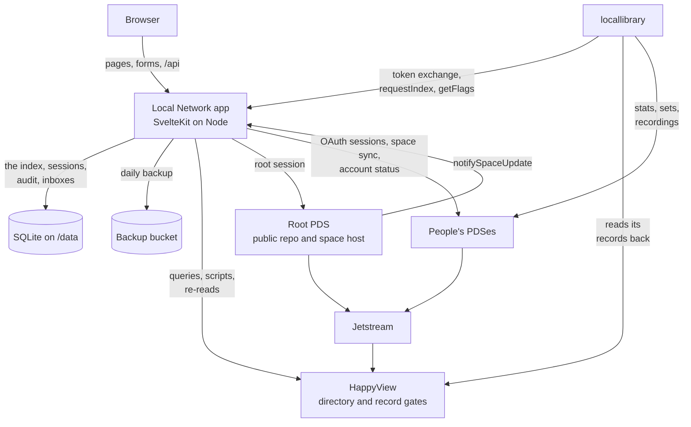

Source: [`src/lib/server/app.ts`](src/lib/server/app.ts), [`src/lib/server/happyview/client.ts`](src/lib/server/happyview/client.ts), [`src/routes/xrpc/com.atproto.space.notifySpaceUpdate/+server.ts`](src/routes/xrpc/com.atproto.space.notifySpaceUpdate/+server.ts)

### Deployment

How the website reaches production on Railway. HappyView and the root's PDS run outside this Railway project.

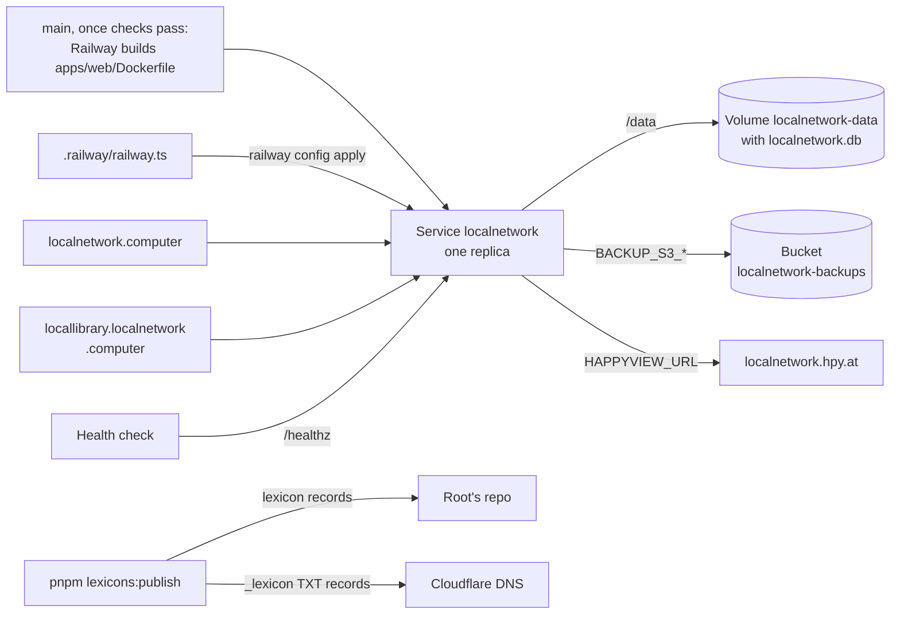

Source: [`../../.railway/railway.ts`](../../.railway/railway.ts), [`Dockerfile`](Dockerfile), [`scripts/publish-lexicons.ts`](scripts/publish-lexicons.ts)

### External services

What the server calls, and why.

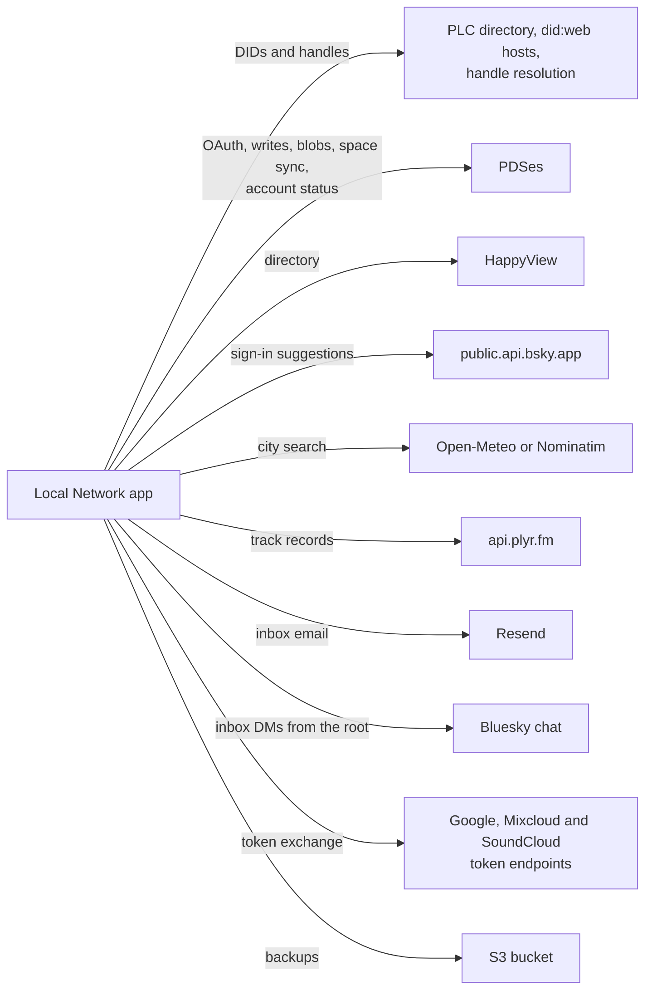

Source: [`src/lib/server/atproto/identity.ts`](src/lib/server/atproto/identity.ts), [`src/lib/server/atproto/account-status.ts`](src/lib/server/atproto/account-status.ts), [`src/lib/server/actor-search.ts`](src/lib/server/actor-search.ts), [`src/lib/server/geocode.ts`](src/lib/server/geocode.ts), [`src/lib/server/plyr.ts`](src/lib/server/plyr.ts), [`src/lib/server/notifications/email.ts`](src/lib/server/notifications/email.ts), [`src/lib/server/notifications/dm.ts`](src/lib/server/notifications/dm.ts), [`src/lib/server/token-exchange/services.json`](src/lib/server/token-exchange/services.json), [`src/lib/server/backup/store.ts`](src/lib/server/backup/store.ts)

### What the browser reaches

Where a page's browser goes besides this site. The CSP lists the audio, script, frame and image hosts.

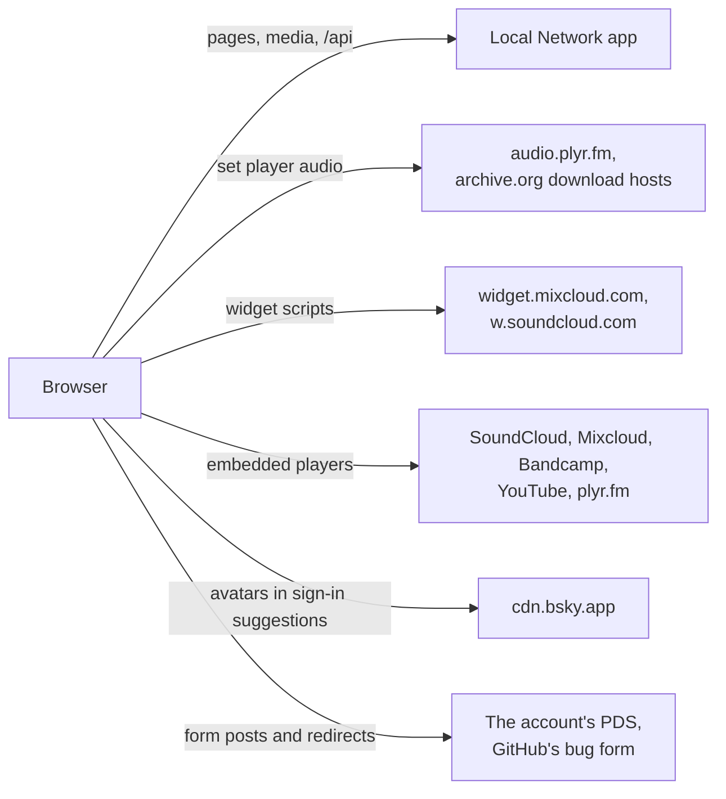

Source: [`vite.config.ts`](vite.config.ts), [`src/lib/bug-report.ts`](src/lib/bug-report.ts)

### Where state lives

Every place the app keeps something, and what rebuilds it. `TABLE_SOURCE` in `schema.ts` marks each SQLite table rebuilt or server-only, and `SERVER_ONLY_COLUMNS` the parts of rebuilt tables a re-sync can't bring back; a test fails when a table has neither.

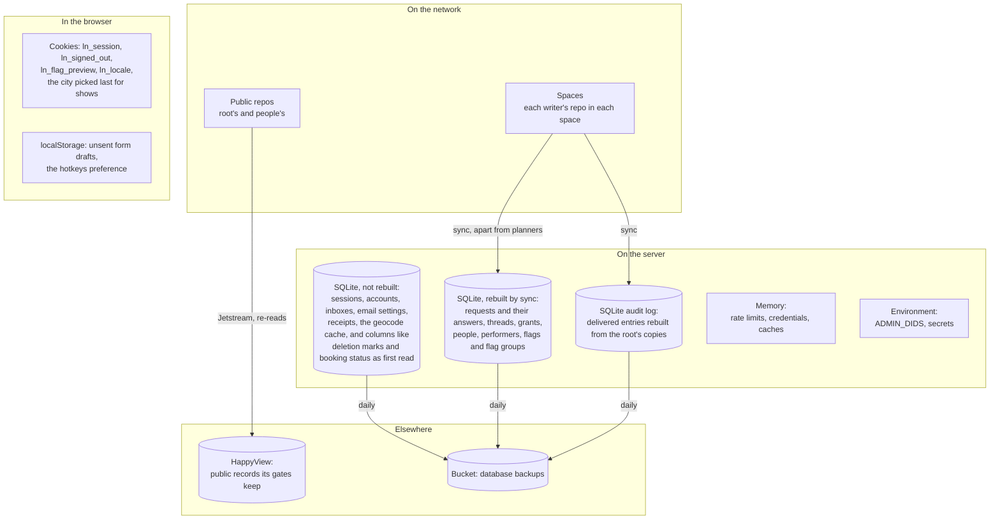

Source: [`src/lib/server/db/schema.ts`](src/lib/server/db/schema.ts), [`src/lib/server/sync/engine.ts`](src/lib/server/sync/engine.ts), [`src/lib/server/config.ts`](src/lib/server/config.ts), [`src/lib/form-draft.page-only.svelte.ts`](src/lib/form-draft.page-only.svelte.ts), [`src/lib/server/shows-place.ts`](src/lib/server/shows-place.ts), [`src/lib/server/flags/preview.ts`](src/lib/server/flags/preview.ts), [`project.inlang/paraglide.config.ts`](project.inlang/paraglide.config.ts)

### Local tables: bookings and press kits

The tables that index booking threads, and press kit requests and grants. Only the link from participants to threads is a foreign key; the other lines are columns the rows share.

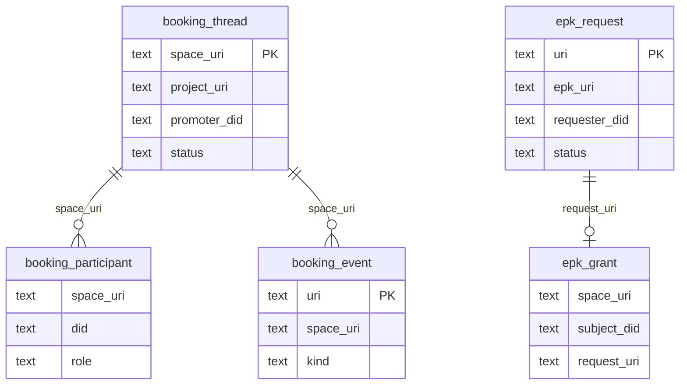

Source: [`src/lib/server/db/schema.ts`](src/lib/server/db/schema.ts), [`src/lib/server/db/migrations.ts`](src/lib/server/db/migrations.ts)

### Local tables: shared spaces

The tables that index performer, party and venue spaces, who each performer space is for, and each venue's place. Each line is a column the rows share.

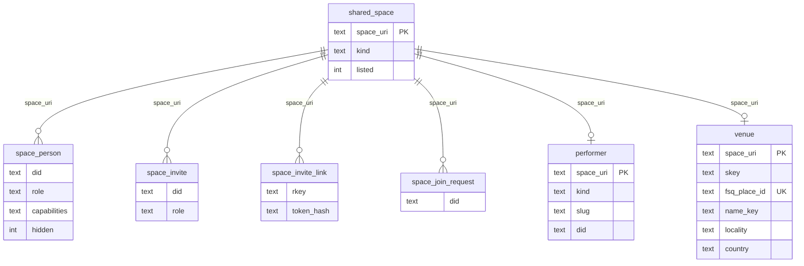

Source: [`src/lib/server/db/schema.ts`](src/lib/server/db/schema.ts), [`src/lib/server/services/shared-spaces.ts`](src/lib/server/services/shared-spaces.ts)

### Local tables: audit and sync

The tables behind the audit log and the syncer. Each line is a column the rows share.

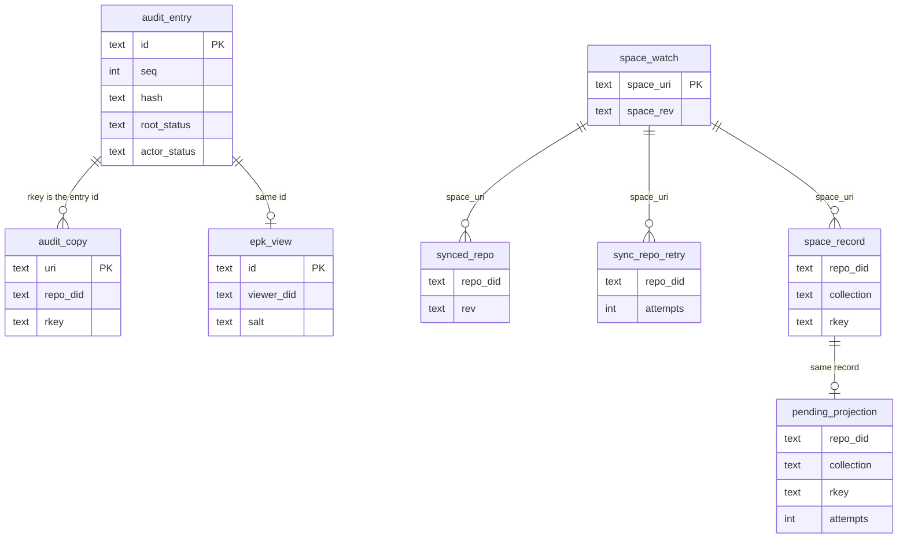

Source: [`src/lib/server/db/schema.ts`](src/lib/server/db/schema.ts), [`src/lib/server/audit/log.ts`](src/lib/server/audit/log.ts), [`src/lib/server/sync/engine.ts`](src/lib/server/sync/engine.ts)

### Local tables: inbox

The tables behind the inbox. Deliveries have a foreign key to their item, and the channel is looked up by DID and channel.

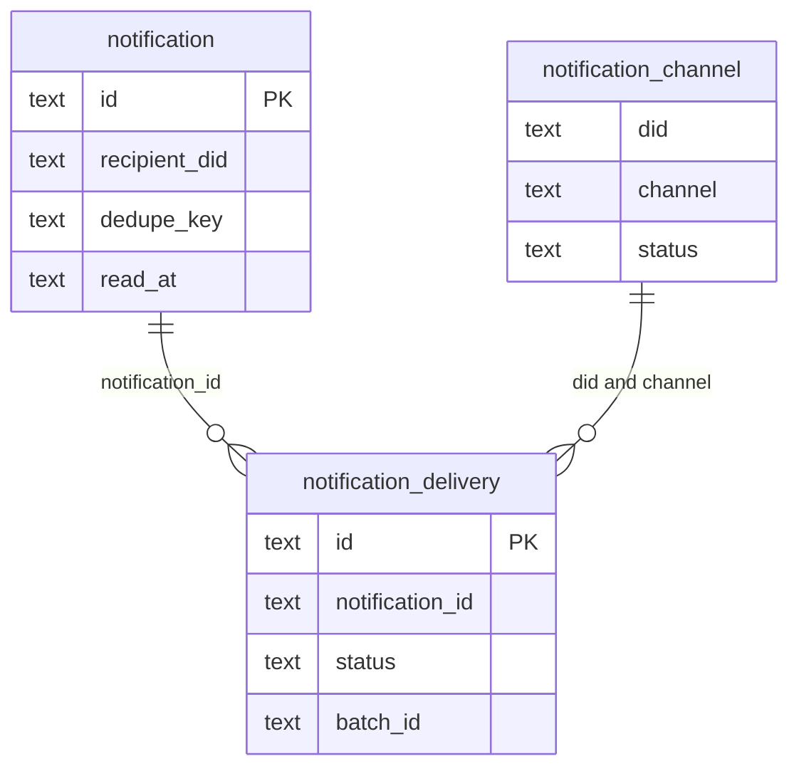

Source: [`src/lib/server/db/schema.ts`](src/lib/server/db/schema.ts), [`src/lib/server/notifications/outbox.ts`](src/lib/server/notifications/outbox.ts)
