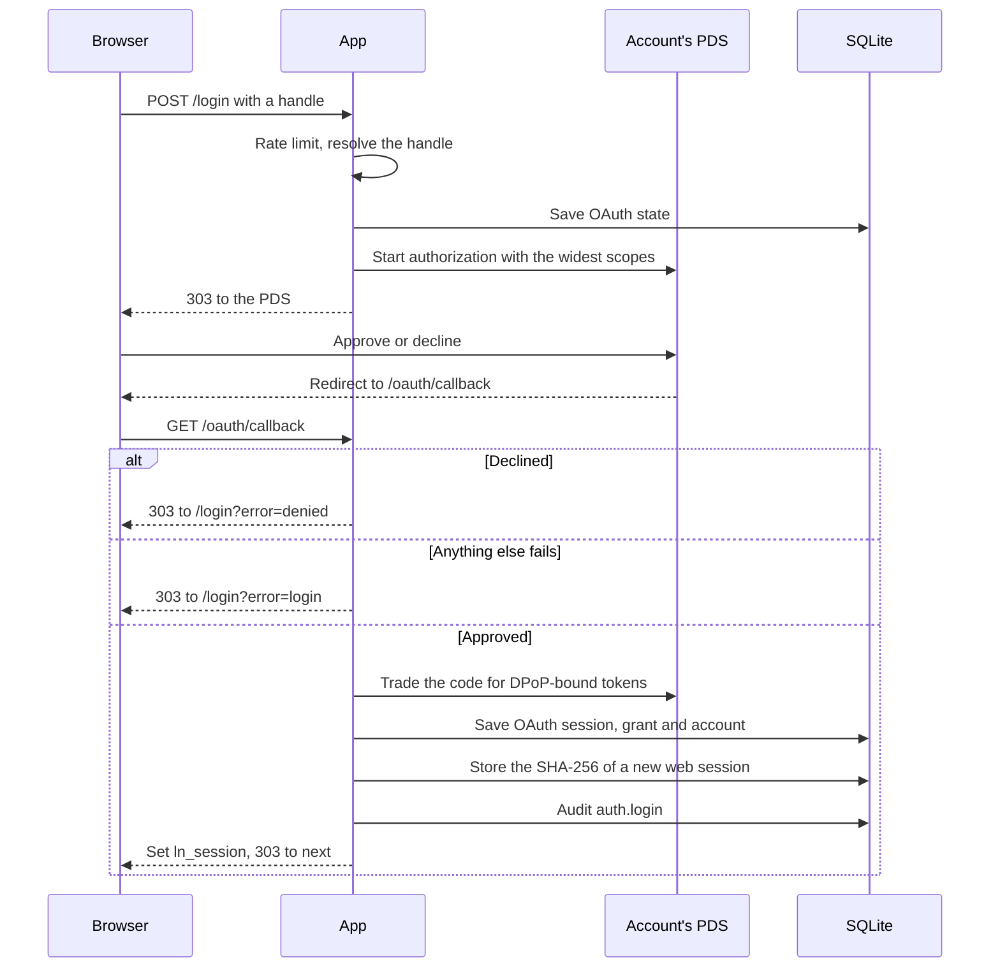
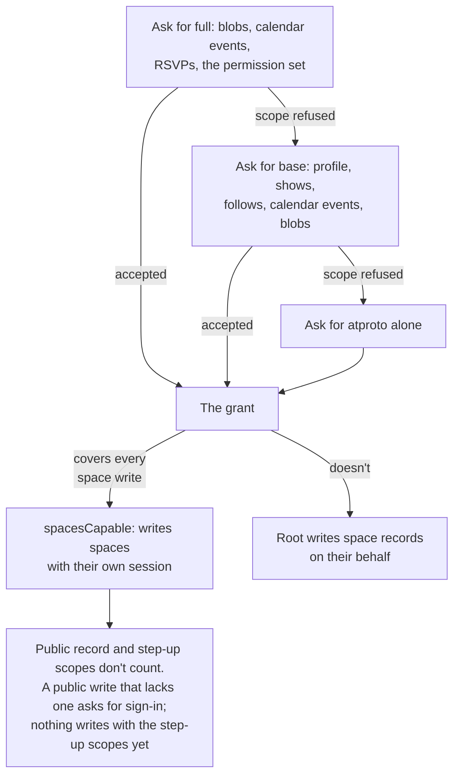
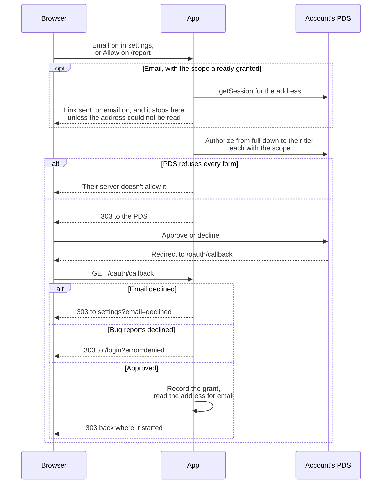
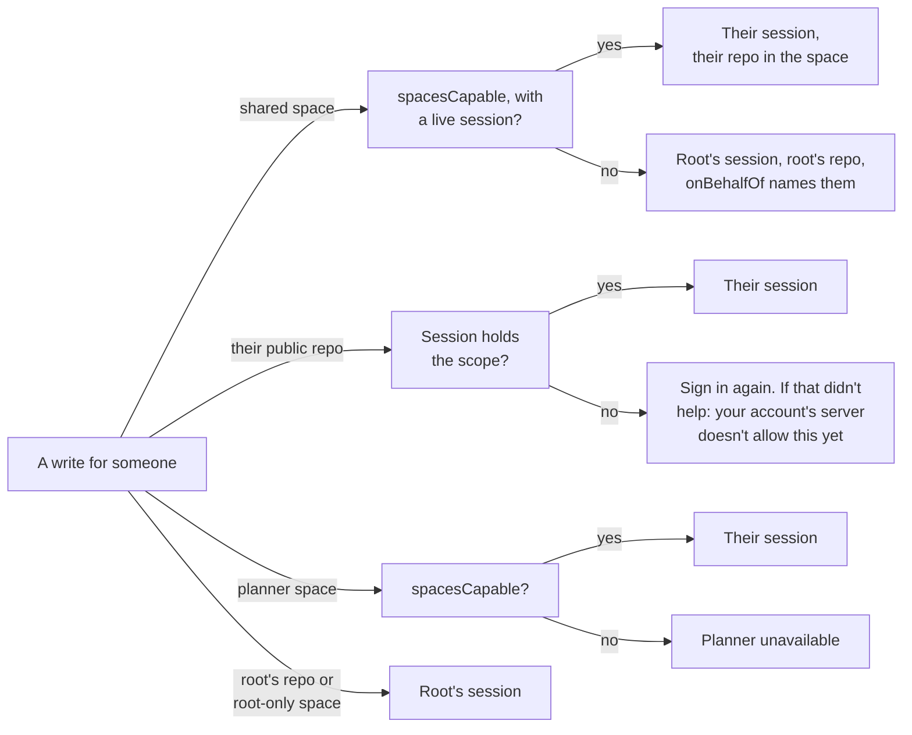
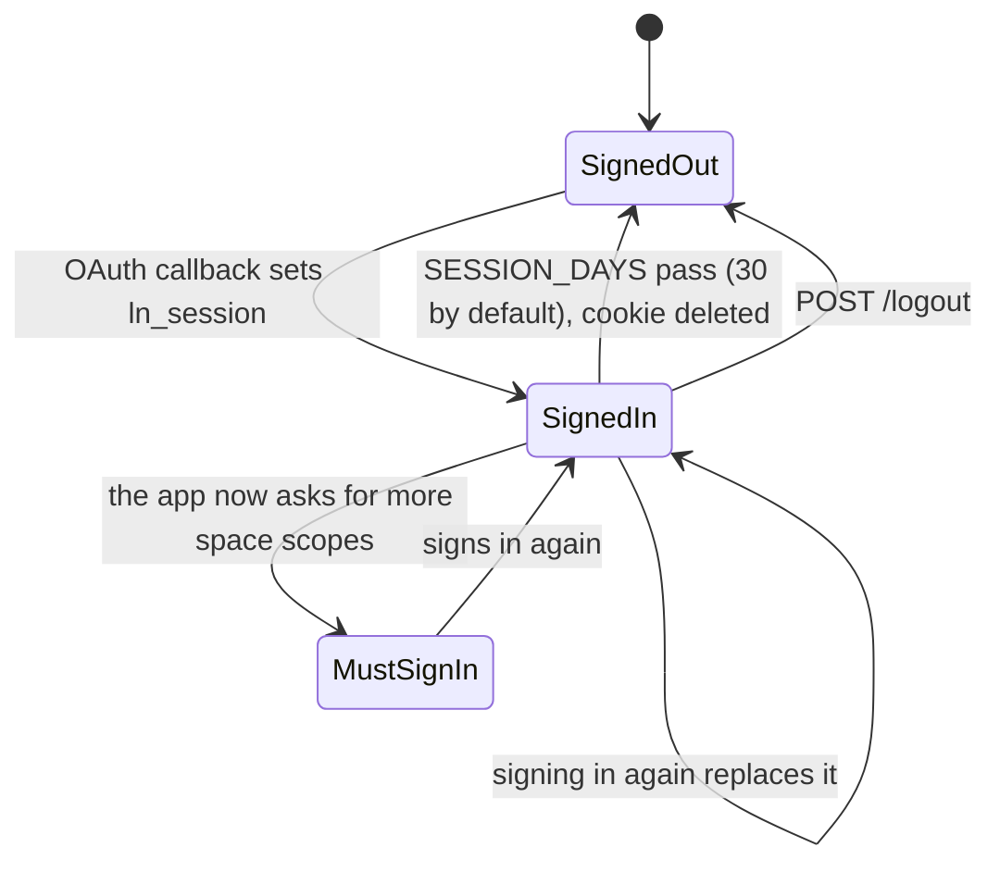
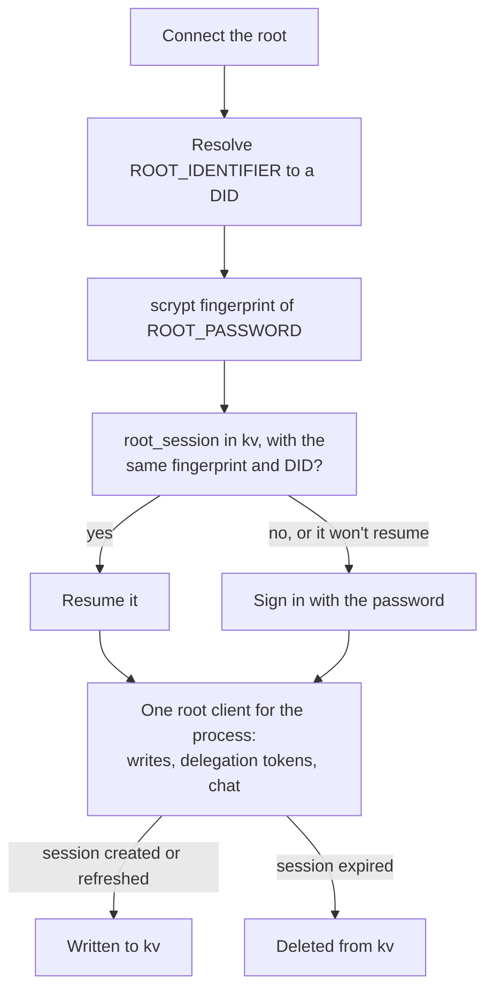
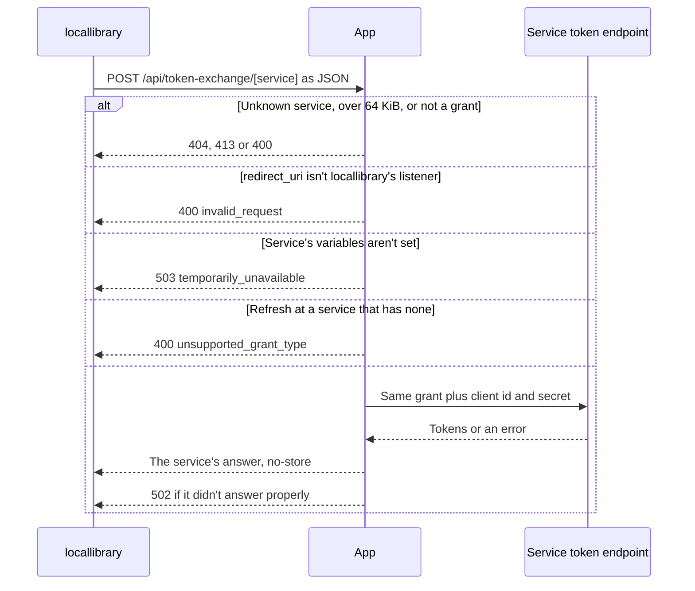
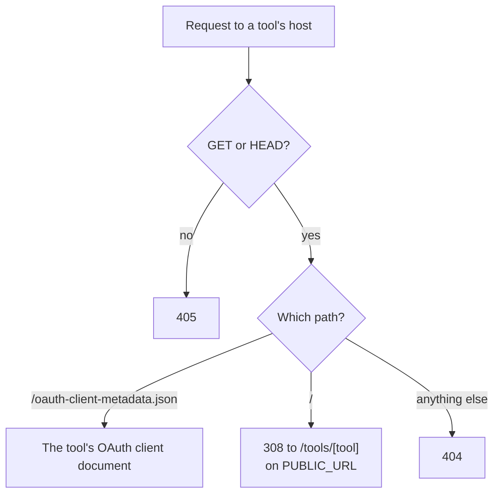
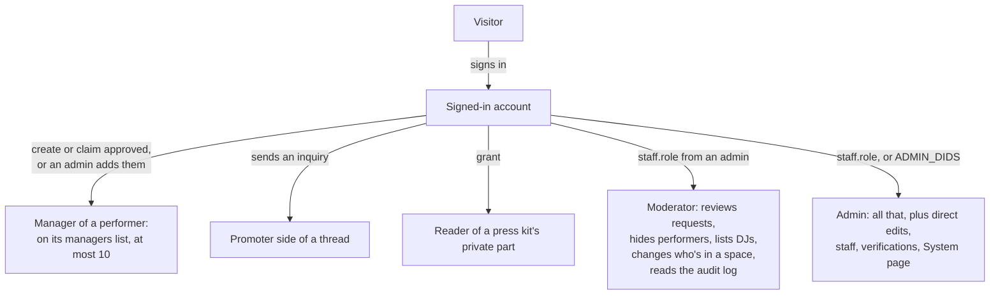
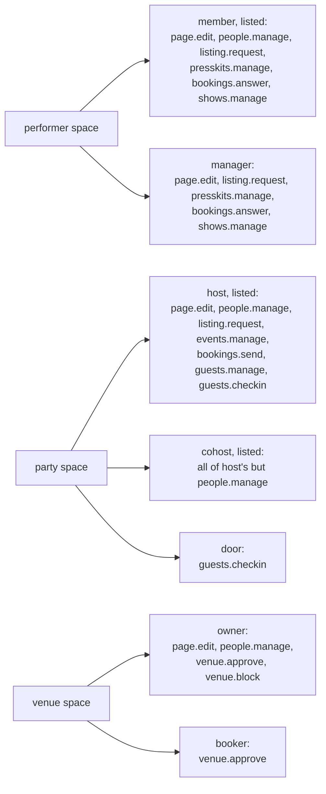

# The website diagrams: Sign-in and roles

OAuth, scopes, sessions, token exchange, roles and capabilities. The rest are listed in the [README](../../README.md#diagrams).

- [Sign-in sequence](#sign-in-sequence)
- [Scope fallback](#scope-fallback)
- [Optional scope opt-in](#optional-scope-opt-in)
- [Who writes a record](#who-writes-a-record)
- [Browser session lifecycle](#browser-session-lifecycle)
- [Root account session](#root-account-session)
- [Token exchange flow](#token-exchange-flow)
- [Tool hosts](#tool-hosts)
- [Site roles](#site-roles)
- [Capabilities by role](#capabilities-by-role)

## Sign-in sequence

Signing in with an Atmosphere account. `/login/create` takes the same path with `prompt=create`. A rate limit or a handle that can't be found stays on the form.

Source: [`src/routes/login/+page.server.ts`](../../src/routes/login/+page.server.ts), [`src/routes/oauth/callback/+server.ts`](../../src/routes/oauth/callback/+server.ts), [`src/lib/server/atproto/oauth.ts`](../../src/lib/server/atproto/oauth.ts), [`src/lib/server/auth/session.ts`](../../src/lib/server/auth/session.ts)

## Scope fallback

What sign-in asks for and what it settles on. Opting in later works differently: see [Optional scope opt-in](#optional-scope-opt-in).

Source: [`src/lib/server/atproto/oauth.ts`](../../src/lib/server/atproto/oauth.ts), [`../../lexicons/computer/localnetwork/permissions.json`](../../../../lexicons/computer/localnetwork/permissions.json)

## Optional scope opt-in

How email and bug reports ask for one more scope after sign-in. It keeps what the account already granted and never asks below the tier it signed in with, so a refusal leaves the account as it was.

Source: [`src/routes/dashboard/inbox/settings/+page.server.ts`](../../src/routes/dashboard/inbox/settings/+page.server.ts), [`src/routes/report/+page.server.ts`](../../src/routes/report/+page.server.ts), [`src/routes/oauth/callback/+server.ts`](../../src/routes/oauth/callback/+server.ts), [`src/lib/server/atproto/oauth.ts`](../../src/lib/server/atproto/oauth.ts), [`src/lib/server/notifications/channels.ts`](../../src/lib/server/notifications/channels.ts)

## Who writes a record

Which account's session makes a write. Public repos have no fallback, since nobody can write there for someone else.

Source: [`src/lib/server/services/own-repo.ts`](../../src/lib/server/services/own-repo.ts), [`src/lib/server/services/planner.ts`](../../src/lib/server/services/planner.ts)

## Browser session lifecycle

A web session from sign-in to sign-out. `POST /logout` audits first, waiting up to five seconds, then revokes the OAuth session and sets `ln_signed_out`.

Source: [`src/lib/server/auth/session.ts`](../../src/lib/server/auth/session.ts), [`src/lib/server/app.ts`](../../src/lib/server/app.ts), [`src/routes/logout/+server.ts`](../../src/routes/logout/+server.ts), [`src/hooks.server.ts`](../../src/hooks.server.ts)

## Root account session

How the root account signs in at startup. Its session lives in `kv`, tied to a slow hash of `ROOT_PASSWORD`, so changing the password forces a fresh sign-in.

Source: [`src/lib/server/atproto/root.ts`](../../src/lib/server/atproto/root.ts), [`src/lib/server/atproto/repo-client.ts`](../../src/lib/server/atproto/repo-client.ts)

## Token exchange flow

How a locallibrary plugin gets tokens from a service that wants a client secret.

Source: [`src/routes/api/token-exchange/[service]/+server.ts`](../../src/routes/api/token-exchange/[service]/+server.ts), [`src/lib/server/token-exchange/exchange.ts`](../../src/lib/server/token-exchange/exchange.ts), [`src/lib/server/token-exchange/services.json`](../../src/lib/server/token-exchange/services.json)

## Tool hosts

What a tool's own host answers. It runs before the app loads, so it works while the app isn't configured.

Source: [`src/lib/server/tools/site.ts`](../../src/lib/server/tools/site.ts), [`src/lib/tools/index.ts`](../../src/lib/tools/index.ts)

## Site roles

The roles the site itself knows, and how someone gets each.

Source: [`src/lib/server/services/staff.ts`](../../src/lib/server/services/staff.ts), [`src/lib/server/app.ts`](../../src/lib/server/app.ts), [`src/lib/server/services/requests.ts`](../../src/lib/server/services/requests.ts), [`src/lib/server/services/project-admin.ts`](../../src/lib/server/services/project-admin.ts)

## Capabilities by role

The starting capabilities of each role in a performer, party or venue space. `page.edit`, `presskits.manage`, `shows.manage` and `events.manage` also make someone a writing member. No page uses these roles yet except the staff console.

Source: [`src/lib/capabilities.ts`](../../src/lib/capabilities.ts), [`src/lib/server/services/shared-spaces.ts`](../../src/lib/server/services/shared-spaces.ts)
