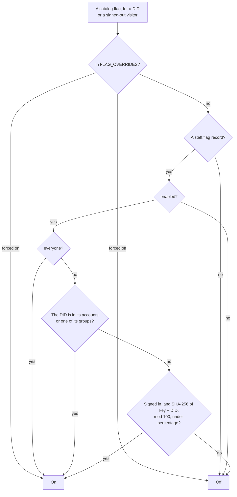
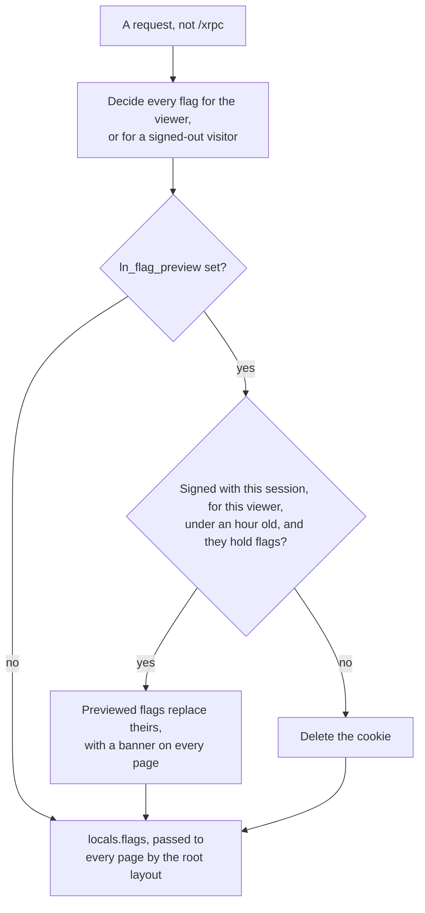
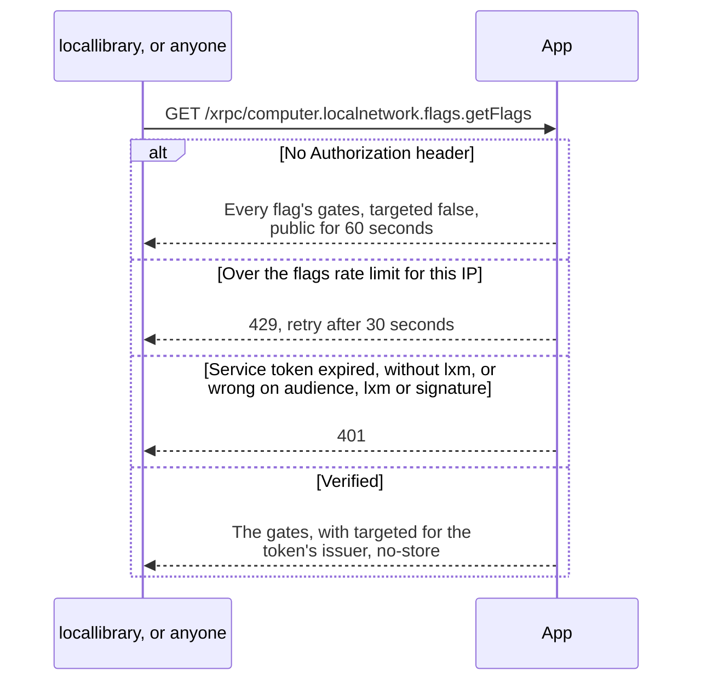
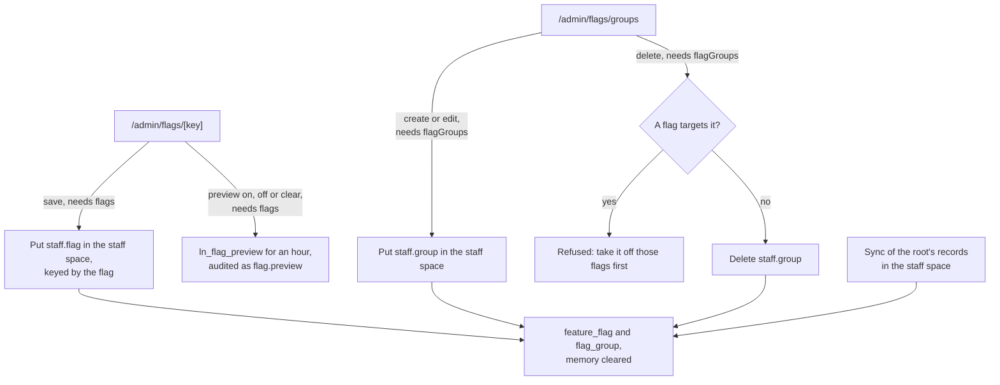
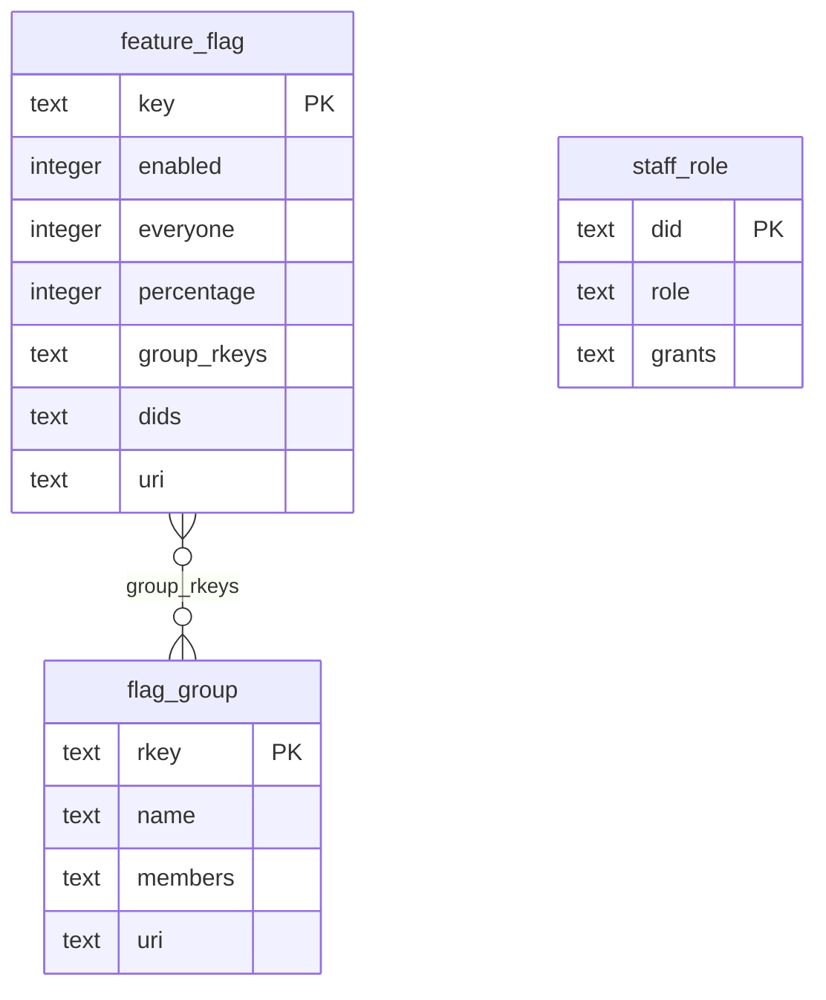

# The website diagrams: Feature flags

Deciding a flag, flags on each request, getFlags, the staff console and the flag tables. The rest are listed in the [README](../../README.md#diagrams).

- [Deciding a flag](#deciding-a-flag)
- [Flags on a page request](#flags-on-a-page-request)
- [getFlags](#getflags)
- [Changing flags](#changing-flags)
- [Flag tables](#flag-tables)

## Deciding a flag

Whether one flag is on for one caller. Only flags in `flags/catalog/` exist: a record for a flag that's gone from it is ignored.

Source: [`src/lib/server/flags/evaluate.ts`](../../src/lib/server/flags/evaluate.ts), [`src/lib/server/services/flags.ts`](../../src/lib/server/services/flags.ts), [`src/lib/server/flags/catalog.ts`](../../src/lib/server/flags/catalog.ts), [`src/lib/server/config.ts`](../../src/lib/server/config.ts)

## Flags on a page request

Every request outside `/xrpc` gets every flag decided once, held in memory between record changes. A staff member's preview changes only their own browser.

Source: [`src/hooks.server.ts`](../../src/hooks.server.ts), [`src/lib/server/flags/preview.ts`](../../src/lib/server/flags/preview.ts), [`src/lib/server/services/flags.ts`](../../src/lib/server/services/flags.ts), [`src/routes/+layout.server.ts`](../../src/routes/+layout.server.ts), [`src/routes/+layout.svelte`](../../src/routes/+layout.svelte)

## getFlags

How locallibrary learns the flags, since the staff space is private. The answer is each flag's gates, and the caller decides with the same rule; [`flags/vectors.json`](../../../../flags/vectors.json) holds both sides to it.

Source: [`src/routes/xrpc/computer.localnetwork.flags.getFlags/+server.ts`](../../src/routes/xrpc/computer.localnetwork.flags.getFlags/+server.ts), [`src/lib/server/flags/get-flags.ts`](../../src/lib/server/flags/get-flags.ts), [`src/lib/server/atproto/service-auth.ts`](../../src/lib/server/atproto/service-auth.ts), [`flags/README.md`](../../../../flags/README.md)

## Changing flags

What `/admin/flags` writes. Admins hold both grants; a moderator holds what an admin gives them on `/admin/staff`. Each write is audited, and saving a flag or a group unchanged writes nothing.

Source: [`src/routes/admin/flags/+page.server.ts`](../../src/routes/admin/flags/+page.server.ts), [`src/routes/admin/flags/[key]/+page.server.ts`](../../src/routes/admin/flags/[key]/+page.server.ts), [`src/routes/admin/flags/groups/+page.server.ts`](../../src/routes/admin/flags/groups/+page.server.ts), [`src/routes/admin/flags/groups/[rkey]/+page.server.ts`](../../src/routes/admin/flags/groups/[rkey]/+page.server.ts), [`src/lib/server/forms/flags.ts`](../../src/lib/server/forms/flags.ts), [`src/lib/server/services/flags.ts`](../../src/lib/server/services/flags.ts), [`src/lib/server/services/staff.ts`](../../src/lib/server/services/staff.ts), [`src/lib/server/sync/projections.ts`](../../src/lib/server/sync/projections.ts)

## Flag tables

The local index of the staff space's flag records, and the grants on staff roles. None of the lines are foreign keys: groups and accounts sit in JSON arrays.

Source: [`src/lib/server/db/migrations.ts`](../../src/lib/server/db/migrations.ts), [`src/lib/server/db/schema.ts`](../../src/lib/server/db/schema.ts)
