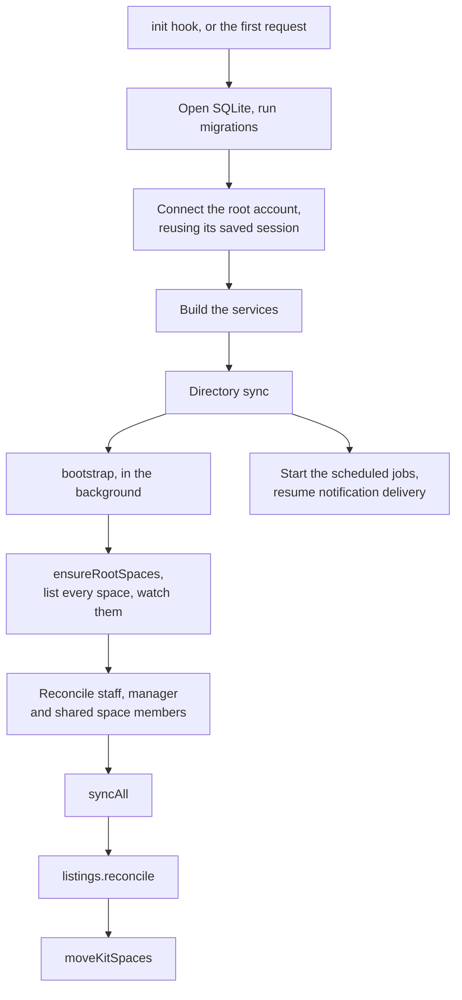
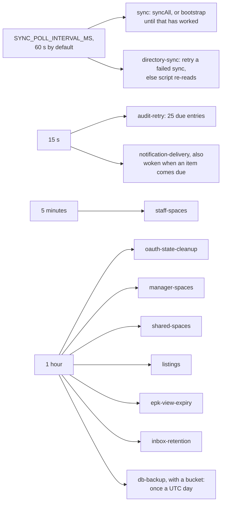
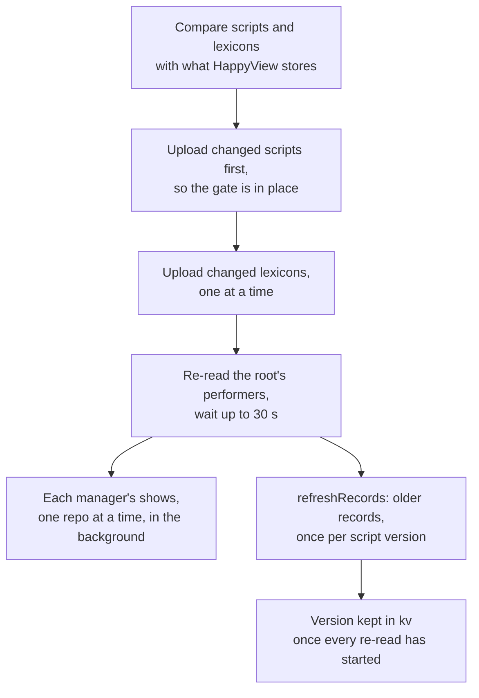
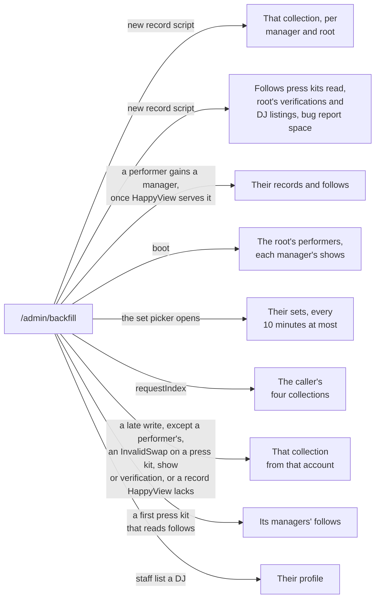
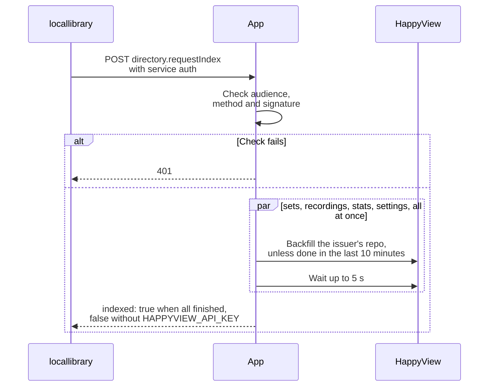
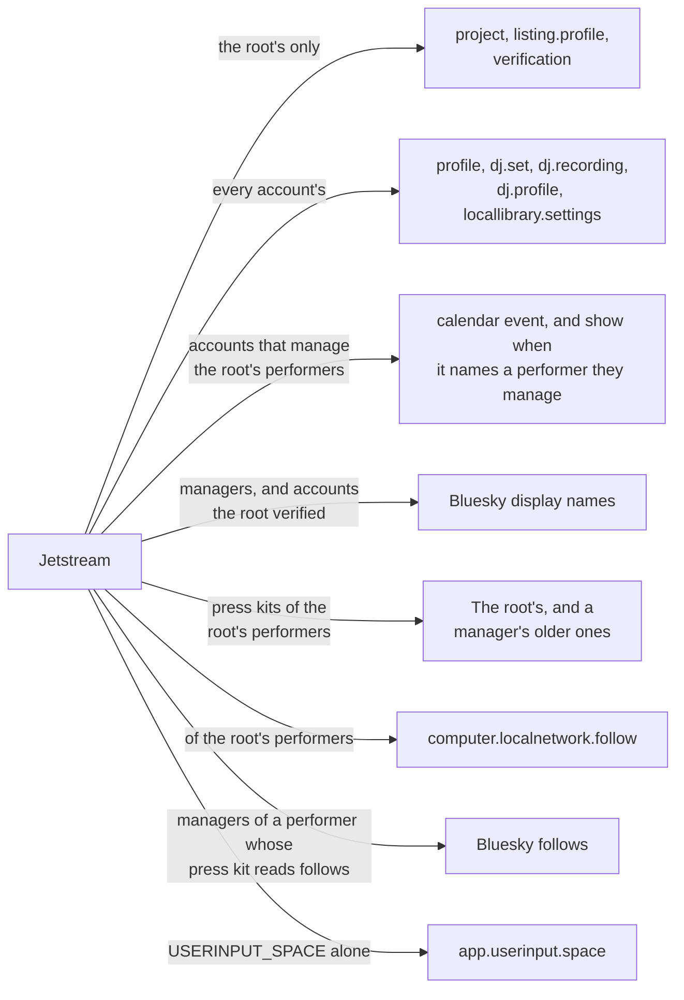
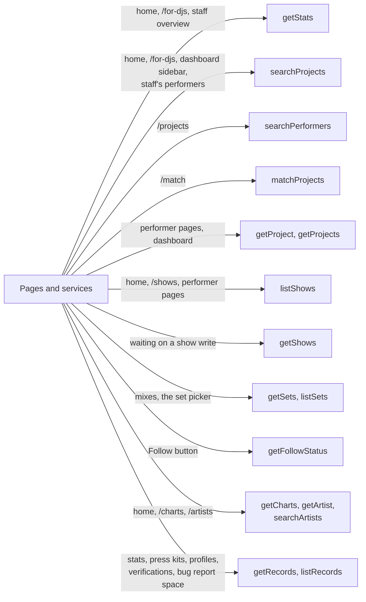

# The website diagrams: Jobs and the directory

Startup, scheduled jobs and HappyView. The rest are listed in the [README](../../README.md#diagrams).

- [Startup](#startup)
- [Scheduled jobs](#scheduled-jobs)
- [Directory sync](#directory-sync)
- [HappyView re-reads](#happyview-re-reads)
- [requestIndex](#requestindex)
- [HappyView record gates](#happyview-record-gates)
- [Directory queries](#directory-queries)

## Startup

What happens when the process starts. A failed start leaves the setup page up, and the next request tries again.

Source: [`src/hooks.server.ts`](../../src/hooks.server.ts), [`src/lib/server/app.ts`](../../src/lib/server/app.ts), [`src/lib/server/bootstrap.ts`](../../src/lib/server/bootstrap.ts), [`src/lib/server/db/migrations.ts`](../../src/lib/server/db/migrations.ts)

## Scheduled jobs

The jobs the app schedules, all in one process. A job still running skips its next turn.

Source: [`src/lib/server/app.ts`](../../src/lib/server/app.ts), [`src/lib/server/backup/backups.ts`](../../src/lib/server/backup/backups.ts), [`src/lib/server/services/epk-views.ts`](../../src/lib/server/services/epk-views.ts), [`src/lib/server/notifications/notifier.ts`](../../src/lib/server/notifications/notifier.ts)

## Directory sync

What `syncDirectory` does with `HAPPYVIEW_API_KEY` set, at boot and from the System page. A failed upload or root re-read is kept for the System page and retried. The re-reads after it only log a failure.

Source: [`src/lib/server/happyview/sync.ts`](../../src/lib/server/happyview/sync.ts), [`src/lib/server/happyview/bundle.ts`](../../src/lib/server/happyview/bundle.ts), [`src/lib/server/happyview/refresh.ts`](../../src/lib/server/happyview/refresh.ts), [`src/lib/server/app.ts`](../../src/lib/server/app.ts)

## HappyView re-reads

What makes the app ask HappyView to read a repo again through `/admin/backfill`. Jetstream only brings new writes, so these fill the gaps.

Source: [`src/lib/server/happyview/refresh.ts`](../../src/lib/server/happyview/refresh.ts), [`src/lib/server/happyview/backfills.ts`](../../src/lib/server/happyview/backfills.ts), [`src/lib/server/happyview/indexed.ts`](../../src/lib/server/happyview/indexed.ts), [`src/lib/server/services/projects.ts`](../../src/lib/server/services/projects.ts), [`src/lib/server/services/sets.ts`](../../src/lib/server/services/sets.ts), [`src/lib/server/services/epk.ts`](../../src/lib/server/services/epk.ts)

## requestIndex

locallibrary asks for its own records to be read again before it replaces them.

Source: [`src/routes/xrpc/computer.localnetwork.directory.requestIndex/+server.ts`](../../src/routes/xrpc/computer.localnetwork.directory.requestIndex/+server.ts), [`src/lib/server/happyview/request-index.ts`](../../src/lib/server/happyview/request-index.ts), [`src/lib/server/happyview/backfills.ts`](../../src/lib/server/happyview/backfills.ts)

## HappyView record gates

What each record script keeps of what Jetstream sends. Anyone can write these collections, so the gates decide what the directory holds.

Source: [`lua/computer/localnetwork/project.lua`](../../lua/computer/localnetwork/project.lua), [`lua/computer/localnetwork/show.lua`](../../lua/computer/localnetwork/show.lua), [`lua/computer/localnetwork/epk.lua`](../../lua/computer/localnetwork/epk.lua), [`lua/computer/localnetwork/follow.lua`](../../lua/computer/localnetwork/follow.lua), [`lua/app/bsky/actor/profile.lua`](../../lua/app/bsky/actor/profile.lua), [`lua/app/bsky/graph/follow.lua`](../../lua/app/bsky/graph/follow.lua), [`lua/app/userinput/space.lua`](../../lua/app/userinput/space.lua), [`src/lib/server/happyview/bundle.ts`](../../src/lib/server/happyview/bundle.ts)

## Directory queries

Which query answers which page. All of them are Lua scripts on HappyView, and `getRecords` and `listRecords` also back `IndexedRepo`.

Source: [`src/lib/server/happyview/client.ts`](../../src/lib/server/happyview/client.ts), [`src/lib/server/happyview/indexed.ts`](../../src/lib/server/happyview/indexed.ts), [`src/lib/server/services/projects.ts`](../../src/lib/server/services/projects.ts), [`src/lib/server/services/performers.ts`](../../src/lib/server/services/performers.ts), [`src/lib/server/services/shows.ts`](../../src/lib/server/services/shows.ts), [`src/lib/server/services/supports.ts`](../../src/lib/server/services/supports.ts), [`src/routes/+page.server.ts`](../../src/routes/+page.server.ts), [`src/routes/for-djs/+page.server.ts`](../../src/routes/for-djs/+page.server.ts)
