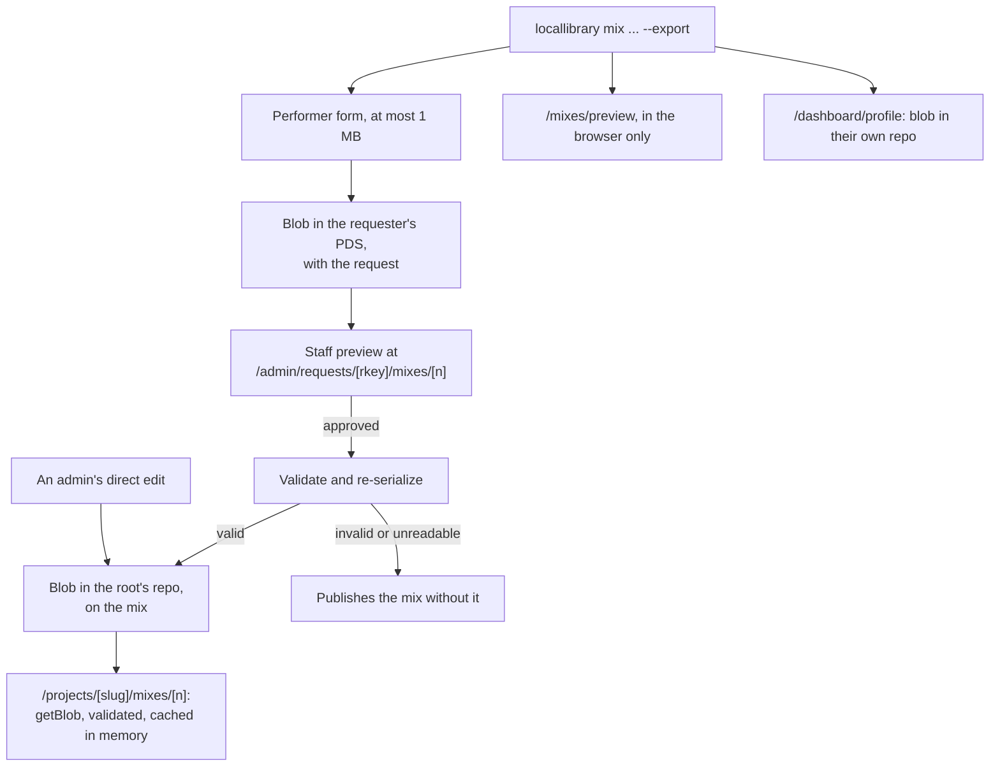
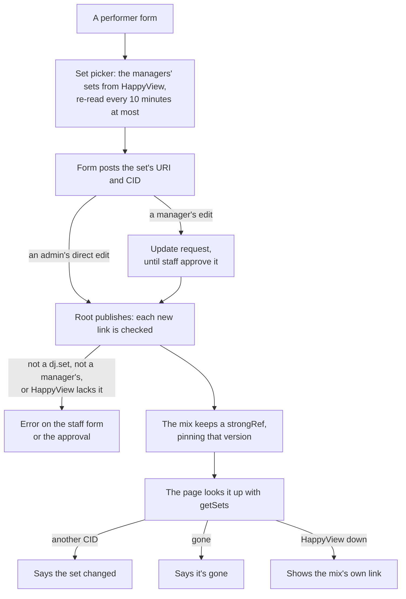
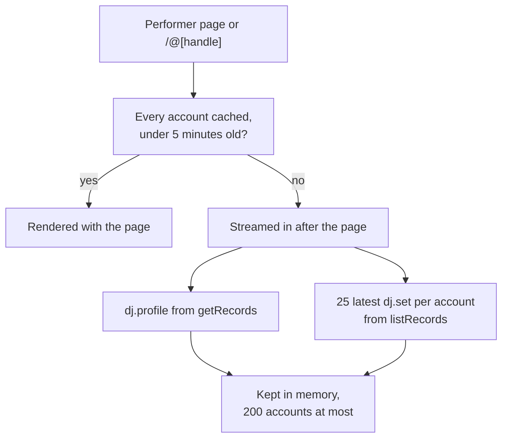
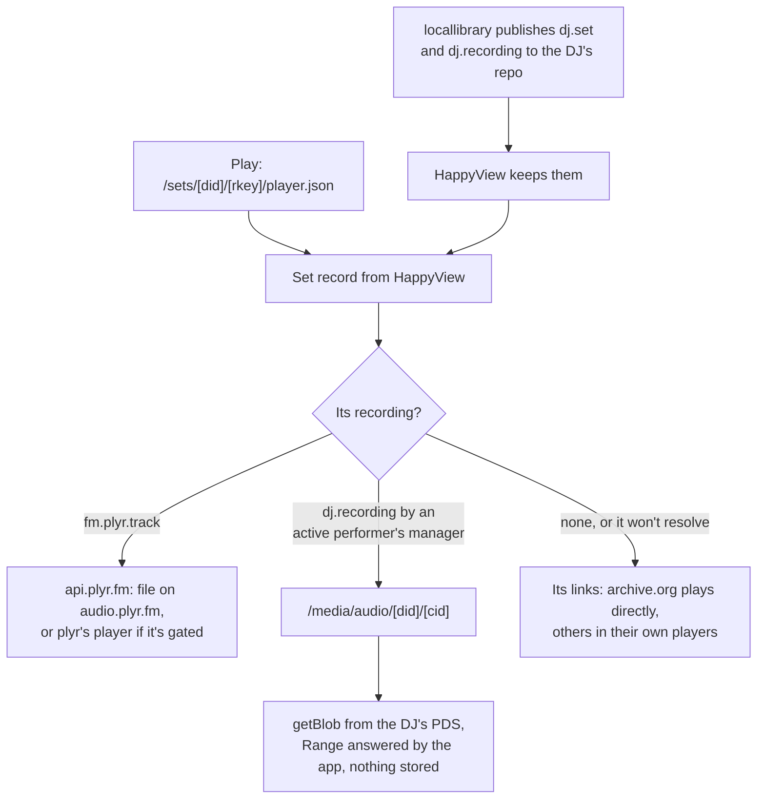
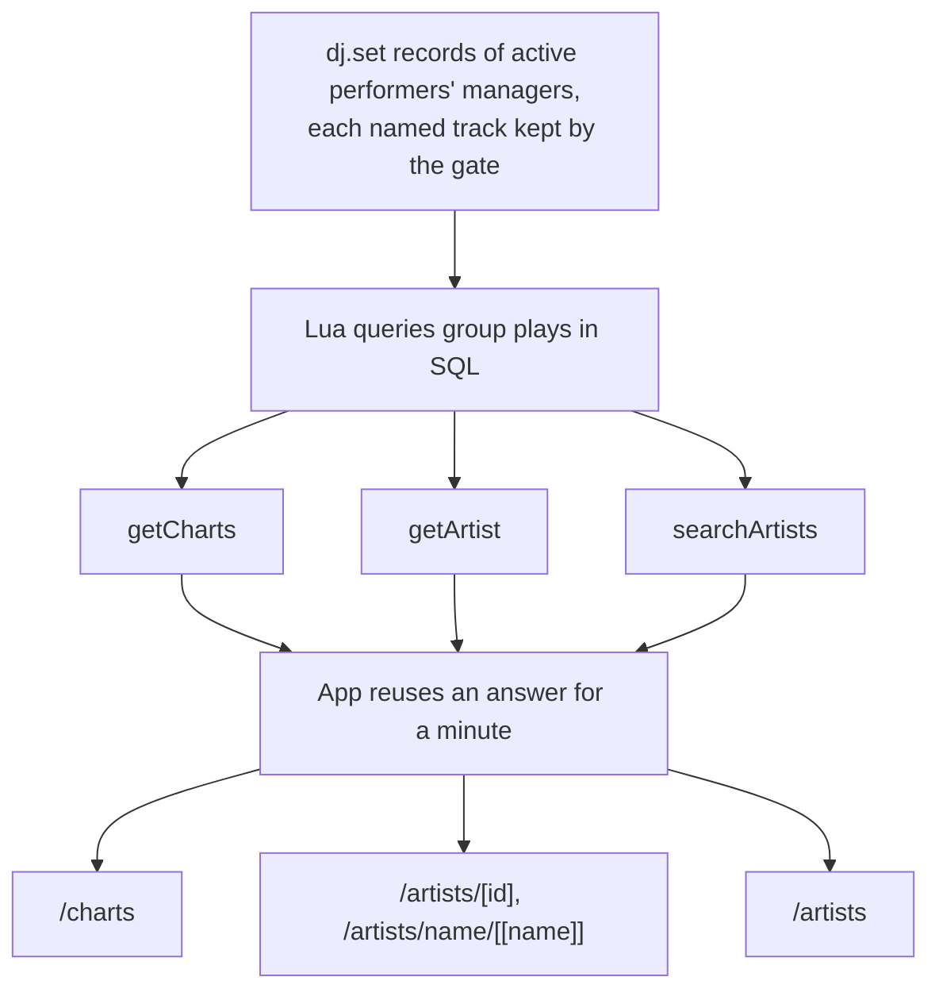

# The website diagrams: Mixes, sets and charts

Tracklists, sets, recordings, stats and artist pages. The rest are listed in the [README](../../README.md#diagrams).

- [Mix tracklist flow](#mix-tracklist-flow)
- [Linking a set to a mix](#linking-a-set-to-a-mix)
- [DJ stats on a page](#dj-stats-on-a-page)
- [Sets and recordings](#sets-and-recordings)
- [Charts and artist pages](#charts-and-artist-pages)

## Mix tracklist flow

How a tracklist gets from locallibrary onto a performer's page.

Source: [`src/lib/server/services/requests.ts`](../../src/lib/server/services/requests.ts), [`src/lib/server/services/tracklists.ts`](../../src/lib/server/services/tracklists.ts), [`src/lib/mix/schema.ts`](../../src/lib/mix/schema.ts), [`src/lib/server/services/project-admin.ts`](../../src/lib/server/services/project-admin.ts), [`src/routes/projects/[slug]/mixes/[n]/+page.server.ts`](../../src/routes/projects/[slug]/mixes/[n]/+page.server.ts)

## Linking a set to a mix

How a mix links a set a manager published, and what the page says afterwards. A mix on someone's own profile goes to their repo unchecked.

Source: [`src/lib/server/services/sets.ts`](../../src/lib/server/services/sets.ts), [`src/lib/server/services/projects.ts`](../../src/lib/server/services/projects.ts), [`src/routes/dashboard/projects/[slug]/profile/+page.server.ts`](../../src/routes/dashboard/projects/[slug]/profile/+page.server.ts), [`src/routes/projects/[slug]/+page.server.ts`](../../src/routes/projects/[slug]/+page.server.ts)

## DJ stats on a page

How a performer page or a profile gets the stats and recent sets DJs publish. The app stores none of it.

Source: [`src/lib/server/services/dj.ts`](../../src/lib/server/services/dj.ts), [`src/lib/server/project-page.ts`](../../src/lib/server/project-page.ts), [`src/lib/server/profile-page.ts`](../../src/lib/server/profile-page.ts)

## Sets and recordings

What plays when someone presses Play. Audio the page plays itself wins over a platform's player. A mix checks its own recording first, then its linked set, then its link.

Source: [`src/lib/server/services/recordings.ts`](../../src/lib/server/services/recordings.ts), [`src/lib/server/media/audio.ts`](../../src/lib/server/media/audio.ts), [`src/routes/media/audio/[did]/[cid]/+server.ts`](../../src/routes/media/audio/[did]/[cid]/+server.ts), [`src/routes/sets/[did]/[rkey]/player.json/+server.ts`](../../src/routes/sets/[did]/[rkey]/player.json/+server.ts), [`src/lib/server/plyr.ts`](../../src/lib/server/plyr.ts)

## Charts and artist pages

Support counts come straight from the sets HappyView keeps, and nothing stores them. A listed DJ who manages no active performer doesn't count. With HappyView down, the pages say so.

Source: [`src/lib/server/services/supports.ts`](../../src/lib/server/services/supports.ts), [`src/routes/charts/+page.server.ts`](../../src/routes/charts/+page.server.ts), [`lua/computer/localnetwork/directory/getCharts.lua`](../../lua/computer/localnetwork/directory/getCharts.lua), [`lua/computer/localnetwork/directory/getArtist.lua`](../../lua/computer/localnetwork/directory/getArtist.lua)
