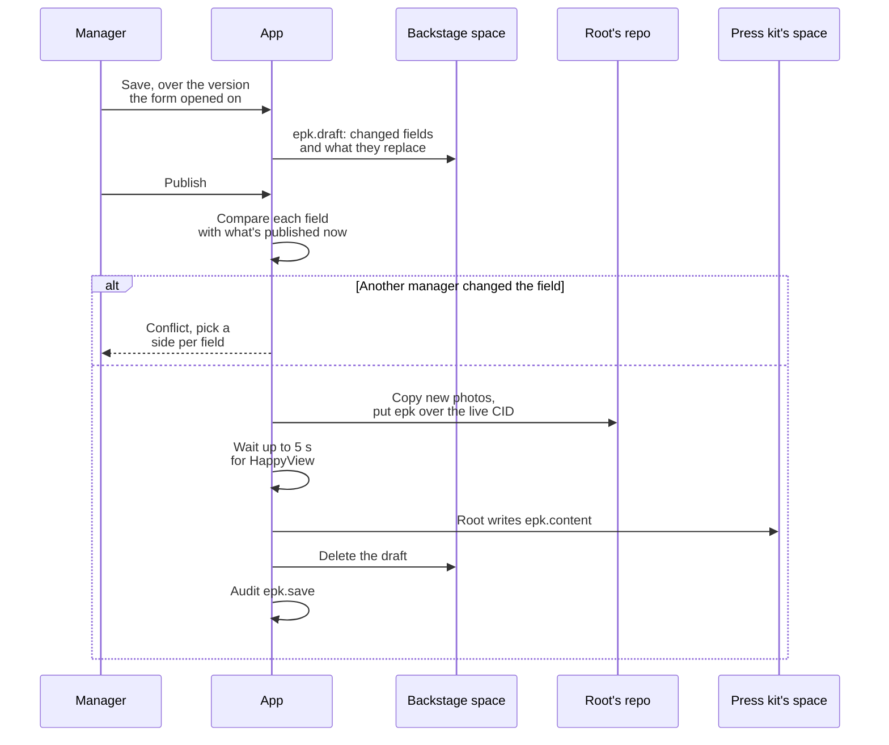
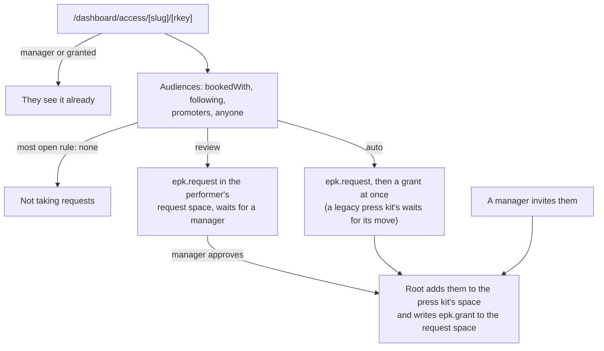
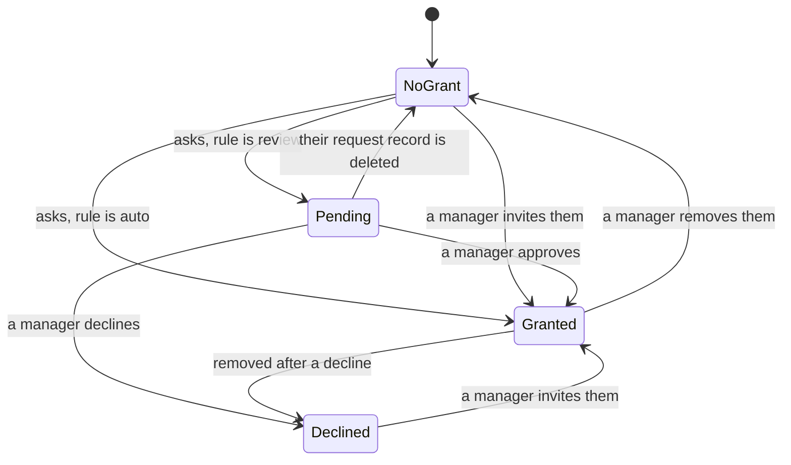
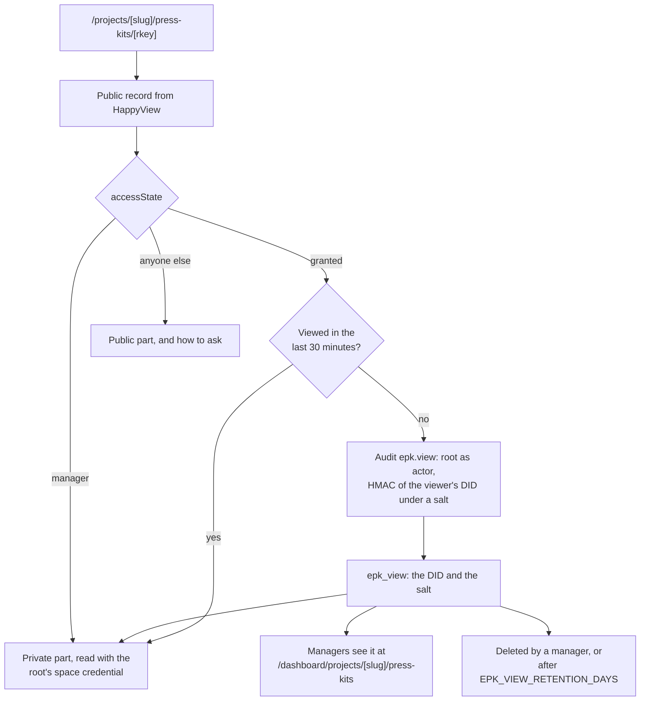
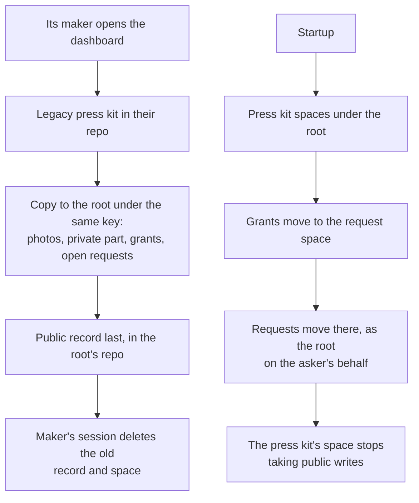
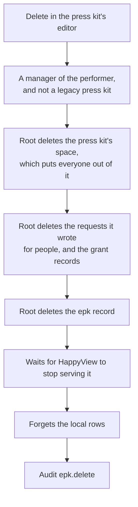

# The website diagrams: Press kits

Drafts, grants, views, moves and deletes. The rest are listed in the [README](../../README.md#diagrams).

- [Press kit drafts and publishing](#press-kit-drafts-and-publishing)
- [Press kit access rules](#press-kit-access-rules)
- [Press kit grant lifecycle](#press-kit-grant-lifecycle)
- [Press kit views and receipts](#press-kit-views-and-receipts)
- [Press kit moves](#press-kit-moves)
- [Deleting a press kit](#deleting-a-press-kit)

## Press kit drafts and publishing

How managers change a press kit. Drafts stay in the backstage until one is published.

Source: [`src/lib/server/services/epk-drafts.ts`](../../src/lib/server/services/epk-drafts.ts), [`src/lib/server/services/epk-fields.ts`](../../src/lib/server/services/epk-fields.ts), [`src/routes/dashboard/projects/[slug]/press-kits/[rkey]/+page.server.ts`](../../src/routes/dashboard/projects/[slug]/press-kits/[rkey]/+page.server.ts)

## Press kit access rules

What happens when someone asks to see a press kit's private part. They get the most open rule of the audiences they're in.

Source: [`src/lib/epk.ts`](../../src/lib/epk.ts), [`src/lib/server/services/epk.ts`](../../src/lib/server/services/epk.ts), [`src/routes/dashboard/access/[slug]/[rkey]/+page.server.ts`](../../src/routes/dashboard/access/[slug]/[rkey]/+page.server.ts), [`src/routes/dashboard/projects/[slug]/press-kits/[rkey]/access/+page.server.ts`](../../src/routes/dashboard/projects/[slug]/press-kits/[rkey]/access/+page.server.ts)

## Press kit grant lifecycle

Where someone stands with one press kit. Someone declined can't ask again, but a manager can still invite them.

Source: [`src/lib/server/services/epk.ts`](../../src/lib/server/services/epk.ts), [`src/lib/server/db/schema.ts`](../../src/lib/server/db/schema.ts), [`src/lib/epk.ts`](../../src/lib/epk.ts)

## Press kit views and receipts

What opening a press kit reads, and the receipt it leaves. A manager's own view leaves no receipt.

Source: [`src/routes/projects/[slug]/press-kits/[rkey]/+page.server.ts`](../../src/routes/projects/[slug]/press-kits/[rkey]/+page.server.ts), [`src/lib/server/services/epk-views.ts`](../../src/lib/server/services/epk-views.ts), [`src/lib/server/services/epk.ts`](../../src/lib/server/services/epk.ts)

## Press kit moves

Two moves for press kits made under older rules. Both can stop part way and finish on the next try.

Source: [`src/lib/server/services/epk-legacy.ts`](../../src/lib/server/services/epk-legacy.ts), [`src/lib/server/services/epk-space-move.ts`](../../src/lib/server/services/epk-space-move.ts), [`src/routes/dashboard/+layout.server.ts`](../../src/routes/dashboard/+layout.server.ts)

## Deleting a press kit

Any of the performer's managers can delete a press kit the root holds. The space goes first, so a delete that fails part way can be run again.

Source: [`src/lib/server/services/epk.ts`](../../src/lib/server/services/epk.ts), [`src/routes/dashboard/projects/[slug]/press-kits/[rkey]/+page.server.ts`](../../src/routes/dashboard/projects/[slug]/press-kits/[rkey]/+page.server.ts)
