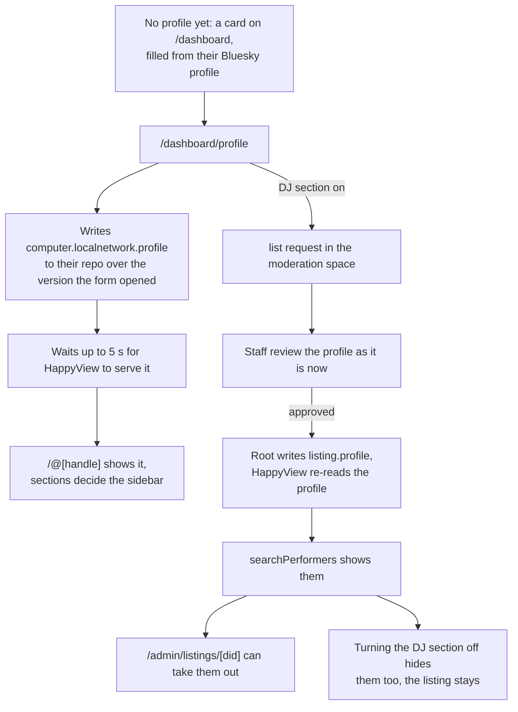
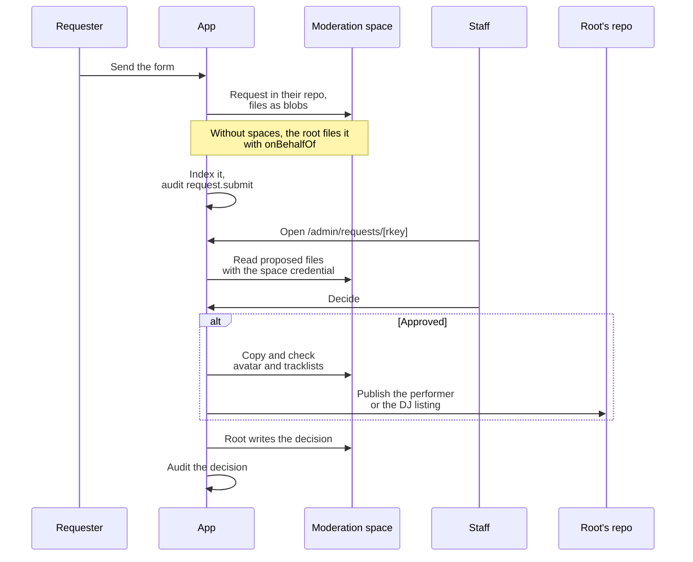
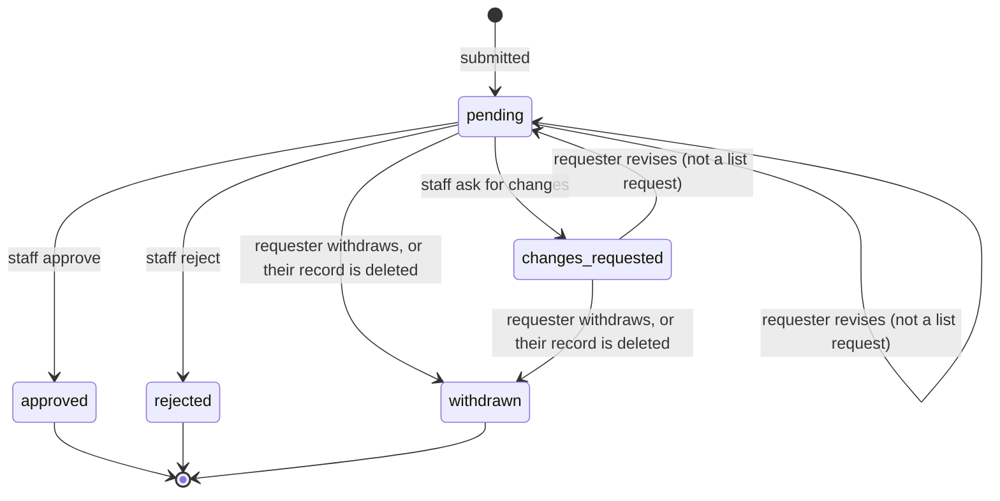
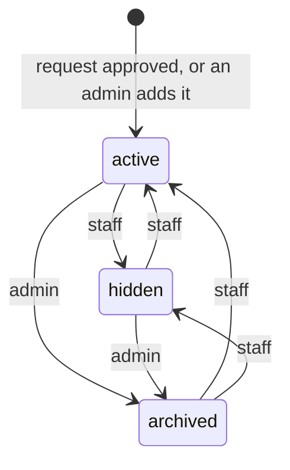
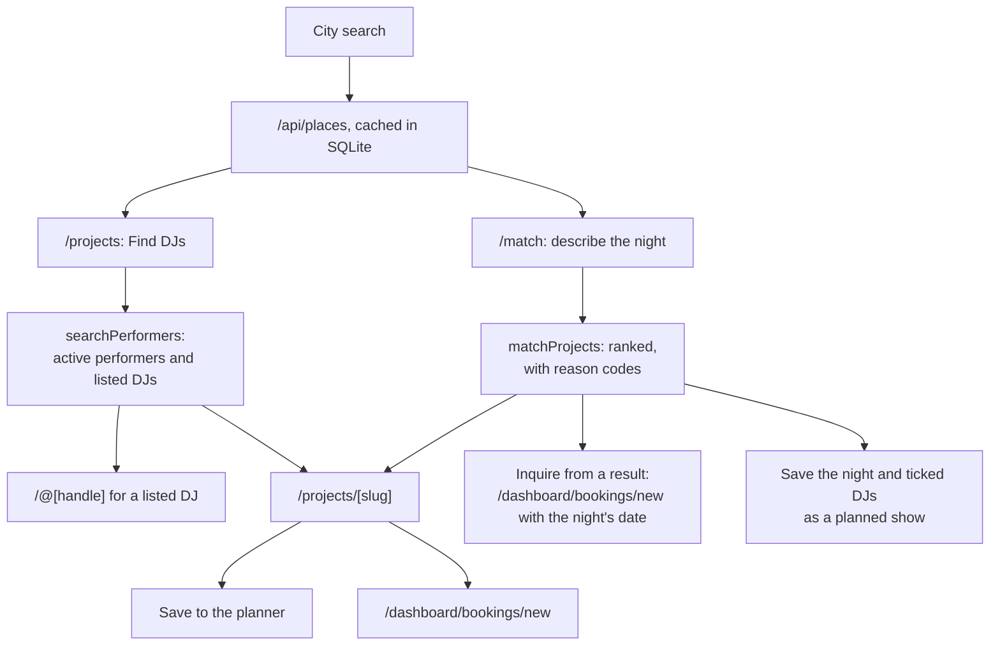
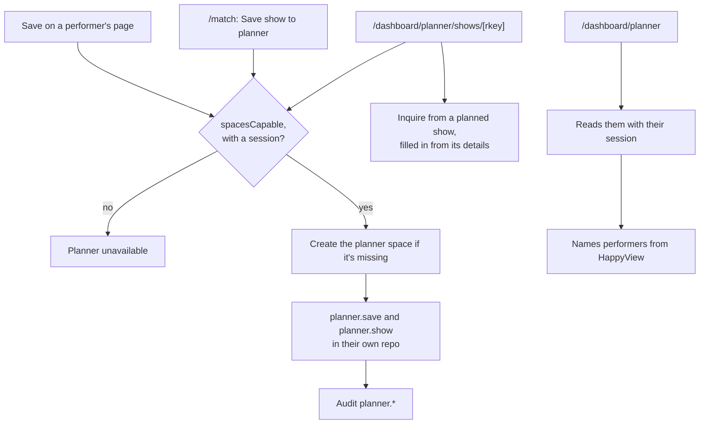
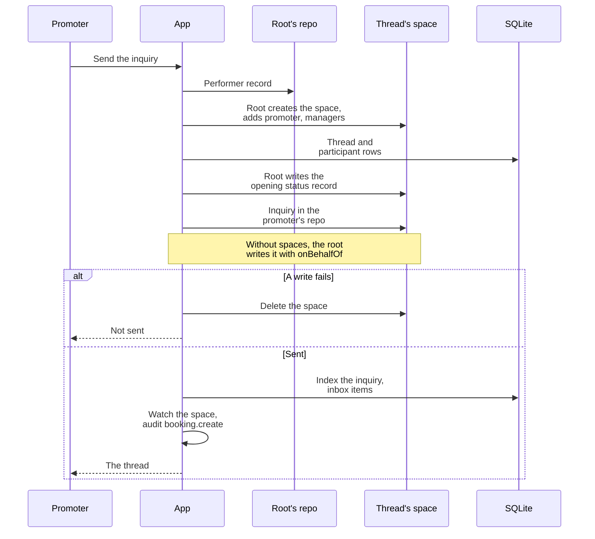
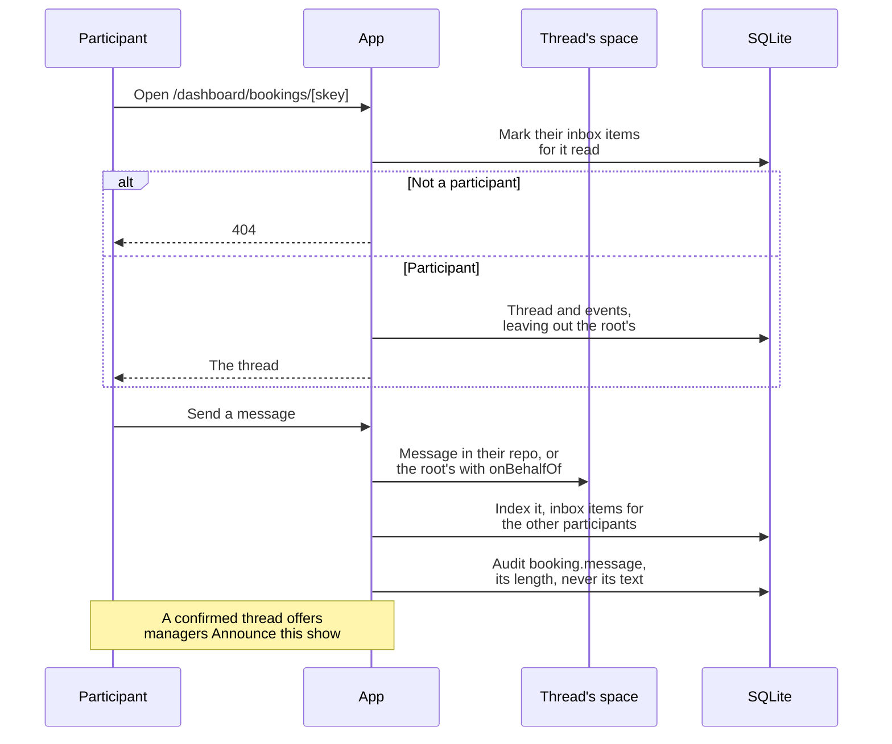
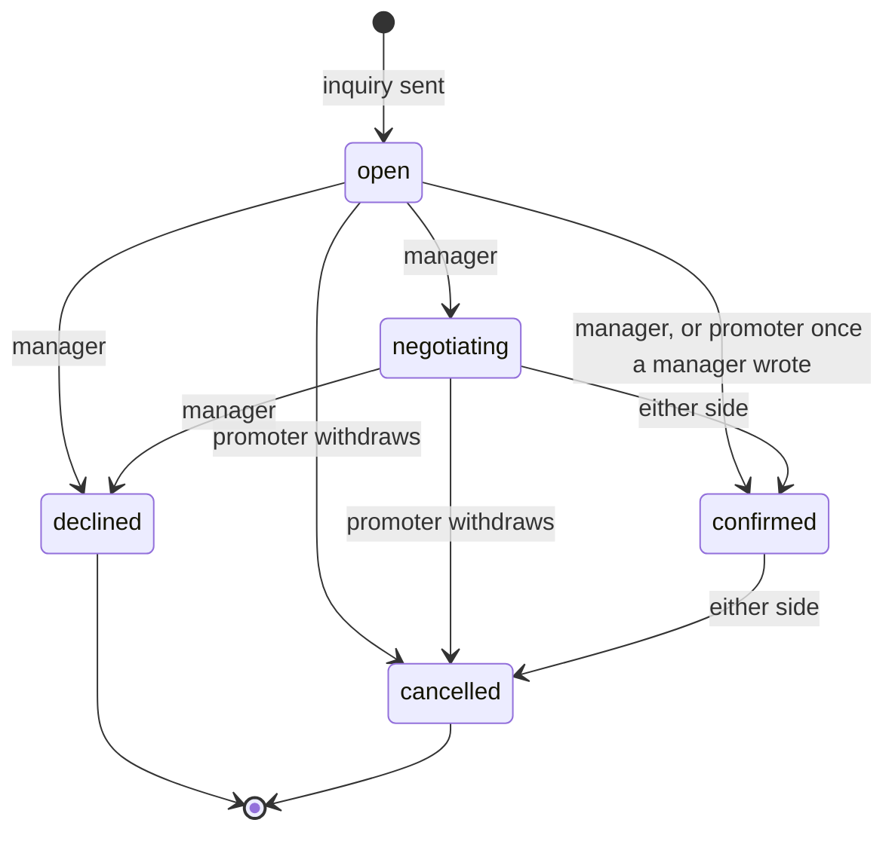

# The website diagrams: Profiles, requests and bookings

Listings, moderation, search, the planner and booking threads. The rest are listed in the [README](../../README.md#diagrams).

- [Profiles and DJ listings](#profiles-and-dj-listings)
- [Moderation requests](#moderation-requests)
- [Request lifecycle](#request-lifecycle)
- [Performer status](#performer-status)
- [Search and the show matcher](#search-and-the-show-matcher)
- [Planner flow](#planner-flow)
- [Booking inquiry](#booking-inquiry)
- [Booking thread messages](#booking-thread-messages)
- [Booking lifecycle](#booking-lifecycle)

## Profiles and DJ listings

How someone gets a profile, and how a DJ gets into Find DJs.

Source: [`src/lib/server/services/profiles.ts`](../../src/lib/server/services/profiles.ts), [`src/routes/dashboard/profile/+page.server.ts`](../../src/routes/dashboard/profile/+page.server.ts), [`src/lib/server/services/dj-listings.ts`](../../src/lib/server/services/dj-listings.ts), [`src/routes/admin/listings/[did]/+page.server.ts`](../../src/routes/admin/listings/[did]/+page.server.ts)

## Moderation requests

A request from filing to decision. `create`, `claim` and `update` publish a performer; `list` lists a DJ.

Source: [`src/lib/server/services/requests.ts`](../../src/lib/server/services/requests.ts), [`src/routes/admin/requests/[rkey]/+page.server.ts`](../../src/routes/admin/requests/[rkey]/+page.server.ts), [`src/routes/dashboard/projects/new/+page.server.ts`](../../src/routes/dashboard/projects/new/+page.server.ts), [`src/routes/dashboard/claim/[slug]/+page.server.ts`](../../src/routes/dashboard/claim/[slug]/+page.server.ts)

## Request lifecycle

The status of a moderation request. Nobody can decide their own, and only staff decide. A rejection or a call for changes needs a reason. A `list` request can't be revised, so changes requested on one end in a withdrawal.

Source: [`src/lib/server/services/requests.ts`](../../src/lib/server/services/requests.ts), [`src/lib/server/sync/projections.ts`](../../src/lib/server/sync/projections.ts), [`src/lib/server/db/schema.ts`](../../src/lib/server/db/schema.ts)

## Performer status

The `status` on a `computer.localnetwork.project` record. Moderators can hide and show a performer; only admins can archive.

Source: [`src/lib/server/services/project-admin.ts`](../../src/lib/server/services/project-admin.ts), [`src/lib/types.ts`](../../src/lib/types.ts), [`src/routes/admin/projects/[slug]/+page.server.ts`](../../src/routes/admin/projects/[slug]/+page.server.ts)

## Search and the show matcher

How a promoter finds a performer and starts a booking.

Source: [`src/routes/projects/+page.server.ts`](../../src/routes/projects/+page.server.ts), [`src/routes/match/+page.server.ts`](../../src/routes/match/+page.server.ts), [`src/lib/server/services/performers.ts`](../../src/lib/server/services/performers.ts), [`src/lib/server/geocode.ts`](../../src/lib/server/geocode.ts), [`lua/lib/directory.lua`](../../lua/lib/directory.lua)

## Planner flow

The promoter's private planner. The space is under their own DID, so it needs a PDS with spaces.

Source: [`src/lib/server/services/planner.ts`](../../src/lib/server/services/planner.ts), [`src/lib/server/planner-page.ts`](../../src/lib/server/planner-page.ts), [`src/routes/dashboard/bookings/new/+page.server.ts`](../../src/routes/dashboard/bookings/new/+page.server.ts)

## Booking inquiry

Opening a booking thread. It reads the performer from the root's own repo, so a new manager is already in the thread.

Source: [`src/lib/server/services/bookings.ts`](../../src/lib/server/services/bookings.ts), [`src/routes/dashboard/bookings/new/+page.server.ts`](../../src/routes/dashboard/bookings/new/+page.server.ts), [`src/routes/dashboard/bookings/[skey]/+page.server.ts`](../../src/routes/dashboard/bookings/[skey]/+page.server.ts)

## Booking thread messages

What happens in a thread once it's open.

Source: [`src/lib/server/services/bookings.ts`](../../src/lib/server/services/bookings.ts), [`src/routes/dashboard/bookings/[skey]/+page.server.ts`](../../src/routes/dashboard/bookings/[skey]/+page.server.ts), [`src/routes/dashboard/bookings/[skey]/+page.svelte`](../../src/routes/dashboard/bookings/[skey]/+page.svelte), [`src/routes/dashboard/+layout.server.ts`](../../src/routes/dashboard/+layout.server.ts)

## Booking lifecycle

The status of a booking thread. The site refuses any other change with a 409 and audits it as denied. A status record a participant writes to the space from elsewhere is indexed without that check.

Source: [`src/lib/bookings.ts`](../../src/lib/bookings.ts), [`src/lib/server/services/bookings.ts`](../../src/lib/server/services/bookings.ts)
