# The website diagrams: Requests and routes

The request path, errors, rate limits, and every route family. The rest are listed in the [README](../../README.md#diagrams).

- [Request path](#request-path)
- [Page loads and form actions](#page-loads-and-form-actions)
- [Response caching](#response-caching)
- [Error paths](#error-paths)
- [Rate limits](#rate-limits)
- [Route families](#route-families)
- [Public pages](#public-pages)
- [Dashboard routes](#dashboard-routes)
- [Staff console routes](#staff-console-routes)
- [Endpoints](#endpoints)
- [Smaller pages and endpoints](#smaller-pages-and-endpoints)

## Request path

What runs for each request, in order. SvelteKit makes its origin check before the `handle` hook.

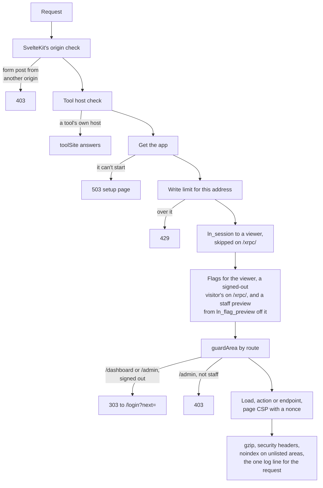

Source: [`src/hooks.server.ts`](../../src/hooks.server.ts), [`src/lib/server/http.ts`](../../src/lib/server/http.ts), [`src/lib/server/services/flags.ts`](../../src/lib/server/services/flags.ts), [`src/lib/server/compress.ts`](../../src/lib/server/compress.ts), [`src/lib/server/logger.ts`](../../src/lib/server/logger.ts), [`vite.config.ts`](../../vite.config.ts)

## Page loads and form actions

How a page gets its data, and how a form changes something. Layouts and the page load run alongside each other, unless a load awaits `parent()`, so the `handle` hook does the guarding.

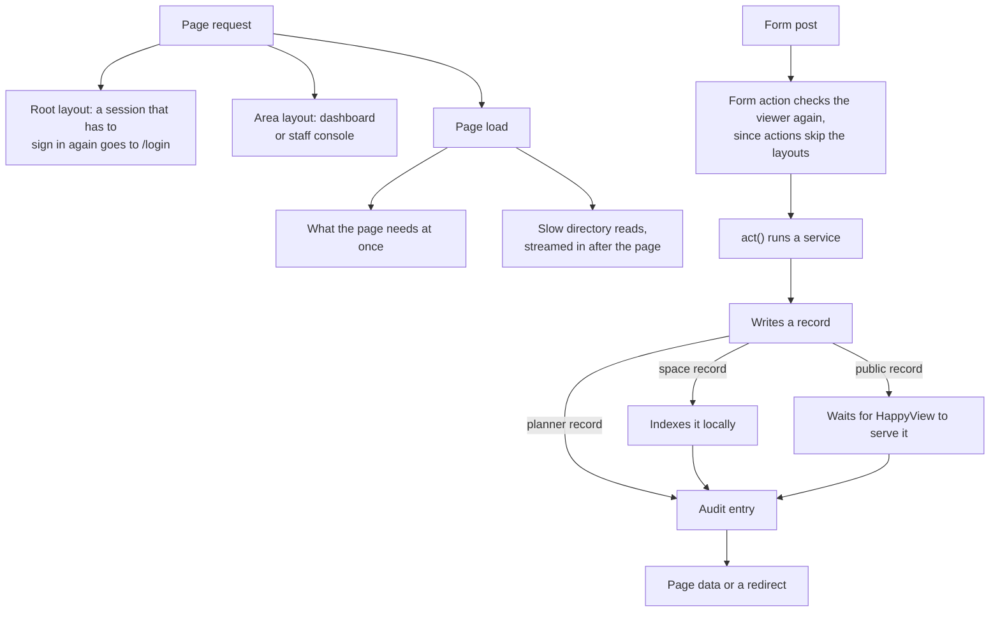

Source: [`src/routes/+layout.server.ts`](../../src/routes/+layout.server.ts), [`src/routes/dashboard/+layout.server.ts`](../../src/routes/dashboard/+layout.server.ts), [`src/lib/server/manage.ts`](../../src/lib/server/manage.ts), [`src/lib/server/http.ts`](../../src/lib/server/http.ts)

## Response caching

What each response lets a browser or a shared cache keep. Pages that show the same thing to everyone use `cacheBriefly`.

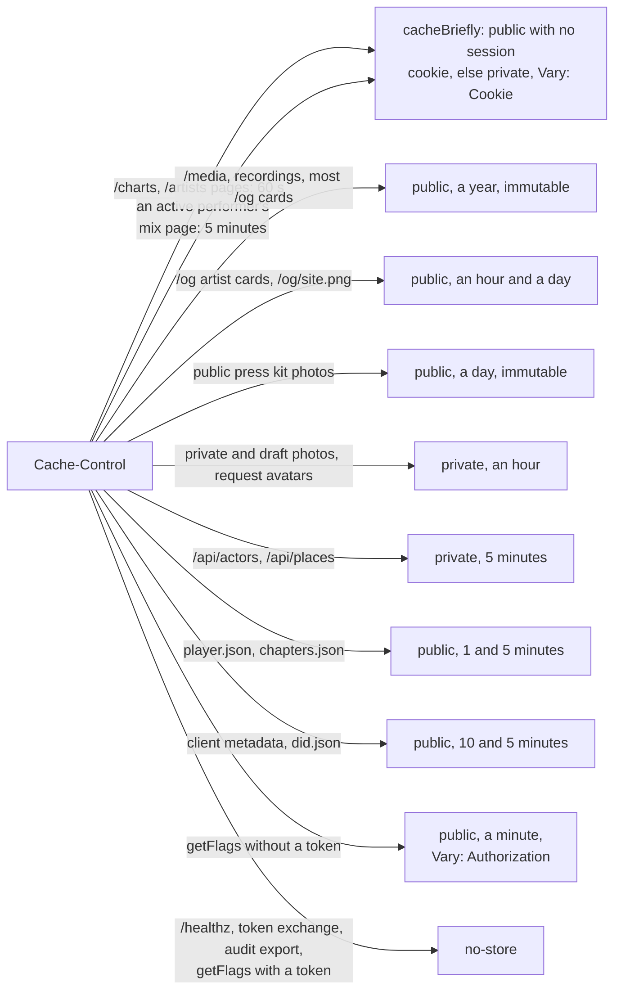

Source: [`src/lib/server/http.ts`](../../src/lib/server/http.ts), [`src/routes/charts/+page.server.ts`](../../src/routes/charts/+page.server.ts), [`src/routes/projects/[slug]/mixes/[n]/+page.server.ts`](../../src/routes/projects/[slug]/mixes/[n]/+page.server.ts), [`src/routes/media/[did]/[cid]/+server.ts`](../../src/routes/media/[did]/[cid]/+server.ts), [`src/lib/server/og/serve.ts`](../../src/lib/server/og/serve.ts), [`src/routes/projects/[slug]/press-kits/[rkey]/photos/[cid]/+server.ts`](../../src/routes/projects/[slug]/press-kits/[rkey]/photos/[cid]/+server.ts), [`src/routes/api/places/+server.ts`](../../src/routes/api/places/+server.ts), [`src/routes/sets/[did]/[rkey]/player.json/+server.ts`](../../src/routes/sets/[did]/[rkey]/player.json/+server.ts), [`src/lib/server/flags/get-flags.ts`](../../src/lib/server/flags/get-flags.ts)

## Error paths

What each kind of failure turns into.

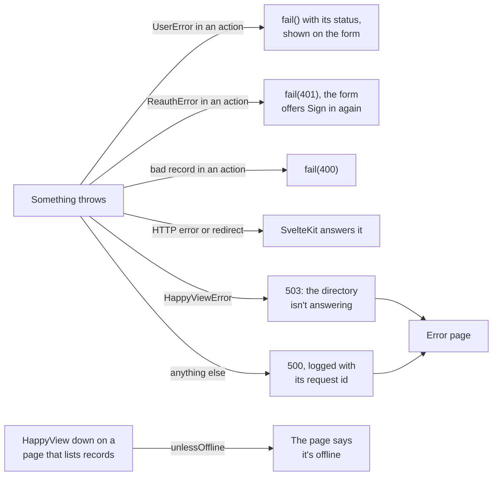

Source: [`src/hooks.server.ts`](../../src/hooks.server.ts), [`src/lib/server/http.ts`](../../src/lib/server/http.ts), [`src/lib/server/core.ts`](../../src/lib/server/core.ts), [`src/lib/server/happyview/offline.ts`](../../src/lib/server/happyview/offline.ts)

## Rate limits

Every token bucket the app sets. They're held in memory, so a restart resets them.

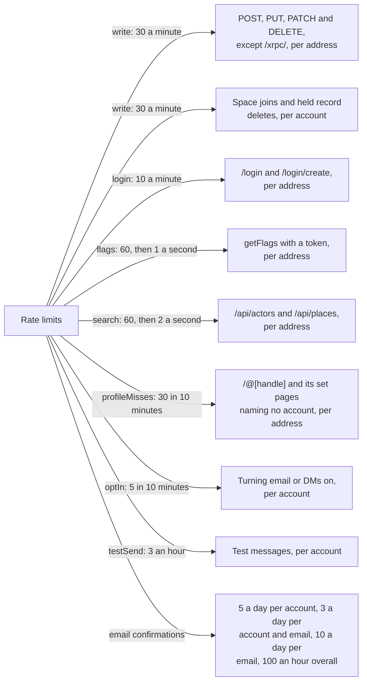

Source: [`src/lib/server/app.ts`](../../src/lib/server/app.ts), [`src/lib/server/rate-limit.ts`](../../src/lib/server/rate-limit.ts), [`src/lib/server/flags/get-flags.ts`](../../src/lib/server/flags/get-flags.ts), [`src/lib/server/profile-page.ts`](../../src/lib/server/profile-page.ts), [`src/lib/server/notifications/channels.ts`](../../src/lib/server/notifications/channels.ts)

## Route families

Who can reach each family of routes.

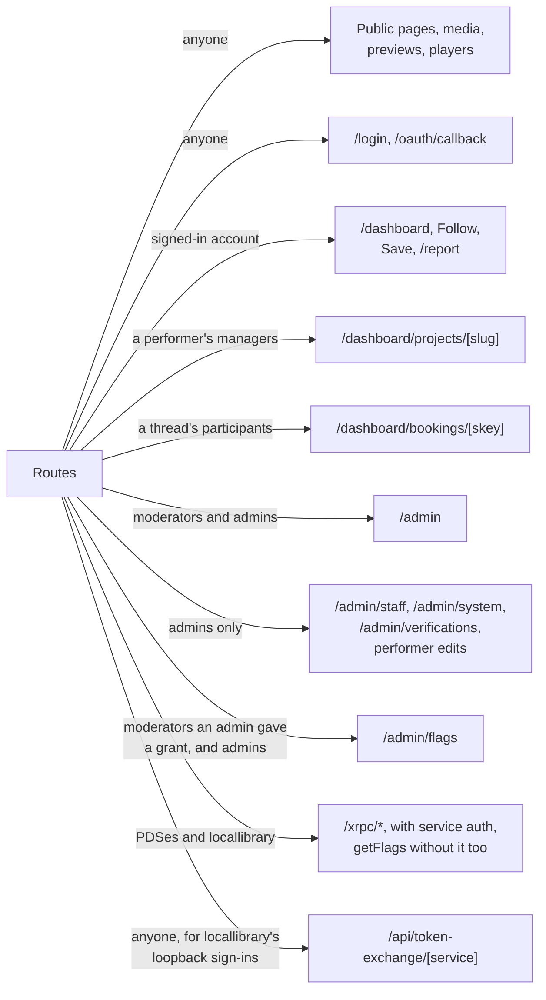

Source: [`src/lib/server/http.ts`](../../src/lib/server/http.ts), [`src/lib/server/manage.ts`](../../src/lib/server/manage.ts), [`src/lib/server/services/bookings.ts`](../../src/lib/server/services/bookings.ts), [`src/routes/admin/+layout.server.ts`](../../src/routes/admin/+layout.server.ts), [`src/lib/server/forms/flags.ts`](../../src/lib/server/forms/flags.ts), [`src/lib/server/flags/get-flags.ts`](../../src/lib/server/flags/get-flags.ts)

## Public pages

The pages anyone can read. A performer that isn't active shows only to its managers and staff; everyone else gets a 404.

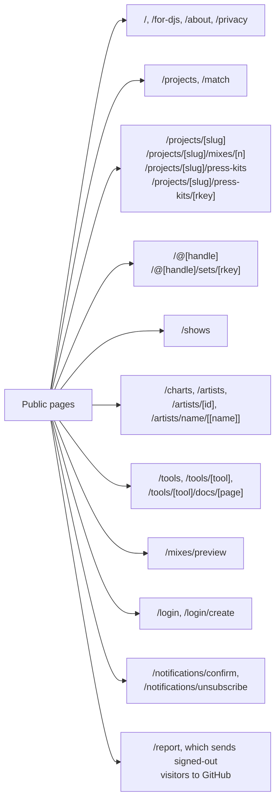

Source: [`src/routes/projects/[slug]/+page.server.ts`](../../src/routes/projects/[slug]/+page.server.ts), [`src/lib/server/project-page.ts`](../../src/lib/server/project-page.ts), [`src/routes/@[handle]/sets/[rkey]/+page.server.ts`](../../src/routes/@[handle]/sets/[rkey]/+page.server.ts), [`src/routes/report/+page.server.ts`](../../src/routes/report/+page.server.ts), [`src/lib/server/http.ts`](../../src/lib/server/http.ts)

## Dashboard routes

Everything under `/dashboard`. The server hook turns away anyone signed out; pages narrow it from there.

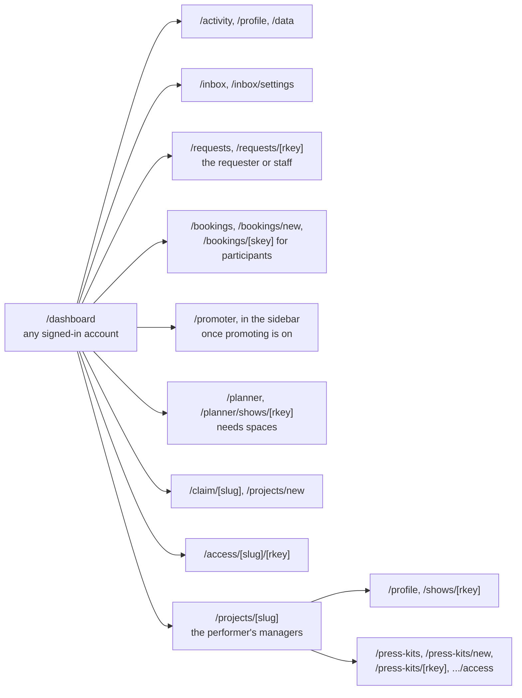

Source: [`src/routes/dashboard/+layout.server.ts`](../../src/routes/dashboard/+layout.server.ts), [`src/routes/dashboard/projects/[slug]/+layout.server.ts`](../../src/routes/dashboard/projects/[slug]/+layout.server.ts), [`src/routes/dashboard/requests/[rkey]/+page.server.ts`](../../src/routes/dashboard/requests/[rkey]/+page.server.ts), [`src/lib/server/planner-page.ts`](../../src/lib/server/planner-page.ts)

## Staff console routes

Everything under `/admin`, by the guard each page or action uses. Services that act for a viewer check the role again.

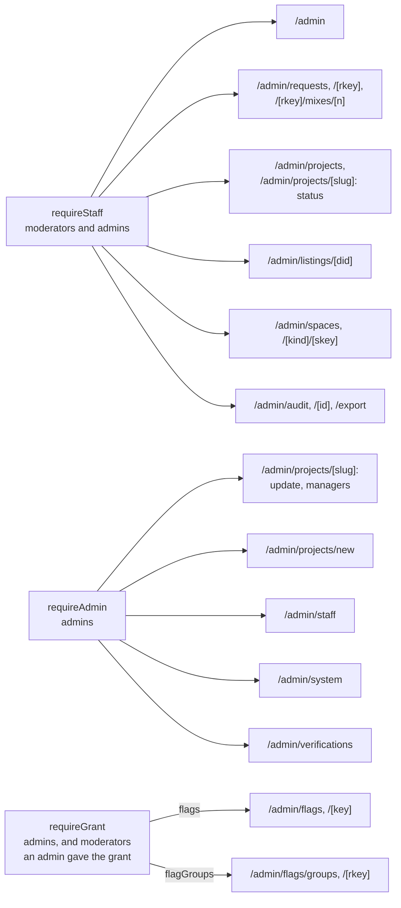

Source: [`src/routes/admin/+layout.server.ts`](../../src/routes/admin/+layout.server.ts), [`src/routes/admin/projects/[slug]/+page.server.ts`](../../src/routes/admin/projects/[slug]/+page.server.ts), [`src/routes/admin/system/+page.server.ts`](../../src/routes/admin/system/+page.server.ts), [`src/routes/admin/staff/+page.server.ts`](../../src/routes/admin/staff/+page.server.ts), [`src/routes/admin/verifications/+page.server.ts`](../../src/routes/admin/verifications/+page.server.ts), [`src/lib/server/forms/flags.ts`](../../src/lib/server/forms/flags.ts), [`src/routes/admin/flags/+page.server.ts`](../../src/routes/admin/flags/+page.server.ts), [`src/routes/admin/flags/groups/+page.server.ts`](../../src/routes/admin/flags/groups/+page.server.ts)

## Endpoints

Routes that answer data rather than a page. [Smaller pages and endpoints](#smaller-pages-and-endpoints) has the redirects and `/healthz`.

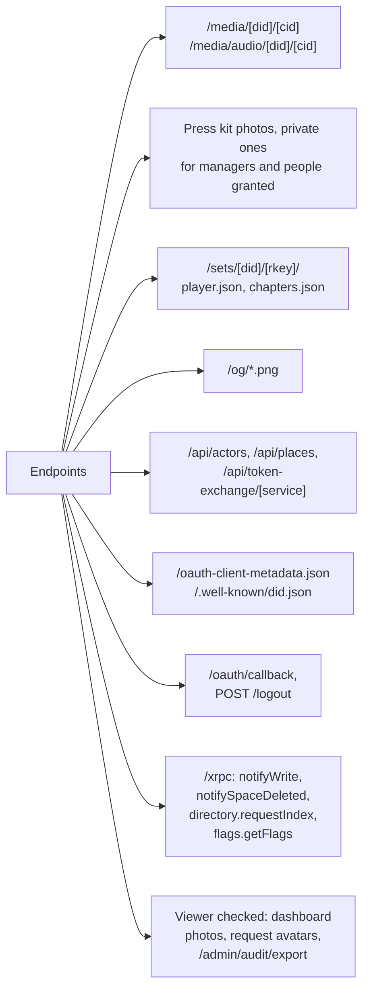

Source: [`src/routes/media/[did]/[cid]/+server.ts`](../../src/routes/media/[did]/[cid]/+server.ts), [`src/routes/media/audio/[did]/[cid]/+server.ts`](../../src/routes/media/audio/[did]/[cid]/+server.ts), [`src/routes/sets/[did]/[rkey]/player.json/+server.ts`](../../src/routes/sets/[did]/[rkey]/player.json/+server.ts), [`src/routes/og/site.png/+server.ts`](../../src/routes/og/site.png/+server.ts), [`src/routes/api/actors/+server.ts`](../../src/routes/api/actors/+server.ts), [`src/routes/xrpc/computer.localnetwork.flags.getFlags/+server.ts`](../../src/routes/xrpc/computer.localnetwork.flags.getFlags/+server.ts), [`src/routes/epk/[did]/[rkey]/+server.ts`](../../src/routes/epk/[did]/[rkey]/+server.ts), [`src/routes/healthz/+server.ts`](../../src/routes/healthz/+server.ts), [`src/routes/.well-known/did.json/+server.ts`](../../src/routes/.well-known/did.json/+server.ts)

## Smaller pages and endpoints

What the small routes do, beside the flows above.

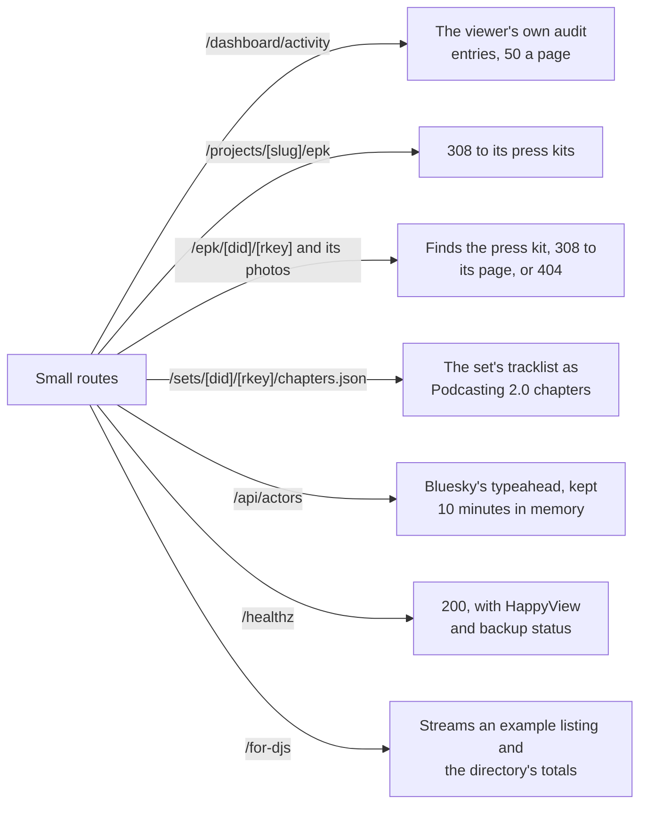

Source: [`src/routes/dashboard/activity/+page.server.ts`](../../src/routes/dashboard/activity/+page.server.ts), [`src/routes/projects/[slug]/epk/+server.ts`](../../src/routes/projects/[slug]/epk/+server.ts), [`src/lib/server/epk-page.ts`](../../src/lib/server/epk-page.ts), [`src/routes/sets/[did]/[rkey]/chapters.json/+server.ts`](../../src/routes/sets/[did]/[rkey]/chapters.json/+server.ts), [`src/lib/server/actor-search.ts`](../../src/lib/server/actor-search.ts), [`src/routes/healthz/+server.ts`](../../src/routes/healthz/+server.ts), [`src/routes/for-djs/+page.server.ts`](../../src/routes/for-djs/+page.server.ts)
