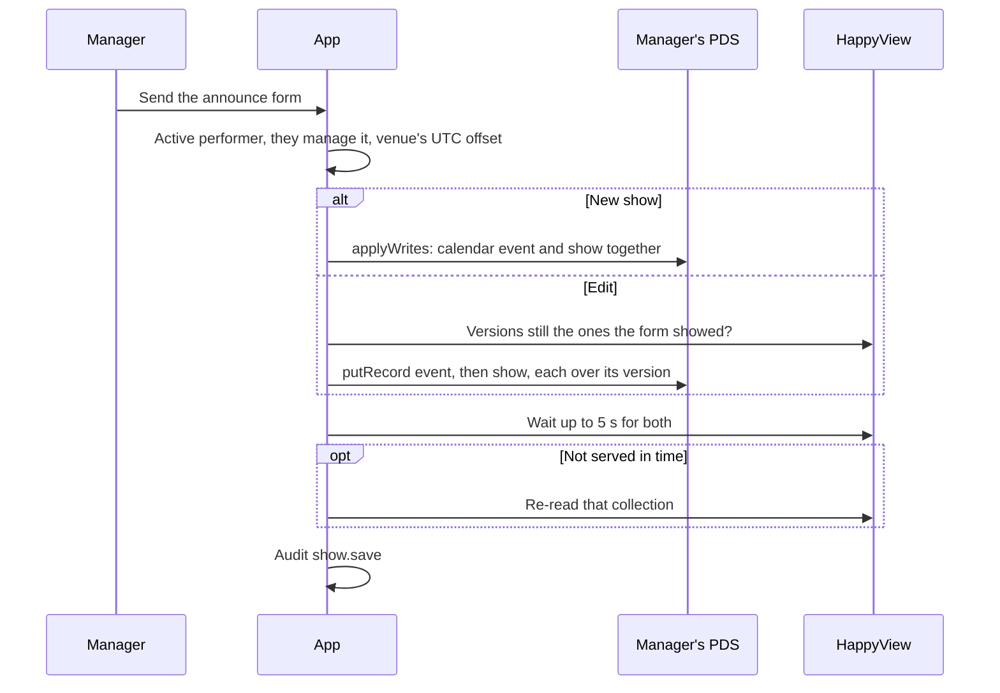
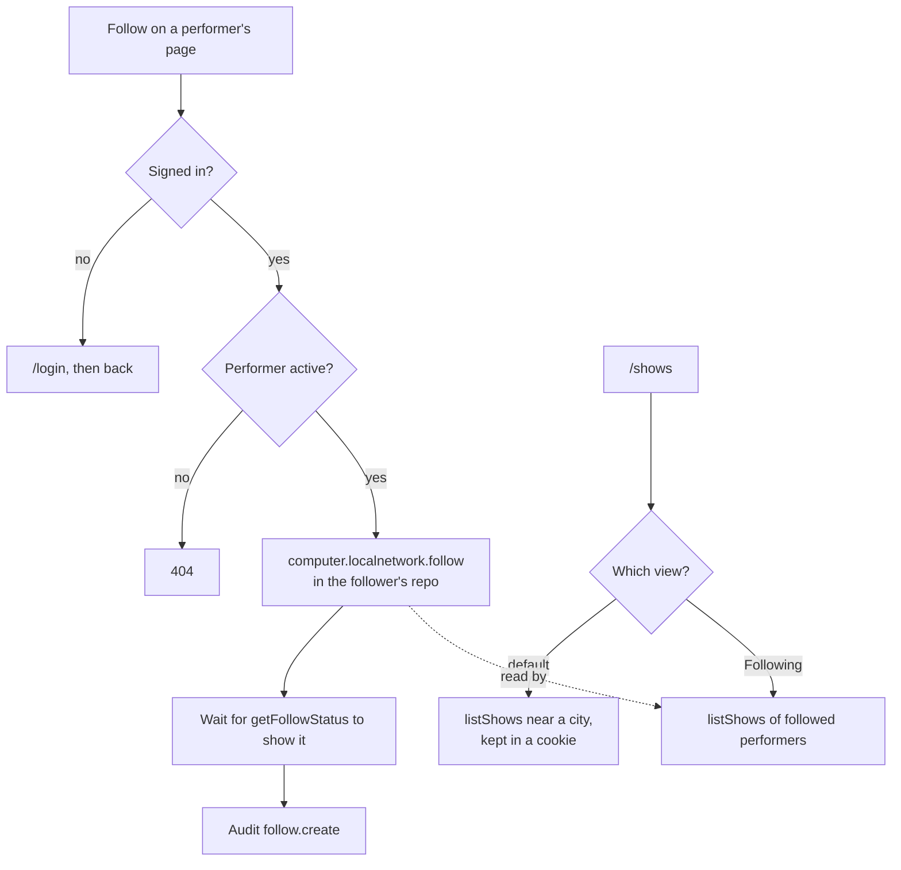
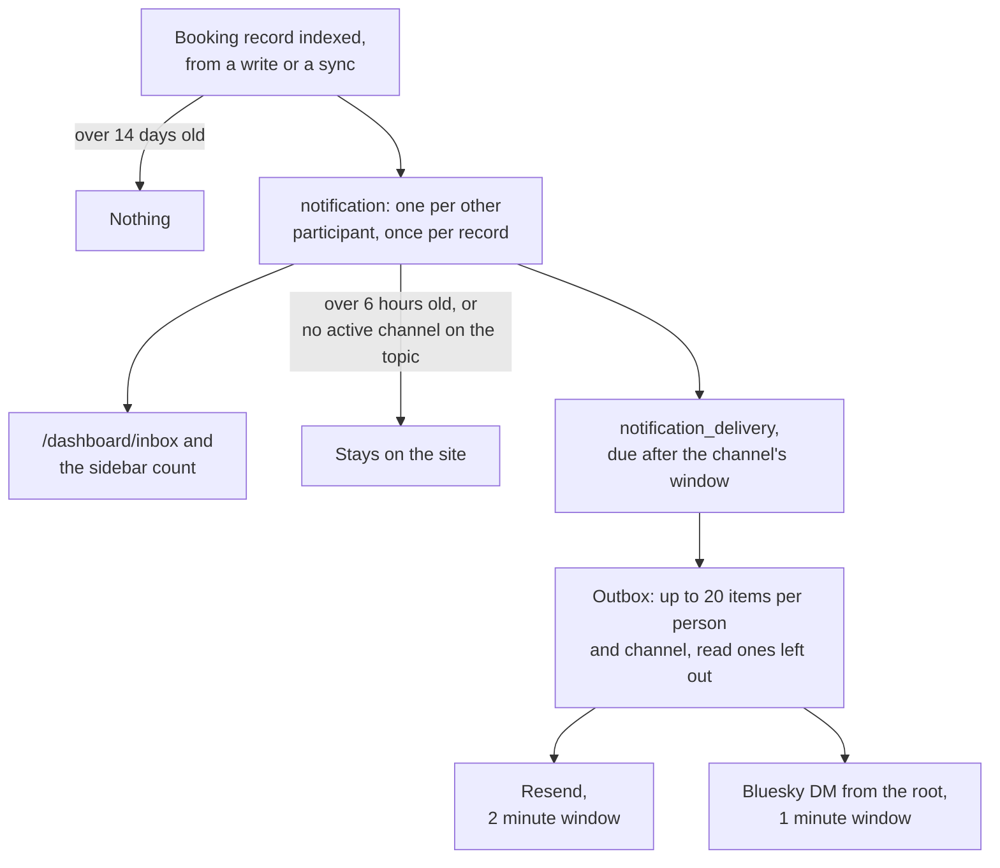
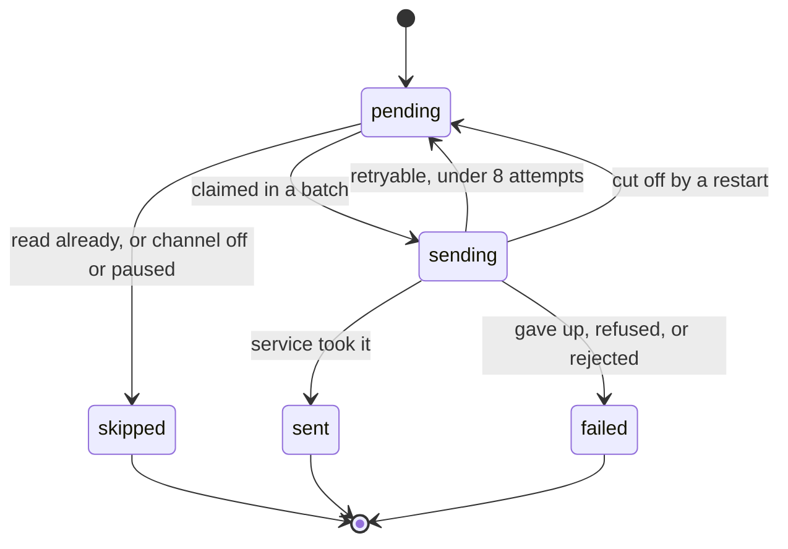
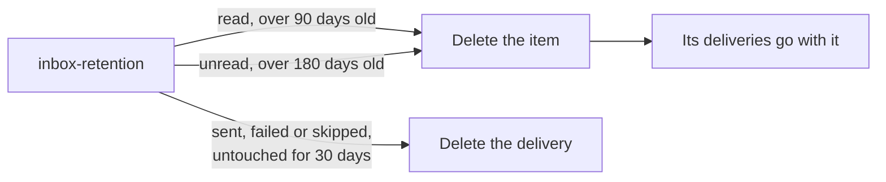
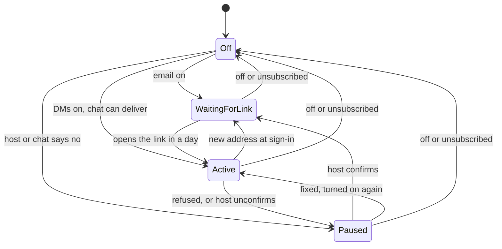

# The website diagrams: Shows and the inbox

Shows, follows, inbox delivery and channels. The rest are listed in the [README](../../README.md#diagrams).

- [Announcing a show](#announcing-a-show)
- [Follows and the shows list](#follows-and-the-shows-list)
- [Inbox delivery](#inbox-delivery)
- [Delivery lifecycle](#delivery-lifecycle)
- [Inbox and delivery retention](#inbox-and-delivery-retention)
- [Email and DM channels](#email-and-dm-channels)

## Announcing a show

A show is two records with the same key in the manager's own repo. A confirmed booking thread can prefill the form.

Source: [`src/lib/server/services/shows.ts`](../../src/lib/server/services/shows.ts), [`src/lib/server/forms/announce.ts`](../../src/lib/server/forms/announce.ts), [`src/routes/dashboard/projects/[slug]/shows/[rkey]/+page.server.ts`](../../src/routes/dashboard/projects/[slug]/shows/[rkey]/+page.server.ts), [`src/lib/server/venue-time.ts`](../../src/lib/server/venue-time.ts)

## Follows and the shows list

Following a performer, and what that does to `/shows`.

Source: [`src/lib/server/services/follows.ts`](../../src/lib/server/services/follows.ts), [`src/routes/projects/[slug]/+page.server.ts`](../../src/routes/projects/[slug]/+page.server.ts), [`src/routes/shows/+page.server.ts`](../../src/routes/shows/+page.server.ts), [`src/lib/server/shows-place.ts`](../../src/lib/server/shows-place.ts), [`lua/computer/localnetwork/directory/listShows.lua`](../../lua/computer/localnetwork/directory/listShows.lua)

## Inbox delivery

How a booking event reaches someone. Items and their deliveries are written in one transaction, and booking events are the only source so far.

Source: [`src/lib/server/notifications/notifier.ts`](../../src/lib/server/notifications/notifier.ts), [`src/lib/server/notifications/outbox.ts`](../../src/lib/server/notifications/outbox.ts), [`src/lib/server/notifications/email.ts`](../../src/lib/server/notifications/email.ts), [`src/lib/server/notifications/dm.ts`](../../src/lib/server/notifications/dm.ts), [`src/lib/server/notifications/kinds.ts`](../../src/lib/server/notifications/kinds.ts)

## Delivery lifecycle

One item on its way out by one channel. A batch keeps its items and key through every retry, so a service that dedupes on the key sends it once.

Source: [`src/lib/server/notifications/outbox.ts`](../../src/lib/server/notifications/outbox.ts), [`src/lib/server/db/schema.ts`](../../src/lib/server/db/schema.ts)

## Inbox and delivery retention

How long inbox items and deliveries last. The hourly `inbox-retention` job deletes them. An item's age counts from when it was made, and opening it or its thread marks it read.

Source: [`src/lib/server/notifications/notifier.ts`](../../src/lib/server/notifications/notifier.ts), [`src/lib/server/notifications/outbox.ts`](../../src/lib/server/notifications/outbox.ts), [`src/lib/server/db/migrations.ts`](../../src/lib/server/db/migrations.ts)

## Email and DM channels

One person's email or DM channel. No row means it's off, and turning either off deletes the row. Waiting for the link is `paused` with the reason `email_unverified`.

Source: [`src/lib/server/notifications/channels.ts`](../../src/lib/server/notifications/channels.ts), [`src/routes/dashboard/account/notifications/+page.server.ts`](../../src/routes/dashboard/account/notifications/+page.server.ts), [`src/routes/notifications/confirm/+page.server.ts`](../../src/routes/notifications/confirm/+page.server.ts), [`src/routes/notifications/unsubscribe/+page.server.ts`](../../src/routes/notifications/unsubscribe/+page.server.ts)
