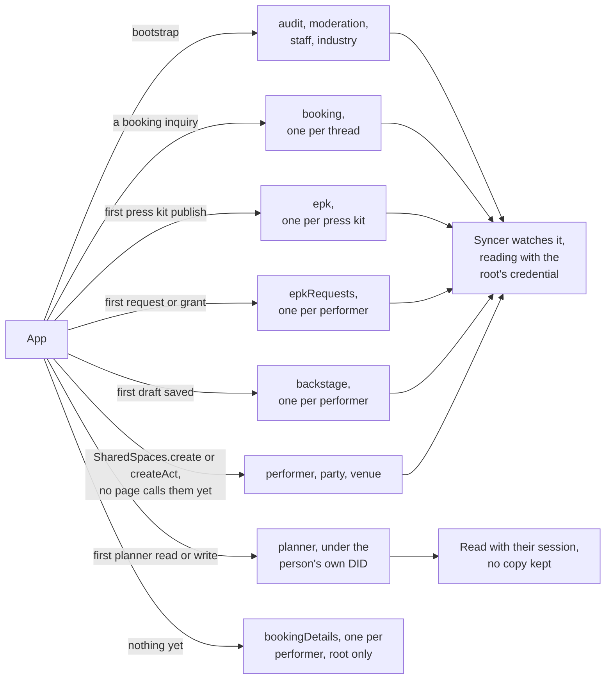
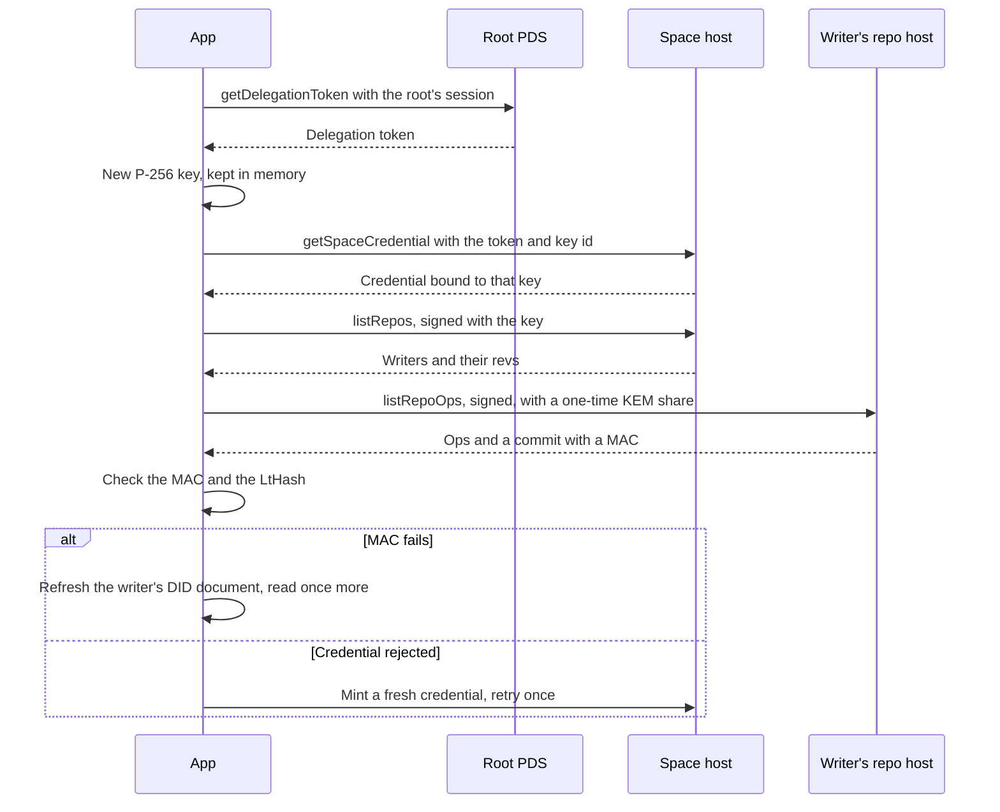
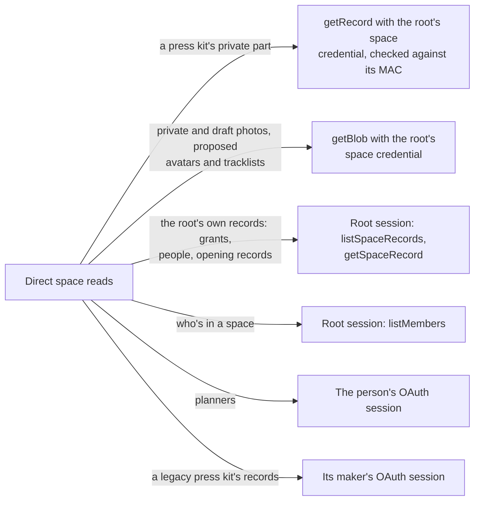
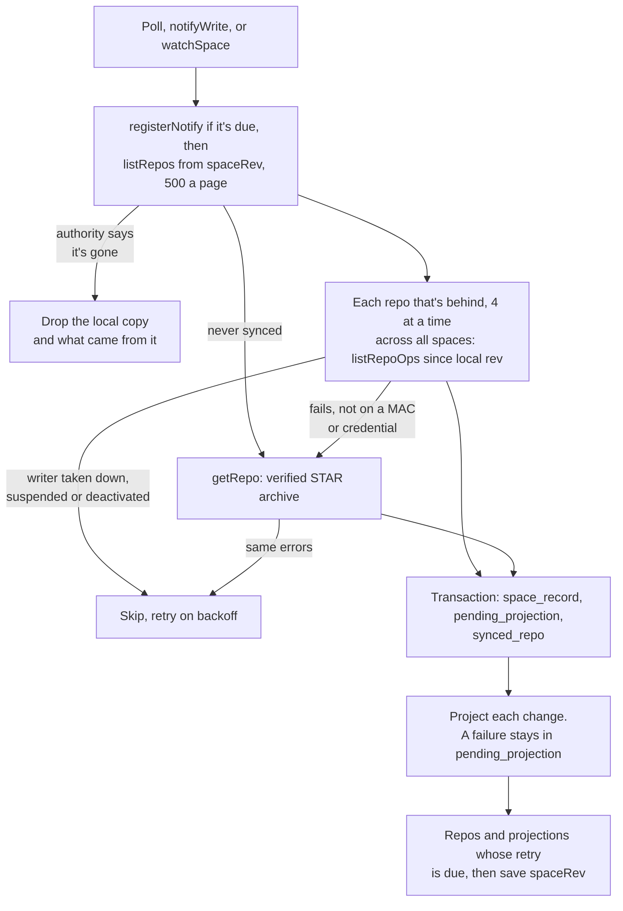
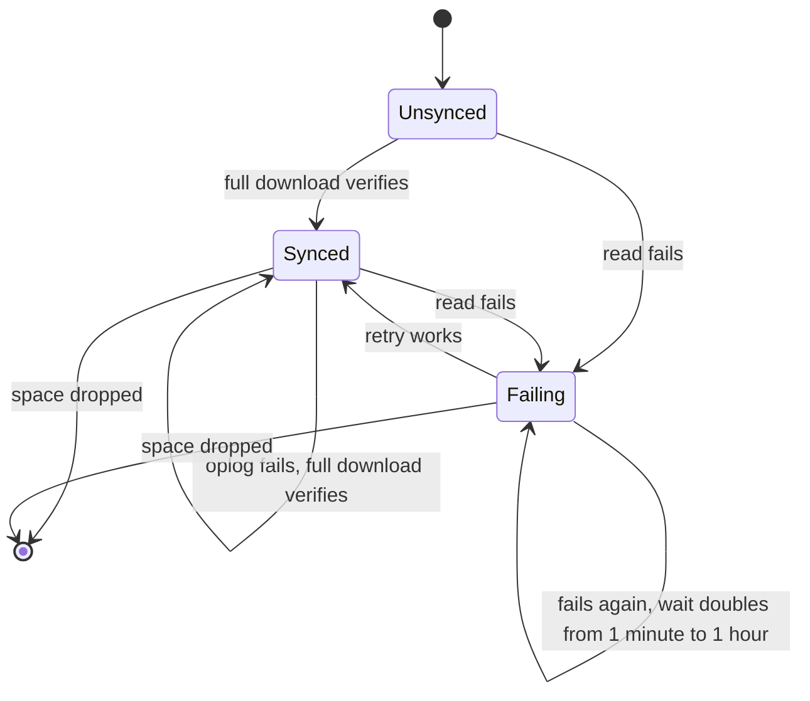
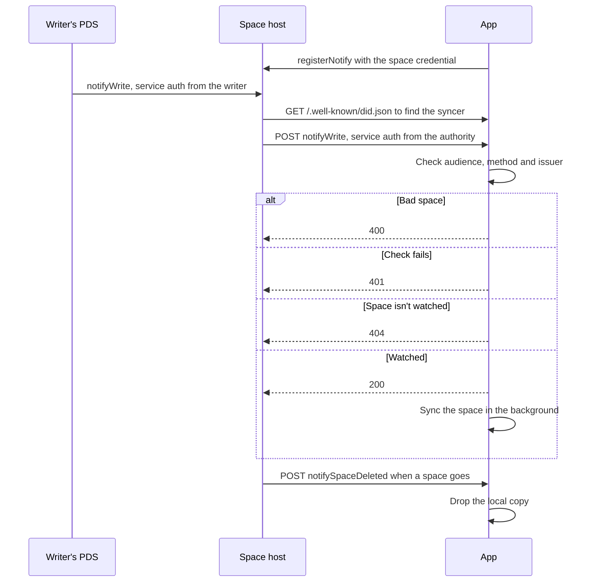
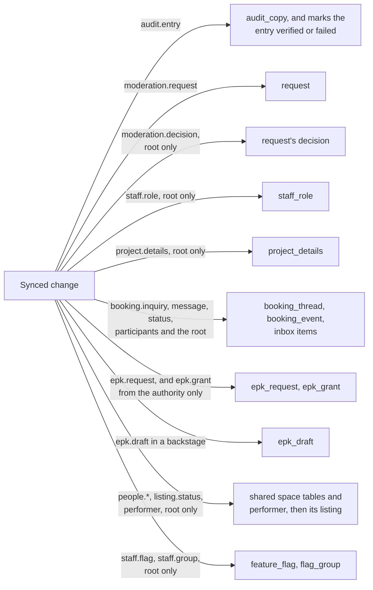
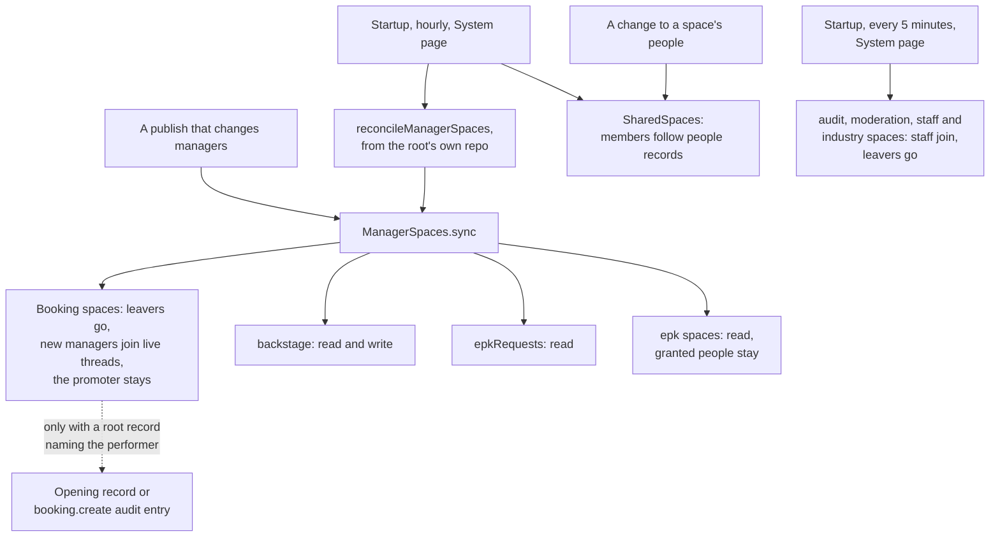

# The website diagrams: Spaces

Credentials, sync, notifications, projections and member lists. The rest are listed in the [README](../../README.md#diagrams).

- [Space types](#space-types)
- [Space credentials](#space-credentials)
- [Reads outside the sync](#reads-outside-the-sync)
- [Space sync pass](#space-sync-pass)
- [Repo sync lifecycle](#repo-sync-lifecycle)
- [Write notifications](#write-notifications)
- [Record projections](#record-projections)
- [Member list upkeep](#member-list-upkeep)

## Space types

Every kind of space, what creates it, and how the app reads it.

Source: [`src/lib/server/bootstrap.ts`](../../src/lib/server/bootstrap.ts), [`src/lib/server/atproto/spaces.ts`](../../src/lib/server/atproto/spaces.ts), [`src/lib/nsid.ts`](../../src/lib/nsid.ts), [`src/lib/server/services/space-members.ts`](../../src/lib/server/services/space-members.ts), [`src/lib/server/services/bookings.ts`](../../src/lib/server/services/bookings.ts), [`src/lib/server/services/planner.ts`](../../src/lib/server/services/planner.ts)

## Space credentials

How the app syncs a space. The root's session gets a delegation token, the space host trades it for a credential, and each repo host proves its answer with a MAC.

Source: [`src/lib/server/atproto/credentials.ts`](../../src/lib/server/atproto/credentials.ts), [`src/lib/server/sync/engine.ts`](../../src/lib/server/sync/engine.ts), [`src/lib/server/atproto/repo-client.ts`](../../src/lib/server/atproto/repo-client.ts)

## Reads outside the sync

What the app reads from a space directly, without going through the local copy.

Source: [`src/lib/server/app.ts`](../../src/lib/server/app.ts), [`src/lib/server/atproto/credentials.ts`](../../src/lib/server/atproto/credentials.ts), [`src/lib/server/services/epk.ts`](../../src/lib/server/services/epk.ts), [`src/lib/server/services/requests.ts`](../../src/lib/server/services/requests.ts), [`src/lib/server/services/manager-spaces.ts`](../../src/lib/server/services/manager-spaces.ts), [`src/lib/server/services/planner.ts`](../../src/lib/server/services/planner.ts), [`src/lib/server/services/epk-legacy.ts`](../../src/lib/server/services/epk-legacy.ts)

## Space sync pass

One pass over one space. A second request while it runs queues one more pass.

Source: [`src/lib/server/sync/engine.ts`](../../src/lib/server/sync/engine.ts)

## Repo sync lifecycle

One writer's repo in one space. A failure stays in `sync_repo_retry`, since `listRepos` won't list that repo again until it changes.

Source: [`src/lib/server/sync/engine.ts`](../../src/lib/server/sync/engine.ts), [`src/lib/server/db/schema.ts`](../../src/lib/server/db/schema.ts)

## Write notifications

How a write reaches the app without waiting for the poll, with `SYNC_NOTIFY` on. Without it, or if registering fails, writes wait for the poll.

Source: [`src/routes/xrpc/com.atproto.space.notifyWrite/+server.ts`](../../src/routes/xrpc/com.atproto.space.notifyWrite/+server.ts), [`src/routes/xrpc/com.atproto.space.notifySpaceDeleted/+server.ts`](../../src/routes/xrpc/com.atproto.space.notifySpaceDeleted/+server.ts), [`src/routes/.well-known/did.json/+server.ts`](../../src/routes/.well-known/did.json/+server.ts), [`src/lib/server/atproto/service-auth.ts`](../../src/lib/server/atproto/service-auth.ts)

## Record projections

Where each synced record lands. Every record is checked against its lexicon first, and an invalid one is skipped. A delete takes its row with it, except that a deleted open request reads as withdrawn and a deleted audit copy marks the entry failed.

Source: [`src/lib/server/sync/projections.ts`](../../src/lib/server/sync/projections.ts), [`src/lib/server/services/bookings.ts`](../../src/lib/server/services/bookings.ts), [`src/lib/server/services/epk.ts`](../../src/lib/server/services/epk.ts), [`src/lib/server/services/flags.ts`](../../src/lib/server/services/flags.ts)

## Member list upkeep

What keeps each space's member list right. Every run compares with the live list, so a run that failed part way is finished by the next.

Source: [`src/lib/server/services/manager-spaces.ts`](../../src/lib/server/services/manager-spaces.ts), [`src/lib/server/services/space-members.ts`](../../src/lib/server/services/space-members.ts), [`src/lib/server/services/shared-spaces.ts`](../../src/lib/server/services/shared-spaces.ts), [`src/lib/server/services/staff.ts`](../../src/lib/server/services/staff.ts)
