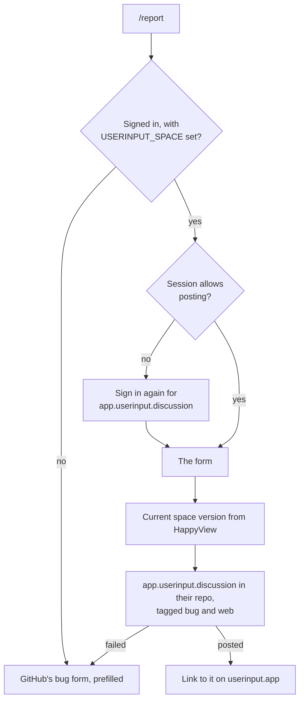
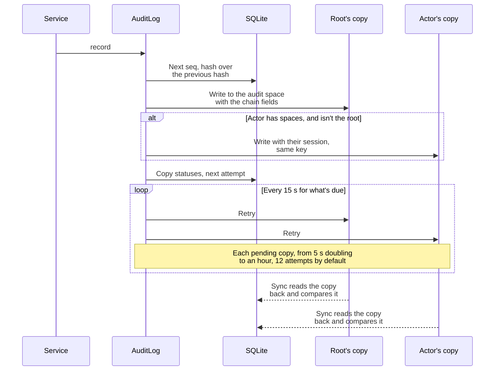
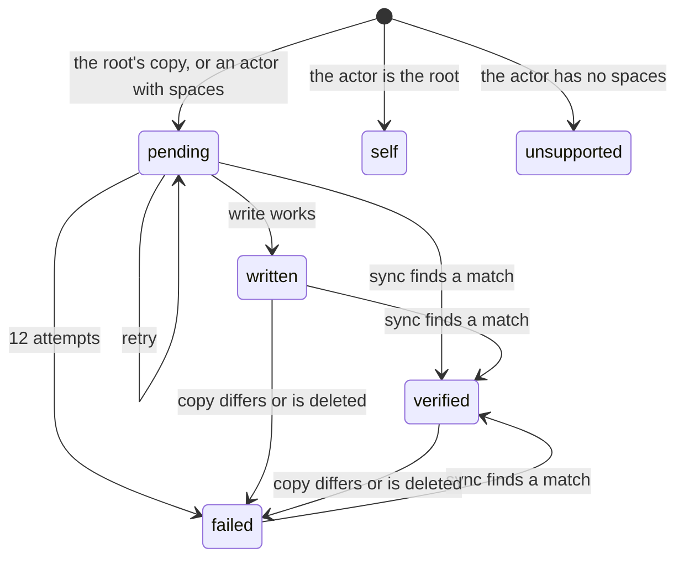
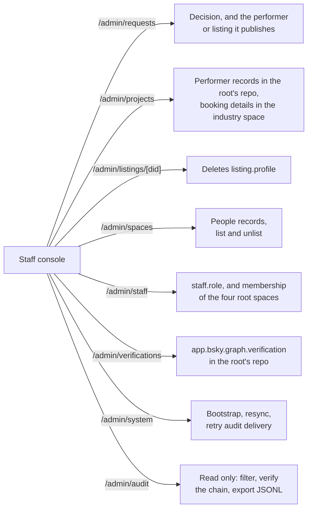
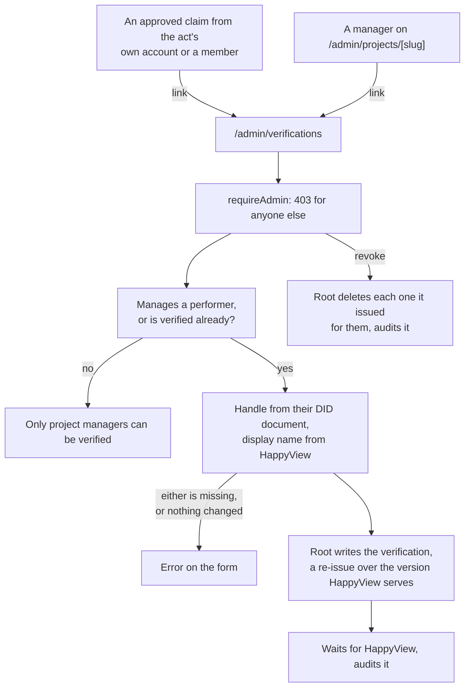
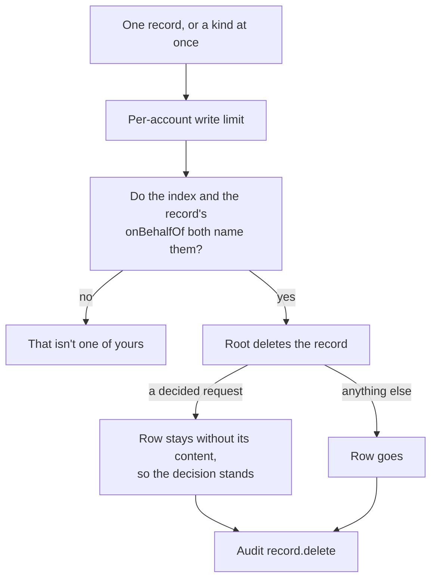
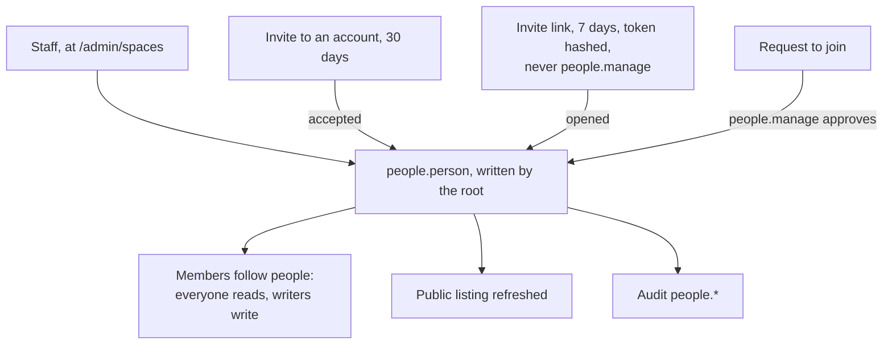
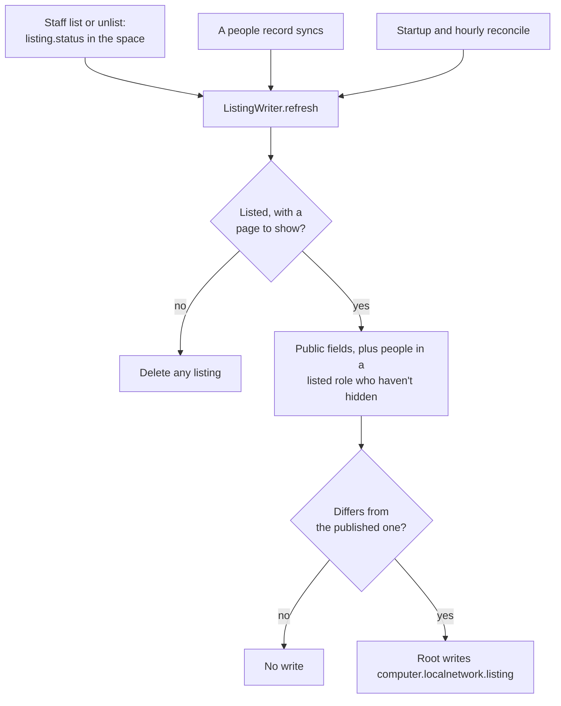
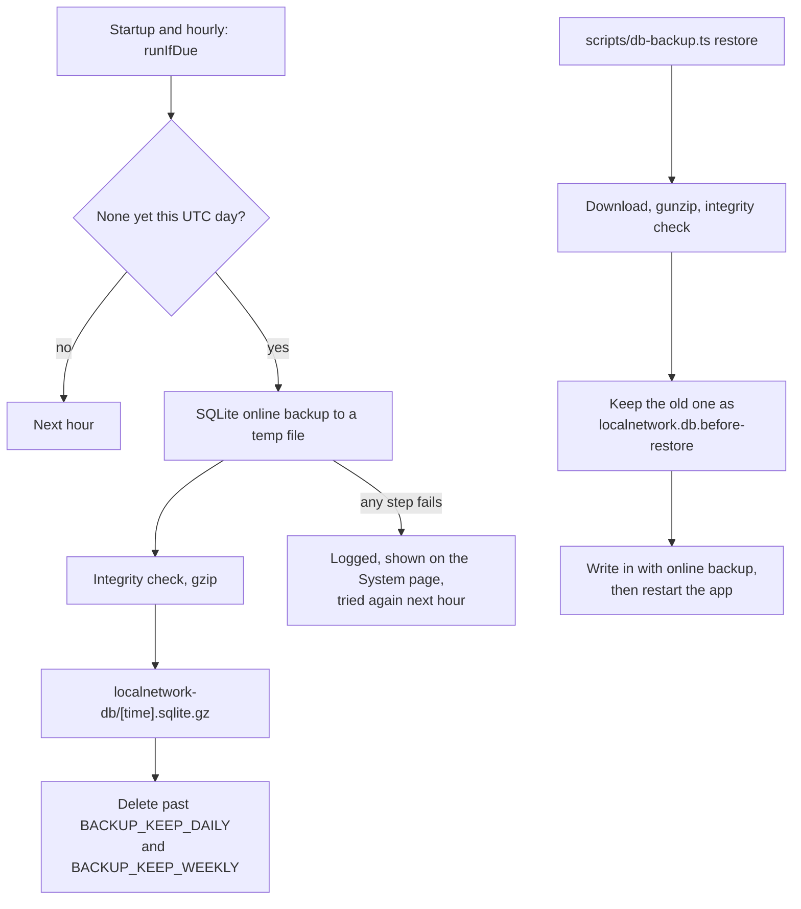
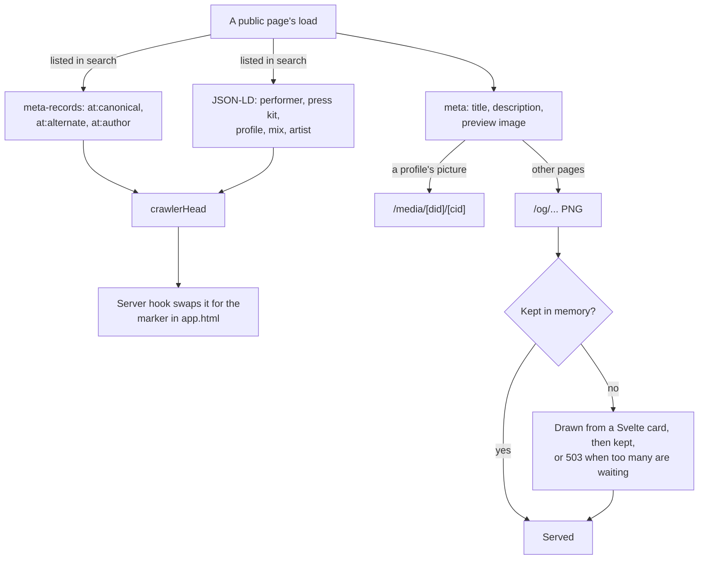

# The website diagrams: Staff and upkeep

Bug reports, the audit log, staff actions, listings and backups. The rest are listed in the [README](../../README.md#diagrams).

- [Bug report flow](#bug-report-flow)
- [Audit delivery](#audit-delivery)
- [Audit copy lifecycle](#audit-copy-lifecycle)
- [Staff actions](#staff-actions)
- [Bluesky verifications](#bluesky-verifications)
- [Records the root holds](#records-the-root-holds)
- [People in shared spaces](#people-in-shared-spaces)
- [Public listings](#public-listings)
- [Backup and restore](#backup-and-restore)
- [Link previews and page heads](#link-previews-and-page-heads)

## Bug report flow

Where "Report a bug" goes. A report that goes to userinput.app comes from the person's own account.

Source: [`src/routes/report/+page.server.ts`](../../src/routes/report/+page.server.ts), [`src/lib/server/services/bug-reports.ts`](../../src/lib/server/services/bug-reports.ts), [`src/lib/bug-report.ts`](../../src/lib/bug-report.ts)

## Audit delivery

How one action becomes a chained entry and two copies.

Source: [`src/lib/server/audit/log.ts`](../../src/lib/server/audit/log.ts), [`src/lib/server/audit/chain.ts`](../../src/lib/server/audit/chain.ts), [`src/lib/server/sync/projections.ts`](../../src/lib/server/sync/projections.ts)

## Audit copy lifecycle

The status of one copy of an entry. If the database is lost, entries come back from the root's copies: the root's copy as verified, the actor's as pending until sync finds it.

Source: [`src/lib/server/audit/log.ts`](../../src/lib/server/audit/log.ts), [`src/lib/server/db/schema.ts`](../../src/lib/server/db/schema.ts), [`src/lib/server/sync/projections.ts`](../../src/lib/server/sync/projections.ts)

## Staff actions

What each part of the staff console changes. Changes to records go in the audit log.

Source: [`src/routes/admin/+layout.server.ts`](../../src/routes/admin/+layout.server.ts), [`src/lib/server/services/staff.ts`](../../src/lib/server/services/staff.ts), [`src/lib/server/services/verifications.ts`](../../src/lib/server/services/verifications.ts), [`src/lib/server/services/project-admin.ts`](../../src/lib/server/services/project-admin.ts), [`src/lib/server/services/requests.ts`](../../src/lib/server/services/requests.ts)

## Bluesky verifications

How an admin verifies a manager's account from the root. Apps that trust the root show a badge while the handle and display name still match.

Source: [`src/lib/server/services/verifications.ts`](../../src/lib/server/services/verifications.ts), [`src/routes/admin/verifications/+page.server.ts`](../../src/routes/admin/verifications/+page.server.ts), [`src/routes/admin/requests/[rkey]/+page.server.ts`](../../src/routes/admin/requests/[rkey]/+page.server.ts), [`src/routes/admin/projects/[slug]/+page.server.ts`](../../src/routes/admin/projects/[slug]/+page.server.ts)

## Records the root holds

How someone deletes what the root wrote for them at `/dashboard/data`. Audit entries and booking status changes aren't offered.

Source: [`src/lib/server/services/held-records.ts`](../../src/lib/server/services/held-records.ts), [`src/routes/dashboard/data/+page.server.ts`](../../src/routes/dashboard/data/+page.server.ts)

## People in shared spaces

How people join a performer, party or venue space. `SpaceJoins` and the self-service parts of `SharedSpaces` exist without pages; today only the staff console adds, changes and removes people. No page starts a space yet either: `SharedSpaces.create`, which adds its first person, has no caller.

Source: [`src/lib/server/services/shared-spaces.ts`](../../src/lib/server/services/shared-spaces.ts), [`src/lib/server/services/space-joins.ts`](../../src/lib/server/services/space-joins.ts), [`src/routes/admin/spaces/[kind]/[skey]/+page.server.ts`](../../src/routes/admin/spaces/[kind]/[skey]/+page.server.ts)

## Public listings

How a listed act, party or venue would reach the directory. No kind has a public page yet, so nothing is listed.

Source: [`src/lib/server/services/listings.ts`](../../src/lib/server/services/listings.ts), [`src/lib/server/sync/projections.ts`](../../src/lib/server/sync/projections.ts), [`../../docs/adr/0003-profiles-in-repos-performers-in-spaces.md`](../../../../docs/adr/0003-profiles-in-repos-performers-in-spaces.md)

## Backup and restore

The database's daily backup and how it comes back. See [Backups](../../README.md#backups).

Source: [`src/lib/server/backup/backups.ts`](../../src/lib/server/backup/backups.ts), [`src/lib/server/backup/retention.ts`](../../src/lib/server/backup/retention.ts), [`scripts/db-backup.ts`](../../scripts/db-backup.ts)

## Link previews and page heads

What a public page tells crawlers and link previews.

Source: [`src/lib/server/meta.ts`](../../src/lib/server/meta.ts), [`src/lib/server/meta-records.ts`](../../src/lib/server/meta-records.ts), [`src/lib/server/structured-data.ts`](../../src/lib/server/structured-data.ts), [`src/lib/server/crawler-head.ts`](../../src/lib/server/crawler-head.ts), [`src/lib/server/og/serve.ts`](../../src/lib/server/og/serve.ts), [`src/hooks.server.ts`](../../src/hooks.server.ts)
