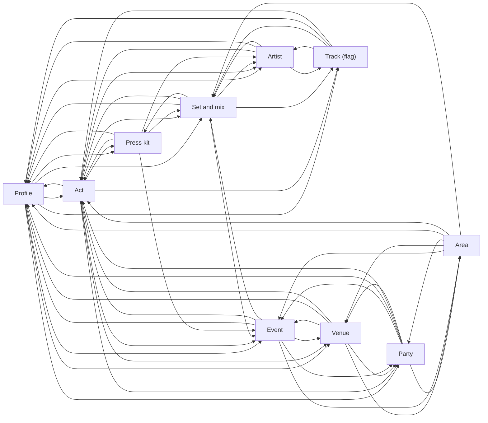
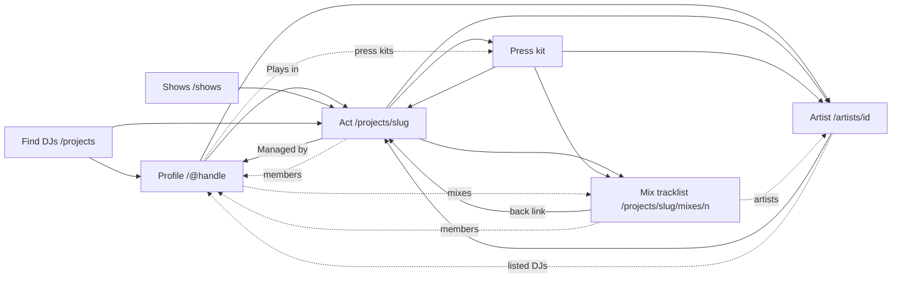

# Link matrix

Which public pages each kind of public page links to, whenever the data for the link exists. [ADR 0012](adr/0012-pages-follow-what-people-look-at-and-link-to-each-other.md) explains why, and the [glossary](../GLOSSARY.md) defines the page types. Each page type gets a test that fails when a page leaves out a link its table asks for and the data is there.

The status column says where main stands, read at [`fe5cadef`](https://github.com/cutenode/localnetwork/tree/fe5cadefac6a3ab54ab995e1e4786b1fd93fc598), and the source links are pinned there:

- **on main**: the link exists.
- **missing**: both pages exist and the link doesn't.
- **new page**: one end has no page yet, so the link comes with that page.

On main an act's page is still `/projects/<slug>`, from before acts, so its links are listed under Act. It moves to `/act/<slug>`.

- [Page types](#page-types)
- [Profile](#profile)
- [Act](#act)
- [Party](#party)
- [Venue](#venue)
- [Event](#event)
- [Set and mix](#set-and-mix)
- [Press kit](#press-kit)
- [Artist](#artist)
- [Track](#track)
- [Area](#area)
- [Search](#search)
- [Followers and Following](#followers-and-following)
- [Home](#home)
- [Diagrams](#diagrams)

## Page types

| Page type               | Path                                                                 | On main                                                                                                                                                                                                    |
| ----------------------- | -------------------------------------------------------------------- | ---------------------------------------------------------------------------------------------------------------------------------------------------------------------------------------------------------- |
| Profile                 | `/@<handle>`, tabs as `?tab=`                                        | yes, without tabs                                                                                                                                                                                          |
| Act                     | `/act/<slug>`                                                        | as `/projects/<slug>`                                                                                                                                                                                      |
| Party                   | `/party/<slug>`                                                      | no ([apps/web/README.md:37](https://github.com/cutenode/localnetwork/blob/fe5cadefac6a3ab54ab995e1e4786b1fd93fc598/apps/web/README.md#L37))                                                                |
| Venue                   | `/venue/<slug>`                                                      | no                                                                                                                                                                                                         |
| Event                   | `/party/<slug>/<event>`, or `/@<handle>/events/<rkey>` with no party | no: shows are rows in `/shows` and on act pages                                                                                                                                                            |
| Set (and mix)           | `/@<handle>/sets/<rkey>`; `/mixes` lists                             | no: sets are rows inside other pages; a mix's tracklist is `/projects/<slug>/mixes/<n>`                                                                                                                    |
| Press kit               | under its performer                                                  | `/projects/<slug>/press-kits/<rkey>`                                                                                                                                                                       |
| Artist                  | `/artists/<id>`                                                      | yes                                                                                                                                                                                                        |
| Track                   | not set yet, behind a flag                                           | no                                                                                                                                                                                                         |
| Area                    | `/events/<country>/<city>`                                           | no: `/shows` lists shows near a city                                                                                                                                                                       |
| Search                  | `/search?q=&type=`                                                   | no: Find DJs (`/projects`) searches acts and listed DJs                                                                                                                                                    |
| Followers and Following | on every profile, act, party and venue                               | no ([routes/shows/+page.svelte:16-17](https://github.com/cutenode/localnetwork/blob/fe5cadefac6a3ab54ab995e1e4786b1fd93fc598/apps/web/src/routes/shows/%2Bpage.svelte#L16-L17) is the only use of follows) |
| Home                    | `/`                                                                  | yes                                                                                                                                                                                                        |

Wherever a handle shows, it links to that profile. That's on main through `profileHref` ([lib/format.ts:37-39](https://github.com/cutenode/localnetwork/blob/fe5cadefac6a3ab54ab995e1e4786b1fd93fc598/apps/web/src/lib/format.ts#L37-L39), [lib/components/Handle.svelte:14](https://github.com/cutenode/localnetwork/blob/fe5cadefac6a3ab54ab995e1e4786b1fd93fc598/apps/web/src/lib/components/Handle.svelte#L14)), so the tables below leave it out.

## Profile

| Links to                                    | When                          | On main  | Source                                                                                                                                                                                                                                 |
| ------------------------------------------- | ----------------------------- | -------- | -------------------------------------------------------------------------------------------------------------------------------------------------------------------------------------------------------------------------------------- |
| Acts they play in or manage                 | they're in one and not hidden | on main  | "Plays in" [routes/@\[handle\]/+page.svelte:134-137](https://github.com/cutenode/localnetwork/blob/fe5cadefac6a3ab54ab995e1e4786b1fd93fc598/apps/web/src/routes/%40%5Bhandle%5D/%2Bpage.svelte#L134-L137)                              |
| Parties they host and venues they work with | they have one                 | new page |                                                                                                                                                                                                                                        |
| Their sets                                  | they published sets           | new page | sets render inline, with no page                                                                                                                                                                                                       |
| Their mixes                                 | they have mixes               | missing  | no `tracklistHref` on profile mixes [routes/@\[handle\]/+page.svelte:70](https://github.com/cutenode/localnetwork/blob/fe5cadefac6a3ab54ab995e1e4786b1fd93fc598/apps/web/src/routes/%40%5Bhandle%5D/%2Bpage.svelte#L70)                |
| Events they're on the lineup for            | they have credits             | new page | no shows section on profiles                                                                                                                                                                                                           |
| Events they went to ("Went to")             | they didn't turn it off       | new page |                                                                                                                                                                                                                                        |
| Their press kits                            | they're a DJ with press kits  | missing  | a listed DJ has no press kits                                                                                                                                                                                                          |
| Artists in their sets                       | they published sets           | on main  | [lib/components/DjSets.svelte:125](https://github.com/cutenode/localnetwork/blob/fe5cadefac6a3ab54ab995e1e4786b1fd93fc598/apps/web/src/lib/components/DjSets.svelte#L125)                                                              |
| Tracks in their sets                        | the tracks flag is on         | new page |                                                                                                                                                                                                                                        |
| Followers and Following                     | always                        | new page |                                                                                                                                                                                                                                        |
| Send an inquiry                             | they're a DJ                  | missing  | the form needs `?project=` [routes/dashboard/bookings/new/+page.server.ts:28](https://github.com/cutenode/localnetwork/blob/fe5cadefac6a3ab54ab995e1e4786b1fd93fc598/apps/web/src/routes/dashboard/bookings/new/%2Bpage.server.ts#L28) |
| locallibrary                                | they're a DJ                  | missing  |                                                                                                                                                                                                                                        |

## Act

| Links to                      | When                      | On main  | Source                                                                                                                                                                                                                                                       |
| ----------------------------- | ------------------------- | -------- | ------------------------------------------------------------------------------------------------------------------------------------------------------------------------------------------------------------------------------------------------------------ |
| Members' profiles             | members who aren't hidden | missing  | "How they play" prints `@handle` as plain text [routes/projects/\[slug\]/+page.svelte:139](https://github.com/cutenode/localnetwork/blob/fe5cadefac6a3ab54ab995e1e4786b1fd93fc598/apps/web/src/routes/projects/%5Bslug%5D/%2Bpage.svelte#L139)               |
| Managers' profiles            | it has managers           | on main  | "Managed by" [routes/projects/\[slug\]/+page.svelte:186](https://github.com/cutenode/localnetwork/blob/fe5cadefac6a3ab54ab995e1e4786b1fd93fc598/apps/web/src/routes/projects/%5Bslug%5D/%2Bpage.svelte#L186)                                                 |
| Its press kits                | it has press kits         | on main  | [routes/projects/\[slug\]/+page.svelte:80](https://github.com/cutenode/localnetwork/blob/fe5cadefac6a3ab54ab995e1e4786b1fd93fc598/apps/web/src/routes/projects/%5Bslug%5D/%2Bpage.svelte#L80)                                                                |
| Its mixes                     | it has mixes              | on main  | only those with a tracklist, to `/projects/<slug>/mixes/<n>` [routes/projects/\[slug\]/+page.svelte:124](https://github.com/cutenode/localnetwork/blob/fe5cadefac6a3ab54ab995e1e4786b1fd93fc598/apps/web/src/routes/projects/%5Bslug%5D/%2Bpage.svelte#L124) |
| Its sets                      | members published sets    | new page | sets render inline                                                                                                                                                                                                                                           |
| Events it's on the lineup for | it has credits            | new page | shows render inline [routes/projects/\[slug\]/+page.svelte:113-119](https://github.com/cutenode/localnetwork/blob/fe5cadefac6a3ab54ab995e1e4786b1fd93fc598/apps/web/src/routes/projects/%5Bslug%5D/%2Bpage.svelte#L113-L119)                                 |
| Parties and venues it played  | its events name them      | new page |                                                                                                                                                                                                                                                              |
| Artists in its sets           | members published sets    | on main  | [lib/components/DjSets.svelte:125](https://github.com/cutenode/localnetwork/blob/fe5cadefac6a3ab54ab995e1e4786b1fd93fc598/apps/web/src/lib/components/DjSets.svelte#L125)                                                                                    |
| Tracks in its sets            | the tracks flag is on     | new page |                                                                                                                                                                                                                                                              |
| Followers and Following       | always                    | new page |                                                                                                                                                                                                                                                              |
| Send an inquiry               | always                    | on main  | signed in only [routes/projects/\[slug\]/+page.svelte:70](https://github.com/cutenode/localnetwork/blob/fe5cadefac6a3ab54ab995e1e4786b1fd93fc598/apps/web/src/routes/projects/%5Bslug%5D/%2Bpage.svelte#L70)                                                 |
| locallibrary                  | members published stats   | missing  | "From locallibrary" is unlinked text [lib/components/DjStats.svelte:177](https://github.com/cutenode/localnetwork/blob/fe5cadefac6a3ab54ab995e1e4786b1fd93fc598/apps/web/src/lib/components/DjStats.svelte#L177)                                             |

## Party

| Links to                               | When                    | On main  |
| -------------------------------------- | ----------------------- | -------- |
| Its events, upcoming and past          | it has events           | new page |
| Hosts' and cohosts' profiles           | they aren't hidden      | new page |
| Venues it runs nights at               | its events name them    | new page |
| Performers who played it               | its events have lineups | new page |
| Community photos' submitters' profiles | a photo was approved    | new page |
| Its area                               | its events have a venue | new page |
| Followers and Following                | always                  | new page |

## Venue

| Links to                               | When                    | On main  |
| -------------------------------------- | ----------------------- | -------- |
| Its events, upcoming and past          | it has events           | new page |
| Parties that run nights there          | its events name a party | new page |
| Performers who played there            | its events have lineups | new page |
| Community photos' submitters' profiles | a photo was approved    | new page |
| Its area                               | always                  | new page |
| Followers and Following                | always                  | new page |

## Event

In the event page's order. Show rows on main link to the act and its tickets, and nothing else.

| Links to                                     | When                                      | On main  | Source                                                                                                                                                                                           |
| -------------------------------------------- | ----------------------------------------- | -------- | ------------------------------------------------------------------------------------------------------------------------------------------------------------------------------------------------ |
| Venue                                        | always                                    | new page |                                                                                                                                                                                                  |
| Party                                        | it belongs to one                         | new page |                                                                                                                                                                                                  |
| Profiles of your network going or interested | signed in, and they didn't hide it        | new page |                                                                                                                                                                                                  |
| Each performer on the lineup                 | always                                    | on main  | one act per show row [lib/components/ShowList.svelte:79](https://github.com/cutenode/localnetwork/blob/fe5cadefac6a3ab54ab995e1e4786b1fd93fc598/apps/web/src/lib/components/ShowList.svelte#L79) |
| A mix by each performer                      | the performer has one                     | new page |                                                                                                                                                                                                  |
| The venue's other events                     | it has others                             | new page |                                                                                                                                                                                                  |
| Community photos' submitters' profiles       | a photo was approved                      | new page |                                                                                                                                                                                                  |
| Sets played there                            | after the night, when sets were published | new page |                                                                                                                                                                                                  |
| Ticket sites                                 | it has a ticket link                      | on main  | [lib/components/ShowList.svelte:88](https://github.com/cutenode/localnetwork/blob/fe5cadefac6a3ab54ab995e1e4786b1fd93fc598/apps/web/src/lib/components/ShowList.svelte#L88)                      |
| Its area                                     | always                                    | new page |                                                                                                                                                                                                  |

## Set and mix

A mix is a set's page with the player. On main the closest page is a mix's tracklist report, `/projects/<slug>/mixes/<n>`.

| Links to                            | When                         | On main  | Source                                                                                                                                                                                                                                                                                                                                                                                                          |
| ----------------------------------- | ---------------------------- | -------- | --------------------------------------------------------------------------------------------------------------------------------------------------------------------------------------------------------------------------------------------------------------------------------------------------------------------------------------------------------------------------------------------------------------- |
| Credited performers                 | always                       | on main  | back to the act [routes/projects/\[slug\]/mixes/\[n\]/+page.svelte:18](https://github.com/cutenode/localnetwork/blob/fe5cadefac6a3ab54ab995e1e4786b1fd93fc598/apps/web/src/routes/projects/%5Bslug%5D/mixes/%5Bn%5D/%2Bpage.svelte#L18); missing to members' profiles                                                                                                                                           |
| The set itself, from a mix          | the mix links a set          | missing  | "Set:" goes to an `at://` URI a browser can't open [lib/components/LinkedSet.svelte:17](https://github.com/cutenode/localnetwork/blob/fe5cadefac6a3ab54ab995e1e4786b1fd93fc598/apps/web/src/lib/components/LinkedSet.svelte#L17), [lib/components/LinkedSet.svelte:23](https://github.com/cutenode/localnetwork/blob/fe5cadefac6a3ab54ab995e1e4786b1fd93fc598/apps/web/src/lib/components/LinkedSet.svelte#L23) |
| The show and event it was played at | it was played at an event    | new page |                                                                                                                                                                                                                                                                                                                                                                                                                 |
| Each tracklist row's artist         | the row names one            | missing  | on the tracklist page; inline set rows link them [lib/components/supports/ArtistLinks.svelte:9](https://github.com/cutenode/localnetwork/blob/fe5cadefac6a3ab54ab995e1e4786b1fd93fc598/apps/web/src/lib/components/supports/ArtistLinks.svelte#L9)                                                                                                                                                              |
| Each tracklist row's track          | the tracks flag is on        | new page |                                                                                                                                                                                                                                                                                                                                                                                                                 |
| Press kits                          | the performer has press kits | missing  |                                                                                                                                                                                                                                                                                                                                                                                                                 |

## Press kit

| Links to                         | When                   | On main  | Source                                                                                                                                                                                                                                    |
| -------------------------------- | ---------------------- | -------- | ----------------------------------------------------------------------------------------------------------------------------------------------------------------------------------------------------------------------------------------- |
| Its performer                    | always                 | on main  | [routes/projects/\[slug\]/press-kits/\[rkey\]/+page.svelte:56](https://github.com/cutenode/localnetwork/blob/fe5cadefac6a3ab54ab995e1e4786b1fd93fc598/apps/web/src/routes/projects/%5Bslug%5D/press-kits/%5Brkey%5D/%2Bpage.svelte#L56)   |
| Its mixes                        | it has mixes           | on main  | [lib/components/epk/EpkMixes.svelte:27](https://github.com/cutenode/localnetwork/blob/fe5cadefac6a3ab54ab995e1e4786b1fd93fc598/apps/web/src/lib/components/epk/EpkMixes.svelte#L27)                                                       |
| Sets                             | the performer has sets | new page |                                                                                                                                                                                                                                           |
| Events on the performer's lineup | it has credits         | new page |                                                                                                                                                                                                                                           |
| Artists in its sets              | it shows sets          | on main  | [lib/components/supports/ArtistLinks.svelte:9](https://github.com/cutenode/localnetwork/blob/fe5cadefac6a3ab54ab995e1e4786b1fd93fc598/apps/web/src/lib/components/supports/ArtistLinks.svelte#L9)                                         |
| Send an inquiry                  | always                 | on main  | [routes/projects/\[slug\]/press-kits/\[rkey\]/+page.svelte:156](https://github.com/cutenode/localnetwork/blob/fe5cadefac6a3ab54ab995e1e4786b1fd93fc598/apps/web/src/routes/projects/%5Bslug%5D/press-kits/%5Brkey%5D/%2Bpage.svelte#L156) |

## Artist

| Links to                           | When                  | On main  | Source                                                                                                                                                                                                  |
| ---------------------------------- | --------------------- | -------- | ------------------------------------------------------------------------------------------------------------------------------------------------------------------------------------------------------- |
| Acts who played their tracks       | always                | on main  | [lib/components/supports/ArtistSupport.svelte:30](https://github.com/cutenode/localnetwork/blob/fe5cadefac6a3ab54ab995e1e4786b1fd93fc598/apps/web/src/lib/components/supports/ArtistSupport.svelte#L30) |
| Listed DJs who played their tracks | always                | missing  |                                                                                                                                                                                                         |
| The sets each play is in           | always                | new page |                                                                                                                                                                                                         |
| Their tracks                       | the tracks flag is on | new page |                                                                                                                                                                                                         |

## Track

Behind a flag until the dataset is public.

| Links to                   | When   | On main  |
| -------------------------- | ------ | -------- |
| Its artists                | always | new page |
| Sets that played it        | always | new page |
| DJs and acts who played it | always | new page |

## Area

| Links to                 | When             | On main  | Source                                                                                                                                                                                                         |
| ------------------------ | ---------------- | -------- | -------------------------------------------------------------------------------------------------------------------------------------------------------------------------------------------------------------- |
| Its events               | always           | new page | `/shows` rows link the act instead [lib/components/ShowList.svelte:79](https://github.com/cutenode/localnetwork/blob/fe5cadefac6a3ab54ab995e1e4786b1fd93fc598/apps/web/src/lib/components/ShowList.svelte#L79) |
| Its venues and parties   | they have events | new page |                                                                                                                                                                                                                |
| DJs and mixes from there | always           | new page |                                                                                                                                                                                                                |

## Search

One tab per kind. Each result links its page.

| Links to                             | On main  | Source                                                                                                                                                                                                                                                                                                              |
| ------------------------------------ | -------- | ------------------------------------------------------------------------------------------------------------------------------------------------------------------------------------------------------------------------------------------------------------------------------------------------------------------- |
| Acts and listed DJs                  | on main  | Find DJs cards [lib/performers.ts:24](https://github.com/cutenode/localnetwork/blob/fe5cadefac6a3ab54ab995e1e4786b1fd93fc598/apps/web/src/lib/performers.ts#L24), [lib/performers.ts:42](https://github.com/cutenode/localnetwork/blob/fe5cadefac6a3ab54ab995e1e4786b1fd93fc598/apps/web/src/lib/performers.ts#L42) |
| Profiles that aren't listed DJs      | missing  |                                                                                                                                                                                                                                                                                                                     |
| Parties, venues, events, sets, mixes | new page |                                                                                                                                                                                                                                                                                                                     |
| Artists                              | missing  | artist search is its own page, `/artists`, reached from one button on Charts [routes/charts/+page.svelte:16](https://github.com/cutenode/localnetwork/blob/fe5cadefac6a3ab54ab995e1e4786b1fd93fc598/apps/web/src/routes/charts/%2Bpage.svelte#L16)                                                                  |
| Tracks                               | new page |                                                                                                                                                                                                                                                                                                                     |

## Followers and Following

Each row links the profile, act, party or venue it names, with a filter by kind. Neither list exists on main.

## Home

| Links to                               | When       | On main  | Source                                                                                                                                                                                       |
| -------------------------------------- | ---------- | -------- | -------------------------------------------------------------------------------------------------------------------------------------------------------------------------------------------- |
| Upcoming events in your area           | signed out | new page | upcoming shows, each linking its act [routes/+page.svelte:53](https://github.com/cutenode/localnetwork/blob/fe5cadefac6a3ab54ab995e1e4786b1fd93fc598/apps/web/src/routes/%2Bpage.svelte#L53) |
| DJs and mixes from your area           | signed out | new page |                                                                                                                                                                                              |
| What your network did, under Following | signed in  | new page |                                                                                                                                                                                              |
| Suggestions, under For you             | signed in  | new page |                                                                                                                                                                                              |

## Diagrams

### Links every page type needs

Each arrow is a link the tables ask for, in the direction it points. Followers and Following, search and the handle links are left out, since every page has them.

Source: the tables above, [ADR 0012](adr/0012-pages-follow-what-people-look-at-and-link-to-each-other.md)

### Links on main

Solid arrows exist at `fe5cadef`. Dotted arrows are missing between pages that both exist. Page types with no page yet are left out.

Source: the tables above, read at [`fe5cadef`](https://github.com/cutenode/localnetwork/tree/fe5cadefac6a3ab54ab995e1e4786b1fd93fc598)
