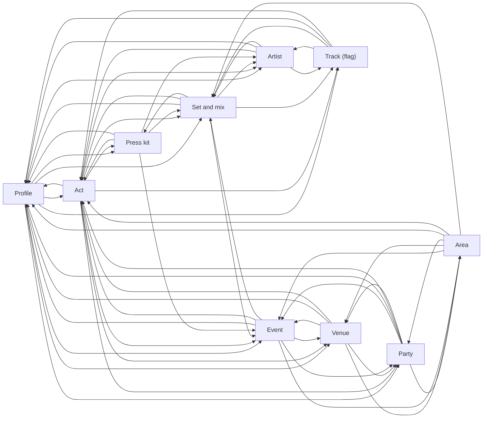

# Link matrix

Which public pages each kind of public page links to, whenever the data for the link exists. [ADR 0012](adr/0012-pages-follow-what-people-look-at-and-link-to-each-other.md) explains why, and the [glossary](../GLOSSARY.md) defines the page types. Each page type gets a test that fails when a page leaves out a link its table asks for and the data is there.

Each page type's table is a file in [link-matrix/](link-matrix/), named like its checks' module in [apps/web/src/lib/testing/link-matrix/](../apps/web/src/lib/testing/link-matrix/) (`profile.md` beside `profile.ts`). The tests check every row marked `on main`: [link-matrix.svelte.test.ts](../apps/web/src/routes/link-matrix.svelte.test.ts) fails when a row marked `on main` has no check, or a check names a row that isn't, and [link-matrix.test.ts](../apps/web/src/lib/testing/link-matrix.test.ts) fails when a module has no file, a file with a row marked `on main` has no module, or a table's cells are padded. So a change that adds a missing link marks its row `on main` and adds its check, and a new page type adds a file and a module. Tables keep one space each side of a cell, so changing a row changes that line only.

The status column says where main stands, read at [`fe5cadef`](https://github.com/cutenode/localnetwork/tree/fe5cadefac6a3ab54ab995e1e4786b1fd93fc598), and the source links are pinned there. A row a later change put on main links its file as it is now:

- **on main**: the link exists.
- **missing**: both pages exist and the link doesn't.
- **new page**: one end has no page yet, so the link comes with that page.

On main an act's page is still `/projects/<slug>`, from before acts, so its links are listed under Act. It moves to `/act/<key>/<name>` ([ADR 0016](adr/0016-names-repeat-keys-and-handles-identify.md)).

## Page types

| Page type | Path | On main |
| --- | --- | --- |
| [Profile](link-matrix/profile.md) | `/@<handle>`, tabs as `?tab=` | yes, without tabs |
| [Act](link-matrix/act.md) | `/act/<key>/<name>` | as `/projects/<slug>` |
| [Party](link-matrix/party.md) | `/party/<key>/<name>` | yes, behind `spacePages` ([routes/party/[key]/[...rest]](../apps/web/src/routes/party/%5Bkey%5D/%5B...rest%5D/%2Bpage.svelte)) |
| [Venue](link-matrix/venue.md) | `/venue/<key>/<name>` | yes, behind `spacePages` ([routes/venue/[key]/[[name]]](../apps/web/src/routes/venue/%5Bkey%5D/%5B%5Bname%5D%5D/%2Bpage.svelte)) |
| [Event](link-matrix/event.md) | `/party/<key>/<event>/<name>`, or `/@<handle>/events/<rkey>` with no party | under a party, behind `spacePages` ([routes/party/[key]/[...rest]](../apps/web/src/routes/party/%5Bkey%5D/%5B...rest%5D/%2Bpage.svelte)); events with no party have no page |
| [Set (and mix)](link-matrix/set-and-mix.md) | `/@<handle>/sets/<rkey>`; `/mixes` lists | no: sets are rows inside other pages; a mix's tracklist is `/projects/<slug>/mixes/<n>` |
| [Press kit](link-matrix/press-kit.md) | under its performer | `/projects/<slug>/press-kits/<rkey>` |
| [Artist](link-matrix/artist.md) | `/artists/<id>` | yes |
| [Track](link-matrix/track.md) | not set yet, behind a flag | no |
| [Area](link-matrix/area.md) | `/events/<country>/<city>` | no: `/shows` lists shows and parties' events near a city |
| [Search](link-matrix/search.md) | `/search?q=&type=` | no: Find DJs (`/djs`) searches acts and listed DJs |
| [Followers and Following](link-matrix/followers-and-following.md) | on every profile, act, party and venue | no ([routes/shows/+page.svelte:16-17](https://github.com/cutenode/localnetwork/blob/fe5cadefac6a3ab54ab995e1e4786b1fd93fc598/apps/web/src/routes/shows/%2Bpage.svelte#L16-L17) is the only use of follows) |
| [Home](link-matrix/home.md) | `/` | yes |
| [For](link-matrix/for.md) | `/for` | yes |
| [For promoters](link-matrix/for-promoters.md) | `/for/promoters` | yes |

Wherever a handle shows, it links to that profile. That's on main through `profileHref` ([lib/format.ts:37-39](https://github.com/cutenode/localnetwork/blob/fe5cadefac6a3ab54ab995e1e4786b1fd93fc598/apps/web/src/lib/format.ts#L37-L39), [lib/components/Handle.svelte:14](https://github.com/cutenode/localnetwork/blob/fe5cadefac6a3ab54ab995e1e4786b1fd93fc598/apps/web/src/lib/components/Handle.svelte#L14)), so the page types' tables leave it out.

## Links every page type needs

Each arrow is a link the tables ask for, in the direction it points. Followers and Following, search and the handle links are left out, since every page has them.

Source: the page types' tables in [link-matrix/](link-matrix/), [ADR 0012](adr/0012-pages-follow-what-people-look-at-and-link-to-each-other.md)
